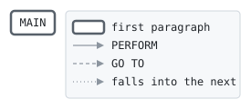

# OVLBIZ

```text
ovlbiz: the over-limit fee of a business card: none; the company is
billed for the excess at the cycle.

history
2020-02-10 mt  lcs-0466 original version.
```

Program [ovlbiz.cbl](../../../laurasia/programs/ovlbiz.cbl): 0 files, 1 paragraphs.

## Contents

- [Files](#files)
- [Flow](#flow)
- [Paragraphs](#paragraphs)
- [Calls](#calls)
- [Data flow](#data-flow)
- [Lineage](#lineage)
  - [Into LK-FEE](#into-lk-fee)
- [Parameters](#parameters)
  - [Parameter 1, LK-PRODUCT](#parameter-1-lk-product)
  - [Parameter 2, LK-OVER-AMOUNT](#parameter-2-lk-over-amount)
  - [Parameter 3, LK-FEE](#parameter-3-lk-fee)
- [Records](#records)
  - [LK-PRODUCT](#lk-product)
  - [LK-OVER-AMOUNT](#lk-over-amount)
  - [LK-FEE](#lk-fee)

## Files

| File | Kind | Assigned to | Organization | Status field | Opened | Records |
| --- | --- | --- | --- | --- | --- | --- |

## Flow



## Paragraphs

| Paragraph | Description | Source | Performs | Goes to | Performed by | Reached by |
| --- | --- | --- | --- | --- | --- | --- |
| MAIN | | [ovlbiz.cbl:17](../../../laurasia/programs/ovlbiz.cbl#L17) | | | | |

## Calls

Called with LK-PRODUCT, LK-OVER-AMOUNT, LK-FEE by no program.

## Data flow

| Paragraph | Reads | Writes |
| --- | --- | --- |
| MAIN | | LK-FEE |

## Lineage

Where each data item's values come from, grouped by the record they go into. A data item links to the record it belongs to.

### Into LK-FEE

Record [LK-FEE](#lk-fee).

| Into | From | Statement | Paragraph | Source |
| --- | --- | --- | --- | --- |
| LK-FEE | literal ZERO | MOVE | MAIN | [ovlbiz.cbl:18](../../../laurasia/programs/ovlbiz.cbl#L18) |

## Parameters

What the program does with each field of the items it is passed, by position: the contract its callers rely on. A statement on a whole item, or a group of it, counts for each field in it; a field neither read nor written is passed for nothing.

### Parameter 1, LK-PRODUCT

| Field | Reads | Writes |
| --- | :-: | :-: |
| LK-PRODUCT | | |

### Parameter 2, LK-OVER-AMOUNT

| Field | Reads | Writes |
| --- | :-: | :-: |
| LK-OVER-AMOUNT | | |

### Parameter 3, LK-FEE

| Field | Reads | Writes |
| --- | :-: | :-: |
| LK-FEE | | yes |

## Records

### LK-PRODUCT

Linkage. 2 bytes.

| Level | Field | Kind | Start | Length | Picture | Usage | Notes | Source |
| --: | --- | --- | --: | --: | --- | --- | --- | --- |
| 01 | LK-PRODUCT | text | 1 | 2 | X(2) | | | [ovlbiz.cbl:12](../../../laurasia/programs/ovlbiz.cbl#L12) |

### LK-OVER-AMOUNT

Linkage. 9 bytes.

| Level | Field | Kind | Start | Length | Picture | Usage | Notes | Source |
| --: | --- | --- | --: | --: | --- | --- | --- | --- |
| 01 | LK-OVER-AMOUNT | amount | 1 | 9 | S9(7)V99 | | | [ovlbiz.cbl:13](../../../laurasia/programs/ovlbiz.cbl#L13) |

### LK-FEE

Linkage. 9 bytes.

| Level | Field | Kind | Start | Length | Picture | Usage | Notes | Source |
| --: | --- | --- | --: | --: | --- | --- | --- | --- |
| 01 | LK-FEE | amount | 1 | 9 | S9(7)V99 | | | [ovlbiz.cbl:14](../../../laurasia/programs/ovlbiz.cbl#L14) |
