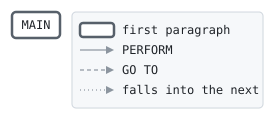

# OVLFEE

```text
ovlfee: the over-limit fee of a consumer card: a tenth of what the
balance is over the limit, at least 5.00 and at most 35.00; a gold
card's first 50.00 over is free.

history
2013-06-03 rk  lcs-0219 original version.
```

Program [ovlfee.cbl](../../../laurasia/programs/ovlfee.cbl): 0 files, 1 paragraphs. Its business rules: [1 decision tables](../rules/OVLFEE.md).

## Contents

- [Files](#files)
- [Constants](#constants)
- [Flow](#flow)
- [Paragraphs](#paragraphs)
- [Calls](#calls)
- [Data flow](#data-flow)
- [Lineage](#lineage)
  - [Into LK-FEE](#into-lk-fee)
- [Parameters](#parameters)
  - [Parameter 1, LK-PRODUCT](#parameter-1-lk-product)
  - [Parameter 2, LK-OVER-AMOUNT](#parameter-2-lk-over-amount)
  - [Parameter 3, LK-FEE](#parameter-3-lk-fee)
- [Records](#records)
  - [LK-PRODUCT](#lk-product)
  - [LK-OVER-AMOUNT](#lk-over-amount)
  - [LK-FEE](#lk-fee)

## Files

| File | Kind | Assigned to | Organization | Status field | Opened | Records |
| --- | --- | --- | --- | --- | --- | --- |

## Constants

| Constant | Value | Source |
| --- | --- | --- |
| LEAST-FEE | 5.00 | [ovlfee.cbl:13](../../../laurasia/programs/ovlfee.cbl#L13) |
| MOST-FEE | 35.00 | [ovlfee.cbl:14](../../../laurasia/programs/ovlfee.cbl#L14) |
| GOLD-ALLOWANCE | 50.00 | [ovlfee.cbl:15](../../../laurasia/programs/ovlfee.cbl#L15) |

## Flow



## Paragraphs

| Paragraph | Description | Source | Performs | Goes to | Performed by | Reached by |
| --- | --- | --- | --- | --- | --- | --- |
| MAIN | | [ovlfee.cbl:23](../../../laurasia/programs/ovlfee.cbl#L23) | | | | |

## Calls

Called with LK-PRODUCT, LK-OVER-AMOUNT, LK-FEE by [POST](POST.md).

## Data flow

| Paragraph | Reads | Writes |
| --- | --- | --- |
| MAIN | LK-PRODUCT, LK-OVER-AMOUNT, GOLD-ALLOWANCE, LK-FEE, LEAST-FEE, MOST-FEE | LK-FEE |

## Lineage

Where each data item's values come from, grouped by the record they go into. A data item links to the record it belongs to.

### Into LK-FEE

Record [LK-FEE](#lk-fee).

| Into | From | Statement | Paragraph | Source |
| --- | --- | --- | --- | --- |
| LK-FEE | literal ZERO | MOVE | MAIN | [ovlfee.cbl:25](../../../laurasia/programs/ovlfee.cbl#L25) |
| LK-FEE | [LK-OVER-AMOUNT](#lk-over-amount) | COMPUTE | MAIN | [ovlfee.cbl:28](../../../laurasia/programs/ovlfee.cbl#L28) |
| LK-FEE | LEAST-FEE | MOVE | MAIN | [ovlfee.cbl:31](../../../laurasia/programs/ovlfee.cbl#L31) |
| LK-FEE | MOST-FEE | MOVE | MAIN | [ovlfee.cbl:33](../../../laurasia/programs/ovlfee.cbl#L33) |

## Parameters

What the program does with each field of the items it is passed, by position: the contract its callers rely on. A statement on a whole item, or a group of it, counts for each field in it; a field neither read nor written is passed for nothing.

### Parameter 1, LK-PRODUCT

| Field | Reads | Writes |
| --- | :-: | :-: |
| LK-PRODUCT | yes | |

### Parameter 2, LK-OVER-AMOUNT

| Field | Reads | Writes |
| --- | :-: | :-: |
| LK-OVER-AMOUNT | yes | |

### Parameter 3, LK-FEE

| Field | Reads | Writes |
| --- | :-: | :-: |
| LK-FEE | yes | yes |

## Records

### LK-PRODUCT

Linkage. 2 bytes.

| Level | Field | Kind | Start | Length | Picture | Usage | Notes | Source |
| --: | --- | --- | --: | --: | --- | --- | --- | --- |
| 01 | LK-PRODUCT | code | 1 | 2 | X(2) | | | [ovlfee.cbl:17](../../../laurasia/programs/ovlfee.cbl#L17) |
| 88 | └ LK-GOLD | | | | | | VALUE 'GD' | [ovlfee.cbl:18](../../../laurasia/programs/ovlfee.cbl#L18) |

### LK-OVER-AMOUNT

Linkage. 9 bytes.

| Level | Field | Kind | Start | Length | Picture | Usage | Notes | Source |
| --: | --- | --- | --: | --: | --- | --- | --- | --- |
| 01 | LK-OVER-AMOUNT | amount | 1 | 9 | S9(7)V99 | | | [ovlfee.cbl:19](../../../laurasia/programs/ovlfee.cbl#L19) |

### LK-FEE

Linkage. 9 bytes.

| Level | Field | Kind | Start | Length | Picture | Usage | Notes | Source |
| --: | --- | --- | --: | --: | --- | --- | --- | --- |
| 01 | LK-FEE | amount | 1 | 9 | S9(7)V99 | | | [ovlfee.cbl:20](../../../laurasia/programs/ovlfee.cbl#L20) |
