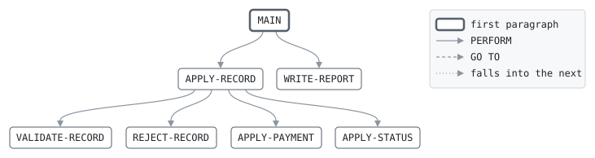

# PAYIN

```text
payin: take in the card system's feed

applies the day's feed from the card system to the cards' accounts: a
payment comes off the card's balance, and marks the last statement
paid in full when it covers it or clears the balance, which spares the
card interest at the cycle; a status change sets the card active,
blocked or closed. a record for a card with no account, a payment of
nothing, a status that is none of the three, or a record of no known
kind is rejected for the card system.

return codes: 0 all applied, 4 some rejected, 16 cannot update.

history
2022-09-05 ah  lcs-0497 original version.
```

Program [payin.cbl](../../../laurasia/programs/payin.cbl): 5 files, 7 paragraphs. Its business rules: [5 decision tables](../rules/PAYIN.md).

## Contents

- [Files](#files)
- [Flow](#flow)
- [Paragraphs](#paragraphs)
- [Data flow](#data-flow)
- [Lineage](#lineage)
  - [Into FEED-RECORD](#into-feed-record)
  - [Into CARD-ACCOUNT](#into-card-account)
  - [Into POSTING](#into-posting)
  - [Into REJECT-LINE](#into-reject-line)
  - [Into REPORT-LINE](#into-report-line)
  - [Into WS-RUN-DATE](#into-ws-run-date)
  - [Into WS-AT-END](#into-ws-at-end)
  - [Into WS-REASON](#into-ws-reason)
  - [Into WS-TOTALS](#into-ws-totals)
  - [Into WS-REPORT-COUNT](#into-ws-report-count)
  - [Into WS-REPORT-AMOUNT](#into-ws-report-amount)
  - [Out of the program](#out-of-the-program)
- [Field origins](#field-origins)
  - [File ACCOUNTS](#file-accounts)
  - [File POSTINGS-OUT](#file-postings-out)
  - [File REJECT-OUT](#file-reject-out)
  - [File REPORT-OUT](#file-report-out)
- [Links between records](#links-between-records)
- [Records](#records)
  - [FEED-RECORD](#feed-record)
  - [CARD-ACCOUNT](#card-account)
  - [POSTING](#posting)
  - [REJECT-LINE](#reject-line)
  - [REPORT-LINE](#report-line)
  - [WS-RUN-DATE](#ws-run-date)
  - [WS-ACCOUNTS-STATUS](#ws-accounts-status)
  - [WS-AT-END](#ws-at-end)
  - [WS-REASON](#ws-reason)
  - [WS-TOTALS](#ws-totals)
  - [WS-REPORT-COUNT](#ws-report-count)
  - [WS-REPORT-AMOUNT](#ws-report-amount)

## Files

| File | Kind | Assigned to | Organization | Status field | Opened | Records |
| --- | --- | --- | --- | --- | --- | --- |
| FEED-IN | FD | FEEDIN | LINE SEQUENTIAL | | INPUT | FEED-RECORD |
| ACCOUNTS | FD | ACCOUNTS | INDEXED, key CA-CARD-NO, RANDOM access | WS-ACCOUNTS-STATUS | I-O | CARD-ACCOUNT |
| POSTINGS-OUT | FD | POSTOUT | LINE SEQUENTIAL | | OUTPUT | POSTING |
| REJECT-OUT | FD | PAYREJ | LINE SEQUENTIAL | | OUTPUT | REJECT-LINE |
| REPORT-OUT | FD | PAYRPT | LINE SEQUENTIAL | | OUTPUT | REPORT-LINE |

## Flow



## Paragraphs

| Paragraph | Description | Source | Performs | Goes to | Performed by | Reached by |
| --- | --- | --- | --- | --- | --- | --- |
| MAIN | | [payin.cbl:72](../../../laurasia/programs/payin.cbl#L72) | APPLY-RECORD, WRITE-REPORT | | | |
| APPLY-RECORD | | [payin.cbl:93](../../../laurasia/programs/payin.cbl#L93) | VALIDATE-RECORD, REJECT-RECORD, APPLY-PAYMENT, APPLY-STATUS | | MAIN | |
| VALIDATE-RECORD | | [payin.cbl:115](../../../laurasia/programs/payin.cbl#L115) | | | APPLY-RECORD | |
| APPLY-PAYMENT | the payment off the balance; one that covers the last statement, or clears the balance, pays the statement in full. | [payin.cbl:129](../../../laurasia/programs/payin.cbl#L129) | | | APPLY-RECORD | |
| APPLY-STATUS | | [payin.cbl:144](../../../laurasia/programs/payin.cbl#L144) | | | APPLY-RECORD | |
| REJECT-RECORD | | [payin.cbl:148](../../../laurasia/programs/payin.cbl#L148) | | | APPLY-RECORD | |
| WRITE-REPORT | | [payin.cbl:155](../../../laurasia/programs/payin.cbl#L155) | | | MAIN | |

## Data flow

| Paragraph | Reads | Writes |
| --- | --- | --- |
| MAIN | WS-ACCOUNTS-STATUS, WS-AT-END, WS-REJECTED | WS-RUN-DATE, RETURN-CODE, FEED-RECORD, WS-AT-END |
| APPLY-RECORD | WS-REASON, PF-CARD-NO, PF-KIND | CA-CARD-NO, CARD-ACCOUNT, WS-REASON, RETURN-CODE |
| VALIDATE-RECORD | PF-KIND, PF-AMOUNT, PF-STATUS | WS-REASON |
| APPLY-PAYMENT | PF-AMOUNT, CA-BALANCE, CA-STATEMENT-BALANCE, CA-CARD-NO, CA-ACCOUNT-NO, PF-REFERENCE, WS-RUN-DATE, WS-PAYMENTS, WS-PAID | CA-BALANCE, CA-PAID-IN-FULL, PO-CARD-NO, PO-ACCOUNT-NO, PO-KIND, PO-AMOUNT, PO-REFERENCE, PO-DATE, POSTING, WS-PAYMENTS, WS-PAID |
| APPLY-STATUS | PF-STATUS, WS-STATUS-CHANGES | CA-STATUS, WS-STATUS-CHANGES |
| REJECT-RECORD | WS-REASON, FEED-RECORD, WS-REJECTED | REJECT-LINE, RJ-REASON, RJ-RECORD, WS-REJECTED |
| WRITE-REPORT | WS-PAYMENTS, WS-REPORT-COUNT, WS-STATUS-CHANGES, WS-REJECTED, WS-PAID, WS-REPORT-AMOUNT | REPORT-LINE, RC-LABEL, RC-VALUE, RA-LABEL, RA-VALUE |

## Lineage

Where each data item's values come from, grouped by the record they go into. A data item links to the record it belongs to.

### Into FEED-RECORD

Record [FEED-RECORD](#feed-record), from copybook [payfeed](../copybooks/payfeed.md).

| Into | From | Statement | Paragraph | Source |
| --- | --- | --- | --- | --- |
| FEED-RECORD | file FEED-IN | READ | MAIN | [payin.cbl:81](../../../laurasia/programs/payin.cbl#L81) |

### Into CARD-ACCOUNT

Record [CARD-ACCOUNT](#card-account), from copybook [cardacct](../copybooks/cardacct.md).

| Into | From | Statement | Paragraph | Source |
| --- | --- | --- | --- | --- |
| CA-BALANCE | [PF-AMOUNT](#feed-record "in FEED-RECORD") | SUBTRACT | APPLY-PAYMENT | [payin.cbl:130](../../../laurasia/programs/payin.cbl#L130) |
| CA-CARD-NO | [PF-CARD-NO](#feed-record "in FEED-RECORD") | MOVE | APPLY-RECORD | [payin.cbl:99](../../../laurasia/programs/payin.cbl#L99) |
| CA-PAID-IN-FULL | literal condition CA-WAS-PAID-IN-FULL | SET | APPLY-PAYMENT | [payin.cbl:132](../../../laurasia/programs/payin.cbl#L132) |
| CA-STATUS | [PF-STATUS](#feed-record "in FEED-RECORD") | MOVE | APPLY-STATUS | [payin.cbl:145](../../../laurasia/programs/payin.cbl#L145) |
| CARD-ACCOUNT | file ACCOUNTS | READ | APPLY-RECORD | [payin.cbl:100](../../../laurasia/programs/payin.cbl#L100) |

### Into POSTING

Record [POSTING](#posting), from copybook [postrec](../copybooks/postrec.md).

| Into | From | Statement | Paragraph | Source |
| --- | --- | --- | --- | --- |
| PO-ACCOUNT-NO | [CA-ACCOUNT-NO](#card-account "in CARD-ACCOUNT") | MOVE | APPLY-PAYMENT | [payin.cbl:135](../../../laurasia/programs/payin.cbl#L135) |
| PO-AMOUNT | [PF-AMOUNT](#feed-record "in FEED-RECORD") | COMPUTE | APPLY-PAYMENT | [payin.cbl:137](../../../laurasia/programs/payin.cbl#L137) |
| PO-CARD-NO | [CA-CARD-NO](#card-account "in CARD-ACCOUNT") | MOVE | APPLY-PAYMENT | [payin.cbl:134](../../../laurasia/programs/payin.cbl#L134) |
| PO-DATE | [WS-RUN-DATE](#ws-run-date) | MOVE | APPLY-PAYMENT | [payin.cbl:139](../../../laurasia/programs/payin.cbl#L139) |
| PO-KIND | literal condition PO-PAYMENT | SET | APPLY-PAYMENT | [payin.cbl:136](../../../laurasia/programs/payin.cbl#L136) |
| PO-REFERENCE | [PF-REFERENCE](#feed-record "in FEED-RECORD") | MOVE | APPLY-PAYMENT | [payin.cbl:138](../../../laurasia/programs/payin.cbl#L138) |

### Into REJECT-LINE

Record [REJECT-LINE](#reject-line).

| Into | From | Statement | Paragraph | Source |
| --- | --- | --- | --- | --- |
| REJECT-LINE | literal SPACES | MOVE | REJECT-RECORD | [payin.cbl:149](../../../laurasia/programs/payin.cbl#L149) |
| RJ-REASON | [WS-REASON](#ws-reason) | MOVE | REJECT-RECORD | [payin.cbl:150](../../../laurasia/programs/payin.cbl#L150) |
| RJ-RECORD | [FEED-RECORD](#feed-record) | MOVE | REJECT-RECORD | [payin.cbl:151](../../../laurasia/programs/payin.cbl#L151) |

### Into REPORT-LINE

Record [REPORT-LINE](#report-line).

| Into | From | Statement | Paragraph | Source |
| --- | --- | --- | --- | --- |
| REPORT-LINE | literal 'PAYIN    CARD SYSTEM FEED' | MOVE | WRITE-REPORT | [payin.cbl:156](../../../laurasia/programs/payin.cbl#L156) |
| REPORT-LINE | [WS-REPORT-COUNT](#ws-report-count) | WRITE | WRITE-REPORT | [payin.cbl:160](../../../laurasia/programs/payin.cbl#L160) |
| REPORT-LINE | [WS-REPORT-COUNT](#ws-report-count) | WRITE | WRITE-REPORT | [payin.cbl:163](../../../laurasia/programs/payin.cbl#L163) |
| REPORT-LINE | [WS-REPORT-COUNT](#ws-report-count) | WRITE | WRITE-REPORT | [payin.cbl:166](../../../laurasia/programs/payin.cbl#L166) |
| REPORT-LINE | [WS-REPORT-AMOUNT](#ws-report-amount) | WRITE | WRITE-REPORT | [payin.cbl:169](../../../laurasia/programs/payin.cbl#L169) |

### Into WS-RUN-DATE

Record [WS-RUN-DATE](#ws-run-date).

| Into | From | Statement | Paragraph | Source |
| --- | --- | --- | --- | --- |
| WS-RUN-DATE | COMMAND-LINE | ACCEPT | MAIN | [payin.cbl:73](../../../laurasia/programs/payin.cbl#L73) |

### Into WS-AT-END

Record [WS-AT-END](#ws-at-end).

| Into | From | Statement | Paragraph | Source |
| --- | --- | --- | --- | --- |
| WS-AT-END | literal condition FEED-AT-END | SET | MAIN | [payin.cbl:82](../../../laurasia/programs/payin.cbl#L82) |

### Into WS-REASON

Record [WS-REASON](#ws-reason).

| Into | From | Statement | Paragraph | Source |
| --- | --- | --- | --- | --- |
| WS-REASON | literal 'CARD' | MOVE | APPLY-RECORD | [payin.cbl:102](../../../laurasia/programs/payin.cbl#L102) |
| WS-REASON | literal 'KIND' | MOVE | VALIDATE-RECORD | [payin.cbl:118](../../../laurasia/programs/payin.cbl#L118) |
| WS-REASON | literal 'AMNT' | MOVE | VALIDATE-RECORD | [payin.cbl:120](../../../laurasia/programs/payin.cbl#L120) |
| WS-REASON | literal 'STAT' | MOVE | VALIDATE-RECORD | [payin.cbl:122](../../../laurasia/programs/payin.cbl#L122) |
| WS-REASON | literal SPACES | MOVE | VALIDATE-RECORD | [payin.cbl:124](../../../laurasia/programs/payin.cbl#L124) |

### Into WS-TOTALS

Record [WS-TOTALS](#ws-totals).

| Into | From | Statement | Paragraph | Source |
| --- | --- | --- | --- | --- |
| WS-PAID | [PF-AMOUNT](#feed-record "in FEED-RECORD") | ADD | APPLY-PAYMENT | [payin.cbl:142](../../../laurasia/programs/payin.cbl#L142) |
| WS-PAYMENTS | literal 1 | ADD | APPLY-PAYMENT | [payin.cbl:141](../../../laurasia/programs/payin.cbl#L141) |
| WS-REJECTED | literal 1 | ADD | REJECT-RECORD | [payin.cbl:153](../../../laurasia/programs/payin.cbl#L153) |
| WS-STATUS-CHANGES | literal 1 | ADD | APPLY-STATUS | [payin.cbl:146](../../../laurasia/programs/payin.cbl#L146) |

### Into WS-REPORT-COUNT

Record [WS-REPORT-COUNT](#ws-report-count).

| Into | From | Statement | Paragraph | Source |
| --- | --- | --- | --- | --- |
| RC-LABEL | literal 'PAYMENTS' | MOVE | WRITE-REPORT | [payin.cbl:158](../../../laurasia/programs/payin.cbl#L158) |
| RC-LABEL | literal 'STATUS CHANGES' | MOVE | WRITE-REPORT | [payin.cbl:161](../../../laurasia/programs/payin.cbl#L161) |
| RC-LABEL | literal 'RECORDS REJECTED' | MOVE | WRITE-REPORT | [payin.cbl:164](../../../laurasia/programs/payin.cbl#L164) |
| RC-VALUE | [WS-PAYMENTS](#ws-totals "in WS-TOTALS") | MOVE | WRITE-REPORT | [payin.cbl:159](../../../laurasia/programs/payin.cbl#L159) |
| RC-VALUE | [WS-STATUS-CHANGES](#ws-totals "in WS-TOTALS") | MOVE | WRITE-REPORT | [payin.cbl:162](../../../laurasia/programs/payin.cbl#L162) |
| RC-VALUE | [WS-REJECTED](#ws-totals "in WS-TOTALS") | MOVE | WRITE-REPORT | [payin.cbl:165](../../../laurasia/programs/payin.cbl#L165) |

### Into WS-REPORT-AMOUNT

Record [WS-REPORT-AMOUNT](#ws-report-amount).

| Into | From | Statement | Paragraph | Source |
| --- | --- | --- | --- | --- |
| RA-LABEL | literal 'PAID' | MOVE | WRITE-REPORT | [payin.cbl:167](../../../laurasia/programs/payin.cbl#L167) |
| RA-VALUE | [WS-PAID](#ws-totals "in WS-TOTALS") | MOVE | WRITE-REPORT | [payin.cbl:168](../../../laurasia/programs/payin.cbl#L168) |

### Out of the program

Records written to files, items passed to the programs called, and items displayed to the job's output.

| Into | From | Statement | Paragraph | Source |
| --- | --- | --- | --- | --- |
| file ACCOUNTS | [CARD-ACCOUNT](#card-account) | REWRITE | APPLY-RECORD | [payin.cbl:111](../../../laurasia/programs/payin.cbl#L111) |
| file POSTINGS-OUT | [POSTING](#posting) | WRITE | APPLY-PAYMENT | [payin.cbl:140](../../../laurasia/programs/payin.cbl#L140) |
| file REJECT-OUT | [REJECT-LINE](#reject-line) | WRITE | REJECT-RECORD | [payin.cbl:152](../../../laurasia/programs/payin.cbl#L152) |
| file REPORT-OUT | [REPORT-LINE](#report-line) | WRITE | WRITE-REPORT | [payin.cbl:157](../../../laurasia/programs/payin.cbl#L157) |
| file REPORT-OUT | [REPORT-LINE](#report-line) | WRITE | WRITE-REPORT | [payin.cbl:160](../../../laurasia/programs/payin.cbl#L160) |
| file REPORT-OUT | [REPORT-LINE](#report-line) | WRITE | WRITE-REPORT | [payin.cbl:163](../../../laurasia/programs/payin.cbl#L163) |
| file REPORT-OUT | [REPORT-LINE](#report-line) | WRITE | WRITE-REPORT | [payin.cbl:166](../../../laurasia/programs/payin.cbl#L166) |
| file REPORT-OUT | [REPORT-LINE](#report-line) | WRITE | WRITE-REPORT | [payin.cbl:169](../../../laurasia/programs/payin.cbl#L169) |

## Field origins

Where the values of each field the program writes to a file come from: the fields of the files it reads, literals, and initial values, followed through every statement that moves a value, and through groups and redefinitions by the bytes they share.

### File ACCOUNTS

Written from [CARD-ACCOUNT](#card-account).

| Field | Position | Origins |
| --- | --: | --- |
| CA-CARD-NO | 1-16 | file ACCOUNTS CA-CARD-NO; file FEED-IN PF-CARD-NO |
| CA-ACCOUNT-NO | 17-26 | file ACCOUNTS CA-ACCOUNT-NO |
| CA-PRODUCT | 27-28 | file ACCOUNTS CA-PRODUCT |
| CA-STATUS | 29 | file ACCOUNTS CA-STATUS; file FEED-IN PF-STATUS |
| CA-LIMIT | 30-38 | file ACCOUNTS CA-LIMIT |
| CA-BALANCE | 39-48 | file ACCOUNTS CA-BALANCE; file FEED-IN PF-AMOUNT |
| CA-STATEMENT-BALANCE | 49-58 | file ACCOUNTS CA-STATEMENT-BALANCE |
| CA-CYCLE-DAY | 59-60 | file ACCOUNTS CA-CYCLE-DAY |
| CA-PAID-IN-FULL | 61 | file ACCOUNTS CA-PAID-IN-FULL; literal condition CA-WAS-PAID-IN-FULL |

### File POSTINGS-OUT

Written from [POSTING](#posting).

| Field | Position | Origins |
| --- | --: | --- |
| PO-CARD-NO | 1-16 | file ACCOUNTS CA-CARD-NO; file FEED-IN PF-CARD-NO |
| PO-ACCOUNT-NO | 17-26 | file ACCOUNTS CA-ACCOUNT-NO |
| PO-KIND | 27 | literal condition PO-PAYMENT |
| PO-AMOUNT | 28-37 | file FEED-IN PF-AMOUNT |
| PO-REFERENCE | 38-43 | file FEED-IN PF-REFERENCE |
| PO-DATE | 44-51 | stream COMMAND-LINE WS-RUN-DATE |

### File REJECT-OUT

Written from [REJECT-LINE](#reject-line).

| Field | Position | Origins |
| --- | --: | --- |
| RJ-REASON | 1-4 | literal 'AMNT'; literal 'CARD'; literal 'KIND'; literal 'STAT'; literal SPACES |
| RJ-RECORD | 6-47 | file FEED-IN FEED-RECORD |

### File REPORT-OUT

Written from [REPORT-LINE](#report-line), [WS-REPORT-COUNT](#ws-report-count) and [WS-REPORT-AMOUNT](#ws-report-amount).

#### Record REPORT-LINE

| Field | Position | Origins |
| --- | --: | --- |
| REPORT-LINE | 1-60 | literal 'PAYIN    CARD SYSTEM FEED' |

#### Record WS-REPORT-COUNT

| Field | Position | Origins |
| --- | --: | --- |
| RC-LABEL | 1-30 | literal 'PAYMENTS'; literal 'RECORDS REJECTED'; literal 'STATUS CHANGES' |
| RC-VALUE | 31-38 | initial value of WS-PAYMENTS; initial value of WS-REJECTED; initial value of WS-STATUS-CHANGES; literal 1 |

#### Record WS-REPORT-AMOUNT

| Field | Position | Origins |
| --- | --: | --- |
| RA-LABEL | 1-30 | literal 'PAID' |
| RA-VALUE | 31-43 | file FEED-IN PF-AMOUNT; initial value of WS-PAID |

## Links between records

Fields of one input the program relies on to find or match the records of another: moved into an indexed file's record key to read it by, compared for equality, or compared for order to merge the two in that order, each side's values from that field alone.

| Field | Of | Links to | Of | How | Source |
| --- | --- | --- | --- | --- | --- |
| PF-CARD-NO | FEED-IN | CA-CARD-NO | ACCOUNTS | key to read by | [payin.cbl:99](../../../laurasia/programs/payin.cbl#L99) |

## Records

### FEED-RECORD

File FEED-IN. 42 bytes, layout in copybook [payfeed](../copybooks/payfeed.md).

### CARD-ACCOUNT

File ACCOUNTS. 61 bytes, layout in copybook [cardacct](../copybooks/cardacct.md).

### POSTING

File POSTINGS-OUT. 51 bytes, layout in copybook [postrec](../copybooks/postrec.md).

### REJECT-LINE

File REJECT-OUT. 47 bytes.

| Level | Field | Kind | Start | Length | Picture | Usage | Notes | Source |
| --: | --- | --- | --: | --: | --- | --- | --- | --- |
| 01 | REJECT-LINE | group | 1 | 47 | | | | [payin.cbl:45](../../../laurasia/programs/payin.cbl#L45) |
| 05 | ├ RJ-REASON | text | 1 | 4 | X(4) | | | [payin.cbl:46](../../../laurasia/programs/payin.cbl#L46) |
| 05 | ├ FILLER | filler | 5 | 1 | X | | | [payin.cbl:47](../../../laurasia/programs/payin.cbl#L47) |
| 05 | └ RJ-RECORD | text | 6 | 42 | X(42) | | | [payin.cbl:48](../../../laurasia/programs/payin.cbl#L48) |

### REPORT-LINE

File REPORT-OUT. 60 bytes.

| Level | Field | Kind | Start | Length | Picture | Usage | Notes | Source |
| --: | --- | --- | --: | --: | --- | --- | --- | --- |
| 01 | REPORT-LINE | text | 1 | 60 | X(60) | | | [payin.cbl:50](../../../laurasia/programs/payin.cbl#L50) |

### WS-RUN-DATE

Working storage. 8 bytes.

| Level | Field | Kind | Start | Length | Picture | Usage | Notes | Source |
| --: | --- | --- | --: | --: | --- | --- | --- | --- |
| 01 | WS-RUN-DATE | date | 1 | 8 | 9(8) | | | [payin.cbl:53](../../../laurasia/programs/payin.cbl#L53) |

### WS-ACCOUNTS-STATUS

Working storage. 2 bytes.

| Level | Field | Kind | Start | Length | Picture | Usage | Notes | Source |
| --: | --- | --- | --: | --: | --- | --- | --- | --- |
| 01 | WS-ACCOUNTS-STATUS | text | 1 | 2 | XX | | | [payin.cbl:54](../../../laurasia/programs/payin.cbl#L54) |

### WS-AT-END

Working storage. 1 bytes.

| Level | Field | Kind | Start | Length | Picture | Usage | Notes | Source |
| --: | --- | --- | --: | --: | --- | --- | --- | --- |
| 01 | WS-AT-END | code | 1 | 1 | X | | VALUE 'N' | [payin.cbl:55](../../../laurasia/programs/payin.cbl#L55) |
| 88 | └ FEED-AT-END | | | | | | VALUE 'Y' | [payin.cbl:56](../../../laurasia/programs/payin.cbl#L56) |

### WS-REASON

Working storage. 4 bytes.

| Level | Field | Kind | Start | Length | Picture | Usage | Notes | Source |
| --: | --- | --- | --: | --: | --- | --- | --- | --- |
| 01 | WS-REASON | code | 1 | 4 | X(4) | | | [payin.cbl:57](../../../laurasia/programs/payin.cbl#L57) |
| 88 | └ RECORD-IS-GOOD | | | | | | VALUE SPACES | [payin.cbl:58](../../../laurasia/programs/payin.cbl#L58) |

### WS-TOTALS

Working storage. 35 bytes.

| Level | Field | Kind | Start | Length | Picture | Usage | Notes | Source |
| --: | --- | --- | --: | --: | --- | --- | --- | --- |
| 01 | WS-TOTALS | group | 1 | 35 | | | | [payin.cbl:59](../../../laurasia/programs/payin.cbl#L59) |
| 05 | ├ WS-PAYMENTS | number | 1 | 8 | 9(8) | | VALUE ZERO | [payin.cbl:60](../../../laurasia/programs/payin.cbl#L60) |
| 05 | ├ WS-STATUS-CHANGES | number | 9 | 8 | 9(8) | | VALUE ZERO | [payin.cbl:61](../../../laurasia/programs/payin.cbl#L61) |
| 05 | ├ WS-REJECTED | number | 17 | 8 | 9(8) | | VALUE ZERO | [payin.cbl:62](../../../laurasia/programs/payin.cbl#L62) |
| 05 | └ WS-PAID | amount | 25 | 11 | S9(9)V99 | | VALUE ZERO | [payin.cbl:63](../../../laurasia/programs/payin.cbl#L63) |

### WS-REPORT-COUNT

Working storage. 38 bytes.

| Level | Field | Kind | Start | Length | Picture | Usage | Notes | Source |
| --: | --- | --- | --: | --: | --- | --- | --- | --- |
| 01 | WS-REPORT-COUNT | group | 1 | 38 | | | | [payin.cbl:64](../../../laurasia/programs/payin.cbl#L64) |
| 05 | ├ RC-LABEL | text | 1 | 30 | X(30) | | | [payin.cbl:65](../../../laurasia/programs/payin.cbl#L65) |
| 05 | └ RC-VALUE | edited | 31 | 8 | Z(7)9 | | | [payin.cbl:66](../../../laurasia/programs/payin.cbl#L66) |

### WS-REPORT-AMOUNT

Working storage. 43 bytes.

| Level | Field | Kind | Start | Length | Picture | Usage | Notes | Source |
| --: | --- | --- | --: | --: | --- | --- | --- | --- |
| 01 | WS-REPORT-AMOUNT | group | 1 | 43 | | | | [payin.cbl:67](../../../laurasia/programs/payin.cbl#L67) |
| 05 | ├ RA-LABEL | text | 1 | 30 | X(30) | | | [payin.cbl:68](../../../laurasia/programs/payin.cbl#L68) |
| 05 | └ RA-VALUE | edited | 31 | 13 | -(9)9.99 | | | [payin.cbl:69](../../../laurasia/programs/payin.cbl#L69) |
