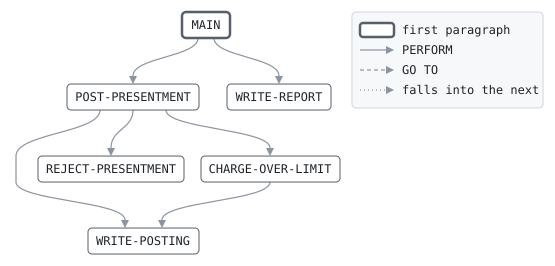

# POST

```text
post: post the night's matched presentments to the cards' accounts

each presentment matched to an approval is a purchase on its card's
account. a purchase that takes the balance over the credit limit still
posts, as it was approved, but may cost an over-limit fee, which the fee
program the account's product names works out. a presentment for a card
with no account, or a blocked or closed one, is rejected for the
disputes desk; a presentment not matched is not posted.

return codes: 0 all posted, 4 some rejected, 16 cannot update.

history
2011-04-04 rk  lcs-0102 original version.
2013-06-03 rk  lcs-0219 over-limit fees.
2020-02-10 mt  lcs-0466 the fee program by name, for the business cards'.
```

Program [post.cbl](../../../laurasia/programs/post.cbl): 5 files, 6 paragraphs. Its business rules: [4 decision tables](../rules/POST.md).

## Contents

- [Files](#files)
- [Flow](#flow)
- [Paragraphs](#paragraphs)
- [Calls](#calls)
- [Data flow](#data-flow)
- [Lineage](#lineage)
  - [Into PRES-RECORD](#into-pres-record)
  - [Into CARD-ACCOUNT](#into-card-account)
  - [Into POSTING](#into-posting)
  - [Into REJECT-LINE](#into-reject-line)
  - [Into REPORT-LINE](#into-report-line)
  - [Into WS-AT-END](#into-ws-at-end)
  - [Into WS-FEE-PROGRAM](#into-ws-fee-program)
  - [Into WS-REJECT-REASON](#into-ws-reject-reason)
  - [Into WS-OVER-AMOUNT](#into-ws-over-amount)
  - [Into WS-TOTALS](#into-ws-totals)
  - [Into WS-REPORT-COUNT](#into-ws-report-count)
  - [Into WS-REPORT-AMOUNT](#into-ws-report-amount)
  - [Out of the program](#out-of-the-program)
- [Field origins](#field-origins)
  - [File ACCOUNTS](#file-accounts)
  - [File POSTINGS-OUT](#file-postings-out)
  - [File REJECT-OUT](#file-reject-out)
  - [File REPORT-OUT](#file-report-out)
- [Links between records](#links-between-records)
- [Records](#records)
  - [PRES-RECORD](#pres-record)
  - [CARD-ACCOUNT](#card-account)
  - [POSTING](#posting)
  - [REJECT-LINE](#reject-line)
  - [REPORT-LINE](#report-line)
  - [WS-RUN-DATE](#ws-run-date)
  - [WS-ACCOUNTS-STATUS](#ws-accounts-status)
  - [WS-AT-END](#ws-at-end)
  - [WS-FEE-PROGRAM](#ws-fee-program)
  - [WS-REJECT-REASON](#ws-reject-reason)
  - [WS-OVER-AMOUNT](#ws-over-amount)
  - [WS-FEE](#ws-fee)
  - [WS-TOTALS](#ws-totals)
  - [WS-REPORT-COUNT](#ws-report-count)
  - [WS-REPORT-AMOUNT](#ws-report-amount)

## Files

| File | Kind | Assigned to | Organization | Status field | Opened | Records |
| --- | --- | --- | --- | --- | --- | --- |
| PRES-IN | FD | PRESIN | LINE SEQUENTIAL | | INPUT | PRES-RECORD |
| ACCOUNTS | FD | ACCOUNTS | INDEXED, key CA-CARD-NO, RANDOM access | WS-ACCOUNTS-STATUS | I-O | CARD-ACCOUNT |
| POSTINGS-OUT | FD | POSTOUT | LINE SEQUENTIAL | | OUTPUT | POSTING |
| REJECT-OUT | FD | POSTREJ | LINE SEQUENTIAL | | OUTPUT | REJECT-LINE |
| REPORT-OUT | FD | POSTRPT | LINE SEQUENTIAL | | OUTPUT | REPORT-LINE |

## Flow



## Paragraphs

| Paragraph | Description | Source | Performs | Goes to | Performed by | Reached by |
| --- | --- | --- | --- | --- | --- | --- |
| MAIN | | [post.cbl:75](../../../laurasia/programs/post.cbl#L75) | POST-PRESENTMENT, WRITE-REPORT | | | |
| POST-PRESENTMENT | | [post.cbl:99](../../../laurasia/programs/post.cbl#L99) | REJECT-PRESENTMENT, WRITE-POSTING, CHARGE-OVER-LIMIT | | MAIN | |
| CHARGE-OVER-LIMIT | the fee for going over the limit, by the program the card's product names; one that charges none returns zero. | [post.cbl:131](../../../laurasia/programs/post.cbl#L131) | WRITE-POSTING | | POST-PRESENTMENT | |
| WRITE-POSTING | | [post.cbl:147](../../../laurasia/programs/post.cbl#L147) | | | POST-PRESENTMENT, CHARGE-OVER-LIMIT | |
| REJECT-PRESENTMENT | | [post.cbl:155](../../../laurasia/programs/post.cbl#L155) | | | POST-PRESENTMENT | |
| WRITE-REPORT | | [post.cbl:163](../../../laurasia/programs/post.cbl#L163) | | | MAIN | |

## Calls

| Calls | Passing | Paragraph | Source |
| --- | --- | --- | --- |
| [OVLBIZ](OVLBIZ.md), named by WS-FEE-PROGRAM | CA-PRODUCT, WS-OVER-AMOUNT, WS-FEE | CHARGE-OVER-LIMIT | [post.cbl:139](../../../laurasia/programs/post.cbl#L139) |
| [OVLFEE](OVLFEE.md), named by WS-FEE-PROGRAM | CA-PRODUCT, WS-OVER-AMOUNT, WS-FEE | CHARGE-OVER-LIMIT | [post.cbl:139](../../../laurasia/programs/post.cbl#L139) |

## Data flow

| Paragraph | Reads | Writes |
| --- | --- | --- |
| MAIN | WS-ACCOUNTS-STATUS, WS-AT-END, PS-MATCH, WS-REJECTED | WS-RUN-DATE, RETURN-CODE, PRES-RECORD, WS-AT-END |
| POST-PRESENTMENT | PS-CARD-NO, CA-STATUS, PS-AMOUNT, CA-BALANCE, WS-PURCHASES, CA-LIMIT | CA-CARD-NO, CARD-ACCOUNT, RJ-REASON, CA-BALANCE, PO-KIND, PO-AMOUNT, WS-PURCHASES, RETURN-CODE |
| CHARGE-OVER-LIMIT | CA-PRODUCT, CA-BALANCE, CA-LIMIT, WS-FEE-PROGRAM, WS-OVER-AMOUNT, WS-FEE, WS-FEES | WS-FEE-PROGRAM, WS-OVER-AMOUNT, CA-PRODUCT, WS-FEE, CA-BALANCE, WS-FEES, PO-KIND, PO-AMOUNT |
| WRITE-POSTING | CA-CARD-NO, CA-ACCOUNT-NO, PS-AUTH-CODE, WS-RUN-DATE, WS-POSTED | PO-CARD-NO, PO-ACCOUNT-NO, PO-REFERENCE, PO-DATE, POSTING, WS-POSTED |
| REJECT-PRESENTMENT | RJ-REASON, WS-REJECT-REASON, PRES-RECORD, WS-REJECTED | WS-REJECT-REASON, REJECT-LINE, RJ-REASON, RJ-PRESENTMENT, WS-REJECTED |
| WRITE-REPORT | WS-POSTED, WS-REPORT-COUNT, WS-REJECTED, WS-PURCHASES, WS-REPORT-AMOUNT, WS-FEES | REPORT-LINE, RC-LABEL, RC-VALUE, RA-LABEL, RA-VALUE |

## Lineage

Where each data item's values come from, grouped by the record they go into. A data item links to the record it belongs to.

### Into PRES-RECORD

Record [PRES-RECORD](#pres-record), from copybook [presrec](../copybooks/presrec.md).

| Into | From | Statement | Paragraph | Source |
| --- | --- | --- | --- | --- |
| PRES-RECORD | file PRES-IN | READ | MAIN | [post.cbl:84](../../../laurasia/programs/post.cbl#L84) |

### Into CARD-ACCOUNT

Record [CARD-ACCOUNT](#card-account), from copybook [cardacct](../copybooks/cardacct.md).

| Into | From | Statement | Paragraph | Source |
| --- | --- | --- | --- | --- |
| CA-BALANCE | [PS-AMOUNT](#pres-record "in PRES-RECORD") | ADD | POST-PRESENTMENT | [post.cbl:117](../../../laurasia/programs/post.cbl#L117) |
| CA-BALANCE | [WS-FEE](#ws-fee) | ADD | CHARGE-OVER-LIMIT | [post.cbl:141](../../../laurasia/programs/post.cbl#L141) |
| CA-BALANCE | [WS-FEES](#ws-totals "in WS-TOTALS") | ADD | CHARGE-OVER-LIMIT | [post.cbl:141](../../../laurasia/programs/post.cbl#L141) |
| CA-CARD-NO | [PS-CARD-NO](#pres-record "in PRES-RECORD") | MOVE | POST-PRESENTMENT | [post.cbl:100](../../../laurasia/programs/post.cbl#L100) |
| CARD-ACCOUNT | file ACCOUNTS | READ | POST-PRESENTMENT | [post.cbl:101](../../../laurasia/programs/post.cbl#L101) |

### Into POSTING

Record [POSTING](#posting), from copybook [postrec](../copybooks/postrec.md).

| Into | From | Statement | Paragraph | Source |
| --- | --- | --- | --- | --- |
| PO-ACCOUNT-NO | [CA-ACCOUNT-NO](#card-account "in CARD-ACCOUNT") | MOVE | WRITE-POSTING | [post.cbl:149](../../../laurasia/programs/post.cbl#L149) |
| PO-AMOUNT | [PS-AMOUNT](#pres-record "in PRES-RECORD") | MOVE | POST-PRESENTMENT | [post.cbl:119](../../../laurasia/programs/post.cbl#L119) |
| PO-AMOUNT | [WS-FEE](#ws-fee) | MOVE | CHARGE-OVER-LIMIT | [post.cbl:143](../../../laurasia/programs/post.cbl#L143) |
| PO-CARD-NO | [CA-CARD-NO](#card-account "in CARD-ACCOUNT") | MOVE | WRITE-POSTING | [post.cbl:148](../../../laurasia/programs/post.cbl#L148) |
| PO-DATE | [WS-RUN-DATE](#ws-run-date) | MOVE | WRITE-POSTING | [post.cbl:151](../../../laurasia/programs/post.cbl#L151) |
| PO-KIND | literal 'P' | MOVE | POST-PRESENTMENT | [post.cbl:118](../../../laurasia/programs/post.cbl#L118) |
| PO-KIND | literal 'F' | MOVE | CHARGE-OVER-LIMIT | [post.cbl:142](../../../laurasia/programs/post.cbl#L142) |
| PO-REFERENCE | [PS-AUTH-CODE](#pres-record "in PRES-RECORD") | MOVE | WRITE-POSTING | [post.cbl:150](../../../laurasia/programs/post.cbl#L150) |

### Into REJECT-LINE

Record [REJECT-LINE](#reject-line).

| Into | From | Statement | Paragraph | Source |
| --- | --- | --- | --- | --- |
| REJECT-LINE | literal SPACES | MOVE | REJECT-PRESENTMENT | [post.cbl:157](../../../laurasia/programs/post.cbl#L157) |
| RJ-PRESENTMENT | [PRES-RECORD](#pres-record) | MOVE | REJECT-PRESENTMENT | [post.cbl:159](../../../laurasia/programs/post.cbl#L159) |
| RJ-REASON | literal 'CARD' | MOVE | POST-PRESENTMENT | [post.cbl:103](../../../laurasia/programs/post.cbl#L103) |
| RJ-REASON | literal 'BLKD' | MOVE | POST-PRESENTMENT | [post.cbl:109](../../../laurasia/programs/post.cbl#L109) |
| RJ-REASON | literal 'CLSD' | MOVE | POST-PRESENTMENT | [post.cbl:113](../../../laurasia/programs/post.cbl#L113) |
| RJ-REASON | [WS-REJECT-REASON](#ws-reject-reason) | MOVE | REJECT-PRESENTMENT | [post.cbl:158](../../../laurasia/programs/post.cbl#L158) |

### Into REPORT-LINE

Record [REPORT-LINE](#report-line).

| Into | From | Statement | Paragraph | Source |
| --- | --- | --- | --- | --- |
| REPORT-LINE | literal 'POST     CARD ACCOUNTS' | MOVE | WRITE-REPORT | [post.cbl:164](../../../laurasia/programs/post.cbl#L164) |
| REPORT-LINE | [WS-REPORT-COUNT](#ws-report-count) | WRITE | WRITE-REPORT | [post.cbl:168](../../../laurasia/programs/post.cbl#L168) |
| REPORT-LINE | [WS-REPORT-COUNT](#ws-report-count) | WRITE | WRITE-REPORT | [post.cbl:171](../../../laurasia/programs/post.cbl#L171) |
| REPORT-LINE | [WS-REPORT-AMOUNT](#ws-report-amount) | WRITE | WRITE-REPORT | [post.cbl:174](../../../laurasia/programs/post.cbl#L174) |
| REPORT-LINE | [WS-REPORT-AMOUNT](#ws-report-amount) | WRITE | WRITE-REPORT | [post.cbl:177](../../../laurasia/programs/post.cbl#L177) |

### Into WS-AT-END

Record [WS-AT-END](#ws-at-end).

| Into | From | Statement | Paragraph | Source |
| --- | --- | --- | --- | --- |
| WS-AT-END | literal condition PRESENTMENTS-AT-END | SET | MAIN | [post.cbl:85](../../../laurasia/programs/post.cbl#L85) |

### Into WS-FEE-PROGRAM

Record [WS-FEE-PROGRAM](#ws-fee-program).

| Into | From | Statement | Paragraph | Source |
| --- | --- | --- | --- | --- |
| WS-FEE-PROGRAM | literal 'ovlbiz' | MOVE | CHARGE-OVER-LIMIT | [post.cbl:134](../../../laurasia/programs/post.cbl#L134) |
| WS-FEE-PROGRAM | literal 'ovlfee' | MOVE | CHARGE-OVER-LIMIT | [post.cbl:136](../../../laurasia/programs/post.cbl#L136) |

### Into WS-REJECT-REASON

Record [WS-REJECT-REASON](#ws-reject-reason).

| Into | From | Statement | Paragraph | Source |
| --- | --- | --- | --- | --- |
| WS-REJECT-REASON | [RJ-REASON](#reject-line "in REJECT-LINE") | MOVE | REJECT-PRESENTMENT | [post.cbl:156](../../../laurasia/programs/post.cbl#L156) |

### Into WS-OVER-AMOUNT

Record [WS-OVER-AMOUNT](#ws-over-amount).

| Into | From | Statement | Paragraph | Source |
| --- | --- | --- | --- | --- |
| WS-OVER-AMOUNT | [CA-BALANCE](#card-account "in CARD-ACCOUNT") | COMPUTE | CHARGE-OVER-LIMIT | [post.cbl:138](../../../laurasia/programs/post.cbl#L138) |
| WS-OVER-AMOUNT | [CA-LIMIT](#card-account "in CARD-ACCOUNT") | COMPUTE | CHARGE-OVER-LIMIT | [post.cbl:138](../../../laurasia/programs/post.cbl#L138) |

### Into WS-TOTALS

Record [WS-TOTALS](#ws-totals).

| Into | From | Statement | Paragraph | Source |
| --- | --- | --- | --- | --- |
| WS-FEES | [WS-FEE](#ws-fee) | ADD | CHARGE-OVER-LIMIT | [post.cbl:141](../../../laurasia/programs/post.cbl#L141) |
| WS-FEES | [CA-BALANCE](#card-account "in CARD-ACCOUNT") | ADD | CHARGE-OVER-LIMIT | [post.cbl:141](../../../laurasia/programs/post.cbl#L141) |
| WS-POSTED | literal 1 | ADD | WRITE-POSTING | [post.cbl:153](../../../laurasia/programs/post.cbl#L153) |
| WS-PURCHASES | [PS-AMOUNT](#pres-record "in PRES-RECORD") | ADD | POST-PRESENTMENT | [post.cbl:121](../../../laurasia/programs/post.cbl#L121) |
| WS-REJECTED | literal 1 | ADD | REJECT-PRESENTMENT | [post.cbl:161](../../../laurasia/programs/post.cbl#L161) |

### Into WS-REPORT-COUNT

Record [WS-REPORT-COUNT](#ws-report-count).

| Into | From | Statement | Paragraph | Source |
| --- | --- | --- | --- | --- |
| RC-LABEL | literal 'POSTINGS' | MOVE | WRITE-REPORT | [post.cbl:166](../../../laurasia/programs/post.cbl#L166) |
| RC-LABEL | literal 'PRESENTMENTS REJECTED' | MOVE | WRITE-REPORT | [post.cbl:169](../../../laurasia/programs/post.cbl#L169) |
| RC-VALUE | [WS-POSTED](#ws-totals "in WS-TOTALS") | MOVE | WRITE-REPORT | [post.cbl:167](../../../laurasia/programs/post.cbl#L167) |
| RC-VALUE | [WS-REJECTED](#ws-totals "in WS-TOTALS") | MOVE | WRITE-REPORT | [post.cbl:170](../../../laurasia/programs/post.cbl#L170) |

### Into WS-REPORT-AMOUNT

Record [WS-REPORT-AMOUNT](#ws-report-amount).

| Into | From | Statement | Paragraph | Source |
| --- | --- | --- | --- | --- |
| RA-LABEL | literal 'PURCHASES' | MOVE | WRITE-REPORT | [post.cbl:172](../../../laurasia/programs/post.cbl#L172) |
| RA-LABEL | literal 'OVER-LIMIT FEES' | MOVE | WRITE-REPORT | [post.cbl:175](../../../laurasia/programs/post.cbl#L175) |
| RA-VALUE | [WS-PURCHASES](#ws-totals "in WS-TOTALS") | MOVE | WRITE-REPORT | [post.cbl:173](../../../laurasia/programs/post.cbl#L173) |
| RA-VALUE | [WS-FEES](#ws-totals "in WS-TOTALS") | MOVE | WRITE-REPORT | [post.cbl:176](../../../laurasia/programs/post.cbl#L176) |

### Out of the program

Records written to files, items passed to the programs called, and items displayed to the job's output.

| Into | From | Statement | Paragraph | Source |
| --- | --- | --- | --- | --- |
| file ACCOUNTS | [CARD-ACCOUNT](#card-account) | REWRITE | POST-PRESENTMENT | [post.cbl:125](../../../laurasia/programs/post.cbl#L125) |
| file POSTINGS-OUT | [POSTING](#posting) | WRITE | WRITE-POSTING | [post.cbl:152](../../../laurasia/programs/post.cbl#L152) |
| file REJECT-OUT | [REJECT-LINE](#reject-line) | WRITE | REJECT-PRESENTMENT | [post.cbl:160](../../../laurasia/programs/post.cbl#L160) |
| file REPORT-OUT | [REPORT-LINE](#report-line) | WRITE | WRITE-REPORT | [post.cbl:165](../../../laurasia/programs/post.cbl#L165) |
| file REPORT-OUT | [REPORT-LINE](#report-line) | WRITE | WRITE-REPORT | [post.cbl:168](../../../laurasia/programs/post.cbl#L168) |
| file REPORT-OUT | [REPORT-LINE](#report-line) | WRITE | WRITE-REPORT | [post.cbl:171](../../../laurasia/programs/post.cbl#L171) |
| file REPORT-OUT | [REPORT-LINE](#report-line) | WRITE | WRITE-REPORT | [post.cbl:174](../../../laurasia/programs/post.cbl#L174) |
| file REPORT-OUT | [REPORT-LINE](#report-line) | WRITE | WRITE-REPORT | [post.cbl:177](../../../laurasia/programs/post.cbl#L177) |

## Field origins

Where the values of each field the program writes to a file come from: the fields of the files it reads, literals, and initial values, followed through every statement that moves a value, and through groups and redefinitions by the bytes they share.

### File ACCOUNTS

Written from [CARD-ACCOUNT](#card-account).

| Field | Position | Origins |
| --- | --: | --- |
| CA-CARD-NO | 1-16 | file ACCOUNTS CA-CARD-NO; file PRES-IN PS-CARD-NO |
| CA-ACCOUNT-NO | 17-26 | file ACCOUNTS CA-ACCOUNT-NO |
| CA-PRODUCT | 27-28 | file ACCOUNTS CA-PRODUCT |
| CA-STATUS | 29 | file ACCOUNTS CA-STATUS |
| CA-LIMIT | 30-38 | file ACCOUNTS CA-LIMIT |
| CA-BALANCE | 39-48 | file ACCOUNTS CA-BALANCE; file PRES-IN PS-AMOUNT; initial value of WS-FEES |
| CA-STATEMENT-BALANCE | 49-58 | file ACCOUNTS CA-STATEMENT-BALANCE |
| CA-CYCLE-DAY | 59-60 | file ACCOUNTS CA-CYCLE-DAY |
| CA-PAID-IN-FULL | 61 | file ACCOUNTS CA-PAID-IN-FULL |

### File POSTINGS-OUT

Written from [POSTING](#posting).

| Field | Position | Origins |
| --- | --: | --- |
| PO-CARD-NO | 1-16 | file ACCOUNTS CA-CARD-NO; file PRES-IN PS-CARD-NO |
| PO-ACCOUNT-NO | 17-26 | file ACCOUNTS CA-ACCOUNT-NO |
| PO-KIND | 27 | literal 'F'; literal 'P' |
| PO-AMOUNT | 28-37 | file PRES-IN PS-AMOUNT |
| PO-REFERENCE | 38-43 | file PRES-IN PS-AUTH-CODE |
| PO-DATE | 44-51 | |

### File REJECT-OUT

Written from [REJECT-LINE](#reject-line).

| Field | Position | Origins |
| --- | --: | --- |
| RJ-REASON | 1-4 | literal 'BLKD'; literal 'CARD'; literal 'CLSD' |
| RJ-PRESENTMENT | 6-81 | file PRES-IN PRES-RECORD |

### File REPORT-OUT

Written from [REPORT-LINE](#report-line), [WS-REPORT-COUNT](#ws-report-count) and [WS-REPORT-AMOUNT](#ws-report-amount).

#### Record REPORT-LINE

| Field | Position | Origins |
| --- | --: | --- |
| REPORT-LINE | 1-60 | literal 'POST     CARD ACCOUNTS' |

#### Record WS-REPORT-COUNT

| Field | Position | Origins |
| --- | --: | --- |
| RC-LABEL | 1-30 | literal 'POSTINGS'; literal 'PRESENTMENTS REJECTED' |
| RC-VALUE | 31-38 | initial value of WS-POSTED; initial value of WS-REJECTED; literal 1 |

#### Record WS-REPORT-AMOUNT

| Field | Position | Origins |
| --- | --: | --- |
| RA-LABEL | 1-30 | literal 'OVER-LIMIT FEES'; literal 'PURCHASES' |
| RA-VALUE | 31-43 | file ACCOUNTS CA-BALANCE; file PRES-IN PS-AMOUNT; initial value of WS-FEES; initial value of WS-PURCHASES |

## Links between records

Fields of one input the program relies on to find or match the records of another: moved into an indexed file's record key to read it by, or compared for equality, each side's values from that field alone.

| Field | Of | Links to | Of | How | Source |
| --- | --- | --- | --- | --- | --- |
| PS-CARD-NO | PRES-IN | CA-CARD-NO | ACCOUNTS | key to read by | [post.cbl:100](../../../laurasia/programs/post.cbl#L100) |

## Records

### PRES-RECORD

File PRES-IN. 76 bytes, layout in copybook [presrec](../copybooks/presrec.md).

### CARD-ACCOUNT

File ACCOUNTS. 61 bytes, layout in copybook [cardacct](../copybooks/cardacct.md).

### POSTING

File POSTINGS-OUT. 51 bytes, layout in copybook [postrec](../copybooks/postrec.md).

### REJECT-LINE

File REJECT-OUT. 81 bytes.

| Level | Field | Kind | Start | Length | Picture | Usage | Notes | Source |
| --: | --- | --- | --: | --: | --- | --- | --- | --- |
| 01 | REJECT-LINE | group | 1 | 81 | | | | [post.cbl:46](../../../laurasia/programs/post.cbl#L46) |
| 05 | ├ RJ-REASON | text | 1 | 4 | X(4) | | | [post.cbl:47](../../../laurasia/programs/post.cbl#L47) |
| 05 | ├ FILLER | filler | 5 | 1 | X | | | [post.cbl:48](../../../laurasia/programs/post.cbl#L48) |
| 05 | └ RJ-PRESENTMENT | text | 6 | 76 | X(76) | | | [post.cbl:49](../../../laurasia/programs/post.cbl#L49) |

### REPORT-LINE

File REPORT-OUT. 60 bytes.

| Level | Field | Kind | Start | Length | Picture | Usage | Notes | Source |
| --: | --- | --- | --: | --: | --- | --- | --- | --- |
| 01 | REPORT-LINE | text | 1 | 60 | X(60) | | | [post.cbl:51](../../../laurasia/programs/post.cbl#L51) |

### WS-RUN-DATE

Working storage. 8 bytes.

| Level | Field | Kind | Start | Length | Picture | Usage | Notes | Source |
| --: | --- | --- | --: | --: | --- | --- | --- | --- |
| 01 | WS-RUN-DATE | date | 1 | 8 | 9(8) | | | [post.cbl:54](../../../laurasia/programs/post.cbl#L54) |

### WS-ACCOUNTS-STATUS

Working storage. 2 bytes.

| Level | Field | Kind | Start | Length | Picture | Usage | Notes | Source |
| --: | --- | --- | --: | --: | --- | --- | --- | --- |
| 01 | WS-ACCOUNTS-STATUS | text | 1 | 2 | XX | | | [post.cbl:55](../../../laurasia/programs/post.cbl#L55) |

### WS-AT-END

Working storage. 1 bytes.

| Level | Field | Kind | Start | Length | Picture | Usage | Notes | Source |
| --: | --- | --- | --: | --: | --- | --- | --- | --- |
| 01 | WS-AT-END | code | 1 | 1 | X | | VALUE 'N' | [post.cbl:56](../../../laurasia/programs/post.cbl#L56) |
| 88 | └ PRESENTMENTS-AT-END | | | | | | VALUE 'Y' | [post.cbl:57](../../../laurasia/programs/post.cbl#L57) |

### WS-FEE-PROGRAM

Working storage. 8 bytes.

| Level | Field | Kind | Start | Length | Picture | Usage | Notes | Source |
| --: | --- | --- | --: | --: | --- | --- | --- | --- |
| 01 | WS-FEE-PROGRAM | text | 1 | 8 | X(8) | | | [post.cbl:58](../../../laurasia/programs/post.cbl#L58) |

### WS-REJECT-REASON

Working storage. 4 bytes.

| Level | Field | Kind | Start | Length | Picture | Usage | Notes | Source |
| --: | --- | --- | --: | --: | --- | --- | --- | --- |
| 01 | WS-REJECT-REASON | text | 1 | 4 | X(4) | | | [post.cbl:59](../../../laurasia/programs/post.cbl#L59) |

### WS-OVER-AMOUNT

Working storage. 9 bytes.

| Level | Field | Kind | Start | Length | Picture | Usage | Notes | Source |
| --: | --- | --- | --: | --: | --- | --- | --- | --- |
| 01 | WS-OVER-AMOUNT | amount | 1 | 9 | S9(7)V99 | | | [post.cbl:60](../../../laurasia/programs/post.cbl#L60) |

### WS-FEE

Working storage. 9 bytes.

| Level | Field | Kind | Start | Length | Picture | Usage | Notes | Source |
| --: | --- | --- | --: | --: | --- | --- | --- | --- |
| 01 | WS-FEE | amount | 1 | 9 | S9(7)V99 | | | [post.cbl:61](../../../laurasia/programs/post.cbl#L61) |

### WS-TOTALS

Working storage. 38 bytes.

| Level | Field | Kind | Start | Length | Picture | Usage | Notes | Source |
| --: | --- | --- | --: | --: | --- | --- | --- | --- |
| 01 | WS-TOTALS | group | 1 | 38 | | | | [post.cbl:62](../../../laurasia/programs/post.cbl#L62) |
| 05 | ├ WS-POSTED | number | 1 | 8 | 9(8) | | VALUE ZERO | [post.cbl:63](../../../laurasia/programs/post.cbl#L63) |
| 05 | ├ WS-REJECTED | number | 9 | 8 | 9(8) | | VALUE ZERO | [post.cbl:64](../../../laurasia/programs/post.cbl#L64) |
| 05 | ├ WS-PURCHASES | amount | 17 | 11 | S9(9)V99 | | VALUE ZERO | [post.cbl:65](../../../laurasia/programs/post.cbl#L65) |
| 05 | └ WS-FEES | amount | 28 | 11 | S9(9)V99 | | VALUE ZERO | [post.cbl:66](../../../laurasia/programs/post.cbl#L66) |

### WS-REPORT-COUNT

Working storage. 38 bytes.

| Level | Field | Kind | Start | Length | Picture | Usage | Notes | Source |
| --: | --- | --- | --: | --: | --- | --- | --- | --- |
| 01 | WS-REPORT-COUNT | group | 1 | 38 | | | | [post.cbl:67](../../../laurasia/programs/post.cbl#L67) |
| 05 | ├ RC-LABEL | text | 1 | 30 | X(30) | | | [post.cbl:68](../../../laurasia/programs/post.cbl#L68) |
| 05 | └ RC-VALUE | edited | 31 | 8 | Z(7)9 | | | [post.cbl:69](../../../laurasia/programs/post.cbl#L69) |

### WS-REPORT-AMOUNT

Working storage. 43 bytes.

| Level | Field | Kind | Start | Length | Picture | Usage | Notes | Source |
| --: | --- | --- | --: | --: | --- | --- | --- | --- |
| 01 | WS-REPORT-AMOUNT | group | 1 | 43 | | | | [post.cbl:70](../../../laurasia/programs/post.cbl#L70) |
| 05 | ├ RA-LABEL | text | 1 | 30 | X(30) | | | [post.cbl:71](../../../laurasia/programs/post.cbl#L71) |
| 05 | └ RA-VALUE | edited | 31 | 13 | -(9)9.99 | | | [post.cbl:72](../../../laurasia/programs/post.cbl#L72) |
