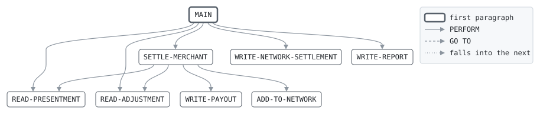

# SETTLE

```text
settle: work out what each merchant is paid

reads the priced presentments and the dispute adjustments, both in
merchant order, and for each merchant pays the matched presentments,
less their interchange, plus or minus the adjustments. a merchant that
ends up owing is not paid, and is listed for collection.

return codes: 0 all paid, 4 some owe.

history
2011-04-04 rk  lcs-0102 original version.
2015-03-23 mt  lcs-0302 dispute adjustments.
```

Program [settle.cbl](../../../laurasia/programs/settle.cbl): 4 files, 6 paragraphs. Its business rules: [6 decision tables](../rules/SETTLE.md).

## Contents

- [Files](#files)
- [Flow](#flow)
- [Paragraphs](#paragraphs)
- [Data flow](#data-flow)
- [Lineage](#lineage)
  - [Into PRES-RECORD](#into-pres-record)
  - [Into ADJUSTMENT](#into-adjustment)
  - [Into PAYOUT](#into-payout)
  - [Into REPORT-LINE](#into-report-line)
  - [Into WS-PRES-KEY](#into-ws-pres-key)
  - [Into WS-ADJUST-KEY](#into-ws-adjust-key)
  - [Into WS-MERCHANT](#into-ws-merchant)
  - [Into WS-MERCHANT-TOTALS](#into-ws-merchant-totals)
  - [Into WS-TOTALS](#into-ws-totals)
  - [Into WS-REPORT-AMOUNT](#into-ws-report-amount)
  - [Into WS-REPORT-COUNT](#into-ws-report-count)
  - [Out of the program](#out-of-the-program)
- [Field origins](#field-origins)
  - [File PAYOUT-OUT](#file-payout-out)
  - [File REPORT-OUT](#file-report-out)
- [Records](#records)
  - [PRES-RECORD](#pres-record)
  - [ADJUSTMENT](#adjustment)
  - [PAYOUT](#payout)
  - [REPORT-LINE](#report-line)
  - [WS-PRES-KEY](#ws-pres-key)
  - [WS-ADJUST-KEY](#ws-adjust-key)
  - [WS-MERCHANT](#ws-merchant)
  - [WS-MERCHANT-TOTALS](#ws-merchant-totals)
  - [WS-TOTALS](#ws-totals)
  - [WS-REPORT-AMOUNT](#ws-report-amount)
  - [WS-REPORT-COUNT](#ws-report-count)

## Files

| File | Kind | Assigned to | Organization | Status field | Opened | Records |
| --- | --- | --- | --- | --- | --- | --- |
| PRES-IN | FD | PRESIN | LINE SEQUENTIAL | | INPUT | PRES-RECORD |
| ADJUST-IN | FD | ADJIN | LINE SEQUENTIAL | | INPUT | ADJUSTMENT |
| PAYOUT-OUT | FD | PAYOUT | LINE SEQUENTIAL | | OUTPUT | PAYOUT |
| REPORT-OUT | FD | SETLRPT | LINE SEQUENTIAL | | OUTPUT | REPORT-LINE |

## Flow



## Paragraphs

| Paragraph | Description | Source | Performs | Goes to | Performed by | Reached by |
| --- | --- | --- | --- | --- | --- | --- |
| MAIN | | [settle.cbl:72](../../../laurasia/programs/settle.cbl#L72) | READ-PRESENTMENT, READ-ADJUSTMENT, SETTLE-MERCHANT, WRITE-REPORT | | | |
| READ-PRESENTMENT | | [settle.cbl:85](../../../laurasia/programs/settle.cbl#L85) | | | MAIN, SETTLE-MERCHANT | |
| READ-ADJUSTMENT | | [settle.cbl:91](../../../laurasia/programs/settle.cbl#L91) | | | MAIN, SETTLE-MERCHANT | |
| SETTLE-MERCHANT | the next merchant: the lower of the two keys, and everything of both files for it. | [settle.cbl:99](../../../laurasia/programs/settle.cbl#L99) | READ-PRESENTMENT, READ-ADJUSTMENT, WRITE-PAYOUT | | MAIN | |
| WRITE-PAYOUT | | [settle.cbl:119](../../../laurasia/programs/settle.cbl#L119) | | | SETTLE-MERCHANT | |
| WRITE-REPORT | | [settle.cbl:135](../../../laurasia/programs/settle.cbl#L135) | | | MAIN | |

## Data flow

| Paragraph | Reads | Writes |
| --- | --- | --- |
| MAIN | WS-PRES-KEY, WS-ADJUST-KEY, WS-OWING-COUNT | RETURN-CODE |
| READ-PRESENTMENT | PS-MERCHANT | PRES-RECORD, WS-PRES-KEY |
| READ-ADJUSTMENT | AD-MERCHANT | ADJUSTMENT, WS-ADJUST-KEY |
| SETTLE-MERCHANT | WS-PRES-KEY, WS-ADJUST-KEY, WS-MERCHANT, PS-MATCH, PS-AMOUNT, WS-GROSS, PS-FEE, WS-INTERCHANGE, AD-AMOUNT, WS-ADJUSTMENTS | WS-MERCHANT, WS-GROSS, WS-INTERCHANGE, WS-ADJUSTMENTS |
| WRITE-PAYOUT | WS-MERCHANT, WS-GROSS, WS-INTERCHANGE, WS-ADJUSTMENTS, PA-NET, WS-OWING-COUNT, WS-PAID-COUNT, WS-PAID-TOTAL | PA-MERCHANT, PA-GROSS, PA-INTERCHANGE, PA-ADJUSTMENTS, PA-NET, PA-STATUS, WS-OWING-COUNT, WS-PAID-COUNT, WS-PAID-TOTAL, PAYOUT |
| WRITE-REPORT | WS-PAID-COUNT, WS-REPORT-COUNT, WS-OWING-COUNT, WS-PAID-TOTAL, WS-REPORT-AMOUNT | REPORT-LINE, RC-LABEL, RC-VALUE, RA-LABEL, RA-VALUE |

## Lineage

Where each data item's values come from, grouped by the record they go into. A data item links to the record it belongs to.

### Into PRES-RECORD

Record [PRES-RECORD](#pres-record), from copybook [presrec](../copybooks/presrec.md).

| Into | From | Statement | Paragraph | Source |
| --- | --- | --- | --- | --- |
| PRES-RECORD | file PRES-IN | READ | READ-PRESENTMENT | [settle.cbl:86](../../../laurasia/programs/settle.cbl#L86) |

### Into ADJUSTMENT

Record [ADJUSTMENT](#adjustment).

| Into | From | Statement | Paragraph | Source |
| --- | --- | --- | --- | --- |
| ADJUSTMENT | file ADJUST-IN | READ | READ-ADJUSTMENT | [settle.cbl:92](../../../laurasia/programs/settle.cbl#L92) |

### Into PAYOUT

Record [PAYOUT](#payout).

| Into | From | Statement | Paragraph | Source |
| --- | --- | --- | --- | --- |
| PA-ADJUSTMENTS | [WS-ADJUSTMENTS](#ws-merchant-totals "in WS-MERCHANT-TOTALS") | MOVE | WRITE-PAYOUT | [settle.cbl:123](../../../laurasia/programs/settle.cbl#L123) |
| PA-GROSS | [WS-GROSS](#ws-merchant-totals "in WS-MERCHANT-TOTALS") | MOVE | WRITE-PAYOUT | [settle.cbl:121](../../../laurasia/programs/settle.cbl#L121) |
| PA-INTERCHANGE | [WS-INTERCHANGE](#ws-merchant-totals "in WS-MERCHANT-TOTALS") | MOVE | WRITE-PAYOUT | [settle.cbl:122](../../../laurasia/programs/settle.cbl#L122) |
| PA-MERCHANT | [WS-MERCHANT](#ws-merchant) | MOVE | WRITE-PAYOUT | [settle.cbl:120](../../../laurasia/programs/settle.cbl#L120) |
| PA-NET | [WS-GROSS](#ws-merchant-totals "in WS-MERCHANT-TOTALS") | COMPUTE | WRITE-PAYOUT | [settle.cbl:124](../../../laurasia/programs/settle.cbl#L124) |
| PA-NET | [WS-INTERCHANGE](#ws-merchant-totals "in WS-MERCHANT-TOTALS") | COMPUTE | WRITE-PAYOUT | [settle.cbl:124](../../../laurasia/programs/settle.cbl#L124) |
| PA-NET | [WS-ADJUSTMENTS](#ws-merchant-totals "in WS-MERCHANT-TOTALS") | COMPUTE | WRITE-PAYOUT | [settle.cbl:124](../../../laurasia/programs/settle.cbl#L124) |
| PA-STATUS | literal condition PA-OWES | SET | WRITE-PAYOUT | [settle.cbl:126](../../../laurasia/programs/settle.cbl#L126) |
| PA-STATUS | literal condition PA-PAID | SET | WRITE-PAYOUT | [settle.cbl:129](../../../laurasia/programs/settle.cbl#L129) |

### Into REPORT-LINE

Record [REPORT-LINE](#report-line).

| Into | From | Statement | Paragraph | Source |
| --- | --- | --- | --- | --- |
| REPORT-LINE | literal 'SETTLE   MERCHANT SETTLEMENT' | MOVE | WRITE-REPORT | [settle.cbl:136](../../../laurasia/programs/settle.cbl#L136) |
| REPORT-LINE | [WS-REPORT-COUNT](#ws-report-count) | WRITE | WRITE-REPORT | [settle.cbl:140](../../../laurasia/programs/settle.cbl#L140) |
| REPORT-LINE | [WS-REPORT-COUNT](#ws-report-count) | WRITE | WRITE-REPORT | [settle.cbl:143](../../../laurasia/programs/settle.cbl#L143) |
| REPORT-LINE | [WS-REPORT-AMOUNT](#ws-report-amount) | WRITE | WRITE-REPORT | [settle.cbl:146](../../../laurasia/programs/settle.cbl#L146) |

### Into WS-PRES-KEY

Record [WS-PRES-KEY](#ws-pres-key).

| Into | From | Statement | Paragraph | Source |
| --- | --- | --- | --- | --- |
| WS-PRES-KEY | literal HIGH-VALUES | MOVE | READ-PRESENTMENT | [settle.cbl:87](../../../laurasia/programs/settle.cbl#L87) |
| WS-PRES-KEY | [PS-MERCHANT](#pres-record "in PRES-RECORD") | MOVE | READ-PRESENTMENT | [settle.cbl:88](../../../laurasia/programs/settle.cbl#L88) |

### Into WS-ADJUST-KEY

Record [WS-ADJUST-KEY](#ws-adjust-key).

| Into | From | Statement | Paragraph | Source |
| --- | --- | --- | --- | --- |
| WS-ADJUST-KEY | literal HIGH-VALUES | MOVE | READ-ADJUSTMENT | [settle.cbl:93](../../../laurasia/programs/settle.cbl#L93) |
| WS-ADJUST-KEY | [AD-MERCHANT](#adjustment "in ADJUSTMENT") | MOVE | READ-ADJUSTMENT | [settle.cbl:94](../../../laurasia/programs/settle.cbl#L94) |

### Into WS-MERCHANT

Record [WS-MERCHANT](#ws-merchant).

| Into | From | Statement | Paragraph | Source |
| --- | --- | --- | --- | --- |
| WS-MERCHANT | [WS-PRES-KEY](#ws-pres-key) | MOVE | SETTLE-MERCHANT | [settle.cbl:101](../../../laurasia/programs/settle.cbl#L101) |
| WS-MERCHANT | [WS-ADJUST-KEY](#ws-adjust-key) | MOVE | SETTLE-MERCHANT | [settle.cbl:103](../../../laurasia/programs/settle.cbl#L103) |

### Into WS-MERCHANT-TOTALS

Record [WS-MERCHANT-TOTALS](#ws-merchant-totals).

| Into | From | Statement | Paragraph | Source |
| --- | --- | --- | --- | --- |
| WS-ADJUSTMENTS | literal ZERO | MOVE | SETTLE-MERCHANT | [settle.cbl:105](../../../laurasia/programs/settle.cbl#L105) |
| WS-ADJUSTMENTS | [AD-AMOUNT](#adjustment "in ADJUSTMENT") | ADD | SETTLE-MERCHANT | [settle.cbl:114](../../../laurasia/programs/settle.cbl#L114) |
| WS-GROSS | literal ZERO | MOVE | SETTLE-MERCHANT | [settle.cbl:105](../../../laurasia/programs/settle.cbl#L105) |
| WS-GROSS | [PS-AMOUNT](#pres-record "in PRES-RECORD") | ADD | SETTLE-MERCHANT | [settle.cbl:108](../../../laurasia/programs/settle.cbl#L108) |
| WS-INTERCHANGE | literal ZERO | MOVE | SETTLE-MERCHANT | [settle.cbl:105](../../../laurasia/programs/settle.cbl#L105) |
| WS-INTERCHANGE | [PS-FEE](#pres-record "in PRES-RECORD") | ADD | SETTLE-MERCHANT | [settle.cbl:109](../../../laurasia/programs/settle.cbl#L109) |

### Into WS-TOTALS

Record [WS-TOTALS](#ws-totals).

| Into | From | Statement | Paragraph | Source |
| --- | --- | --- | --- | --- |
| WS-OWING-COUNT | literal 1 | ADD | WRITE-PAYOUT | [settle.cbl:127](../../../laurasia/programs/settle.cbl#L127) |
| WS-PAID-COUNT | literal 1 | ADD | WRITE-PAYOUT | [settle.cbl:130](../../../laurasia/programs/settle.cbl#L130) |
| WS-PAID-TOTAL | [PA-NET](#payout "in PAYOUT") | ADD | WRITE-PAYOUT | [settle.cbl:131](../../../laurasia/programs/settle.cbl#L131) |

### Into WS-REPORT-AMOUNT

Record [WS-REPORT-AMOUNT](#ws-report-amount).

| Into | From | Statement | Paragraph | Source |
| --- | --- | --- | --- | --- |
| RA-LABEL | literal 'PAID' | MOVE | WRITE-REPORT | [settle.cbl:144](../../../laurasia/programs/settle.cbl#L144) |
| RA-VALUE | [WS-PAID-TOTAL](#ws-totals "in WS-TOTALS") | MOVE | WRITE-REPORT | [settle.cbl:145](../../../laurasia/programs/settle.cbl#L145) |

### Into WS-REPORT-COUNT

Record [WS-REPORT-COUNT](#ws-report-count).

| Into | From | Statement | Paragraph | Source |
| --- | --- | --- | --- | --- |
| RC-LABEL | literal 'MERCHANTS PAID' | MOVE | WRITE-REPORT | [settle.cbl:138](../../../laurasia/programs/settle.cbl#L138) |
| RC-LABEL | literal 'MERCHANTS OWING' | MOVE | WRITE-REPORT | [settle.cbl:141](../../../laurasia/programs/settle.cbl#L141) |
| RC-VALUE | [WS-PAID-COUNT](#ws-totals "in WS-TOTALS") | MOVE | WRITE-REPORT | [settle.cbl:139](../../../laurasia/programs/settle.cbl#L139) |
| RC-VALUE | [WS-OWING-COUNT](#ws-totals "in WS-TOTALS") | MOVE | WRITE-REPORT | [settle.cbl:142](../../../laurasia/programs/settle.cbl#L142) |

### Out of the program

Records written to files, items passed to the programs called, and items displayed to the job's output.

| Into | From | Statement | Paragraph | Source |
| --- | --- | --- | --- | --- |
| file PAYOUT-OUT | [PAYOUT](#payout) | WRITE | WRITE-PAYOUT | [settle.cbl:133](../../../laurasia/programs/settle.cbl#L133) |
| file REPORT-OUT | [REPORT-LINE](#report-line) | WRITE | WRITE-REPORT | [settle.cbl:137](../../../laurasia/programs/settle.cbl#L137) |
| file REPORT-OUT | [REPORT-LINE](#report-line) | WRITE | WRITE-REPORT | [settle.cbl:140](../../../laurasia/programs/settle.cbl#L140) |
| file REPORT-OUT | [REPORT-LINE](#report-line) | WRITE | WRITE-REPORT | [settle.cbl:143](../../../laurasia/programs/settle.cbl#L143) |
| file REPORT-OUT | [REPORT-LINE](#report-line) | WRITE | WRITE-REPORT | [settle.cbl:146](../../../laurasia/programs/settle.cbl#L146) |

## Field origins

Where the values of each field the program writes to a file come from: the fields of the files it reads, literals, and initial values, followed through every statement that moves a value, and through groups and redefinitions by the bytes they share.

### File PAYOUT-OUT

Written from [PAYOUT](#payout).

| Field | Position | Origins |
| --- | --: | --- |
| PA-MERCHANT | 1-10 | file ADJUST-IN AD-MERCHANT; file PRES-IN PS-MERCHANT; literal HIGH-VALUES |
| PA-GROSS | 11-24 | file PRES-IN PS-AMOUNT; literal ZERO |
| PA-INTERCHANGE | 25-36 | file PRES-IN PS-FEE; literal ZERO |
| PA-ADJUSTMENTS | 37-50 | file ADJUST-IN AD-AMOUNT; literal ZERO |
| PA-NET | 51-64 | file ADJUST-IN AD-AMOUNT; file PRES-IN PS-AMOUNT; file PRES-IN PS-FEE; literal ZERO |
| PA-STATUS | 65 | literal condition PA-OWES; literal condition PA-PAID |

### File REPORT-OUT

Written from [REPORT-LINE](#report-line), [WS-REPORT-COUNT](#ws-report-count) and [WS-REPORT-AMOUNT](#ws-report-amount).

#### Record REPORT-LINE

| Field | Position | Origins |
| --- | --: | --- |
| REPORT-LINE | 1-60 | literal 'SETTLE   MERCHANT SETTLEMENT' |

#### Record WS-REPORT-COUNT

| Field | Position | Origins |
| --- | --: | --- |
| RC-LABEL | 1-30 | literal 'MERCHANTS OWING'; literal 'MERCHANTS PAID' |
| RC-VALUE | 31-36 | initial value of WS-OWING-COUNT; initial value of WS-PAID-COUNT; literal 1 |

#### Record WS-REPORT-AMOUNT

| Field | Position | Origins |
| --- | --: | --- |
| RA-LABEL | 1-30 | literal 'PAID' |
| RA-VALUE | 31-45 | file ADJUST-IN AD-AMOUNT; file PRES-IN PS-AMOUNT; file PRES-IN PS-FEE; initial value of WS-PAID-TOTAL; literal ZERO |

## Records

### PRES-RECORD

File PRES-IN. 76 bytes, layout in copybook [presrec](../copybooks/presrec.md).

### ADJUSTMENT

File ADJUST-IN. 32 bytes.

| Level | Field | Kind | Start | Length | Picture | Usage | Notes | Source |
| --: | --- | --- | --: | --: | --- | --- | --- | --- |
| 01 | ADJUSTMENT | group | 1 | 32 | | | | [settle.cbl:34](../../../laurasia/programs/settle.cbl#L34) |
| 05 | ├ AD-MERCHANT | text | 1 | 10 | X(10) | | | [settle.cbl:35](../../../laurasia/programs/settle.cbl#L35) |
| 05 | ├ AD-AMOUNT | amount | 11 | 12 | S9(9)V99 | | SIGN LEADING SEPARATE | [settle.cbl:36](../../../laurasia/programs/settle.cbl#L36) |
| 05 | ├ AD-CASE-NO | number | 23 | 8 | 9(8) | | | [settle.cbl:37](../../../laurasia/programs/settle.cbl#L37) |
| 05 | └ AD-EVENT | text | 31 | 2 | X(2) | | | [settle.cbl:38](../../../laurasia/programs/settle.cbl#L38) |

### PAYOUT

File PAYOUT-OUT. 65 bytes.

| Level | Field | Kind | Start | Length | Picture | Usage | Notes | Source |
| --: | --- | --- | --: | --: | --- | --- | --- | --- |
| 01 | PAYOUT | group | 1 | 65 | | | | [settle.cbl:40](../../../laurasia/programs/settle.cbl#L40) |
| 05 | ├ PA-MERCHANT | text | 1 | 10 | X(10) | | | [settle.cbl:41](../../../laurasia/programs/settle.cbl#L41) |
| 05 | ├ PA-GROSS | amount | 11 | 14 | S9(11)V99 | | SIGN LEADING SEPARATE | [settle.cbl:42](../../../laurasia/programs/settle.cbl#L42) |
| 05 | ├ PA-INTERCHANGE | amount | 25 | 12 | S9(9)V99 | | SIGN LEADING SEPARATE | [settle.cbl:43](../../../laurasia/programs/settle.cbl#L43) |
| 05 | ├ PA-ADJUSTMENTS | amount | 37 | 14 | S9(11)V99 | | SIGN LEADING SEPARATE | [settle.cbl:44](../../../laurasia/programs/settle.cbl#L44) |
| 05 | ├ PA-NET | amount | 51 | 14 | S9(11)V99 | | SIGN LEADING SEPARATE | [settle.cbl:45](../../../laurasia/programs/settle.cbl#L45) |
| 05 | └ PA-STATUS | code | 65 | 1 | X | | | [settle.cbl:46](../../../laurasia/programs/settle.cbl#L46) |
| 88 |   ├ PA-PAID | | | | | | VALUE 'P' | [settle.cbl:47](../../../laurasia/programs/settle.cbl#L47) |
| 88 |   └ PA-OWES | | | | | | VALUE 'C' | [settle.cbl:48](../../../laurasia/programs/settle.cbl#L48) |

### REPORT-LINE

File REPORT-OUT. 60 bytes.

| Level | Field | Kind | Start | Length | Picture | Usage | Notes | Source |
| --: | --- | --- | --: | --: | --- | --- | --- | --- |
| 01 | REPORT-LINE | text | 1 | 60 | X(60) | | | [settle.cbl:50](../../../laurasia/programs/settle.cbl#L50) |

### WS-PRES-KEY

Working storage. 10 bytes.

| Level | Field | Kind | Start | Length | Picture | Usage | Notes | Source |
| --: | --- | --- | --: | --: | --- | --- | --- | --- |
| 01 | WS-PRES-KEY | text | 1 | 10 | X(10) | | | [settle.cbl:53](../../../laurasia/programs/settle.cbl#L53) |

### WS-ADJUST-KEY

Working storage. 10 bytes.

| Level | Field | Kind | Start | Length | Picture | Usage | Notes | Source |
| --: | --- | --- | --: | --: | --- | --- | --- | --- |
| 01 | WS-ADJUST-KEY | text | 1 | 10 | X(10) | | | [settle.cbl:54](../../../laurasia/programs/settle.cbl#L54) |

### WS-MERCHANT

Working storage. 10 bytes.

| Level | Field | Kind | Start | Length | Picture | Usage | Notes | Source |
| --: | --- | --- | --: | --: | --- | --- | --- | --- |
| 01 | WS-MERCHANT | text | 1 | 10 | X(10) | | | [settle.cbl:55](../../../laurasia/programs/settle.cbl#L55) |

### WS-MERCHANT-TOTALS

Working storage. 37 bytes.

| Level | Field | Kind | Start | Length | Picture | Usage | Notes | Source |
| --: | --- | --- | --: | --: | --- | --- | --- | --- |
| 01 | WS-MERCHANT-TOTALS | group | 1 | 37 | | | | [settle.cbl:56](../../../laurasia/programs/settle.cbl#L56) |
| 05 | ├ WS-GROSS | amount | 1 | 13 | S9(11)V99 | | | [settle.cbl:57](../../../laurasia/programs/settle.cbl#L57) |
| 05 | ├ WS-INTERCHANGE | amount | 14 | 11 | S9(9)V99 | | | [settle.cbl:58](../../../laurasia/programs/settle.cbl#L58) |
| 05 | └ WS-ADJUSTMENTS | amount | 25 | 13 | S9(11)V99 | | | [settle.cbl:59](../../../laurasia/programs/settle.cbl#L59) |

### WS-TOTALS

Working storage. 27 bytes.

| Level | Field | Kind | Start | Length | Picture | Usage | Notes | Source |
| --: | --- | --- | --: | --: | --- | --- | --- | --- |
| 01 | WS-TOTALS | group | 1 | 27 | | | | [settle.cbl:60](../../../laurasia/programs/settle.cbl#L60) |
| 05 | ├ WS-PAID-COUNT | number | 1 | 6 | 9(6) | | VALUE ZERO | [settle.cbl:61](../../../laurasia/programs/settle.cbl#L61) |
| 05 | ├ WS-OWING-COUNT | number | 7 | 6 | 9(6) | | VALUE ZERO | [settle.cbl:62](../../../laurasia/programs/settle.cbl#L62) |
| 05 | └ WS-PAID-TOTAL | amount | 13 | 15 | S9(13)V99 | | VALUE ZERO | [settle.cbl:63](../../../laurasia/programs/settle.cbl#L63) |

### WS-REPORT-AMOUNT

Working storage. 45 bytes.

| Level | Field | Kind | Start | Length | Picture | Usage | Notes | Source |
| --: | --- | --- | --: | --: | --- | --- | --- | --- |
| 01 | WS-REPORT-AMOUNT | group | 1 | 45 | | | | [settle.cbl:64](../../../laurasia/programs/settle.cbl#L64) |
| 05 | ├ RA-LABEL | text | 1 | 30 | X(30) | | | [settle.cbl:65](../../../laurasia/programs/settle.cbl#L65) |
| 05 | └ RA-VALUE | edited | 31 | 15 | -(11)9.99 | | | [settle.cbl:66](../../../laurasia/programs/settle.cbl#L66) |

### WS-REPORT-COUNT

Working storage. 36 bytes.

| Level | Field | Kind | Start | Length | Picture | Usage | Notes | Source |
| --: | --- | --- | --: | --: | --- | --- | --- | --- |
| 01 | WS-REPORT-COUNT | group | 1 | 36 | | | | [settle.cbl:67](../../../laurasia/programs/settle.cbl#L67) |
| 05 | ├ RC-LABEL | text | 1 | 30 | X(30) | | | [settle.cbl:68](../../../laurasia/programs/settle.cbl#L68) |
| 05 | └ RC-VALUE | edited | 31 | 6 | Z(5)9 | | | [settle.cbl:69](../../../laurasia/programs/settle.cbl#L69) |
