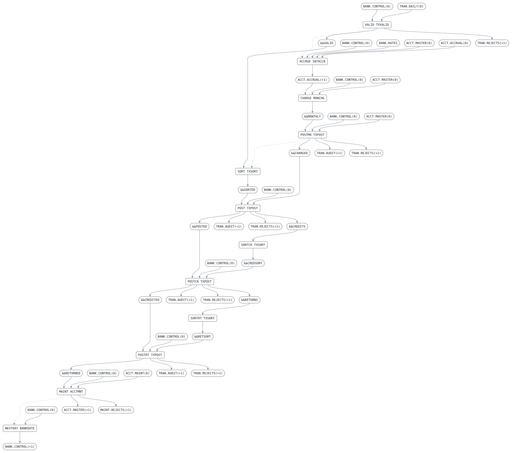

# DAILY

```text
DAILY BATCH: VALIDATE THE DAY'S TRANSACTIONS, ACCRUE INTEREST
AND POST WHAT A CLOSED MONTH OWES, THEN SORT AND POST THE
DAY'S TRANSACTIONS, THE TRANSFER CREDITS AND RETURNS THEY LEAD
TO, APPLY THE DAY'S ACCOUNT MAINTENANCE, AND MOVE TO THE NEXT
BUSINESS DAY.

READS   BANK.CONTROL(0)  ACCT.MASTER(0)  TRAN.DAILY(0)
        ACCT.ACCRUAL(0)  ACCT.MAINT(0)    BANK.RATES
WRITES  BANK.CONTROL(+1) ACCT.MASTER(+1) ACCT.ACCRUAL(+1)
        TRAN.AUDIT(+1)   TRAN.REJECTS(+1) MAINT.REJECTS(+1)

A STEP RUNS ONLY IF NO EARLIER STEP ENDED WITH RC ABOVE 4, SO
A RUN THAT FAILS LEAVES THE BUSINESS DATE WHERE IT WAS.
```

Job [DAILY.jcl](../../../pangaea/jobs/DAILY.jcl): 12 steps.

## Contents

- [Network](#network)
- [Steps](#steps)
  - [VALID](#valid)
  - [ACCRUE](#accrue)
  - [CHARGE](#charge)
  - [POSTMO](#postmo)
  - [SORT](#sort)
  - [POST](#post)
  - [SORTCR](#sortcr)
  - [POSTCR](#postcr)
  - [SORTRT](#sortrt)
  - [POSTRT](#postrt)
  - [MAINT](#maint)
  - [NEXTDAY](#nextday)
- [Findings](#findings)

## Network



Boxes are steps, with the program each runs; rounded boxes are datasets, as the job names them. Arrows run from the datasets a step reads to the step, and from the step to the datasets it writes; dotted ones from a step to the next where no dataset leads from one to the other.

## Steps

| Step | Program | Bypassed by | Description | Source |
| --- | --- | --- | --- | --- |
| VALID | [TXVALID](../programs/TXVALID.md) | | VALIDATE THE DAY'S TRANSACTION FILE | [DAILY.jcl:20](../../../pangaea/jobs/DAILY.jcl#L20) |
| ACCRUE | [INTACCR](../programs/INTACCR.md) | COND=(4,LT) | ACCRUE INTEREST UP TO TODAY ON THE OPENING BALANCES. WHEN A MONTH HAS CLOSED, POST ITS INTEREST AND FEES. THE CHARGES COME IN MASTER ORDER, SO THEY ARE POSTED WITHOUT A SORT. | [DAILY.jcl:33](../../../pangaea/jobs/DAILY.jcl#L33) |
| CHARGE | [MONCHG](../programs/MONCHG.md) | COND=(4,LT) | | [DAILY.jcl:41](../../../pangaea/jobs/DAILY.jcl#L41) |
| POSTMO | [TXPOST](../programs/TXPOST.md) | COND=(4,LT) | | [DAILY.jcl:48](../../../pangaea/jobs/DAILY.jcl#L48) |
| SORT | [TXSORT](../programs/TXSORT.md) | COND=(4,LT) | SORT THE DAY'S TRANSACTIONS INTO ACCOUNT ORDER AND POST THEM | [DAILY.jcl:62](../../../pangaea/jobs/DAILY.jcl#L62) |
| POST | [TXPOST](../programs/TXPOST.md) | COND=(4,LT) | | [DAILY.jcl:66](../../../pangaea/jobs/DAILY.jcl#L66) |
| SORTCR | [TXSORT](../programs/TXSORT.md) | COND=(4,LT) | SORT AND POST THE CREDITS OF THE TRANSFERS THAT POSTED | [DAILY.jcl:80](../../../pangaea/jobs/DAILY.jcl#L80) |
| POSTCR | [TXPOST](../programs/TXPOST.md) | COND=(4,LT) | | [DAILY.jcl:84](../../../pangaea/jobs/DAILY.jcl#L84) |
| SORTRT | [TXSORT](../programs/TXSORT.md) | COND=(4,LT) | SORT AND POST THE RETURNS OF THE CREDITS THAT COULD NOT POST | [DAILY.jcl:98](../../../pangaea/jobs/DAILY.jcl#L98) |
| POSTRT | [TXPOST](../programs/TXPOST.md) | COND=(4,LT) | | [DAILY.jcl:102](../../../pangaea/jobs/DAILY.jcl#L102) |
| MAINT | [ACCTMNT](../programs/ACCTMNT.md) | COND=(4,LT) | APPLY THE DAY'S ACCOUNT MAINTENANCE, WRITING THE NEW MASTER | [DAILY.jcl:115](../../../pangaea/jobs/DAILY.jcl#L115) |
| NEXTDAY | [BANKDATE](../programs/BANKDATE.md) | COND=(4,LT) | MOVE TO THE NEXT BUSINESS DAY | [DAILY.jcl:127](../../../pangaea/jobs/DAILY.jcl#L127) |

### VALID

| DD | Dataset | DISP | File | Use |
| --- | --- | --- | --- | --- |
| BANKCTL | BANK.CONTROL(0) | SHR | CONTROL-FILE | read |
| TRANIN | TRAN.DAILY(0) | SHR | TRAN-IN | read |
| TRANOUT | &&VALID | NEW | TRAN-OUT | write |
| REJECTS | TRAN.REJECTS(+1) | NEW | REJECT-OUT | write |
| VALRPT | job output | | REPORT-OUT | write |

### ACCRUE

| DD | Dataset | DISP | File | Use |
| --- | --- | --- | --- | --- |
| BANKCTL | BANK.CONTROL(0) | SHR | CONTROL-FILE | read |
| RATES | BANK.RATES | SHR | RATE-FILE | read |
| ACCTIN | ACCT.MASTER(0) | SHR | ACCT-IN | read |
| ACCRIN | ACCT.ACCRUAL(0) | SHR | ACCR-IN | read |
| ACCROUT | ACCT.ACCRUAL(+1) | NEW | ACCR-OUT | write |
| ACCRRPT | job output | | REPORT-OUT | write |

### CHARGE

| DD | Dataset | DISP | File | Use |
| --- | --- | --- | --- | --- |
| BANKCTL | BANK.CONTROL(0) | SHR | CONTROL-FILE | read |
| ACCTIN | ACCT.MASTER(0) | SHR | ACCT-IN | read |
| ACCRIN | ACCT.ACCRUAL(+1) | SHR | ACCR-IN | read |
| TRANOUT | &&MONTHLY | NEW | TRAN-OUT | write |
| MONRPT | job output | | REPORT-OUT | write |

### POSTMO

| DD | Dataset | DISP | File | Use |
| --- | --- | --- | --- | --- |
| BANKCTL | BANK.CONTROL(0) | SHR | CONTROL-FILE | read |
| ACCTIN | ACCT.MASTER(0) | SHR | ACCT-IN | read |
| TRANIN | &&MONTHLY | OLD | TRAN-IN | read |
| ACCTOUT | &&CHARGED | NEW | ACCT-OUT | write |
| AUDIT | TRAN.AUDIT(+1) | MOD | AUDIT-OUT | append |
| REJECTS | TRAN.REJECTS(+1) | MOD | REJECT-OUT | append |
| LEGS | dummy | | LEGS-OUT | write |
| POSTRPT | job output | | REPORT-OUT | write |

### SORT

| DD | Dataset | DISP | File | Use |
| --- | --- | --- | --- | --- |
| TRANIN | &&VALID | OLD | TRAN-IN | read |
| TRANOUT | &&SORTED | NEW | TRAN-OUT | write |

### POST

| DD | Dataset | DISP | File | Use |
| --- | --- | --- | --- | --- |
| BANKCTL | BANK.CONTROL(0) | SHR | CONTROL-FILE | read |
| ACCTIN | &&CHARGED | OLD | ACCT-IN | read |
| TRANIN | &&SORTED | OLD | TRAN-IN | read |
| ACCTOUT | &&POSTED | NEW | ACCT-OUT | write |
| AUDIT | TRAN.AUDIT(+1) | MOD | AUDIT-OUT | append |
| REJECTS | TRAN.REJECTS(+1) | MOD | REJECT-OUT | append |
| LEGS | &&CREDITS | NEW | LEGS-OUT | write |
| POSTRPT | job output | | REPORT-OUT | write |

### SORTCR

| DD | Dataset | DISP | File | Use |
| --- | --- | --- | --- | --- |
| TRANIN | &&CREDITS | OLD | TRAN-IN | read |
| TRANOUT | &&CREDSORT | NEW | TRAN-OUT | write |

### POSTCR

| DD | Dataset | DISP | File | Use |
| --- | --- | --- | --- | --- |
| BANKCTL | BANK.CONTROL(0) | SHR | CONTROL-FILE | read |
| ACCTIN | &&POSTED | OLD | ACCT-IN | read |
| TRANIN | &&CREDSORT | OLD | TRAN-IN | read |
| ACCTOUT | &&CREDITED | NEW | ACCT-OUT | write |
| AUDIT | TRAN.AUDIT(+1) | MOD | AUDIT-OUT | append |
| REJECTS | TRAN.REJECTS(+1) | MOD | REJECT-OUT | append |
| LEGS | &&RETURNS | NEW | LEGS-OUT | write |
| POSTRPT | job output | | REPORT-OUT | write |

### SORTRT

| DD | Dataset | DISP | File | Use |
| --- | --- | --- | --- | --- |
| TRANIN | &&RETURNS | OLD | TRAN-IN | read |
| TRANOUT | &&RETSORT | NEW | TRAN-OUT | write |

### POSTRT

| DD | Dataset | DISP | File | Use |
| --- | --- | --- | --- | --- |
| BANKCTL | BANK.CONTROL(0) | SHR | CONTROL-FILE | read |
| ACCTIN | &&CREDITED | OLD | ACCT-IN | read |
| TRANIN | &&RETSORT | OLD | TRAN-IN | read |
| ACCTOUT | &&RETURNED | NEW | ACCT-OUT | write |
| AUDIT | TRAN.AUDIT(+1) | MOD | AUDIT-OUT | append |
| REJECTS | TRAN.REJECTS(+1) | MOD | REJECT-OUT | append |
| LEGS | dummy | | LEGS-OUT | write |
| POSTRPT | job output | | REPORT-OUT | write |

### MAINT

| DD | Dataset | DISP | File | Use |
| --- | --- | --- | --- | --- |
| BANKCTL | BANK.CONTROL(0) | SHR | CONTROL-FILE | read |
| ACCTIN | &&RETURNED | OLD | ACCT-IN | read |
| MAINTIN | ACCT.MAINT(0) | SHR | MAINT-IN | read |
| ACCTOUT | ACCT.MASTER(+1) | NEW | ACCT-OUT | write |
| REJECTS | MAINT.REJECTS(+1) | NEW | REJECT-OUT | write |
| MNTRPT | job output | | REPORT-OUT | write |

### NEXTDAY

| DD | Dataset | DISP | File | Use |
| --- | --- | --- | --- | --- |
| BANKIN | BANK.CONTROL(0) | SHR | CONTROL-IN | read |
| BANKOUT | BANK.CONTROL(+1) | NEW | CONTROL-OUT | write |

## Findings

None: every DD is assigned a file, every file a DD, and every disposition fits its use.
