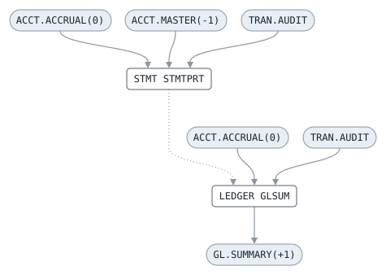

# MONTHLY

```text
MONTH-END: THE STATEMENTS AND THE GENERAL LEDGER SUMMARY OF
THE MONTH THAT CLOSED. THE SCHEDULER RUNS IT ON THE FIRST
BUSINESS DAY OF EVERY MONTH, AFTER THE DAILY BATCH HAS POSTED
THE MONTH'S INTEREST AND FEES. ON THE FIRST DAY OF A NEW BANK
NO MONTH HAS CLOSED, AND IT PRINTS NOTHING.

READS   ACCT.ACCRUAL(0)  ACCT.MASTER(-1)  TRAN.AUDIT
WRITES  GL.SUMMARY(+1)
```

Job [MONTHLY.jcl](../../../pangaea/jobs/MONTHLY.jcl): 2 steps.

## Contents

- [Network](#network)
- [Steps](#steps)
  - [STMT](#stmt)
  - [LEDGER](#ledger)
- [Findings](#findings)

## Network



Boxes are steps, with the program each runs; rounded boxes are datasets, as the job names them. Arrows run from the datasets a step reads to the step, and from the step to the datasets it writes; dotted ones from a step to the next where no dataset leads from one to the other.

## Steps

| Step | Program | Bypassed by | Description | Source |
| --- | --- | --- | --- | --- |
| STMT | [STMTPRT](../programs/STMTPRT.md) | | PRINT THE STATEMENTS FROM EVERY AUDIT TRAIL AND THE MASTER THE CLOSED MONTH ENDED WITH, BEFORE THE DAILY BATCH OF TODAY | [MONTHLY.jcl:16](../../../pangaea/jobs/MONTHLY.jcl#L16) |
| LEDGER | [GLSUM](../programs/GLSUM.md) | COND=(4,LT) | SUMMARIZE THE MONTH'S POSTINGS FOR THE GENERAL LEDGER | [MONTHLY.jcl:25](../../../pangaea/jobs/MONTHLY.jcl#L25) |

### STMT

| DD | Dataset | DISP | File | Use |
| --- | --- | --- | --- | --- |
| ACCRIN | ACCT.ACCRUAL(0) | SHR | ACCR-IN | read |
| ACCTIN | ACCT.MASTER(-1) | SHR | ACCT-IN | read |
| AUDIT | TRAN.AUDIT | SHR | AUDIT-IN | read |
| STMTOUT | job output | | STMT-OUT | write |
| STMTRPT | job output | | REPORT-OUT | write |

### LEDGER

| DD | Dataset | DISP | File | Use |
| --- | --- | --- | --- | --- |
| ACCRIN | ACCT.ACCRUAL(0) | SHR | ACCR-IN | read |
| AUDIT | TRAN.AUDIT | SHR | AUDIT-IN | read |
| GLOUT | GL.SUMMARY(+1) | NEW | GL-OUT | write |
| GLRPT | job output | | REPORT-OUT | write |

## Findings

None: every DD is assigned a file, every file a DD, and every disposition fits its use.
