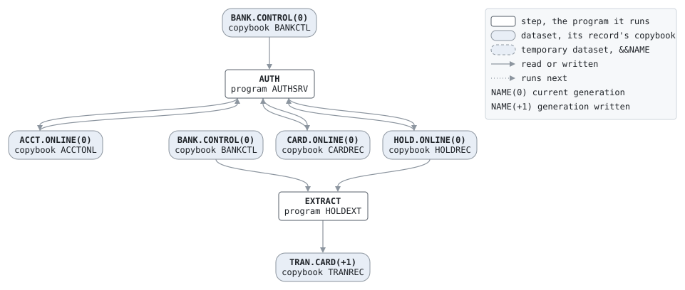

# ONLINE

```text
THE ONLINE DAY: AUTHSRV AUTHORIZES CARD PURCHASES, THEIR
REVERSALS, ATM WITHDRAWALS AND BALANCE ENQUIRIES, ONE REQUEST
AT A TIME, FROM THE OPENING OF THE BUSINESS DAY TO THE BATCH
WINDOW. THE REQUESTS ARE THE JOB'S IN-STREAM DATA, WHICH THE
ONLINE SERVER SUPPLIES FROM THE TERMINALS AS THEY COME, AND
THE RESPONSES GO TO THE STEP'S OUTPUT, BACK TO THE SERVER.

READS   BANK.CONTROL(0)
UPDATES ACCT.ONLINE(0)   CARD.ONLINE(0)   HOLD.ONLINE(0)

THE NIGHT'S BATCH LOADS THE ONLINE FILES AND STARTS THE HOLD
FILE, SO THE JOB CAN BE RUN AGAIN DURING THE DAY.
```

Job [ONLINE.jcl](../../../pangaea/jobs/ONLINE.jcl): 1 steps.

## Contents

- [Network](#network)
- [Steps](#steps)
  - [AUTH](#auth)
- [Datasets](#datasets)
- [Findings](#findings)

## Network



## Steps

| Step | Program | Reads | Writes | Bypassed by | Description | Source |
| --- | --- | --- | --- | --- | --- | --- |
| AUTH | [AUTHSRV](../programs/AUTHSRV.md) | BANK.CONTROL(0), ACCT.ONLINE(0), CARD.ONLINE(0), HOLD.ONLINE(0) | ACCT.ONLINE(0), CARD.ONLINE(0), HOLD.ONLINE(0) | | | [ONLINE.jcl:16](../../../pangaea/jobs/ONLINE.jcl#L16) |

### AUTH

| DD | Dataset | DISP | File | Copybook | Use |
| --- | --- | --- | --- | --- | --- |
| BANKCTL | BANK.CONTROL(0) | SHR | CONTROL-FILE | [BANKCTL](../copybooks/BANKCTL.md) | read |
| ACCTONL | ACCT.ONLINE(0) | OLD | ACCT-FILE | [ACCTONL](../copybooks/ACCTONL.md) | update |
| CARDONL | CARD.ONLINE(0) | OLD | CARD-FILE | [CARDREC](../copybooks/CARDREC.md) | update |
| HOLDS | HOLD.ONLINE(0) | OLD | HOLD-FILE | [HOLDREC](../copybooks/HOLDREC.md) | update |
| AUTHRPT | job output | | REPORT-OUT | | write |
| SYSIN | in-stream data | | | | read |

## Datasets

Each dataset the job names, the copybook that describes its records, from the programs that read or write it in any job, and the steps that write and read it.

| Dataset | Copybook | Written by | Read by |
| --- | --- | --- | --- |
| BANK.CONTROL(0) | [BANKCTL](../copybooks/BANKCTL.md) | | AUTH |
| ACCT.ONLINE(0) | [ACCTONL](../copybooks/ACCTONL.md) | AUTH | AUTH |
| CARD.ONLINE(0) | [CARDREC](../copybooks/CARDREC.md) | AUTH | AUTH |
| HOLD.ONLINE(0) | [HOLDREC](../copybooks/HOLDREC.md) | AUTH | AUTH |

## Findings

None: every DD is assigned a file, every file a DD, and every disposition fits its use.
