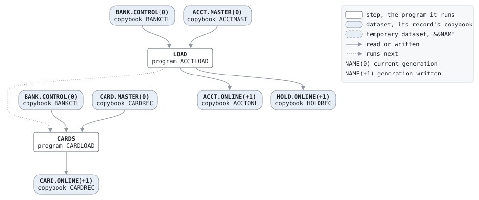

# START

```text
OPEN A NEW BANK: LOAD THE ONLINE FILES FOR ITS FIRST BUSINESS
DAY, AS THE DAILY BATCH LOADS THEM EVERY NIGHT AFTER.

READS   BANK.CONTROL(0)  ACCT.MASTER(0)  CARD.MASTER(0)
WRITES  ACCT.ONLINE(+1)  HOLD.ONLINE(+1)  CARD.ONLINE(+1)
```

Job [START.jcl](../../../pangaea/jobs/START.jcl): 2 steps.

## Contents

- [Network](#network)
- [Steps](#steps)
  - [LOAD](#load)
  - [CARDS](#cards)
- [Datasets](#datasets)
- [Findings](#findings)

## Network



## Steps

| Step | Program | Reads | Writes | Bypassed by | Description | Source |
| --- | --- | --- | --- | --- | --- | --- |
| LOAD | [ACCTLOAD](../programs/ACCTLOAD.md) | BANK.CONTROL(0), ACCT.MASTER(0) | ACCT.ONLINE(+1), HOLD.ONLINE(+1) | | | [START.jcl:9](../../../pangaea/jobs/START.jcl#L9) |
| CARDS | [CARDLOAD](../programs/CARDLOAD.md) | BANK.CONTROL(0), CARD.MASTER(0) | CARD.ONLINE(+1) | COND=(4,LT) | | [START.jcl:17](../../../pangaea/jobs/START.jcl#L17) |

### LOAD

| DD | Dataset | DISP | File | Copybook | Use |
| --- | --- | --- | --- | --- | --- |
| BANKCTL | BANK.CONTROL(0) | SHR | CONTROL-FILE | [BANKCTL](../copybooks/BANKCTL.md) | read |
| ACCTIN | ACCT.MASTER(0) | SHR | ACCT-IN | [ACCTMAST](../copybooks/ACCTMAST.md) | read |
| ACCTOUT | ACCT.ONLINE(+1) (indexed) | NEW | ONLINE-OUT | [ACCTONL](../copybooks/ACCTONL.md) | write |
| HOLDOUT | HOLD.ONLINE(+1) (indexed) | NEW | HOLD-OUT | [HOLDREC](../copybooks/HOLDREC.md) | write |
| LOADRPT | job output | | REPORT-OUT | | write |

### CARDS

| DD | Dataset | DISP | File | Copybook | Use |
| --- | --- | --- | --- | --- | --- |
| BANKCTL | BANK.CONTROL(0) | SHR | CONTROL-FILE | [BANKCTL](../copybooks/BANKCTL.md) | read |
| CARDIN | CARD.MASTER(0) | SHR | CARD-IN | [CARDREC](../copybooks/CARDREC.md) | read |
| CARDOUT | CARD.ONLINE(+1) (indexed) | NEW | ONLINE-OUT | [CARDREC](../copybooks/CARDREC.md) | write |
| LOADRPT | job output | | REPORT-OUT | | write |

## Datasets

Each dataset the job names, the copybook that describes its records, from the programs that read or write it in any job, and the steps that write and read it.

| Dataset | Copybook | Written by | Read by |
| --- | --- | --- | --- |
| BANK.CONTROL(0) | [BANKCTL](../copybooks/BANKCTL.md) | | LOAD, CARDS |
| ACCT.MASTER(0) | [ACCTMAST](../copybooks/ACCTMAST.md) | | LOAD |
| ACCT.ONLINE(+1) | [ACCTONL](../copybooks/ACCTONL.md) | LOAD | |
| HOLD.ONLINE(+1) | [HOLDREC](../copybooks/HOLDREC.md) | LOAD | |
| CARD.MASTER(0) | [CARDREC](../copybooks/CARDREC.md) | | CARDS |
| CARD.ONLINE(+1) | [CARDREC](../copybooks/CARDREC.md) | CARDS | |

## Findings

None: every DD is assigned a file, every file a DD, and every disposition fits its use.
