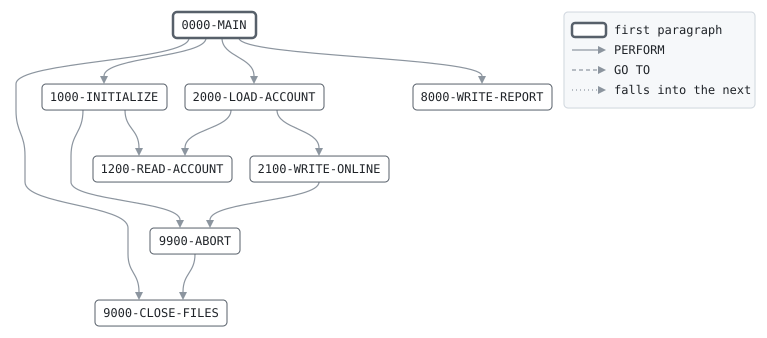

# ACCTLOAD

```text
ACCTLOAD: LOAD THE ONLINE ACCOUNT FILE

WRITES THE NEW ACCOUNT MASTER'S ACCOUNTS TO A NEW INDEXED
ONLINE ACCOUNT FILE, FOR THE CARD AND ATM AUTHORIZATIONS OF
THE NEXT BUSINESS DAY, WITH NO HOLDS, AND STARTS THE DAY'S
HOLD FILE, EMPTY. CLOSED ACCOUNTS ARE LEFT OUT, SO THAT
AUTHORIZATIONS FIND NO SUCH ACCOUNT. THE MASTER IS IN ACCOUNT
NUMBER ORDER, SO THE FILE IS WRITTEN IN KEY ORDER,
SEQUENTIALLY.

RETURN CODES: 0 LOADED, 16 MASTER OUT OF ORDER OR I/O.

MODIFICATION HISTORY
DATE       BY  CHANGE
2003-05-19 MV  CR-0342 ORIGINAL VERSION.
```

Program [ACCTLOAD.cbl](../../../pangaea/programs/ACCTLOAD.cbl): 5 files, 8 paragraphs. Its business rules: [4 decision tables](../rules/ACCTLOAD.md).

- AUTHOR: M. VARGA, ONLINE SYSTEMS.
- INSTALLATION: FIRST BANK OF PANGAEA, DATA CENTER.
- DATE-WRITTEN: 2003-05-19.

## Contents

- [Files](#files)
- [Flow](#flow)
- [Paragraphs](#paragraphs)
- [Data flow](#data-flow)
- [Lineage](#lineage)
  - [Into BANK-CONTROL-RECORD](#into-bank-control-record)
  - [Into ACCT-MASTER-RECORD](#into-acct-master-record)
  - [Into ACCT-ONLINE-RECORD](#into-acct-online-record)
  - [Into REPORT-LINE](#into-report-line)
  - [Into WS-BUSINESS-DATE](#into-ws-business-date)
  - [Into WS-ABORT-MESSAGE](#into-ws-abort-message)
  - [Into WS-MASTER-END-SW](#into-ws-master-end-sw)
  - [Into WS-TOTALS](#into-ws-totals)
  - [Into WS-REPORT-COUNT-LINE](#into-ws-report-count-line)
  - [Into WS-REPORT-AMOUNT-LINE](#into-ws-report-amount-line)
  - [Out of the program](#out-of-the-program)
  - [Into other data items](#into-other-data-items)
- [Field origins](#field-origins)
  - [File ONLINE-OUT](#file-online-out)
  - [File REPORT-OUT](#file-report-out)
- [Records](#records)
  - [BANK-CONTROL-RECORD](#bank-control-record)
  - [ACCT-MASTER-RECORD](#acct-master-record)
  - [ACCT-ONLINE-RECORD](#acct-online-record)
  - [HOLD-RECORD](#hold-record)
  - [REPORT-LINE](#report-line)
  - [WS-FILE-STATUSES](#ws-file-statuses)
  - [WS-BUSINESS-DATE](#ws-business-date)
  - [WS-ABORT-MESSAGE](#ws-abort-message)
  - [WS-MASTER-END-SW](#ws-master-end-sw)
  - [WS-TOTALS](#ws-totals)
  - [WS-REPORT-COUNT-LINE](#ws-report-count-line)
  - [WS-REPORT-AMOUNT-LINE](#ws-report-amount-line)

## Files

| File | Kind | Assigned to | Organization | Status field | Opened | Records |
| --- | --- | --- | --- | --- | --- | --- |
| CONTROL-FILE | FD | BANKCTL | SEQUENTIAL | WS-CONTROL-STATUS | INPUT | BANK-CONTROL-RECORD |
| ACCT-IN | FD | ACCTIN | SEQUENTIAL | WS-ACCT-IN-STATUS | INPUT | ACCT-MASTER-RECORD |
| ONLINE-OUT | FD | ACCTOUT | INDEXED, key AO-ACCT-NO | WS-ONLINE-STATUS | OUTPUT | ACCT-ONLINE-RECORD |
| HOLD-OUT | FD | HOLDOUT | INDEXED, key HD-KEY | WS-HOLD-STATUS | OUTPUT | HOLD-RECORD |
| REPORT-OUT | FD | LOADRPT | LINE SEQUENTIAL | WS-REPORT-STATUS | OUTPUT | REPORT-LINE |

## Flow



## Paragraphs

| Paragraph | Description | Source | Performs | Goes to | Performed by | Reached by |
| --- | --- | --- | --- | --- | --- | --- |
| 0000-MAIN | LOAD EVERY ACCOUNT, THEN REPORT. | [ACCTLOAD.cbl:90](../../../pangaea/programs/ACCTLOAD.cbl#L90) | 1000-INITIALIZE, 2000-LOAD-ACCOUNT, 8000-WRITE-REPORT, 9000-CLOSE-FILES | | | |
| 1000-INITIALIZE | OPEN THE FILES AND READ THE FIRST ACCOUNT. THE HOLD FILE IS OPENED ONLY TO START IT. | [ACCTLOAD.cbl:100](../../../pangaea/programs/ACCTLOAD.cbl#L100) | 9900-ABORT, 1200-READ-ACCOUNT | | 0000-MAIN | |
| 1200-READ-ACCOUNT | | [ACCTLOAD.cbl:116](../../../pangaea/programs/ACCTLOAD.cbl#L116) | | | 1000-INITIALIZE, 2000-LOAD-ACCOUNT | |
| 2000-LOAD-ACCOUNT | WRITE AN ACCOUNT THAT IS NOT CLOSED TO THE ONLINE FILE. | [ACCTLOAD.cbl:125](../../../pangaea/programs/ACCTLOAD.cbl#L125) | 2100-WRITE-ONLINE, 1200-READ-ACCOUNT | | 0000-MAIN | |
| 2100-WRITE-ONLINE | | [ACCTLOAD.cbl:133](../../../pangaea/programs/ACCTLOAD.cbl#L133) | 9900-ABORT | | 2000-LOAD-ACCOUNT | |
| 8000-WRITE-REPORT | WRITE THE LOAD REPORT. | [ACCTLOAD.cbl:154](../../../pangaea/programs/ACCTLOAD.cbl#L154) | | | 0000-MAIN | |
| 9000-CLOSE-FILES | CLOSE ALL FILES. | [ACCTLOAD.cbl:178](../../../pangaea/programs/ACCTLOAD.cbl#L178) | | | 0000-MAIN, 9900-ABORT | |
| 9900-ABORT | STOP THE RUN WITH RETURN CODE 16, SAYING WHY. | [ACCTLOAD.cbl:182](../../../pangaea/programs/ACCTLOAD.cbl#L182) | 9000-CLOSE-FILES | | 1000-INITIALIZE, 2100-WRITE-ONLINE | |

## Data flow

| Paragraph | Reads | Writes |
| --- | --- | --- |
| 0000-MAIN | WS-MASTER-END-SW | RETURN-CODE |
| 1000-INITIALIZE | WS-FILE-STATUSES, BC-BUSINESS-DATE | RETURN-CODE, BANK-CONTROL-RECORD, WS-ABORT-MESSAGE, WS-BUSINESS-DATE |
| 1200-READ-ACCOUNT | WS-READ-COUNT | ACCT-MASTER-RECORD, WS-MASTER-END-SW, WS-READ-COUNT |
| 2000-LOAD-ACCOUNT | AM-STATUS, WS-CLOSED-COUNT | WS-CLOSED-COUNT |
| 2100-WRITE-ONLINE | AM-ACCT-NO, AM-CUST-NO, AM-SHORT-NAME, AM-ACCT-TYPE, AM-STATUS, AM-BALANCE, AM-OVERDRAFT-LIMIT, WS-BUSINESS-DATE, WS-LOADED-COUNT, WS-LOADED-BALANCE | ACCT-ONLINE-RECORD, AO-ACCT-NO, AO-CUST-NO, AO-SHORT-NAME, AO-ACCT-TYPE, AO-STATUS, AO-BALANCE, AO-OVERDRAFT-LIMIT, AO-HOLDS, AO-AS-OF-DATE, WS-ABORT-MESSAGE, WS-LOADED-COUNT, WS-LOADED-BALANCE |
| 8000-WRITE-REPORT | WS-BUSINESS-DATE, WS-READ-COUNT, WS-REPORT-COUNT-LINE, WS-LOADED-COUNT, WS-CLOSED-COUNT, WS-LOADED-BALANCE, WS-REPORT-AMOUNT-LINE | REPORT-LINE, WS-RC-LABEL, WS-RC-VALUE, WS-RA-LABEL, WS-RA-VALUE |
| 9000-CLOSE-FILES | | |
| 9900-ABORT | WS-ABORT-MESSAGE | RETURN-CODE |

## Lineage

Where each data item's values come from, grouped by the record they go into. A data item links to the record it belongs to.

### Into BANK-CONTROL-RECORD

Record [BANK-CONTROL-RECORD](#bank-control-record), from copybook [BANKCTL](../copybooks/BANKCTL.md).

| Into | From | Statement | Paragraph | Source |
| --- | --- | --- | --- | --- |
| BANK-CONTROL-RECORD | file CONTROL-FILE | READ | 1000-INITIALIZE | [ACCTLOAD.cbl:108](../../../pangaea/programs/ACCTLOAD.cbl#L108) |

### Into ACCT-MASTER-RECORD

Record [ACCT-MASTER-RECORD](#acct-master-record), from copybook [ACCTMAST](../copybooks/ACCTMAST.md).

| Into | From | Statement | Paragraph | Source |
| --- | --- | --- | --- | --- |
| ACCT-MASTER-RECORD | file ACCT-IN | READ | 1200-READ-ACCOUNT | [ACCTLOAD.cbl:117](../../../pangaea/programs/ACCTLOAD.cbl#L117) |

### Into ACCT-ONLINE-RECORD

Record [ACCT-ONLINE-RECORD](#acct-online-record), from copybook [ACCTONL](../copybooks/ACCTONL.md).

| Into | From | Statement | Paragraph | Source |
| --- | --- | --- | --- | --- |
| ACCT-ONLINE-RECORD | literal SPACES | MOVE | 2100-WRITE-ONLINE | [ACCTLOAD.cbl:134](../../../pangaea/programs/ACCTLOAD.cbl#L134) |
| AO-ACCT-NO | [AM-ACCT-NO](#acct-master-record "in ACCT-MASTER-RECORD") | MOVE | 2100-WRITE-ONLINE | [ACCTLOAD.cbl:135](../../../pangaea/programs/ACCTLOAD.cbl#L135) |
| AO-ACCT-TYPE | [AM-ACCT-TYPE](#acct-master-record "in ACCT-MASTER-RECORD") | MOVE | 2100-WRITE-ONLINE | [ACCTLOAD.cbl:138](../../../pangaea/programs/ACCTLOAD.cbl#L138) |
| AO-AS-OF-DATE | [WS-BUSINESS-DATE](#ws-business-date) | MOVE | 2100-WRITE-ONLINE | [ACCTLOAD.cbl:143](../../../pangaea/programs/ACCTLOAD.cbl#L143) |
| AO-BALANCE | [AM-BALANCE](#acct-master-record "in ACCT-MASTER-RECORD") | MOVE | 2100-WRITE-ONLINE | [ACCTLOAD.cbl:140](../../../pangaea/programs/ACCTLOAD.cbl#L140) |
| AO-CUST-NO | [AM-CUST-NO](#acct-master-record "in ACCT-MASTER-RECORD") | MOVE | 2100-WRITE-ONLINE | [ACCTLOAD.cbl:136](../../../pangaea/programs/ACCTLOAD.cbl#L136) |
| AO-HOLDS | literal 0 | MOVE | 2100-WRITE-ONLINE | [ACCTLOAD.cbl:142](../../../pangaea/programs/ACCTLOAD.cbl#L142) |
| AO-OVERDRAFT-LIMIT | [AM-OVERDRAFT-LIMIT](#acct-master-record "in ACCT-MASTER-RECORD") | MOVE | 2100-WRITE-ONLINE | [ACCTLOAD.cbl:141](../../../pangaea/programs/ACCTLOAD.cbl#L141) |
| AO-SHORT-NAME | [AM-SHORT-NAME](#acct-master-record "in ACCT-MASTER-RECORD") | MOVE | 2100-WRITE-ONLINE | [ACCTLOAD.cbl:137](../../../pangaea/programs/ACCTLOAD.cbl#L137) |
| AO-STATUS | [AM-STATUS](#acct-master-record "in ACCT-MASTER-RECORD") | MOVE | 2100-WRITE-ONLINE | [ACCTLOAD.cbl:139](../../../pangaea/programs/ACCTLOAD.cbl#L139) |

### Into REPORT-LINE

Record [REPORT-LINE](#report-line).

| Into | From | Statement | Paragraph | Source |
| --- | --- | --- | --- | --- |
| REPORT-LINE | literal SPACES | MOVE | 8000-WRITE-REPORT | [ACCTLOAD.cbl:155](../../../pangaea/programs/ACCTLOAD.cbl#L155) |
| REPORT-LINE | literal 'ACCTLOAD ONLINE ACCOUNT LOAD     BUSINESS DATE ' | STRING | 8000-WRITE-REPORT | [ACCTLOAD.cbl:156](../../../pangaea/programs/ACCTLOAD.cbl#L156) |
| REPORT-LINE | [WS-BUSINESS-DATE](#ws-business-date) | STRING | 8000-WRITE-REPORT | [ACCTLOAD.cbl:156](../../../pangaea/programs/ACCTLOAD.cbl#L156) |
| REPORT-LINE | literal SPACES | MOVE | 8000-WRITE-REPORT | [ACCTLOAD.cbl:160](../../../pangaea/programs/ACCTLOAD.cbl#L160) |
| REPORT-LINE | [WS-REPORT-COUNT-LINE](#ws-report-count-line) | WRITE | 8000-WRITE-REPORT | [ACCTLOAD.cbl:164](../../../pangaea/programs/ACCTLOAD.cbl#L164) |
| REPORT-LINE | [WS-REPORT-COUNT-LINE](#ws-report-count-line) | WRITE | 8000-WRITE-REPORT | [ACCTLOAD.cbl:167](../../../pangaea/programs/ACCTLOAD.cbl#L167) |
| REPORT-LINE | [WS-REPORT-COUNT-LINE](#ws-report-count-line) | WRITE | 8000-WRITE-REPORT | [ACCTLOAD.cbl:170](../../../pangaea/programs/ACCTLOAD.cbl#L170) |
| REPORT-LINE | literal SPACES | MOVE | 8000-WRITE-REPORT | [ACCTLOAD.cbl:171](../../../pangaea/programs/ACCTLOAD.cbl#L171) |
| REPORT-LINE | [WS-REPORT-AMOUNT-LINE](#ws-report-amount-line) | WRITE | 8000-WRITE-REPORT | [ACCTLOAD.cbl:175](../../../pangaea/programs/ACCTLOAD.cbl#L175) |

### Into WS-BUSINESS-DATE

Record [WS-BUSINESS-DATE](#ws-business-date).

| Into | From | Statement | Paragraph | Source |
| --- | --- | --- | --- | --- |
| WS-BUSINESS-DATE | [BC-BUSINESS-DATE](#bank-control-record "in BANK-CONTROL-RECORD") | MOVE | 1000-INITIALIZE | [ACCTLOAD.cbl:113](../../../pangaea/programs/ACCTLOAD.cbl#L113) |

### Into WS-ABORT-MESSAGE

Record [WS-ABORT-MESSAGE](#ws-abort-message).

| Into | From | Statement | Paragraph | Source |
| --- | --- | --- | --- | --- |
| WS-ABORT-MESSAGE | literal 'NO BANK CONTROL RECORD' | MOVE | 1000-INITIALIZE | [ACCTLOAD.cbl:110](../../../pangaea/programs/ACCTLOAD.cbl#L110) |
| WS-ABORT-MESSAGE | literal 'MASTER NOT IN ACCOUNT NUMBER ORDER' | MOVE | 2100-WRITE-ONLINE | [ACCTLOAD.cbl:146](../../../pangaea/programs/ACCTLOAD.cbl#L146) |

### Into WS-MASTER-END-SW

Record [WS-MASTER-END-SW](#ws-master-end-sw).

| Into | From | Statement | Paragraph | Source |
| --- | --- | --- | --- | --- |
| WS-MASTER-END-SW | literal condition MASTER-AT-END | SET | 1200-READ-ACCOUNT | [ACCTLOAD.cbl:119](../../../pangaea/programs/ACCTLOAD.cbl#L119) |

### Into WS-TOTALS

Record [WS-TOTALS](#ws-totals).

| Into | From | Statement | Paragraph | Source |
| --- | --- | --- | --- | --- |
| WS-CLOSED-COUNT | literal 1 | ADD | 2000-LOAD-ACCOUNT | [ACCTLOAD.cbl:127](../../../pangaea/programs/ACCTLOAD.cbl#L127) |
| WS-LOADED-BALANCE | [AM-BALANCE](#acct-master-record "in ACCT-MASTER-RECORD") | ADD | 2100-WRITE-ONLINE | [ACCTLOAD.cbl:151](../../../pangaea/programs/ACCTLOAD.cbl#L151) |
| WS-LOADED-COUNT | literal 1 | ADD | 2100-WRITE-ONLINE | [ACCTLOAD.cbl:150](../../../pangaea/programs/ACCTLOAD.cbl#L150) |
| WS-READ-COUNT | literal 1 | ADD | 1200-READ-ACCOUNT | [ACCTLOAD.cbl:121](../../../pangaea/programs/ACCTLOAD.cbl#L121) |

### Into WS-REPORT-COUNT-LINE

Record [WS-REPORT-COUNT-LINE](#ws-report-count-line).

| Into | From | Statement | Paragraph | Source |
| --- | --- | --- | --- | --- |
| WS-RC-LABEL | literal 'ACCOUNTS READ' | MOVE | 8000-WRITE-REPORT | [ACCTLOAD.cbl:162](../../../pangaea/programs/ACCTLOAD.cbl#L162) |
| WS-RC-LABEL | literal 'ACCOUNTS LOADED' | MOVE | 8000-WRITE-REPORT | [ACCTLOAD.cbl:165](../../../pangaea/programs/ACCTLOAD.cbl#L165) |
| WS-RC-LABEL | literal 'CLOSED ACCOUNTS LEFT OUT' | MOVE | 8000-WRITE-REPORT | [ACCTLOAD.cbl:168](../../../pangaea/programs/ACCTLOAD.cbl#L168) |
| WS-RC-VALUE | [WS-READ-COUNT](#ws-totals "in WS-TOTALS") | MOVE | 8000-WRITE-REPORT | [ACCTLOAD.cbl:163](../../../pangaea/programs/ACCTLOAD.cbl#L163) |
| WS-RC-VALUE | [WS-LOADED-COUNT](#ws-totals "in WS-TOTALS") | MOVE | 8000-WRITE-REPORT | [ACCTLOAD.cbl:166](../../../pangaea/programs/ACCTLOAD.cbl#L166) |
| WS-RC-VALUE | [WS-CLOSED-COUNT](#ws-totals "in WS-TOTALS") | MOVE | 8000-WRITE-REPORT | [ACCTLOAD.cbl:169](../../../pangaea/programs/ACCTLOAD.cbl#L169) |

### Into WS-REPORT-AMOUNT-LINE

Record [WS-REPORT-AMOUNT-LINE](#ws-report-amount-line).

| Into | From | Statement | Paragraph | Source |
| --- | --- | --- | --- | --- |
| WS-RA-LABEL | literal 'BALANCES LOADED' | MOVE | 8000-WRITE-REPORT | [ACCTLOAD.cbl:173](../../../pangaea/programs/ACCTLOAD.cbl#L173) |
| WS-RA-VALUE | [WS-LOADED-BALANCE](#ws-totals "in WS-TOTALS") | MOVE | 8000-WRITE-REPORT | [ACCTLOAD.cbl:174](../../../pangaea/programs/ACCTLOAD.cbl#L174) |

### Out of the program

Records written to files, items passed to the programs called, and items displayed to the job's output.

| Into | From | Statement | Paragraph | Source |
| --- | --- | --- | --- | --- |
| file ONLINE-OUT | [ACCT-ONLINE-RECORD](#acct-online-record) | WRITE | 2100-WRITE-ONLINE | [ACCTLOAD.cbl:144](../../../pangaea/programs/ACCTLOAD.cbl#L144) |
| file REPORT-OUT | [REPORT-LINE](#report-line) | WRITE | 8000-WRITE-REPORT | [ACCTLOAD.cbl:159](../../../pangaea/programs/ACCTLOAD.cbl#L159) |
| file REPORT-OUT | [REPORT-LINE](#report-line) | WRITE | 8000-WRITE-REPORT | [ACCTLOAD.cbl:161](../../../pangaea/programs/ACCTLOAD.cbl#L161) |
| file REPORT-OUT | [REPORT-LINE](#report-line) | WRITE | 8000-WRITE-REPORT | [ACCTLOAD.cbl:164](../../../pangaea/programs/ACCTLOAD.cbl#L164) |
| file REPORT-OUT | [REPORT-LINE](#report-line) | WRITE | 8000-WRITE-REPORT | [ACCTLOAD.cbl:167](../../../pangaea/programs/ACCTLOAD.cbl#L167) |
| file REPORT-OUT | [REPORT-LINE](#report-line) | WRITE | 8000-WRITE-REPORT | [ACCTLOAD.cbl:170](../../../pangaea/programs/ACCTLOAD.cbl#L170) |
| file REPORT-OUT | [REPORT-LINE](#report-line) | WRITE | 8000-WRITE-REPORT | [ACCTLOAD.cbl:172](../../../pangaea/programs/ACCTLOAD.cbl#L172) |
| file REPORT-OUT | [REPORT-LINE](#report-line) | WRITE | 8000-WRITE-REPORT | [ACCTLOAD.cbl:175](../../../pangaea/programs/ACCTLOAD.cbl#L175) |
| SYSOUT | [WS-FILE-STATUSES](#ws-file-statuses) | DISPLAY | 1000-INITIALIZE | [ACCTLOAD.cbl:104](../../../pangaea/programs/ACCTLOAD.cbl#L104) |
| SYSOUT | [WS-ABORT-MESSAGE](#ws-abort-message) | DISPLAY | 9900-ABORT | [ACCTLOAD.cbl:183](../../../pangaea/programs/ACCTLOAD.cbl#L183) |

### Into other data items

Data items the program does not declare, such as special registers and index names.

| Into | From | Statement | Paragraph | Source |
| --- | --- | --- | --- | --- |
| RETURN-CODE | literal 0 | MOVE | 0000-MAIN | [ACCTLOAD.cbl:95](../../../pangaea/programs/ACCTLOAD.cbl#L95) |
| RETURN-CODE | literal 16 | MOVE | 1000-INITIALIZE | [ACCTLOAD.cbl:105](../../../pangaea/programs/ACCTLOAD.cbl#L105) |
| RETURN-CODE | literal 16 | MOVE | 9900-ABORT | [ACCTLOAD.cbl:185](../../../pangaea/programs/ACCTLOAD.cbl#L185) |

## Field origins

Where the values of each field the program writes to a file come from: the fields of the files it reads, literals, and initial values, followed through every statement that moves a value, and through groups and redefinitions by the bytes they share.

### File ONLINE-OUT

Written from [ACCT-ONLINE-RECORD](#acct-online-record).

| Field | Position | Origins |
| --- | --: | --- |
| AO-ACCT-NO | 1-10 | file ACCT-IN AM-ACCT-NO |
| AO-CUST-NO | 11-18 | file ACCT-IN AM-CUST-NO |
| AO-SHORT-NAME | 19-38 | file ACCT-IN AM-SHORT-NAME |
| AO-ACCT-TYPE | 39 | file ACCT-IN AM-ACCT-TYPE |
| AO-STATUS | 40 | file ACCT-IN AM-STATUS |
| AO-BALANCE | 41-53 | file ACCT-IN AM-BALANCE |
| AO-OVERDRAFT-LIMIT | 54-62 | file ACCT-IN AM-OVERDRAFT-LIMIT |
| AO-HOLDS | 63-75 | literal 0 |
| AO-AS-OF-DATE | 76-83 | file CONTROL-FILE BC-BUSINESS-DATE |

### File REPORT-OUT

Written from [REPORT-LINE](#report-line), [WS-REPORT-COUNT-LINE](#ws-report-count-line) and [WS-REPORT-AMOUNT-LINE](#ws-report-amount-line).

#### Record REPORT-LINE

| Field | Position | Origins |
| --- | --: | --- |
| REPORT-LINE | 1-80 | file ACCT-IN AM-BALANCE; file CONTROL-FILE BC-BUSINESS-DATE; initial value of WS-CLOSED-COUNT; initial value of WS-LOADED-BALANCE; initial value of WS-LOADED-COUNT; initial value of WS-READ-COUNT; literal 'ACCOUNTS LOADED'; literal 'ACCOUNTS READ'; literal 'ACCTLOAD ONLINE ACCOUNT LOAD     BUSINESS DATE '; literal 'BALANCES LOADED'; literal 'CLOSED ACCOUNTS LEFT OUT'; literal 1; literal SPACES |

#### Record WS-REPORT-COUNT-LINE

| Field | Position | Origins |
| --- | --: | --- |
| WS-RC-LABEL | 1-30 | literal 'ACCOUNTS LOADED'; literal 'ACCOUNTS READ'; literal 'CLOSED ACCOUNTS LEFT OUT' |
| WS-RC-VALUE | 31-40 | initial value of WS-CLOSED-COUNT; initial value of WS-LOADED-COUNT; initial value of WS-READ-COUNT; literal 1 |

#### Record WS-REPORT-AMOUNT-LINE

| Field | Position | Origins |
| --- | --: | --- |
| WS-RA-LABEL | 1-30 | literal 'BALANCES LOADED' |
| WS-RA-VALUE | 31-51 | file ACCT-IN AM-BALANCE; initial value of WS-LOADED-BALANCE |

## Records

### BANK-CONTROL-RECORD

File CONTROL-FILE. 80 bytes, layout in copybook [BANKCTL](../copybooks/BANKCTL.md).

### ACCT-MASTER-RECORD

File ACCT-IN. 100 bytes, layout in copybook [ACCTMAST](../copybooks/ACCTMAST.md).

### ACCT-ONLINE-RECORD

File ONLINE-OUT. 100 bytes, layout in copybook [ACCTONL](../copybooks/ACCTONL.md).

### HOLD-RECORD

File HOLD-OUT. 100 bytes, layout in copybook [HOLDREC](../copybooks/HOLDREC.md).

### REPORT-LINE

File REPORT-OUT. 80 bytes.

| Level | Field | Kind | Start | Length | Picture | Usage | Notes | Source |
| --: | --- | --- | --: | --: | --- | --- | --- | --- |
| 01 | REPORT-LINE | text | 1 | 80 | X(80) | | | [ACCTLOAD.cbl:58](../../../pangaea/programs/ACCTLOAD.cbl#L58) |

### WS-FILE-STATUSES

Working storage. 10 bytes.

| Level | Field | Kind | Start | Length | Picture | Usage | Notes | Source |
| --: | --- | --- | --: | --: | --- | --- | --- | --- |
| 01 | WS-FILE-STATUSES | group | 1 | 10 | | | | [ACCTLOAD.cbl:61](../../../pangaea/programs/ACCTLOAD.cbl#L61) |
| 05 | ├ WS-CONTROL-STATUS | text | 1 | 2 | XX | | | [ACCTLOAD.cbl:62](../../../pangaea/programs/ACCTLOAD.cbl#L62) |
| 05 | ├ WS-ACCT-IN-STATUS | text | 3 | 2 | XX | | | [ACCTLOAD.cbl:63](../../../pangaea/programs/ACCTLOAD.cbl#L63) |
| 05 | ├ WS-ONLINE-STATUS | text | 5 | 2 | XX | | | [ACCTLOAD.cbl:64](../../../pangaea/programs/ACCTLOAD.cbl#L64) |
| 05 | ├ WS-HOLD-STATUS | text | 7 | 2 | XX | | | [ACCTLOAD.cbl:65](../../../pangaea/programs/ACCTLOAD.cbl#L65) |
| 05 | └ WS-REPORT-STATUS | text | 9 | 2 | XX | | | [ACCTLOAD.cbl:66](../../../pangaea/programs/ACCTLOAD.cbl#L66) |

### WS-BUSINESS-DATE

Working storage. 8 bytes.

| Level | Field | Kind | Start | Length | Picture | Usage | Notes | Source |
| --: | --- | --- | --: | --: | --- | --- | --- | --- |
| 01 | WS-BUSINESS-DATE | date | 1 | 8 | 9(8) | | | [ACCTLOAD.cbl:68](../../../pangaea/programs/ACCTLOAD.cbl#L68) |

### WS-ABORT-MESSAGE

Working storage. 40 bytes.

| Level | Field | Kind | Start | Length | Picture | Usage | Notes | Source |
| --: | --- | --- | --: | --: | --- | --- | --- | --- |
| 01 | WS-ABORT-MESSAGE | text | 1 | 40 | X(40) | | | [ACCTLOAD.cbl:69](../../../pangaea/programs/ACCTLOAD.cbl#L69) |

### WS-MASTER-END-SW

Working storage. 1 bytes.

| Level | Field | Kind | Start | Length | Picture | Usage | Notes | Source |
| --: | --- | --- | --: | --: | --- | --- | --- | --- |
| 01 | WS-MASTER-END-SW | code | 1 | 1 | X | | VALUE 'N' | [ACCTLOAD.cbl:70](../../../pangaea/programs/ACCTLOAD.cbl#L70) |
| 88 | └ MASTER-AT-END | | | | | | VALUE 'Y' | [ACCTLOAD.cbl:71](../../../pangaea/programs/ACCTLOAD.cbl#L71) |

### WS-TOTALS

Working storage. 37 bytes.

| Level | Field | Kind | Start | Length | Picture | Usage | Notes | Source |
| --: | --- | --- | --: | --: | --- | --- | --- | --- |
| 01 | WS-TOTALS | group | 1 | 37 | | | | [ACCTLOAD.cbl:73](../../../pangaea/programs/ACCTLOAD.cbl#L73) |
| 05 | ├ WS-READ-COUNT | number | 1 | 8 | 9(8) | | VALUE 0 | [ACCTLOAD.cbl:74](../../../pangaea/programs/ACCTLOAD.cbl#L74) |
| 05 | ├ WS-LOADED-COUNT | number | 9 | 8 | 9(8) | | VALUE 0 | [ACCTLOAD.cbl:75](../../../pangaea/programs/ACCTLOAD.cbl#L75) |
| 05 | ├ WS-CLOSED-COUNT | number | 17 | 8 | 9(8) | | VALUE 0 | [ACCTLOAD.cbl:76](../../../pangaea/programs/ACCTLOAD.cbl#L76) |
| 05 | └ WS-LOADED-BALANCE | amount | 25 | 13 | S9(11)V99 | | VALUE 0 | [ACCTLOAD.cbl:77](../../../pangaea/programs/ACCTLOAD.cbl#L77) |

### WS-REPORT-COUNT-LINE

Working storage. 80 bytes.

| Level | Field | Kind | Start | Length | Picture | Usage | Notes | Source |
| --: | --- | --- | --: | --: | --- | --- | --- | --- |
| 01 | WS-REPORT-COUNT-LINE | group | 1 | 80 | | | | [ACCTLOAD.cbl:79](../../../pangaea/programs/ACCTLOAD.cbl#L79) |
| 05 | ├ WS-RC-LABEL | text | 1 | 30 | X(30) | | | [ACCTLOAD.cbl:80](../../../pangaea/programs/ACCTLOAD.cbl#L80) |
| 05 | ├ WS-RC-VALUE | edited | 31 | 10 | ZZ,ZZZ,ZZ9 | | | [ACCTLOAD.cbl:81](../../../pangaea/programs/ACCTLOAD.cbl#L81) |
| 05 | └ FILLER | filler | 41 | 40 | X(40) | | VALUE SPACES | [ACCTLOAD.cbl:82](../../../pangaea/programs/ACCTLOAD.cbl#L82) |

### WS-REPORT-AMOUNT-LINE

Working storage. 80 bytes.

| Level | Field | Kind | Start | Length | Picture | Usage | Notes | Source |
| --: | --- | --- | --: | --: | --- | --- | --- | --- |
| 01 | WS-REPORT-AMOUNT-LINE | group | 1 | 80 | | | | [ACCTLOAD.cbl:83](../../../pangaea/programs/ACCTLOAD.cbl#L83) |
| 05 | ├ WS-RA-LABEL | text | 1 | 30 | X(30) | | | [ACCTLOAD.cbl:84](../../../pangaea/programs/ACCTLOAD.cbl#L84) |
| 05 | ├ WS-RA-VALUE | edited | 31 | 21 | Z,ZZZ,ZZZ,ZZZ,ZZ9.99- | | | [ACCTLOAD.cbl:85](../../../pangaea/programs/ACCTLOAD.cbl#L85) |
| 05 | └ FILLER | filler | 52 | 29 | X(29) | | VALUE SPACES | [ACCTLOAD.cbl:86](../../../pangaea/programs/ACCTLOAD.cbl#L86) |
