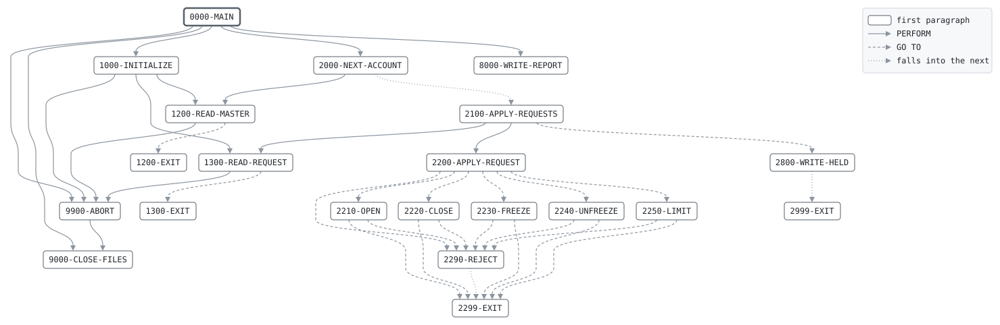

# ACCTMNT

```text
ACCTMNT: ACCOUNT MAINTENANCE

APPLIES THE BRANCHES' MAINTENANCE REQUESTS TO THE MASTER AT
THE END OF THE DAY: OPENS ACCOUNTS, CLOSES THEM, FREEZES AND
UNFREEZES THEM, AND CHANGES OVERDRAFT LIMITS. THE REQUESTS
COME IN ACCOUNT NUMBER ORDER AND ARE MATCHED AGAINST THE
MASTER: EACH ACCOUNT IS HELD WHILE ITS REQUESTS APPLY, THEN
WRITTEN TO THE NEW MASTER. A REQUEST THAT CANNOT APPLY GOES TO
THE REJECTS WITH ITS REASON.

RULES: AN OPENING NEEDS AN ACCOUNT NUMBER NOT YET USED; ANY
OTHER REQUEST AN ACCOUNT THAT EXISTS AND IS NOT CLOSED. ONLY
AN EMPTY ACCOUNT CLOSES. ONLY AN OPEN ACCOUNT FREEZES, ONLY A
FROZEN ONE UNFREEZES. ONLY CURRENT ACCOUNTS HAVE OVERDRAFTS.
MAINTENANCE NEVER MOVES MONEY: THE NEW MASTER MUST HOLD THE
SAME BALANCES AS THE OLD.

RETURN CODES: 0 ALL APPLIED, 4 SOME REJECTED,
              16 INPUT OUT OF ORDER, OUT OF BALANCE OR I/O.

MODIFICATION HISTORY
DATE       BY  CHANGE
1988-05-09 JA  CR-0031 ORIGINAL VERSION.
1994-11-14 PK  CR-0201 OVERDRAFT LIMIT CHANGES.
1999-01-11 SL  Y2K: 8-DIGIT OPEN DATES.
```

Program [ACCTMNT.cbl](../../../pangaea/programs/ACCTMNT.cbl): 6 files, 21 paragraphs. Its business rules: [13 decision tables](../rules/ACCTMNT.md).

- AUTHOR: J. ARKWRIGHT, BATCH SYSTEMS.
- INSTALLATION: FIRST BANK OF PANGAEA, DATA CENTER.
- DATE-WRITTEN: 1988-05-09.

## Contents

- [Files](#files)
- [Flow](#flow)
- [Paragraphs](#paragraphs)
- [Data flow](#data-flow)
- [Lineage](#lineage)
  - [Into BANK-CONTROL-RECORD](#into-bank-control-record)
  - [Into ACCT-IN-RECORD](#into-acct-in-record)
  - [Into MAINT-REQUEST](#into-maint-request)
  - [Into ACCT-OUT-RECORD](#into-acct-out-record)
  - [Into REJECT-OUT-RECORD](#into-reject-out-record)
  - [Into REPORT-LINE](#into-report-line)
  - [Into WS-BUSINESS-DATE](#into-ws-business-date)
  - [Into WS-ABORT-MESSAGE](#into-ws-abort-message)
  - [Into WS-MASTER-KEY](#into-ws-master-key)
  - [Into WS-REQUEST-KEY](#into-ws-request-key)
  - [Into WS-ACTIVE-KEY](#into-ws-active-key)
  - [Into WS-PREV-MASTER-KEY](#into-ws-prev-master-key)
  - [Into WS-REQUEST-ORDER-KEY](#into-ws-request-order-key)
  - [Into WS-PREV-REQUEST-ORDER-KEY](#into-ws-prev-request-order-key)
  - [Into WS-HELD-SW](#into-ws-held-sw)
  - [Into ACCT-MASTER-RECORD](#into-acct-master-record)
  - [Into REJECT-RECORD](#into-reject-record)
  - [Into WS-TOTALS](#into-ws-totals)
  - [Into WS-REPORT-COUNT-LINE](#into-ws-report-count-line)
  - [Into WS-REPORT-AMOUNT-LINE](#into-ws-report-amount-line)
  - [Into files](#into-files)
  - [Into other data items](#into-other-data-items)
- [Field origins](#field-origins)
  - [File REJECT-OUT](#file-reject-out)
  - [File ACCT-OUT](#file-acct-out)
  - [File REPORT-OUT](#file-report-out)
- [Records](#records)
  - [BANK-CONTROL-RECORD](#bank-control-record)
  - [ACCT-IN-RECORD](#acct-in-record)
  - [MAINT-REQUEST](#maint-request)
  - [ACCT-OUT-RECORD](#acct-out-record)
  - [REJECT-OUT-RECORD](#reject-out-record)
  - [REPORT-LINE](#report-line)
  - [WS-FILE-STATUSES](#ws-file-statuses)
  - [WS-BUSINESS-DATE](#ws-business-date)
  - [WS-ABORT-MESSAGE](#ws-abort-message)
  - [WS-MASTER-KEY](#ws-master-key)
  - [WS-REQUEST-KEY](#ws-request-key)
  - [WS-ACTIVE-KEY](#ws-active-key)
  - [WS-PREV-MASTER-KEY](#ws-prev-master-key)
  - [WS-REQUEST-ORDER-KEY](#ws-request-order-key)
  - [WS-PREV-REQUEST-ORDER-KEY](#ws-prev-request-order-key)
  - [WS-HELD-SW](#ws-held-sw)
  - [ACCT-MASTER-RECORD](#acct-master-record)
  - [REJECT-RECORD](#reject-record)
  - [WS-TOTALS](#ws-totals)
  - [WS-REPORT-COUNT-LINE](#ws-report-count-line)
  - [WS-REPORT-AMOUNT-LINE](#ws-report-amount-line)

## Files

| File | Kind | Assigned to | Organization | Status field | Opened | Records |
| --- | --- | --- | --- | --- | --- | --- |
| CONTROL-FILE | FD | BANKCTL | SEQUENTIAL | WS-CONTROL-STATUS | INPUT | BANK-CONTROL-RECORD |
| ACCT-IN | FD | ACCTIN | SEQUENTIAL | WS-ACCT-IN-STATUS | INPUT | ACCT-IN-RECORD |
| MAINT-IN | FD | MAINTIN | SEQUENTIAL | WS-MAINT-IN-STATUS | INPUT | MAINT-REQUEST |
| ACCT-OUT | FD | ACCTOUT | SEQUENTIAL | WS-ACCT-OUT-STATUS | OUTPUT | ACCT-OUT-RECORD |
| REJECT-OUT | FD | REJECTS | SEQUENTIAL | WS-REJECT-STATUS | OUTPUT | REJECT-OUT-RECORD |
| REPORT-OUT | FD | MNTRPT | LINE SEQUENTIAL | WS-REPORT-STATUS | OUTPUT | REPORT-LINE |

## Flow



## Paragraphs

| Paragraph | Description | Source | Performs | Goes to | Performed by | Reached by |
| --- | --- | --- | --- | --- | --- | --- |
| 0000-MAIN | MATCH UNTIL BOTH FILES END, THEN RECONCILE AND REPORT. | [ACCTMNT.cbl:128](../../../pangaea/programs/ACCTMNT.cbl#L128) | 1000-INITIALIZE, 2000-NEXT-ACCOUNT THRU 2999-EXIT, 9900-ABORT, 8000-WRITE-REPORT, 9000-CLOSE-FILES | | | |
| 1000-INITIALIZE | OPEN THE FILES AND READ THE FIRST RECORD OF EACH. | [ACCTMNT.cbl:145](../../../pangaea/programs/ACCTMNT.cbl#L145) | 9900-ABORT, 1200-READ-MASTER THRU 1200-EXIT, 1300-READ-REQUEST THRU 1300-EXIT | | 0000-MAIN | |
| 1200-READ-MASTER | READ THE NEXT OLD MASTER RECORD, CHECKING ACCOUNT ORDER. | [ACCTMNT.cbl:162](../../../pangaea/programs/ACCTMNT.cbl#L162) | 9900-ABORT | 1200-EXIT, 1200-EXIT (falls into) | 1000-INITIALIZE, 2000-NEXT-ACCOUNT | |
| 1200-EXIT | | [ACCTMNT.cbl:173](../../../pangaea/programs/ACCTMNT.cbl#L173) | | | 1000-INITIALIZE, 2000-NEXT-ACCOUNT | 1200-READ-MASTER |
| 1300-READ-REQUEST | READ THE NEXT REQUEST, CHECKING ITS ORDER. | [ACCTMNT.cbl:177](../../../pangaea/programs/ACCTMNT.cbl#L177) | 9900-ABORT | 1300-EXIT, 1300-EXIT (falls into) | 1000-INITIALIZE, 2100-APPLY-REQUESTS | |
| 1300-EXIT | | [ACCTMNT.cbl:189](../../../pangaea/programs/ACCTMNT.cbl#L189) | | | 1000-INITIALIZE, 2100-APPLY-REQUESTS | 1300-READ-REQUEST |
| 2000-NEXT-ACCOUNT | TAKE THE LOWER KEY AS THE ACTIVE ACCOUNT, AND HOLD IT IF THE MASTER HAS IT. AN ACCOUNT ONLY THE REQUESTS NAME IS NOT HELD UNTIL AN OPENING MAKES IT. | [ACCTMNT.cbl:195](../../../pangaea/programs/ACCTMNT.cbl#L195) | 1200-READ-MASTER THRU 1200-EXIT | 2100-APPLY-REQUESTS (falls into) | 0000-MAIN | |
| 2100-APPLY-REQUESTS | APPLY THE ACTIVE ACCOUNT'S REQUESTS, ONE AFTER THE OTHER. | [ACCTMNT.cbl:207](../../../pangaea/programs/ACCTMNT.cbl#L207) | 2200-APPLY-REQUEST THRU 2299-EXIT, 1300-READ-REQUEST THRU 1300-EXIT | 2800-WRITE-HELD, 2100-APPLY-REQUESTS | 0000-MAIN | 2000-NEXT-ACCOUNT, 2100-APPLY-REQUESTS |
| 2200-APPLY-REQUEST | APPLY ONE REQUEST BY ITS TYPE. | [ACCTMNT.cbl:215](../../../pangaea/programs/ACCTMNT.cbl#L215) | | 2210-OPEN, 2290-REJECT, 2220-CLOSE, 2230-FREEZE, 2240-UNFREEZE, 2250-LIMIT | 0000-MAIN, 2100-APPLY-REQUESTS | |
| 2210-OPEN | OPEN A NEW ACCOUNT, EMPTY, FROM TODAY. | [ACCTMNT.cbl:236](../../../pangaea/programs/ACCTMNT.cbl#L236) | | 2290-REJECT, 2299-EXIT | 0000-MAIN, 2100-APPLY-REQUESTS | 2200-APPLY-REQUEST |
| 2220-CLOSE | CLOSE AN ACCOUNT, IF IT IS EMPTY. | [ACCTMNT.cbl:256](../../../pangaea/programs/ACCTMNT.cbl#L256) | | 2290-REJECT, 2299-EXIT | 0000-MAIN, 2100-APPLY-REQUESTS | 2200-APPLY-REQUEST |
| 2230-FREEZE | FREEZE AN OPEN ACCOUNT. | [ACCTMNT.cbl:266](../../../pangaea/programs/ACCTMNT.cbl#L266) | | 2290-REJECT, 2299-EXIT | 0000-MAIN, 2100-APPLY-REQUESTS | 2200-APPLY-REQUEST |
| 2240-UNFREEZE | UNFREEZE A FROZEN ACCOUNT. | [ACCTMNT.cbl:275](../../../pangaea/programs/ACCTMNT.cbl#L275) | | 2290-REJECT, 2299-EXIT | 0000-MAIN, 2100-APPLY-REQUESTS | 2200-APPLY-REQUEST |
| 2250-LIMIT | CHANGE A CURRENT ACCOUNT'S OVERDRAFT LIMIT. | [ACCTMNT.cbl:284](../../../pangaea/programs/ACCTMNT.cbl#L284) | | 2290-REJECT, 2299-EXIT | 0000-MAIN, 2100-APPLY-REQUESTS | 2200-APPLY-REQUEST |
| 2290-REJECT | WRITE THE REQUEST TO THE REJECTS WITH ITS REASON. | [ACCTMNT.cbl:293](../../../pangaea/programs/ACCTMNT.cbl#L293) | | 2299-EXIT (falls into) | 0000-MAIN, 2100-APPLY-REQUESTS | 2200-APPLY-REQUEST, 2210-OPEN, 2220-CLOSE, 2230-FREEZE, 2240-UNFREEZE, 2250-LIMIT |
| 2299-EXIT | | [ACCTMNT.cbl:298](../../../pangaea/programs/ACCTMNT.cbl#L298) | | | 0000-MAIN, 2100-APPLY-REQUESTS | 2210-OPEN, 2220-CLOSE, 2230-FREEZE, 2240-UNFREEZE, 2250-LIMIT, 2290-REJECT |
| 2800-WRITE-HELD | WRITE THE HELD ACCOUNT, ITS REQUESTS APPLIED, TO THE NEW MASTER. | [ACCTMNT.cbl:302](../../../pangaea/programs/ACCTMNT.cbl#L302) | | 2999-EXIT (falls into) | 0000-MAIN | 2100-APPLY-REQUESTS |
| 2999-EXIT | | [ACCTMNT.cbl:307](../../../pangaea/programs/ACCTMNT.cbl#L307) | | | 0000-MAIN | 2800-WRITE-HELD |
| 8000-WRITE-REPORT | WRITE THE MAINTENANCE REPORT. | [ACCTMNT.cbl:311](../../../pangaea/programs/ACCTMNT.cbl#L311) | | | 0000-MAIN | |
| 9000-CLOSE-FILES | CLOSE ALL FILES. | [ACCTMNT.cbl:357](../../../pangaea/programs/ACCTMNT.cbl#L357) | | | 0000-MAIN, 9900-ABORT | |
| 9900-ABORT | STOP THE RUN WITH RETURN CODE 16, SAYING WHY. | [ACCTMNT.cbl:362](../../../pangaea/programs/ACCTMNT.cbl#L362) | 9000-CLOSE-FILES | | 0000-MAIN, 1000-INITIALIZE, 1200-READ-MASTER, 1300-READ-REQUEST | |

## Data flow

| Paragraph | Reads | Writes |
| --- | --- | --- |
| 0000-MAIN | WS-MASTER-KEY, WS-REQUEST-KEY, WS-BALANCES-OUT, WS-BALANCES-IN, WS-REJECT-COUNT | WS-ABORT-MESSAGE, RETURN-CODE |
| 1000-INITIALIZE | WS-FILE-STATUSES, BC-BUSINESS-DATE | RETURN-CODE, BANK-CONTROL-RECORD, WS-ABORT-MESSAGE, WS-BUSINESS-DATE, REJECT-RECORD |
| 1200-READ-MASTER | AI-ACCT-NO, WS-MASTER-KEY, WS-PREV-MASTER-KEY, WS-MASTERS-READ | ACCT-IN-RECORD, WS-MASTER-KEY, WS-ABORT-MESSAGE, WS-PREV-MASTER-KEY, WS-MASTERS-READ |
| 1200-EXIT | | |
| 1300-READ-REQUEST | MR-ACCT-NO, MR-REQUEST-ID, WS-REQUEST-ORDER-KEY, WS-PREV-REQUEST-ORDER-KEY, WS-REQUEST-COUNT | MAINT-REQUEST, WS-REQUEST-KEY, WS-ROK-ACCT-NO, WS-ROK-REQUEST-ID, WS-ABORT-MESSAGE, WS-PREV-REQUEST-ORDER-KEY, WS-REQUEST-COUNT |
| 1300-EXIT | | |
| 2000-NEXT-ACCOUNT | WS-MASTER-KEY, WS-REQUEST-KEY, WS-ACTIVE-KEY, ACCT-IN-RECORD, AM-BALANCE, WS-BALANCES-IN | WS-ACTIVE-KEY, WS-HELD-SW, ACCT-MASTER-RECORD, WS-BALANCES-IN |
| 2100-APPLY-REQUESTS | WS-REQUEST-KEY, WS-ACTIVE-KEY | |
| 2200-APPLY-REQUEST | MR-REQUEST-TYPE, WS-HELD-SW, AM-STATUS | RJ-REASON |
| 2210-OPEN | WS-HELD-SW, MR-ACCT-NO, MR-CUST-NO, MR-SHORT-NAME, MR-ACCT-TYPE, WS-BUSINESS-DATE, MR-OVERDRAFT-LIMIT, AM-ACCT-TYPE, WS-OPENED-COUNT | RJ-REASON, ACCT-MASTER-RECORD, AM-ACCT-NO, AM-CUST-NO, AM-SHORT-NAME, AM-ACCT-TYPE, AM-STATUS, AM-OPEN-DATE, AM-LAST-ACTIVITY-DATE, AM-BALANCE, AM-OVERDRAFT-LIMIT, WS-HELD-SW, WS-OPENED-COUNT |
| 2220-CLOSE | AM-BALANCE, WS-CLOSED-COUNT | RJ-REASON, AM-STATUS, AM-OVERDRAFT-LIMIT, WS-CLOSED-COUNT |
| 2230-FREEZE | AM-STATUS, WS-FROZEN-COUNT | RJ-REASON, AM-STATUS, WS-FROZEN-COUNT |
| 2240-UNFREEZE | AM-STATUS, WS-UNFROZEN-COUNT | RJ-REASON, AM-STATUS, WS-UNFROZEN-COUNT |
| 2250-LIMIT | AM-ACCT-TYPE, MR-OVERDRAFT-LIMIT, WS-LIMIT-COUNT | RJ-REASON, AM-OVERDRAFT-LIMIT, WS-LIMIT-COUNT |
| 2290-REJECT | MAINT-REQUEST, REJECT-RECORD, WS-REJECT-COUNT | RJ-PROGRAM, RJ-TRAN, REJECT-OUT-RECORD, WS-REJECT-COUNT |
| 2299-EXIT | | |
| 2800-WRITE-HELD | WS-HELD-SW, ACCT-MASTER-RECORD, WS-MASTERS-WRITTEN, AM-BALANCE, WS-BALANCES-OUT | ACCT-OUT-RECORD, WS-MASTERS-WRITTEN, WS-BALANCES-OUT |
| 2999-EXIT | | |
| 8000-WRITE-REPORT | WS-BUSINESS-DATE, WS-MASTERS-READ, WS-REPORT-COUNT-LINE, WS-MASTERS-WRITTEN, WS-REQUEST-COUNT, WS-OPENED-COUNT, WS-CLOSED-COUNT, WS-FROZEN-COUNT, WS-UNFROZEN-COUNT, WS-LIMIT-COUNT, WS-REJECT-COUNT, WS-BALANCES-OUT, WS-REPORT-AMOUNT-LINE | REPORT-LINE, WS-RC-LABEL, WS-RC-VALUE, WS-RA-LABEL, WS-RA-VALUE |
| 9000-CLOSE-FILES | | |
| 9900-ABORT | WS-ABORT-MESSAGE | RETURN-CODE |

## Lineage

Where each data item's values come from, grouped by the record they go into. A data item links to the record it belongs to.

### Into BANK-CONTROL-RECORD

Record [BANK-CONTROL-RECORD](#bank-control-record), from copybook [BANKCTL](../copybooks/BANKCTL.md).

| Into | From | Statement | Paragraph | Source |
| --- | --- | --- | --- | --- |
| BANK-CONTROL-RECORD | file CONTROL-FILE | READ | 1000-INITIALIZE | [ACCTMNT.cbl:152](../../../pangaea/programs/ACCTMNT.cbl#L152) |

### Into ACCT-IN-RECORD

Record [ACCT-IN-RECORD](#acct-in-record).

| Into | From | Statement | Paragraph | Source |
| --- | --- | --- | --- | --- |
| ACCT-IN-RECORD | file ACCT-IN | READ | 1200-READ-MASTER | [ACCTMNT.cbl:163](../../../pangaea/programs/ACCTMNT.cbl#L163) |

### Into MAINT-REQUEST

Record [MAINT-REQUEST](#maint-request), from copybook [MAINTREC](../copybooks/MAINTREC.md).

| Into | From | Statement | Paragraph | Source |
| --- | --- | --- | --- | --- |
| MAINT-REQUEST | file MAINT-IN | READ | 1300-READ-REQUEST | [ACCTMNT.cbl:178](../../../pangaea/programs/ACCTMNT.cbl#L178) |

### Into ACCT-OUT-RECORD

Record [ACCT-OUT-RECORD](#acct-out-record).

| Into | From | Statement | Paragraph | Source |
| --- | --- | --- | --- | --- |
| ACCT-OUT-RECORD | [ACCT-MASTER-RECORD](#acct-master-record) | WRITE | 2800-WRITE-HELD | [ACCTMNT.cbl:304](../../../pangaea/programs/ACCTMNT.cbl#L304) |

### Into REJECT-OUT-RECORD

Record [REJECT-OUT-RECORD](#reject-out-record).

| Into | From | Statement | Paragraph | Source |
| --- | --- | --- | --- | --- |
| REJECT-OUT-RECORD | [REJECT-RECORD](#reject-record) | WRITE | 2290-REJECT | [ACCTMNT.cbl:296](../../../pangaea/programs/ACCTMNT.cbl#L296) |

### Into REPORT-LINE

Record [REPORT-LINE](#report-line).

| Into | From | Statement | Paragraph | Source |
| --- | --- | --- | --- | --- |
| REPORT-LINE | literal SPACES | MOVE | 8000-WRITE-REPORT | [ACCTMNT.cbl:312](../../../pangaea/programs/ACCTMNT.cbl#L312) |
| REPORT-LINE | literal 'ACCTMNT  ACCOUNT MAINTENANCE     BUSINESS DATE ' | STRING | 8000-WRITE-REPORT | [ACCTMNT.cbl:313](../../../pangaea/programs/ACCTMNT.cbl#L313) |
| REPORT-LINE | [WS-BUSINESS-DATE](#ws-business-date) | STRING | 8000-WRITE-REPORT | [ACCTMNT.cbl:313](../../../pangaea/programs/ACCTMNT.cbl#L313) |
| REPORT-LINE | literal SPACES | MOVE | 8000-WRITE-REPORT | [ACCTMNT.cbl:317](../../../pangaea/programs/ACCTMNT.cbl#L317) |
| REPORT-LINE | [WS-REPORT-COUNT-LINE](#ws-report-count-line) | WRITE | 8000-WRITE-REPORT | [ACCTMNT.cbl:321](../../../pangaea/programs/ACCTMNT.cbl#L321) |
| REPORT-LINE | [WS-REPORT-COUNT-LINE](#ws-report-count-line) | WRITE | 8000-WRITE-REPORT | [ACCTMNT.cbl:324](../../../pangaea/programs/ACCTMNT.cbl#L324) |
| REPORT-LINE | [WS-REPORT-COUNT-LINE](#ws-report-count-line) | WRITE | 8000-WRITE-REPORT | [ACCTMNT.cbl:327](../../../pangaea/programs/ACCTMNT.cbl#L327) |
| REPORT-LINE | [WS-REPORT-COUNT-LINE](#ws-report-count-line) | WRITE | 8000-WRITE-REPORT | [ACCTMNT.cbl:330](../../../pangaea/programs/ACCTMNT.cbl#L330) |
| REPORT-LINE | [WS-REPORT-COUNT-LINE](#ws-report-count-line) | WRITE | 8000-WRITE-REPORT | [ACCTMNT.cbl:333](../../../pangaea/programs/ACCTMNT.cbl#L333) |
| REPORT-LINE | [WS-REPORT-COUNT-LINE](#ws-report-count-line) | WRITE | 8000-WRITE-REPORT | [ACCTMNT.cbl:336](../../../pangaea/programs/ACCTMNT.cbl#L336) |
| REPORT-LINE | [WS-REPORT-COUNT-LINE](#ws-report-count-line) | WRITE | 8000-WRITE-REPORT | [ACCTMNT.cbl:339](../../../pangaea/programs/ACCTMNT.cbl#L339) |
| REPORT-LINE | [WS-REPORT-COUNT-LINE](#ws-report-count-line) | WRITE | 8000-WRITE-REPORT | [ACCTMNT.cbl:342](../../../pangaea/programs/ACCTMNT.cbl#L342) |
| REPORT-LINE | [WS-REPORT-COUNT-LINE](#ws-report-count-line) | WRITE | 8000-WRITE-REPORT | [ACCTMNT.cbl:345](../../../pangaea/programs/ACCTMNT.cbl#L345) |
| REPORT-LINE | literal SPACES | MOVE | 8000-WRITE-REPORT | [ACCTMNT.cbl:346](../../../pangaea/programs/ACCTMNT.cbl#L346) |
| REPORT-LINE | [WS-REPORT-AMOUNT-LINE](#ws-report-amount-line) | WRITE | 8000-WRITE-REPORT | [ACCTMNT.cbl:350](../../../pangaea/programs/ACCTMNT.cbl#L350) |
| REPORT-LINE | literal SPACES | MOVE | 8000-WRITE-REPORT | [ACCTMNT.cbl:351](../../../pangaea/programs/ACCTMNT.cbl#L351) |
| REPORT-LINE | literal 'NEW MASTER IN BALANCE' | MOVE | 8000-WRITE-REPORT | [ACCTMNT.cbl:353](../../../pangaea/programs/ACCTMNT.cbl#L353) |

### Into WS-BUSINESS-DATE

Record [WS-BUSINESS-DATE](#ws-business-date).

| Into | From | Statement | Paragraph | Source |
| --- | --- | --- | --- | --- |
| WS-BUSINESS-DATE | [BC-BUSINESS-DATE](#bank-control-record "in BANK-CONTROL-RECORD") | MOVE | 1000-INITIALIZE | [ACCTMNT.cbl:156](../../../pangaea/programs/ACCTMNT.cbl#L156) |

### Into WS-ABORT-MESSAGE

Record [WS-ABORT-MESSAGE](#ws-abort-message).

| Into | From | Statement | Paragraph | Source |
| --- | --- | --- | --- | --- |
| WS-ABORT-MESSAGE | literal 'NEW MASTER OUT OF BALANCE' | MOVE | 0000-MAIN | [ACCTMNT.cbl:134](../../../pangaea/programs/ACCTMNT.cbl#L134) |
| WS-ABORT-MESSAGE | literal 'NO BANK CONTROL RECORD' | MOVE | 1000-INITIALIZE | [ACCTMNT.cbl:154](../../../pangaea/programs/ACCTMNT.cbl#L154) |
| WS-ABORT-MESSAGE | literal 'MASTER NOT IN ACCOUNT ORDER' | MOVE | 1200-READ-MASTER | [ACCTMNT.cbl:169](../../../pangaea/programs/ACCTMNT.cbl#L169) |
| WS-ABORT-MESSAGE | literal 'REQUESTS NOT IN ACCOUNT ORDER' | MOVE | 1300-READ-REQUEST | [ACCTMNT.cbl:185](../../../pangaea/programs/ACCTMNT.cbl#L185) |

### Into WS-MASTER-KEY

Record [WS-MASTER-KEY](#ws-master-key).

| Into | From | Statement | Paragraph | Source |
| --- | --- | --- | --- | --- |
| WS-MASTER-KEY | literal HIGH-VALUES | MOVE | 1200-READ-MASTER | [ACCTMNT.cbl:165](../../../pangaea/programs/ACCTMNT.cbl#L165) |
| WS-MASTER-KEY | [AI-ACCT-NO](#acct-in-record "in ACCT-IN-RECORD") | MOVE | 1200-READ-MASTER | [ACCTMNT.cbl:167](../../../pangaea/programs/ACCTMNT.cbl#L167) |

### Into WS-REQUEST-KEY

Record [WS-REQUEST-KEY](#ws-request-key).

| Into | From | Statement | Paragraph | Source |
| --- | --- | --- | --- | --- |
| WS-REQUEST-KEY | literal HIGH-VALUES | MOVE | 1300-READ-REQUEST | [ACCTMNT.cbl:180](../../../pangaea/programs/ACCTMNT.cbl#L180) |
| WS-REQUEST-KEY | [MR-ACCT-NO](#maint-request "in MAINT-REQUEST") | MOVE | 1300-READ-REQUEST | [ACCTMNT.cbl:182](../../../pangaea/programs/ACCTMNT.cbl#L182) |

### Into WS-ACTIVE-KEY

Record [WS-ACTIVE-KEY](#ws-active-key).

| Into | From | Statement | Paragraph | Source |
| --- | --- | --- | --- | --- |
| WS-ACTIVE-KEY | [WS-MASTER-KEY](#ws-master-key) | MOVE | 2000-NEXT-ACCOUNT | [ACCTMNT.cbl:196](../../../pangaea/programs/ACCTMNT.cbl#L196) |
| WS-ACTIVE-KEY | [WS-REQUEST-KEY](#ws-request-key) | MOVE | 2000-NEXT-ACCOUNT | [ACCTMNT.cbl:198](../../../pangaea/programs/ACCTMNT.cbl#L198) |

### Into WS-PREV-MASTER-KEY

Record [WS-PREV-MASTER-KEY](#ws-prev-master-key).

| Into | From | Statement | Paragraph | Source |
| --- | --- | --- | --- | --- |
| WS-PREV-MASTER-KEY | [WS-MASTER-KEY](#ws-master-key) | MOVE | 1200-READ-MASTER | [ACCTMNT.cbl:171](../../../pangaea/programs/ACCTMNT.cbl#L171) |

### Into WS-REQUEST-ORDER-KEY

Record [WS-REQUEST-ORDER-KEY](#ws-request-order-key).

| Into | From | Statement | Paragraph | Source |
| --- | --- | --- | --- | --- |
| WS-ROK-ACCT-NO | [MR-ACCT-NO](#maint-request "in MAINT-REQUEST") | MOVE | 1300-READ-REQUEST | [ACCTMNT.cbl:182](../../../pangaea/programs/ACCTMNT.cbl#L182) |
| WS-ROK-REQUEST-ID | [MR-REQUEST-ID](#maint-request "in MAINT-REQUEST") | MOVE | 1300-READ-REQUEST | [ACCTMNT.cbl:183](../../../pangaea/programs/ACCTMNT.cbl#L183) |

### Into WS-PREV-REQUEST-ORDER-KEY

Record [WS-PREV-REQUEST-ORDER-KEY](#ws-prev-request-order-key).

| Into | From | Statement | Paragraph | Source |
| --- | --- | --- | --- | --- |
| WS-PREV-REQUEST-ORDER-KEY | [WS-REQUEST-ORDER-KEY](#ws-request-order-key) | MOVE | 1300-READ-REQUEST | [ACCTMNT.cbl:187](../../../pangaea/programs/ACCTMNT.cbl#L187) |

### Into WS-HELD-SW

Record [WS-HELD-SW](#ws-held-sw).

| Into | From | Statement | Paragraph | Source |
| --- | --- | --- | --- | --- |
| WS-HELD-SW | literal condition NOTHING-HELD | SET | 2000-NEXT-ACCOUNT | [ACCTMNT.cbl:199](../../../pangaea/programs/ACCTMNT.cbl#L199) |
| WS-HELD-SW | literal condition ACCOUNT-HELD | SET | 2000-NEXT-ACCOUNT | [ACCTMNT.cbl:203](../../../pangaea/programs/ACCTMNT.cbl#L203) |
| WS-HELD-SW | literal condition ACCOUNT-HELD | SET | 2210-OPEN | [ACCTMNT.cbl:251](../../../pangaea/programs/ACCTMNT.cbl#L251) |

### Into ACCT-MASTER-RECORD

Record [ACCT-MASTER-RECORD](#acct-master-record), from copybook [ACCTMAST](../copybooks/ACCTMAST.md).

| Into | From | Statement | Paragraph | Source |
| --- | --- | --- | --- | --- |
| ACCT-MASTER-RECORD | [ACCT-IN-RECORD](#acct-in-record) | MOVE | 2000-NEXT-ACCOUNT | [ACCTMNT.cbl:201](../../../pangaea/programs/ACCTMNT.cbl#L201) |
| ACCT-MASTER-RECORD | literal SPACES | MOVE | 2210-OPEN | [ACCTMNT.cbl:240](../../../pangaea/programs/ACCTMNT.cbl#L240) |
| AM-ACCT-NO | [MR-ACCT-NO](#maint-request "in MAINT-REQUEST") | MOVE | 2210-OPEN | [ACCTMNT.cbl:241](../../../pangaea/programs/ACCTMNT.cbl#L241) |
| AM-ACCT-TYPE | [MR-ACCT-TYPE](#maint-request "in MAINT-REQUEST") | MOVE | 2210-OPEN | [ACCTMNT.cbl:244](../../../pangaea/programs/ACCTMNT.cbl#L244) |
| AM-BALANCE | literal 0 | MOVE | 2210-OPEN | [ACCTMNT.cbl:247](../../../pangaea/programs/ACCTMNT.cbl#L247) |
| AM-CUST-NO | [MR-CUST-NO](#maint-request "in MAINT-REQUEST") | MOVE | 2210-OPEN | [ACCTMNT.cbl:242](../../../pangaea/programs/ACCTMNT.cbl#L242) |
| AM-LAST-ACTIVITY-DATE | [WS-BUSINESS-DATE](#ws-business-date) | MOVE | 2210-OPEN | [ACCTMNT.cbl:246](../../../pangaea/programs/ACCTMNT.cbl#L246) |
| AM-OPEN-DATE | [WS-BUSINESS-DATE](#ws-business-date) | MOVE | 2210-OPEN | [ACCTMNT.cbl:246](../../../pangaea/programs/ACCTMNT.cbl#L246) |
| AM-OVERDRAFT-LIMIT | [MR-OVERDRAFT-LIMIT](#maint-request "in MAINT-REQUEST") | MOVE | 2210-OPEN | [ACCTMNT.cbl:248](../../../pangaea/programs/ACCTMNT.cbl#L248) |
| AM-OVERDRAFT-LIMIT | literal 0 | MOVE | 2210-OPEN | [ACCTMNT.cbl:250](../../../pangaea/programs/ACCTMNT.cbl#L250) |
| AM-OVERDRAFT-LIMIT | literal 0 | MOVE | 2220-CLOSE | [ACCTMNT.cbl:261](../../../pangaea/programs/ACCTMNT.cbl#L261) |
| AM-OVERDRAFT-LIMIT | [MR-OVERDRAFT-LIMIT](#maint-request "in MAINT-REQUEST") | MOVE | 2250-LIMIT | [ACCTMNT.cbl:288](../../../pangaea/programs/ACCTMNT.cbl#L288) |
| AM-SHORT-NAME | [MR-SHORT-NAME](#maint-request "in MAINT-REQUEST") | MOVE | 2210-OPEN | [ACCTMNT.cbl:243](../../../pangaea/programs/ACCTMNT.cbl#L243) |
| AM-STATUS | literal condition AM-OPEN | SET | 2210-OPEN | [ACCTMNT.cbl:245](../../../pangaea/programs/ACCTMNT.cbl#L245) |
| AM-STATUS | literal condition AM-CLOSED | SET | 2220-CLOSE | [ACCTMNT.cbl:260](../../../pangaea/programs/ACCTMNT.cbl#L260) |
| AM-STATUS | literal condition AM-FROZEN | SET | 2230-FREEZE | [ACCTMNT.cbl:270](../../../pangaea/programs/ACCTMNT.cbl#L270) |
| AM-STATUS | literal condition AM-OPEN | SET | 2240-UNFREEZE | [ACCTMNT.cbl:279](../../../pangaea/programs/ACCTMNT.cbl#L279) |

### Into REJECT-RECORD

Record [REJECT-RECORD](#reject-record), from copybook [REJREC](../copybooks/REJREC.md).

| Into | From | Statement | Paragraph | Source |
| --- | --- | --- | --- | --- |
| REJECT-RECORD | literal SPACES | MOVE | 1000-INITIALIZE | [ACCTMNT.cbl:157](../../../pangaea/programs/ACCTMNT.cbl#L157) |
| RJ-PROGRAM | literal 'ACCTMNT' | MOVE | 2290-REJECT | [ACCTMNT.cbl:294](../../../pangaea/programs/ACCTMNT.cbl#L294) |
| RJ-REASON | literal condition RJ-NO-ACCOUNT | SET | 2200-APPLY-REQUEST | [ACCTMNT.cbl:219](../../../pangaea/programs/ACCTMNT.cbl#L219) |
| RJ-REASON | literal condition RJ-CLOSED | SET | 2200-APPLY-REQUEST | [ACCTMNT.cbl:222](../../../pangaea/programs/ACCTMNT.cbl#L222) |
| RJ-REASON | literal condition RJ-BAD-TYPE | SET | 2200-APPLY-REQUEST | [ACCTMNT.cbl:232](../../../pangaea/programs/ACCTMNT.cbl#L232) |
| RJ-REASON | literal condition RJ-EXISTS | SET | 2210-OPEN | [ACCTMNT.cbl:238](../../../pangaea/programs/ACCTMNT.cbl#L238) |
| RJ-REASON | literal condition RJ-HAS-BALANCE | SET | 2220-CLOSE | [ACCTMNT.cbl:258](../../../pangaea/programs/ACCTMNT.cbl#L258) |
| RJ-REASON | literal condition RJ-BAD-STATUS | SET | 2230-FREEZE | [ACCTMNT.cbl:268](../../../pangaea/programs/ACCTMNT.cbl#L268) |
| RJ-REASON | literal condition RJ-BAD-STATUS | SET | 2240-UNFREEZE | [ACCTMNT.cbl:277](../../../pangaea/programs/ACCTMNT.cbl#L277) |
| RJ-REASON | literal condition RJ-BAD-TYPE | SET | 2250-LIMIT | [ACCTMNT.cbl:286](../../../pangaea/programs/ACCTMNT.cbl#L286) |
| RJ-TRAN | [MAINT-REQUEST](#maint-request) | MOVE | 2290-REJECT | [ACCTMNT.cbl:295](../../../pangaea/programs/ACCTMNT.cbl#L295) |

### Into WS-TOTALS

Record [WS-TOTALS](#ws-totals).

| Into | From | Statement | Paragraph | Source |
| --- | --- | --- | --- | --- |
| WS-BALANCES-IN | [AM-BALANCE](#acct-master-record "in ACCT-MASTER-RECORD") | ADD | 2000-NEXT-ACCOUNT | [ACCTMNT.cbl:202](../../../pangaea/programs/ACCTMNT.cbl#L202) |
| WS-BALANCES-OUT | [AM-BALANCE](#acct-master-record "in ACCT-MASTER-RECORD") | ADD | 2800-WRITE-HELD | [ACCTMNT.cbl:306](../../../pangaea/programs/ACCTMNT.cbl#L306) |
| WS-CLOSED-COUNT | literal 1 | ADD | 2220-CLOSE | [ACCTMNT.cbl:262](../../../pangaea/programs/ACCTMNT.cbl#L262) |
| WS-FROZEN-COUNT | literal 1 | ADD | 2230-FREEZE | [ACCTMNT.cbl:271](../../../pangaea/programs/ACCTMNT.cbl#L271) |
| WS-LIMIT-COUNT | literal 1 | ADD | 2250-LIMIT | [ACCTMNT.cbl:289](../../../pangaea/programs/ACCTMNT.cbl#L289) |
| WS-MASTERS-READ | literal 1 | ADD | 1200-READ-MASTER | [ACCTMNT.cbl:172](../../../pangaea/programs/ACCTMNT.cbl#L172) |
| WS-MASTERS-WRITTEN | literal 1 | ADD | 2800-WRITE-HELD | [ACCTMNT.cbl:305](../../../pangaea/programs/ACCTMNT.cbl#L305) |
| WS-OPENED-COUNT | literal 1 | ADD | 2210-OPEN | [ACCTMNT.cbl:252](../../../pangaea/programs/ACCTMNT.cbl#L252) |
| WS-REJECT-COUNT | literal 1 | ADD | 2290-REJECT | [ACCTMNT.cbl:297](../../../pangaea/programs/ACCTMNT.cbl#L297) |
| WS-REQUEST-COUNT | literal 1 | ADD | 1300-READ-REQUEST | [ACCTMNT.cbl:188](../../../pangaea/programs/ACCTMNT.cbl#L188) |
| WS-UNFROZEN-COUNT | literal 1 | ADD | 2240-UNFREEZE | [ACCTMNT.cbl:280](../../../pangaea/programs/ACCTMNT.cbl#L280) |

### Into WS-REPORT-COUNT-LINE

Record [WS-REPORT-COUNT-LINE](#ws-report-count-line).

| Into | From | Statement | Paragraph | Source |
| --- | --- | --- | --- | --- |
| WS-RC-LABEL | literal 'ACCOUNTS READ' | MOVE | 8000-WRITE-REPORT | [ACCTMNT.cbl:319](../../../pangaea/programs/ACCTMNT.cbl#L319) |
| WS-RC-LABEL | literal 'ACCOUNTS WRITTEN' | MOVE | 8000-WRITE-REPORT | [ACCTMNT.cbl:322](../../../pangaea/programs/ACCTMNT.cbl#L322) |
| WS-RC-LABEL | literal 'REQUESTS READ' | MOVE | 8000-WRITE-REPORT | [ACCTMNT.cbl:325](../../../pangaea/programs/ACCTMNT.cbl#L325) |
| WS-RC-LABEL | literal 'ACCOUNTS OPENED' | MOVE | 8000-WRITE-REPORT | [ACCTMNT.cbl:328](../../../pangaea/programs/ACCTMNT.cbl#L328) |
| WS-RC-LABEL | literal 'ACCOUNTS CLOSED' | MOVE | 8000-WRITE-REPORT | [ACCTMNT.cbl:331](../../../pangaea/programs/ACCTMNT.cbl#L331) |
| WS-RC-LABEL | literal 'ACCOUNTS FROZEN' | MOVE | 8000-WRITE-REPORT | [ACCTMNT.cbl:334](../../../pangaea/programs/ACCTMNT.cbl#L334) |
| WS-RC-LABEL | literal 'ACCOUNTS UNFROZEN' | MOVE | 8000-WRITE-REPORT | [ACCTMNT.cbl:337](../../../pangaea/programs/ACCTMNT.cbl#L337) |
| WS-RC-LABEL | literal 'OVERDRAFT LIMITS CHANGED' | MOVE | 8000-WRITE-REPORT | [ACCTMNT.cbl:340](../../../pangaea/programs/ACCTMNT.cbl#L340) |
| WS-RC-LABEL | literal 'REQUESTS REJECTED' | MOVE | 8000-WRITE-REPORT | [ACCTMNT.cbl:343](../../../pangaea/programs/ACCTMNT.cbl#L343) |
| WS-RC-VALUE | [WS-MASTERS-READ](#ws-totals "in WS-TOTALS") | MOVE | 8000-WRITE-REPORT | [ACCTMNT.cbl:320](../../../pangaea/programs/ACCTMNT.cbl#L320) |
| WS-RC-VALUE | [WS-MASTERS-WRITTEN](#ws-totals "in WS-TOTALS") | MOVE | 8000-WRITE-REPORT | [ACCTMNT.cbl:323](../../../pangaea/programs/ACCTMNT.cbl#L323) |
| WS-RC-VALUE | [WS-REQUEST-COUNT](#ws-totals "in WS-TOTALS") | MOVE | 8000-WRITE-REPORT | [ACCTMNT.cbl:326](../../../pangaea/programs/ACCTMNT.cbl#L326) |
| WS-RC-VALUE | [WS-OPENED-COUNT](#ws-totals "in WS-TOTALS") | MOVE | 8000-WRITE-REPORT | [ACCTMNT.cbl:329](../../../pangaea/programs/ACCTMNT.cbl#L329) |
| WS-RC-VALUE | [WS-CLOSED-COUNT](#ws-totals "in WS-TOTALS") | MOVE | 8000-WRITE-REPORT | [ACCTMNT.cbl:332](../../../pangaea/programs/ACCTMNT.cbl#L332) |
| WS-RC-VALUE | [WS-FROZEN-COUNT](#ws-totals "in WS-TOTALS") | MOVE | 8000-WRITE-REPORT | [ACCTMNT.cbl:335](../../../pangaea/programs/ACCTMNT.cbl#L335) |
| WS-RC-VALUE | [WS-UNFROZEN-COUNT](#ws-totals "in WS-TOTALS") | MOVE | 8000-WRITE-REPORT | [ACCTMNT.cbl:338](../../../pangaea/programs/ACCTMNT.cbl#L338) |
| WS-RC-VALUE | [WS-LIMIT-COUNT](#ws-totals "in WS-TOTALS") | MOVE | 8000-WRITE-REPORT | [ACCTMNT.cbl:341](../../../pangaea/programs/ACCTMNT.cbl#L341) |
| WS-RC-VALUE | [WS-REJECT-COUNT](#ws-totals "in WS-TOTALS") | MOVE | 8000-WRITE-REPORT | [ACCTMNT.cbl:344](../../../pangaea/programs/ACCTMNT.cbl#L344) |

### Into WS-REPORT-AMOUNT-LINE

Record [WS-REPORT-AMOUNT-LINE](#ws-report-amount-line).

| Into | From | Statement | Paragraph | Source |
| --- | --- | --- | --- | --- |
| WS-RA-LABEL | literal 'BALANCES' | MOVE | 8000-WRITE-REPORT | [ACCTMNT.cbl:348](../../../pangaea/programs/ACCTMNT.cbl#L348) |
| WS-RA-VALUE | [WS-BALANCES-OUT](#ws-totals "in WS-TOTALS") | MOVE | 8000-WRITE-REPORT | [ACCTMNT.cbl:349](../../../pangaea/programs/ACCTMNT.cbl#L349) |

### Into files

Records written to files.

| Into | From | Statement | Paragraph | Source |
| --- | --- | --- | --- | --- |
| file ACCT-OUT | [ACCT-OUT-RECORD](#acct-out-record) | WRITE | 2800-WRITE-HELD | [ACCTMNT.cbl:304](../../../pangaea/programs/ACCTMNT.cbl#L304) |
| file REJECT-OUT | [REJECT-OUT-RECORD](#reject-out-record) | WRITE | 2290-REJECT | [ACCTMNT.cbl:296](../../../pangaea/programs/ACCTMNT.cbl#L296) |
| file REPORT-OUT | [REPORT-LINE](#report-line) | WRITE | 8000-WRITE-REPORT | [ACCTMNT.cbl:316](../../../pangaea/programs/ACCTMNT.cbl#L316) |
| file REPORT-OUT | [REPORT-LINE](#report-line) | WRITE | 8000-WRITE-REPORT | [ACCTMNT.cbl:318](../../../pangaea/programs/ACCTMNT.cbl#L318) |
| file REPORT-OUT | [REPORT-LINE](#report-line) | WRITE | 8000-WRITE-REPORT | [ACCTMNT.cbl:321](../../../pangaea/programs/ACCTMNT.cbl#L321) |
| file REPORT-OUT | [REPORT-LINE](#report-line) | WRITE | 8000-WRITE-REPORT | [ACCTMNT.cbl:324](../../../pangaea/programs/ACCTMNT.cbl#L324) |
| file REPORT-OUT | [REPORT-LINE](#report-line) | WRITE | 8000-WRITE-REPORT | [ACCTMNT.cbl:327](../../../pangaea/programs/ACCTMNT.cbl#L327) |
| file REPORT-OUT | [REPORT-LINE](#report-line) | WRITE | 8000-WRITE-REPORT | [ACCTMNT.cbl:330](../../../pangaea/programs/ACCTMNT.cbl#L330) |
| file REPORT-OUT | [REPORT-LINE](#report-line) | WRITE | 8000-WRITE-REPORT | [ACCTMNT.cbl:333](../../../pangaea/programs/ACCTMNT.cbl#L333) |
| file REPORT-OUT | [REPORT-LINE](#report-line) | WRITE | 8000-WRITE-REPORT | [ACCTMNT.cbl:336](../../../pangaea/programs/ACCTMNT.cbl#L336) |
| file REPORT-OUT | [REPORT-LINE](#report-line) | WRITE | 8000-WRITE-REPORT | [ACCTMNT.cbl:339](../../../pangaea/programs/ACCTMNT.cbl#L339) |
| file REPORT-OUT | [REPORT-LINE](#report-line) | WRITE | 8000-WRITE-REPORT | [ACCTMNT.cbl:342](../../../pangaea/programs/ACCTMNT.cbl#L342) |
| file REPORT-OUT | [REPORT-LINE](#report-line) | WRITE | 8000-WRITE-REPORT | [ACCTMNT.cbl:345](../../../pangaea/programs/ACCTMNT.cbl#L345) |
| file REPORT-OUT | [REPORT-LINE](#report-line) | WRITE | 8000-WRITE-REPORT | [ACCTMNT.cbl:347](../../../pangaea/programs/ACCTMNT.cbl#L347) |
| file REPORT-OUT | [REPORT-LINE](#report-line) | WRITE | 8000-WRITE-REPORT | [ACCTMNT.cbl:350](../../../pangaea/programs/ACCTMNT.cbl#L350) |
| file REPORT-OUT | [REPORT-LINE](#report-line) | WRITE | 8000-WRITE-REPORT | [ACCTMNT.cbl:352](../../../pangaea/programs/ACCTMNT.cbl#L352) |
| file REPORT-OUT | [REPORT-LINE](#report-line) | WRITE | 8000-WRITE-REPORT | [ACCTMNT.cbl:354](../../../pangaea/programs/ACCTMNT.cbl#L354) |

### Into other data items

Data items the program does not declare, such as special registers and index names.

| Into | From | Statement | Paragraph | Source |
| --- | --- | --- | --- | --- |
| RETURN-CODE | literal 4 | MOVE | 0000-MAIN | [ACCTMNT.cbl:139](../../../pangaea/programs/ACCTMNT.cbl#L139) |
| RETURN-CODE | literal 0 | MOVE | 0000-MAIN | [ACCTMNT.cbl:141](../../../pangaea/programs/ACCTMNT.cbl#L141) |
| RETURN-CODE | literal 16 | MOVE | 1000-INITIALIZE | [ACCTMNT.cbl:150](../../../pangaea/programs/ACCTMNT.cbl#L150) |
| RETURN-CODE | literal 16 | MOVE | 9900-ABORT | [ACCTMNT.cbl:365](../../../pangaea/programs/ACCTMNT.cbl#L365) |

## Field origins

Where the values of each field the program writes to a file come from: the fields of the files it reads, literals, and initial values, followed through every statement that moves a value, and through groups and redefinitions by the bytes they share.

### File REJECT-OUT

Written from [REJECT-RECORD](#reject-record).

| Field | Position | Origins |
| --- | --: | --- |
| RJ-PROGRAM | 1-8 | literal 'ACCTMNT' |
| RJ-REASON | 9-12 | literal condition RJ-BAD-STATUS; literal condition RJ-BAD-TYPE; literal condition RJ-CLOSED; literal condition RJ-EXISTS; literal condition RJ-HAS-BALANCE; literal condition RJ-NO-ACCOUNT |
| RJ-TRAN | 13-92 | file MAINT-IN MAINT-REQUEST |

### File ACCT-OUT

Written from [ACCT-MASTER-RECORD](#acct-master-record).

| Field | Position | Origins |
| --- | --: | --- |
| AM-ACCT-NO | 1-10 | file ACCT-IN AI-ACCT-NO; file MAINT-IN MR-ACCT-NO |
| AM-CUST-NO | 11-18 | file ACCT-IN ACCT-IN-RECORD; file MAINT-IN MR-CUST-NO |
| AM-SHORT-NAME | 19-38 | file ACCT-IN ACCT-IN-RECORD; file MAINT-IN MR-SHORT-NAME |
| AM-ACCT-TYPE | 39 | file ACCT-IN ACCT-IN-RECORD; file MAINT-IN MR-ACCT-TYPE |
| AM-STATUS | 40 | file ACCT-IN ACCT-IN-RECORD; literal condition AM-CLOSED; literal condition AM-FROZEN; literal condition AM-OPEN |
| AM-OPEN-DATE | 41-48 | file ACCT-IN ACCT-IN-RECORD; file CONTROL-FILE BC-BUSINESS-DATE |
| AM-LAST-ACTIVITY-DATE | 49-56 | file ACCT-IN ACCT-IN-RECORD; file CONTROL-FILE BC-BUSINESS-DATE |
| AM-BALANCE | 57-69 | file ACCT-IN ACCT-IN-RECORD; literal 0 |
| AM-OVERDRAFT-LIMIT | 70-78 | file ACCT-IN ACCT-IN-RECORD; file MAINT-IN MR-OVERDRAFT-LIMIT; literal 0 |

### File REPORT-OUT

Written from [WS-REPORT-AMOUNT-LINE](#ws-report-amount-line).

| Field | Position | Origins |
| --- | --: | --- |
| WS-RA-LABEL | 1-30 | literal 'BALANCES' |
| WS-RA-VALUE | 31-51 | file ACCT-IN ACCT-IN-RECORD; initial value of WS-BALANCES-OUT; literal 0 |

## Records

### BANK-CONTROL-RECORD

File CONTROL-FILE. 80 bytes, layout in copybook [BANKCTL](../copybooks/BANKCTL.md).

### ACCT-IN-RECORD

File ACCT-IN. 100 bytes.

| Level | Field | Kind | Start | Length | Picture | Usage | Notes | Source |
| --: | --- | --- | --: | --: | --- | --- | --- | --- |
| 01 | ACCT-IN-RECORD | group | 1 | 100 | | | | [ACCTMNT.cbl:61](../../../pangaea/programs/ACCTMNT.cbl#L61) |
| 05 | ├ AI-ACCT-NO | text | 1 | 10 | X(10) | | | [ACCTMNT.cbl:62](../../../pangaea/programs/ACCTMNT.cbl#L62) |
| 05 | └ FILLER | filler | 11 | 90 | X(90) | | | [ACCTMNT.cbl:63](../../../pangaea/programs/ACCTMNT.cbl#L63) |

### MAINT-REQUEST

File MAINT-IN. 80 bytes, layout in copybook [MAINTREC](../copybooks/MAINTREC.md).

### ACCT-OUT-RECORD

File ACCT-OUT. 100 bytes.

| Level | Field | Kind | Start | Length | Picture | Usage | Notes | Source |
| --: | --- | --- | --: | --: | --- | --- | --- | --- |
| 01 | ACCT-OUT-RECORD | text | 1 | 100 | X(100) | | | [ACCTMNT.cbl:67](../../../pangaea/programs/ACCTMNT.cbl#L67) |

### REJECT-OUT-RECORD

File REJECT-OUT. 100 bytes.

| Level | Field | Kind | Start | Length | Picture | Usage | Notes | Source |
| --: | --- | --- | --: | --: | --- | --- | --- | --- |
| 01 | REJECT-OUT-RECORD | text | 1 | 100 | X(100) | | | [ACCTMNT.cbl:69](../../../pangaea/programs/ACCTMNT.cbl#L69) |

### REPORT-LINE

File REPORT-OUT. 80 bytes.

| Level | Field | Kind | Start | Length | Picture | Usage | Notes | Source |
| --: | --- | --- | --: | --: | --- | --- | --- | --- |
| 01 | REPORT-LINE | text | 1 | 80 | X(80) | | | [ACCTMNT.cbl:71](../../../pangaea/programs/ACCTMNT.cbl#L71) |

### WS-FILE-STATUSES

Working storage. 12 bytes.

| Level | Field | Kind | Start | Length | Picture | Usage | Notes | Source |
| --: | --- | --- | --: | --: | --- | --- | --- | --- |
| 01 | WS-FILE-STATUSES | group | 1 | 12 | | | | [ACCTMNT.cbl:74](../../../pangaea/programs/ACCTMNT.cbl#L74) |
| 05 | ├ WS-CONTROL-STATUS | text | 1 | 2 | XX | | | [ACCTMNT.cbl:75](../../../pangaea/programs/ACCTMNT.cbl#L75) |
| 05 | ├ WS-ACCT-IN-STATUS | text | 3 | 2 | XX | | | [ACCTMNT.cbl:76](../../../pangaea/programs/ACCTMNT.cbl#L76) |
| 05 | ├ WS-MAINT-IN-STATUS | text | 5 | 2 | XX | | | [ACCTMNT.cbl:77](../../../pangaea/programs/ACCTMNT.cbl#L77) |
| 05 | ├ WS-ACCT-OUT-STATUS | text | 7 | 2 | XX | | | [ACCTMNT.cbl:78](../../../pangaea/programs/ACCTMNT.cbl#L78) |
| 05 | ├ WS-REJECT-STATUS | text | 9 | 2 | XX | | | [ACCTMNT.cbl:79](../../../pangaea/programs/ACCTMNT.cbl#L79) |
| 05 | └ WS-REPORT-STATUS | text | 11 | 2 | XX | | | [ACCTMNT.cbl:80](../../../pangaea/programs/ACCTMNT.cbl#L80) |

### WS-BUSINESS-DATE

Working storage. 8 bytes.

| Level | Field | Kind | Start | Length | Picture | Usage | Notes | Source |
| --: | --- | --- | --: | --: | --- | --- | --- | --- |
| 01 | WS-BUSINESS-DATE | date | 1 | 8 | 9(8) | | | [ACCTMNT.cbl:82](../../../pangaea/programs/ACCTMNT.cbl#L82) |

### WS-ABORT-MESSAGE

Working storage. 40 bytes.

| Level | Field | Kind | Start | Length | Picture | Usage | Notes | Source |
| --: | --- | --- | --: | --: | --- | --- | --- | --- |
| 01 | WS-ABORT-MESSAGE | text | 1 | 40 | X(40) | | | [ACCTMNT.cbl:83](../../../pangaea/programs/ACCTMNT.cbl#L83) |

### WS-MASTER-KEY

Working storage. 10 bytes. MATCH KEYS: HIGH-VALUES ONCE A FILE IS AT ITS END. THE ACTIVE KEY IS THE LOWER OF THE TWO: THE ACCOUNT BEING WORKED ON.

| Level | Field | Kind | Start | Length | Picture | Usage | Notes | Source |
| --: | --- | --- | --: | --: | --- | --- | --- | --- |
| 01 | WS-MASTER-KEY | text | 1 | 10 | X(10) | | | [ACCTMNT.cbl:87](../../../pangaea/programs/ACCTMNT.cbl#L87) |

### WS-REQUEST-KEY

Working storage. 10 bytes.

| Level | Field | Kind | Start | Length | Picture | Usage | Notes | Source |
| --: | --- | --- | --: | --: | --- | --- | --- | --- |
| 01 | WS-REQUEST-KEY | text | 1 | 10 | X(10) | | | [ACCTMNT.cbl:88](../../../pangaea/programs/ACCTMNT.cbl#L88) |

### WS-ACTIVE-KEY

Working storage. 10 bytes.

| Level | Field | Kind | Start | Length | Picture | Usage | Notes | Source |
| --: | --- | --- | --: | --: | --- | --- | --- | --- |
| 01 | WS-ACTIVE-KEY | text | 1 | 10 | X(10) | | | [ACCTMNT.cbl:89](../../../pangaea/programs/ACCTMNT.cbl#L89) |

### WS-PREV-MASTER-KEY

Working storage. 10 bytes.

| Level | Field | Kind | Start | Length | Picture | Usage | Notes | Source |
| --: | --- | --- | --: | --: | --- | --- | --- | --- |
| 01 | WS-PREV-MASTER-KEY | text | 1 | 10 | X(10) | | VALUE LOW-VALUES | [ACCTMNT.cbl:90](../../../pangaea/programs/ACCTMNT.cbl#L90) |

### WS-REQUEST-ORDER-KEY

Working storage. 20 bytes.

| Level | Field | Kind | Start | Length | Picture | Usage | Notes | Source |
| --: | --- | --- | --: | --: | --- | --- | --- | --- |
| 01 | WS-REQUEST-ORDER-KEY | group | 1 | 20 | | | | [ACCTMNT.cbl:91](../../../pangaea/programs/ACCTMNT.cbl#L91) |
| 05 | ├ WS-ROK-ACCT-NO | text | 1 | 10 | X(10) | | | [ACCTMNT.cbl:92](../../../pangaea/programs/ACCTMNT.cbl#L92) |
| 05 | └ WS-ROK-REQUEST-ID | text | 11 | 10 | X(10) | | | [ACCTMNT.cbl:93](../../../pangaea/programs/ACCTMNT.cbl#L93) |

### WS-PREV-REQUEST-ORDER-KEY

Working storage. 20 bytes.

| Level | Field | Kind | Start | Length | Picture | Usage | Notes | Source |
| --: | --- | --- | --: | --: | --- | --- | --- | --- |
| 01 | WS-PREV-REQUEST-ORDER-KEY | text | 1 | 20 | X(20) | | VALUE LOW-VALUES | [ACCTMNT.cbl:94](../../../pangaea/programs/ACCTMNT.cbl#L94) |

### WS-HELD-SW

Working storage. 1 bytes. THE ACCOUNT HELD WHILE ITS REQUESTS APPLY.

| Level | Field | Kind | Start | Length | Picture | Usage | Notes | Source |
| --: | --- | --- | --: | --: | --- | --- | --- | --- |
| 01 | WS-HELD-SW | code | 1 | 1 | X | | | [ACCTMNT.cbl:97](../../../pangaea/programs/ACCTMNT.cbl#L97) |
| 88 | ├ ACCOUNT-HELD | | | | | | VALUE 'Y' | [ACCTMNT.cbl:98](../../../pangaea/programs/ACCTMNT.cbl#L98) |
| 88 | └ NOTHING-HELD | | | | | | VALUE 'N' | [ACCTMNT.cbl:99](../../../pangaea/programs/ACCTMNT.cbl#L99) |

### ACCT-MASTER-RECORD

Working storage. 100 bytes, layout in copybook [ACCTMAST](../copybooks/ACCTMAST.md).

### REJECT-RECORD

Working storage. 100 bytes, layout in copybook [REJREC](../copybooks/REJREC.md).

### WS-TOTALS

Working storage. 102 bytes.

| Level | Field | Kind | Start | Length | Picture | Usage | Notes | Source |
| --: | --- | --- | --: | --: | --- | --- | --- | --- |
| 01 | WS-TOTALS | group | 1 | 102 | | | | [ACCTMNT.cbl:104](../../../pangaea/programs/ACCTMNT.cbl#L104) |
| 05 | ├ WS-MASTERS-READ | number | 1 | 8 | 9(8) | | VALUE 0 | [ACCTMNT.cbl:105](../../../pangaea/programs/ACCTMNT.cbl#L105) |
| 05 | ├ WS-MASTERS-WRITTEN | number | 9 | 8 | 9(8) | | VALUE 0 | [ACCTMNT.cbl:106](../../../pangaea/programs/ACCTMNT.cbl#L106) |
| 05 | ├ WS-REQUEST-COUNT | number | 17 | 8 | 9(8) | | VALUE 0 | [ACCTMNT.cbl:107](../../../pangaea/programs/ACCTMNT.cbl#L107) |
| 05 | ├ WS-OPENED-COUNT | number | 25 | 8 | 9(8) | | VALUE 0 | [ACCTMNT.cbl:108](../../../pangaea/programs/ACCTMNT.cbl#L108) |
| 05 | ├ WS-CLOSED-COUNT | number | 33 | 8 | 9(8) | | VALUE 0 | [ACCTMNT.cbl:109](../../../pangaea/programs/ACCTMNT.cbl#L109) |
| 05 | ├ WS-FROZEN-COUNT | number | 41 | 8 | 9(8) | | VALUE 0 | [ACCTMNT.cbl:110](../../../pangaea/programs/ACCTMNT.cbl#L110) |
| 05 | ├ WS-UNFROZEN-COUNT | number | 49 | 8 | 9(8) | | VALUE 0 | [ACCTMNT.cbl:111](../../../pangaea/programs/ACCTMNT.cbl#L111) |
| 05 | ├ WS-LIMIT-COUNT | number | 57 | 8 | 9(8) | | VALUE 0 | [ACCTMNT.cbl:112](../../../pangaea/programs/ACCTMNT.cbl#L112) |
| 05 | ├ WS-REJECT-COUNT | number | 65 | 8 | 9(8) | | VALUE 0 | [ACCTMNT.cbl:113](../../../pangaea/programs/ACCTMNT.cbl#L113) |
| 05 | ├ WS-BALANCES-IN | amount | 73 | 15 | S9(13)V99 | | VALUE 0 | [ACCTMNT.cbl:114](../../../pangaea/programs/ACCTMNT.cbl#L114) |
| 05 | └ WS-BALANCES-OUT | amount | 88 | 15 | S9(13)V99 | | VALUE 0 | [ACCTMNT.cbl:115](../../../pangaea/programs/ACCTMNT.cbl#L115) |

### WS-REPORT-COUNT-LINE

Working storage. 80 bytes.

| Level | Field | Kind | Start | Length | Picture | Usage | Notes | Source |
| --: | --- | --- | --: | --: | --- | --- | --- | --- |
| 01 | WS-REPORT-COUNT-LINE | group | 1 | 80 | | | | [ACCTMNT.cbl:117](../../../pangaea/programs/ACCTMNT.cbl#L117) |
| 05 | ├ WS-RC-LABEL | text | 1 | 30 | X(30) | | | [ACCTMNT.cbl:118](../../../pangaea/programs/ACCTMNT.cbl#L118) |
| 05 | ├ WS-RC-VALUE | edited | 31 | 10 | ZZ,ZZZ,ZZ9 | | | [ACCTMNT.cbl:119](../../../pangaea/programs/ACCTMNT.cbl#L119) |
| 05 | └ FILLER | filler | 41 | 40 | X(40) | | VALUE SPACES | [ACCTMNT.cbl:120](../../../pangaea/programs/ACCTMNT.cbl#L120) |

### WS-REPORT-AMOUNT-LINE

Working storage. 80 bytes.

| Level | Field | Kind | Start | Length | Picture | Usage | Notes | Source |
| --: | --- | --- | --: | --: | --- | --- | --- | --- |
| 01 | WS-REPORT-AMOUNT-LINE | group | 1 | 80 | | | | [ACCTMNT.cbl:121](../../../pangaea/programs/ACCTMNT.cbl#L121) |
| 05 | ├ WS-RA-LABEL | text | 1 | 30 | X(30) | | | [ACCTMNT.cbl:122](../../../pangaea/programs/ACCTMNT.cbl#L122) |
| 05 | ├ WS-RA-VALUE | edited | 31 | 21 | Z,ZZZ,ZZZ,ZZZ,ZZ9.99- | | | [ACCTMNT.cbl:123](../../../pangaea/programs/ACCTMNT.cbl#L123) |
| 05 | └ FILLER | filler | 52 | 29 | X(29) | | VALUE SPACES | [ACCTMNT.cbl:124](../../../pangaea/programs/ACCTMNT.cbl#L124) |
