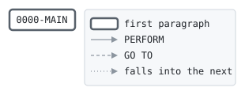

# ATMBAL

```text
ATMBAL: ANSWER AN ATM BALANCE ENQUIRY

CALLED BY AUTHSRV WITH THE REQUEST, THE CARD AND ITS ACCOUNT.
FOR AN ACTIVE CARD OF AN OPEN ACCOUNT, GIVES THE BALANCE AND
THE AVAILABLE BALANCE: THE BALANCE PLUS THE OVERDRAFT LIMIT
LESS WHAT IS HELD. CHANGES NOTHING. NO FILES.

MODIFICATION HISTORY
DATE       BY  CHANGE
2003-05-19 MV  CR-0342 ORIGINAL VERSION.
```

Program [ATMBAL.cbl](../../../pangaea/programs/ATMBAL.cbl): 0 files, 1 paragraphs. Its business rules: [1 decision tables](../rules/ATMBAL.md).

- AUTHOR: M. VARGA, ONLINE SYSTEMS.
- INSTALLATION: FIRST BANK OF PANGAEA, DATA CENTER.
- DATE-WRITTEN: 2003-05-19.

## Contents

- [Files](#files)
- [Flow](#flow)
- [Paragraphs](#paragraphs)
- [Calls](#calls)
- [Data flow](#data-flow)
- [Lineage](#lineage)
  - [Into WS-AVAILABLE](#into-ws-available)
  - [Into AUTH-RESPONSE](#into-auth-response)
- [Records](#records)
  - [WS-AVAILABLE](#ws-available)
  - [AUTH-REQUEST](#auth-request)
  - [AUTH-RESPONSE](#auth-response)
  - [BANK-CONTROL-RECORD](#bank-control-record)
  - [ACCT-ONLINE-RECORD](#acct-online-record)
  - [CARD-RECORD](#card-record)
  - [HOLD-RECORD](#hold-record)

## Files

| File | Kind | Assigned to | Organization | Status field | Opened | Records |
| --- | --- | --- | --- | --- | --- | --- |

## Flow



## Paragraphs

| Paragraph | Description | Source | Performs | Goes to | Performed by | Reached by |
| --- | --- | --- | --- | --- | --- | --- |
| 0000-MAIN | GIVE THE BALANCES TO AN ACTIVE CARD OF AN OPEN ACCOUNT. | [ATMBAL.cbl:34](../../../pangaea/programs/ATMBAL.cbl#L34) | | | | |

## Calls

Called with AUTH-REQUEST, AUTH-RESPONSE, BANK-CONTROL-RECORD, ACCT-ONLINE-RECORD, CARD-RECORD, HOLD-RECORD by [AUTHSRV](AUTHSRV.md).

## Data flow

| Paragraph | Reads | Writes |
| --- | --- | --- |
| 0000-MAIN | CR-STATUS, AO-STATUS, AO-BALANCE, AO-OVERDRAFT-LIMIT, AO-HOLDS, WS-AVAILABLE | RS-RESULT, RS-MESSAGE, RS-BALANCE, WS-AVAILABLE, RS-AVAILABLE |

## Lineage

Where each data item's values come from, grouped by the record they go into. A data item links to the record it belongs to.

### Into WS-AVAILABLE

Record [WS-AVAILABLE](#ws-available).

| Into | From | Statement | Paragraph | Source |
| --- | --- | --- | --- | --- |
| WS-AVAILABLE | [AO-BALANCE](#acct-online-record "in ACCT-ONLINE-RECORD") | ADD | 0000-MAIN | [ATMBAL.cbl:46](../../../pangaea/programs/ATMBAL.cbl#L46) |
| WS-AVAILABLE | [AO-OVERDRAFT-LIMIT](#acct-online-record "in ACCT-ONLINE-RECORD") | ADD | 0000-MAIN | [ATMBAL.cbl:46](../../../pangaea/programs/ATMBAL.cbl#L46) |
| WS-AVAILABLE | [AO-HOLDS](#acct-online-record "in ACCT-ONLINE-RECORD") | SUBTRACT | 0000-MAIN | [ATMBAL.cbl:47](../../../pangaea/programs/ATMBAL.cbl#L47) |

### Into AUTH-RESPONSE

Record [AUTH-RESPONSE](#auth-response), from copybook [AUTHMSG](../copybooks/AUTHMSG.md).

| Into | From | Statement | Paragraph | Source |
| --- | --- | --- | --- | --- |
| RS-AVAILABLE | [WS-AVAILABLE](#ws-available) | MOVE | 0000-MAIN | [ATMBAL.cbl:48](../../../pangaea/programs/ATMBAL.cbl#L48) |
| RS-BALANCE | [AO-BALANCE](#acct-online-record "in ACCT-ONLINE-RECORD") | MOVE | 0000-MAIN | [ATMBAL.cbl:45](../../../pangaea/programs/ATMBAL.cbl#L45) |
| RS-MESSAGE | literal 'CARD BLOCKED' | MOVE | 0000-MAIN | [ATMBAL.cbl:38](../../../pangaea/programs/ATMBAL.cbl#L38) |
| RS-MESSAGE | literal 'ACCOUNT NOT OPEN' | MOVE | 0000-MAIN | [ATMBAL.cbl:41](../../../pangaea/programs/ATMBAL.cbl#L41) |
| RS-MESSAGE | literal 'BALANCE' | MOVE | 0000-MAIN | [ATMBAL.cbl:44](../../../pangaea/programs/ATMBAL.cbl#L44) |
| RS-RESULT | literal condition RS-CARD-BLOCKED | SET | 0000-MAIN | [ATMBAL.cbl:37](../../../pangaea/programs/ATMBAL.cbl#L37) |
| RS-RESULT | literal condition RS-ACCOUNT-NOT-OPEN | SET | 0000-MAIN | [ATMBAL.cbl:40](../../../pangaea/programs/ATMBAL.cbl#L40) |
| RS-RESULT | literal condition RS-APPROVED | SET | 0000-MAIN | [ATMBAL.cbl:43](../../../pangaea/programs/ATMBAL.cbl#L43) |

## Records

### WS-AVAILABLE

Working storage. 13 bytes.

| Level | Field | Kind | Start | Length | Picture | Usage | Notes | Source |
| --: | --- | --- | --: | --: | --- | --- | --- | --- |
| 01 | WS-AVAILABLE | amount | 1 | 13 | S9(11)V99 | | | [ATMBAL.cbl:21](../../../pangaea/programs/ATMBAL.cbl#L21) |

### AUTH-REQUEST

Linkage. 80 bytes, layout in copybook [AUTHMSG](../copybooks/AUTHMSG.md).

### AUTH-RESPONSE

Linkage. 90 bytes, layout in copybook [AUTHMSG](../copybooks/AUTHMSG.md).

### BANK-CONTROL-RECORD

Linkage. 80 bytes, layout in copybook [BANKCTL](../copybooks/BANKCTL.md).

### ACCT-ONLINE-RECORD

Linkage. 100 bytes, layout in copybook [ACCTONL](../copybooks/ACCTONL.md).

### CARD-RECORD

Linkage. 80 bytes, layout in copybook [CARDREC](../copybooks/CARDREC.md).

### HOLD-RECORD

Linkage. 100 bytes, layout in copybook [HOLDREC](../copybooks/HOLDREC.md).
