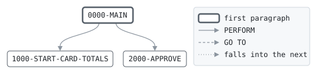

# ATMWDL

```text
ATMWDL: AUTHORIZE AN ATM CASH WITHDRAWAL

CALLED BY AUTHSRV WITH THE REQUEST, THE CARD AND ITS ACCOUNT.
APPROVES THE WITHDRAWAL IF THE CARD IS ACTIVE, THE ACCOUNT
OPEN, THE AMOUNT IN NOTES OF 20, THE DAY'S CASH WITHIN THE
CARD'S DAILY CASH LIMIT, AND THE AMOUNT AND ANY FEE WITHIN THE
AVAILABLE BALANCE. THE FIRST FOUR WITHDRAWALS OF A MONTH ARE
FREE; EACH ONE AFTER THAT CARRIES THE ATM FEE. AN APPROVED
WITHDRAWAL AND ITS FEE ARE HELD ON THE ACCOUNT AND COUNTED ON
THE CARD, AND THE HOLD RECORD FILLED IN FOR AUTHSRV TO WRITE.
NO FILES.

MODIFICATION HISTORY
DATE       BY  CHANGE
2003-05-19 MV  CR-0342 ORIGINAL VERSION.
2007-02-05 MV  CR-0415 ATM FEE AFTER FOUR FREE WITHDRAWALS A
               MONTH.
```

Program [ATMWDL.cbl](../../../pangaea/programs/ATMWDL.cbl): 0 files, 3 paragraphs. Its business rules: [2 decision tables](../rules/ATMWDL.md).

- AUTHOR: M. VARGA, ONLINE SYSTEMS.
- INSTALLATION: FIRST BANK OF PANGAEA, DATA CENTER.
- DATE-WRITTEN: 2003-05-19.

## Contents

- [Files](#files)
- [Flow](#flow)
- [Paragraphs](#paragraphs)
- [Calls](#calls)
- [Data flow](#data-flow)
- [Lineage](#lineage)
  - [Into WS-AVAILABLE](#into-ws-available)
  - [Into WS-DAY-CASH](#into-ws-day-cash)
  - [Into WS-FEE](#into-ws-fee)
  - [Into WS-TO-HOLD](#into-ws-to-hold)
  - [Into AUTH-RESPONSE](#into-auth-response)
  - [Into ACCT-ONLINE-RECORD](#into-acct-online-record)
  - [Into CARD-RECORD](#into-card-record)
  - [Into HOLD-RECORD](#into-hold-record)
- [Records](#records)
  - [WS-NOTE](#ws-note)
  - [WS-FREE-WITHDRAWALS](#ws-free-withdrawals)
  - [WS-ATM-FEE](#ws-atm-fee)
  - [WS-AVAILABLE](#ws-available)
  - [WS-DAY-CASH](#ws-day-cash)
  - [WS-FEE](#ws-fee)
  - [WS-TO-HOLD](#ws-to-hold)
  - [AUTH-REQUEST](#auth-request)
  - [AUTH-RESPONSE](#auth-response)
  - [BANK-CONTROL-RECORD](#bank-control-record)
  - [ACCT-ONLINE-RECORD](#acct-online-record)
  - [CARD-RECORD](#card-record)
  - [HOLD-RECORD](#hold-record)

## Files

| File | Kind | Assigned to | Organization | Status field | Opened | Records |
| --- | --- | --- | --- | --- | --- | --- |

## Flow



## Paragraphs

| Paragraph | Description | Source | Performs | Goes to | Performed by | Reached by |
| --- | --- | --- | --- | --- | --- | --- |
| 0000-MAIN | DECIDE, AND HOLD THE AMOUNT AND FEE IF APPROVED. | [ATMWDL.cbl:47](../../../pangaea/programs/ATMWDL.cbl#L47) | 1000-START-CARD-TOTALS, 2000-APPROVE | | | |
| 1000-START-CARD-TOTALS | THE CARD'S TOTALS ARE FOR ONE DAY, AND ITS COUNT OF WITHDRAWALS FOR ONE MONTH: START THEM OVER ON A NEW ONE. | [ATMWDL.cbl:82](../../../pangaea/programs/ATMWDL.cbl#L82) | | | 0000-MAIN | |
| 2000-APPROVE | HOLD THE AMOUNT AND THE FEE, AND COUNT THE WITHDRAWAL. | [ATMWDL.cbl:92](../../../pangaea/programs/ATMWDL.cbl#L92) | | | 0000-MAIN | |

## Calls

Called with AUTH-REQUEST, AUTH-RESPONSE, BANK-CONTROL-RECORD, ACCT-ONLINE-RECORD, CARD-RECORD, HOLD-RECORD by [AUTHSRV](AUTHSRV.md).

## Data flow

| Paragraph | Reads | Writes |
| --- | --- | --- |
| 0000-MAIN | AO-BALANCE, AO-OVERDRAFT-LIMIT, AO-HOLDS, WS-AVAILABLE, CR-DAY-CASH, RQ-AMOUNT, CR-MONTH-WITHDRAWALS, WS-FREE-WITHDRAWALS, WS-ATM-FEE, WS-FEE, CR-STATUS, AO-STATUS, WS-NOTE, WS-DAY-CASH, CR-CASH-LIMIT, WS-TO-HOLD | WS-AVAILABLE, WS-DAY-CASH, WS-FEE, WS-TO-HOLD, RS-RESULT, RS-MESSAGE |
| 1000-START-CARD-TOTALS | CR-TOTALS-DATE, BC-BUSINESS-DATE | CR-MONTH-WITHDRAWALS, CR-DAY-PURCHASES, CR-DAY-CASH, CR-TOTALS-DATE |
| 2000-APPROVE | WS-TO-HOLD, AO-HOLDS, WS-DAY-CASH, CR-MONTH-WITHDRAWALS, AO-ACCT-NO, CR-CARD-NO, RQ-AMOUNT, WS-FEE, RQ-TERMINAL, RQ-TIMESTAMP, BC-BUSINESS-DATE, AO-BALANCE, WS-AVAILABLE | AO-HOLDS, CR-DAY-CASH, CR-MONTH-WITHDRAWALS, HD-ACCT-NO, HD-CARD-NO, HD-KIND, HD-STATUS, HD-AMOUNT, HD-FEE, HD-TERMINAL, HD-TIMESTAMP, HD-BUSINESS-DATE, RS-RESULT, RS-MESSAGE, RS-AMOUNT, RS-FEE, RS-BALANCE, WS-AVAILABLE, RS-AVAILABLE |

## Lineage

Where each data item's values come from, grouped by the record they go into. A data item links to the record it belongs to.

### Into WS-AVAILABLE

Record [WS-AVAILABLE](#ws-available).

| Into | From | Statement | Paragraph | Source |
| --- | --- | --- | --- | --- |
| WS-AVAILABLE | [AO-BALANCE](#acct-online-record "in ACCT-ONLINE-RECORD") | ADD | 0000-MAIN | [ATMWDL.cbl:49](../../../pangaea/programs/ATMWDL.cbl#L49) |
| WS-AVAILABLE | [AO-OVERDRAFT-LIMIT](#acct-online-record "in ACCT-ONLINE-RECORD") | ADD | 0000-MAIN | [ATMWDL.cbl:49](../../../pangaea/programs/ATMWDL.cbl#L49) |
| WS-AVAILABLE | [AO-HOLDS](#acct-online-record "in ACCT-ONLINE-RECORD") | SUBTRACT | 0000-MAIN | [ATMWDL.cbl:50](../../../pangaea/programs/ATMWDL.cbl#L50) |
| WS-AVAILABLE | [WS-TO-HOLD](#ws-to-hold) | SUBTRACT | 2000-APPROVE | [ATMWDL.cbl:110](../../../pangaea/programs/ATMWDL.cbl#L110) |

### Into WS-DAY-CASH

Record [WS-DAY-CASH](#ws-day-cash).

| Into | From | Statement | Paragraph | Source |
| --- | --- | --- | --- | --- |
| WS-DAY-CASH | [CR-DAY-CASH](#card-record "in CARD-RECORD") | COMPUTE | 0000-MAIN | [ATMWDL.cbl:51](../../../pangaea/programs/ATMWDL.cbl#L51) |
| WS-DAY-CASH | [RQ-AMOUNT](#auth-request "in AUTH-REQUEST") | COMPUTE | 0000-MAIN | [ATMWDL.cbl:51](../../../pangaea/programs/ATMWDL.cbl#L51) |

### Into WS-FEE

Record [WS-FEE](#ws-fee).

| Into | From | Statement | Paragraph | Source |
| --- | --- | --- | --- | --- |
| WS-FEE | literal 0 | MOVE | 0000-MAIN | [ATMWDL.cbl:53](../../../pangaea/programs/ATMWDL.cbl#L53) |
| WS-FEE | [WS-ATM-FEE](#ws-atm-fee) | MOVE | 0000-MAIN | [ATMWDL.cbl:55](../../../pangaea/programs/ATMWDL.cbl#L55) |

### Into WS-TO-HOLD

Record [WS-TO-HOLD](#ws-to-hold).

| Into | From | Statement | Paragraph | Source |
| --- | --- | --- | --- | --- |
| WS-TO-HOLD | [RQ-AMOUNT](#auth-request "in AUTH-REQUEST") | COMPUTE | 0000-MAIN | [ATMWDL.cbl:57](../../../pangaea/programs/ATMWDL.cbl#L57) |
| WS-TO-HOLD | [WS-FEE](#ws-fee) | COMPUTE | 0000-MAIN | [ATMWDL.cbl:57](../../../pangaea/programs/ATMWDL.cbl#L57) |

### Into AUTH-RESPONSE

Record [AUTH-RESPONSE](#auth-response), from copybook [AUTHMSG](../copybooks/AUTHMSG.md).

| Into | From | Statement | Paragraph | Source |
| --- | --- | --- | --- | --- |
| RS-AMOUNT | [RQ-AMOUNT](#auth-request "in AUTH-REQUEST") | MOVE | 2000-APPROVE | [ATMWDL.cbl:107](../../../pangaea/programs/ATMWDL.cbl#L107) |
| RS-AVAILABLE | [WS-AVAILABLE](#ws-available) | MOVE | 2000-APPROVE | [ATMWDL.cbl:111](../../../pangaea/programs/ATMWDL.cbl#L111) |
| RS-BALANCE | [AO-BALANCE](#acct-online-record "in ACCT-ONLINE-RECORD") | MOVE | 2000-APPROVE | [ATMWDL.cbl:109](../../../pangaea/programs/ATMWDL.cbl#L109) |
| RS-FEE | [WS-FEE](#ws-fee) | MOVE | 2000-APPROVE | [ATMWDL.cbl:108](../../../pangaea/programs/ATMWDL.cbl#L108) |
| RS-MESSAGE | literal 'CARD BLOCKED' | MOVE | 0000-MAIN | [ATMWDL.cbl:61](../../../pangaea/programs/ATMWDL.cbl#L61) |
| RS-MESSAGE | literal 'ACCOUNT NOT OPEN' | MOVE | 0000-MAIN | [ATMWDL.cbl:64](../../../pangaea/programs/ATMWDL.cbl#L64) |
| RS-MESSAGE | literal 'AMOUNT NOT IN NOTES OF 20' | MOVE | 0000-MAIN | [ATMWDL.cbl:68](../../../pangaea/programs/ATMWDL.cbl#L68) |
| RS-MESSAGE | literal 'OVER DAILY CASH LIMIT' | MOVE | 0000-MAIN | [ATMWDL.cbl:71](../../../pangaea/programs/ATMWDL.cbl#L71) |
| RS-MESSAGE | literal 'INSUFFICIENT FUNDS' | MOVE | 0000-MAIN | [ATMWDL.cbl:74](../../../pangaea/programs/ATMWDL.cbl#L74) |
| RS-MESSAGE | literal 'APPROVED' | MOVE | 2000-APPROVE | [ATMWDL.cbl:106](../../../pangaea/programs/ATMWDL.cbl#L106) |
| RS-RESULT | literal condition RS-CARD-BLOCKED | SET | 0000-MAIN | [ATMWDL.cbl:60](../../../pangaea/programs/ATMWDL.cbl#L60) |
| RS-RESULT | literal condition RS-ACCOUNT-NOT-OPEN | SET | 0000-MAIN | [ATMWDL.cbl:63](../../../pangaea/programs/ATMWDL.cbl#L63) |
| RS-RESULT | literal condition RS-INVALID-AMOUNT | SET | 0000-MAIN | [ATMWDL.cbl:67](../../../pangaea/programs/ATMWDL.cbl#L67) |
| RS-RESULT | literal condition RS-OVER-LIMIT | SET | 0000-MAIN | [ATMWDL.cbl:70](../../../pangaea/programs/ATMWDL.cbl#L70) |
| RS-RESULT | literal condition RS-INSUFFICIENT-FUNDS | SET | 0000-MAIN | [ATMWDL.cbl:73](../../../pangaea/programs/ATMWDL.cbl#L73) |
| RS-RESULT | literal condition RS-APPROVED | SET | 2000-APPROVE | [ATMWDL.cbl:105](../../../pangaea/programs/ATMWDL.cbl#L105) |

### Into ACCT-ONLINE-RECORD

Record [ACCT-ONLINE-RECORD](#acct-online-record), from copybook [ACCTONL](../copybooks/ACCTONL.md).

| Into | From | Statement | Paragraph | Source |
| --- | --- | --- | --- | --- |
| AO-HOLDS | [WS-TO-HOLD](#ws-to-hold) | ADD | 2000-APPROVE | [ATMWDL.cbl:93](../../../pangaea/programs/ATMWDL.cbl#L93) |

### Into CARD-RECORD

Record [CARD-RECORD](#card-record), from copybook [CARDREC](../copybooks/CARDREC.md).

| Into | From | Statement | Paragraph | Source |
| --- | --- | --- | --- | --- |
| CR-DAY-CASH | literal 0 | MOVE | 1000-START-CARD-TOTALS | [ATMWDL.cbl:87](../../../pangaea/programs/ATMWDL.cbl#L87) |
| CR-DAY-CASH | [WS-DAY-CASH](#ws-day-cash) | MOVE | 2000-APPROVE | [ATMWDL.cbl:94](../../../pangaea/programs/ATMWDL.cbl#L94) |
| CR-DAY-PURCHASES | literal 0 | MOVE | 1000-START-CARD-TOTALS | [ATMWDL.cbl:87](../../../pangaea/programs/ATMWDL.cbl#L87) |
| CR-MONTH-WITHDRAWALS | literal 0 | MOVE | 1000-START-CARD-TOTALS | [ATMWDL.cbl:85](../../../pangaea/programs/ATMWDL.cbl#L85) |
| CR-MONTH-WITHDRAWALS | literal 1 | ADD | 2000-APPROVE | [ATMWDL.cbl:95](../../../pangaea/programs/ATMWDL.cbl#L95) |
| CR-TOTALS-DATE | [BC-BUSINESS-DATE](#bank-control-record "in BANK-CONTROL-RECORD") | MOVE | 1000-START-CARD-TOTALS | [ATMWDL.cbl:88](../../../pangaea/programs/ATMWDL.cbl#L88) |

### Into HOLD-RECORD

Record [HOLD-RECORD](#hold-record), from copybook [HOLDREC](../copybooks/HOLDREC.md).

| Into | From | Statement | Paragraph | Source |
| --- | --- | --- | --- | --- |
| HD-ACCT-NO | [AO-ACCT-NO](#acct-online-record "in ACCT-ONLINE-RECORD") | MOVE | 2000-APPROVE | [ATMWDL.cbl:96](../../../pangaea/programs/ATMWDL.cbl#L96) |
| HD-AMOUNT | [RQ-AMOUNT](#auth-request "in AUTH-REQUEST") | MOVE | 2000-APPROVE | [ATMWDL.cbl:100](../../../pangaea/programs/ATMWDL.cbl#L100) |
| HD-BUSINESS-DATE | [BC-BUSINESS-DATE](#bank-control-record "in BANK-CONTROL-RECORD") | MOVE | 2000-APPROVE | [ATMWDL.cbl:104](../../../pangaea/programs/ATMWDL.cbl#L104) |
| HD-CARD-NO | [CR-CARD-NO](#card-record "in CARD-RECORD") | MOVE | 2000-APPROVE | [ATMWDL.cbl:97](../../../pangaea/programs/ATMWDL.cbl#L97) |
| HD-FEE | [WS-FEE](#ws-fee) | MOVE | 2000-APPROVE | [ATMWDL.cbl:101](../../../pangaea/programs/ATMWDL.cbl#L101) |
| HD-KIND | literal condition HD-WITHDRAWAL | SET | 2000-APPROVE | [ATMWDL.cbl:98](../../../pangaea/programs/ATMWDL.cbl#L98) |
| HD-STATUS | literal condition HD-OPEN | SET | 2000-APPROVE | [ATMWDL.cbl:99](../../../pangaea/programs/ATMWDL.cbl#L99) |
| HD-TERMINAL | [RQ-TERMINAL](#auth-request "in AUTH-REQUEST") | MOVE | 2000-APPROVE | [ATMWDL.cbl:102](../../../pangaea/programs/ATMWDL.cbl#L102) |
| HD-TIMESTAMP | [RQ-TIMESTAMP](#auth-request "in AUTH-REQUEST") | MOVE | 2000-APPROVE | [ATMWDL.cbl:103](../../../pangaea/programs/ATMWDL.cbl#L103) |

## Records

### WS-NOTE

Working storage. 2 bytes.

| Level | Field | Kind | Start | Length | Picture | Usage | Notes | Source |
| --: | --- | --- | --: | --: | --- | --- | --- | --- |
| 01 | WS-NOTE | number | 1 | 2 | 99 | | VALUE 20 | [ATMWDL.cbl:28](../../../pangaea/programs/ATMWDL.cbl#L28) |

### WS-FREE-WITHDRAWALS

Working storage. 3 bytes.

| Level | Field | Kind | Start | Length | Picture | Usage | Notes | Source |
| --: | --- | --- | --: | --: | --- | --- | --- | --- |
| 01 | WS-FREE-WITHDRAWALS | number | 1 | 3 | 9(3) | | VALUE 4 | [ATMWDL.cbl:29](../../../pangaea/programs/ATMWDL.cbl#L29) |

### WS-ATM-FEE

Working storage. 3 bytes.

| Level | Field | Kind | Start | Length | Picture | Usage | Notes | Source |
| --: | --- | --- | --: | --: | --- | --- | --- | --- |
| 01 | WS-ATM-FEE | amount | 1 | 3 | 9V99 | | VALUE 2.00 | [ATMWDL.cbl:30](../../../pangaea/programs/ATMWDL.cbl#L30) |

### WS-AVAILABLE

Working storage. 13 bytes.

| Level | Field | Kind | Start | Length | Picture | Usage | Notes | Source |
| --: | --- | --- | --: | --: | --- | --- | --- | --- |
| 01 | WS-AVAILABLE | amount | 1 | 13 | S9(11)V99 | | | [ATMWDL.cbl:31](../../../pangaea/programs/ATMWDL.cbl#L31) |

### WS-DAY-CASH

Working storage. 9 bytes.

| Level | Field | Kind | Start | Length | Picture | Usage | Notes | Source |
| --: | --- | --- | --: | --: | --- | --- | --- | --- |
| 01 | WS-DAY-CASH | amount | 1 | 9 | 9(7)V99 | | | [ATMWDL.cbl:32](../../../pangaea/programs/ATMWDL.cbl#L32) |

### WS-FEE

Working storage. 3 bytes.

| Level | Field | Kind | Start | Length | Picture | Usage | Notes | Source |
| --: | --- | --- | --: | --: | --- | --- | --- | --- |
| 01 | WS-FEE | amount | 1 | 3 | 9V99 | | | [ATMWDL.cbl:33](../../../pangaea/programs/ATMWDL.cbl#L33) |

### WS-TO-HOLD

Working storage. 9 bytes.

| Level | Field | Kind | Start | Length | Picture | Usage | Notes | Source |
| --: | --- | --- | --: | --: | --- | --- | --- | --- |
| 01 | WS-TO-HOLD | amount | 1 | 9 | 9(7)V99 | | | [ATMWDL.cbl:34](../../../pangaea/programs/ATMWDL.cbl#L34) |

### AUTH-REQUEST

Linkage. 80 bytes, layout in copybook [AUTHMSG](../copybooks/AUTHMSG.md).

### AUTH-RESPONSE

Linkage. 90 bytes, layout in copybook [AUTHMSG](../copybooks/AUTHMSG.md).

### BANK-CONTROL-RECORD

Linkage. 80 bytes, layout in copybook [BANKCTL](../copybooks/BANKCTL.md).

### ACCT-ONLINE-RECORD

Linkage. 100 bytes, layout in copybook [ACCTONL](../copybooks/ACCTONL.md).

### CARD-RECORD

Linkage. 80 bytes, layout in copybook [CARDREC](../copybooks/CARDREC.md).

### HOLD-RECORD

Linkage. 100 bytes, layout in copybook [HOLDREC](../copybooks/HOLDREC.md).
