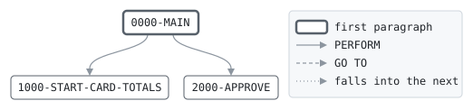

# AUTHPUR

```text
AUTHPUR: AUTHORIZE A CARD PURCHASE

CALLED BY AUTHSRV WITH THE REQUEST, THE CARD AND ITS ACCOUNT.
APPROVES THE PURCHASE IF THE CARD IS ACTIVE, THE ACCOUNT OPEN,
THE DAY'S PURCHASES STAY WITHIN THE CARD'S DAILY LIMIT AND THE
AMOUNT WITHIN THE AVAILABLE BALANCE: THE BALANCE PLUS THE
OVERDRAFT LIMIT LESS WHAT IS ALREADY HELD. AN APPROVED
PURCHASE IS HELD ON THE ACCOUNT AND COUNTED ON THE CARD, AND
THE HOLD RECORD FILLED IN FOR AUTHSRV TO WRITE. NO FILES.

MODIFICATION HISTORY
DATE       BY  CHANGE
2003-05-19 MV  CR-0342 ORIGINAL VERSION.
```

Program [AUTHPUR.cbl](../../../pangaea/programs/AUTHPUR.cbl): 0 files, 3 paragraphs. Its business rules: [2 decision tables](../rules/AUTHPUR.md).

- AUTHOR: M. VARGA, ONLINE SYSTEMS.
- INSTALLATION: FIRST BANK OF PANGAEA, DATA CENTER.
- DATE-WRITTEN: 2003-05-19.

## Contents

- [Files](#files)
- [Flow](#flow)
- [Paragraphs](#paragraphs)
- [Calls](#calls)
- [Data flow](#data-flow)
- [Lineage](#lineage)
  - [Into WS-AVAILABLE](#into-ws-available)
  - [Into WS-DAY-PURCHASES](#into-ws-day-purchases)
  - [Into AUTH-RESPONSE](#into-auth-response)
  - [Into ACCT-ONLINE-RECORD](#into-acct-online-record)
  - [Into CARD-RECORD](#into-card-record)
  - [Into HOLD-RECORD](#into-hold-record)
- [Records](#records)
  - [WS-AVAILABLE](#ws-available)
  - [WS-DAY-PURCHASES](#ws-day-purchases)
  - [AUTH-REQUEST](#auth-request)
  - [AUTH-RESPONSE](#auth-response)
  - [BANK-CONTROL-RECORD](#bank-control-record)
  - [ACCT-ONLINE-RECORD](#acct-online-record)
  - [CARD-RECORD](#card-record)
  - [HOLD-RECORD](#hold-record)

## Files

| File | Kind | Assigned to | Organization | Status field | Opened | Records |
| --- | --- | --- | --- | --- | --- | --- |

## Flow



## Paragraphs

| Paragraph | Description | Source | Performs | Goes to | Performed by | Reached by |
| --- | --- | --- | --- | --- | --- | --- |
| 0000-MAIN | DECIDE, AND HOLD THE AMOUNT IF APPROVED. | [AUTHPUR.cbl:38](../../../pangaea/programs/AUTHPUR.cbl#L38) | 1000-START-CARD-TOTALS, 2000-APPROVE | | | |
| 1000-START-CARD-TOTALS | THE CARD'S TOTALS ARE FOR ONE DAY: START THEM OVER ON A NEW ONE. | [AUTHPUR.cbl:65](../../../pangaea/programs/AUTHPUR.cbl#L65) | | | 0000-MAIN | |
| 2000-APPROVE | HOLD THE AMOUNT AND COUNT IT ON THE CARD. | [AUTHPUR.cbl:75](../../../pangaea/programs/AUTHPUR.cbl#L75) | | | 0000-MAIN | |

## Calls

Called with AUTH-REQUEST, AUTH-RESPONSE, BANK-CONTROL-RECORD, ACCT-ONLINE-RECORD, CARD-RECORD, HOLD-RECORD by [AUTHSRV](AUTHSRV.md).

## Data flow

| Paragraph | Reads | Writes |
| --- | --- | --- |
| 0000-MAIN | AO-BALANCE, AO-OVERDRAFT-LIMIT, AO-HOLDS, WS-AVAILABLE, CR-DAY-PURCHASES, RQ-AMOUNT, CR-STATUS, AO-STATUS, WS-DAY-PURCHASES, CR-PURCHASE-LIMIT | WS-AVAILABLE, WS-DAY-PURCHASES, RS-RESULT, RS-MESSAGE |
| 1000-START-CARD-TOTALS | CR-TOTALS-DATE, BC-BUSINESS-DATE | CR-MONTH-WITHDRAWALS, CR-DAY-PURCHASES, CR-DAY-CASH, CR-TOTALS-DATE |
| 2000-APPROVE | RQ-AMOUNT, AO-HOLDS, WS-DAY-PURCHASES, AO-ACCT-NO, CR-CARD-NO, RQ-TERMINAL, RQ-TIMESTAMP, BC-BUSINESS-DATE, AO-BALANCE, WS-AVAILABLE | AO-HOLDS, CR-DAY-PURCHASES, HD-ACCT-NO, HD-CARD-NO, HD-KIND, HD-STATUS, HD-AMOUNT, HD-FEE, HD-TERMINAL, HD-TIMESTAMP, HD-BUSINESS-DATE, RS-RESULT, RS-MESSAGE, RS-AMOUNT, RS-FEE, RS-BALANCE, WS-AVAILABLE, RS-AVAILABLE |

## Lineage

Where each data item's values come from, grouped by the record they go into. A data item links to the record it belongs to.

### Into WS-AVAILABLE

Record [WS-AVAILABLE](#ws-available).

| Into | From | Statement | Paragraph | Source |
| --- | --- | --- | --- | --- |
| WS-AVAILABLE | [AO-BALANCE](#acct-online-record "in ACCT-ONLINE-RECORD") | ADD | 0000-MAIN | [AUTHPUR.cbl:40](../../../pangaea/programs/AUTHPUR.cbl#L40) |
| WS-AVAILABLE | [AO-OVERDRAFT-LIMIT](#acct-online-record "in ACCT-ONLINE-RECORD") | ADD | 0000-MAIN | [AUTHPUR.cbl:40](../../../pangaea/programs/AUTHPUR.cbl#L40) |
| WS-AVAILABLE | [AO-HOLDS](#acct-online-record "in ACCT-ONLINE-RECORD") | SUBTRACT | 0000-MAIN | [AUTHPUR.cbl:41](../../../pangaea/programs/AUTHPUR.cbl#L41) |
| WS-AVAILABLE | [RQ-AMOUNT](#auth-request "in AUTH-REQUEST") | SUBTRACT | 2000-APPROVE | [AUTHPUR.cbl:92](../../../pangaea/programs/AUTHPUR.cbl#L92) |

### Into WS-DAY-PURCHASES

Record [WS-DAY-PURCHASES](#ws-day-purchases).

| Into | From | Statement | Paragraph | Source |
| --- | --- | --- | --- | --- |
| WS-DAY-PURCHASES | [CR-DAY-PURCHASES](#card-record "in CARD-RECORD") | COMPUTE | 0000-MAIN | [AUTHPUR.cbl:42](../../../pangaea/programs/AUTHPUR.cbl#L42) |
| WS-DAY-PURCHASES | [RQ-AMOUNT](#auth-request "in AUTH-REQUEST") | COMPUTE | 0000-MAIN | [AUTHPUR.cbl:42](../../../pangaea/programs/AUTHPUR.cbl#L42) |

### Into AUTH-RESPONSE

Record [AUTH-RESPONSE](#auth-response), from copybook [AUTHMSG](../copybooks/AUTHMSG.md).

| Into | From | Statement | Paragraph | Source |
| --- | --- | --- | --- | --- |
| RS-AMOUNT | [RQ-AMOUNT](#auth-request "in AUTH-REQUEST") | MOVE | 2000-APPROVE | [AUTHPUR.cbl:89](../../../pangaea/programs/AUTHPUR.cbl#L89) |
| RS-AVAILABLE | [WS-AVAILABLE](#ws-available) | MOVE | 2000-APPROVE | [AUTHPUR.cbl:93](../../../pangaea/programs/AUTHPUR.cbl#L93) |
| RS-BALANCE | [AO-BALANCE](#acct-online-record "in ACCT-ONLINE-RECORD") | MOVE | 2000-APPROVE | [AUTHPUR.cbl:91](../../../pangaea/programs/AUTHPUR.cbl#L91) |
| RS-FEE | literal 0 | MOVE | 2000-APPROVE | [AUTHPUR.cbl:90](../../../pangaea/programs/AUTHPUR.cbl#L90) |
| RS-MESSAGE | literal 'CARD BLOCKED' | MOVE | 0000-MAIN | [AUTHPUR.cbl:46](../../../pangaea/programs/AUTHPUR.cbl#L46) |
| RS-MESSAGE | literal 'ACCOUNT NOT OPEN' | MOVE | 0000-MAIN | [AUTHPUR.cbl:49](../../../pangaea/programs/AUTHPUR.cbl#L49) |
| RS-MESSAGE | literal 'NO AMOUNT' | MOVE | 0000-MAIN | [AUTHPUR.cbl:52](../../../pangaea/programs/AUTHPUR.cbl#L52) |
| RS-MESSAGE | literal 'OVER DAILY PURCHASE LIMIT' | MOVE | 0000-MAIN | [AUTHPUR.cbl:55](../../../pangaea/programs/AUTHPUR.cbl#L55) |
| RS-MESSAGE | literal 'INSUFFICIENT FUNDS' | MOVE | 0000-MAIN | [AUTHPUR.cbl:58](../../../pangaea/programs/AUTHPUR.cbl#L58) |
| RS-MESSAGE | literal 'APPROVED' | MOVE | 2000-APPROVE | [AUTHPUR.cbl:88](../../../pangaea/programs/AUTHPUR.cbl#L88) |
| RS-RESULT | literal condition RS-CARD-BLOCKED | SET | 0000-MAIN | [AUTHPUR.cbl:45](../../../pangaea/programs/AUTHPUR.cbl#L45) |
| RS-RESULT | literal condition RS-ACCOUNT-NOT-OPEN | SET | 0000-MAIN | [AUTHPUR.cbl:48](../../../pangaea/programs/AUTHPUR.cbl#L48) |
| RS-RESULT | literal condition RS-INVALID-AMOUNT | SET | 0000-MAIN | [AUTHPUR.cbl:51](../../../pangaea/programs/AUTHPUR.cbl#L51) |
| RS-RESULT | literal condition RS-OVER-LIMIT | SET | 0000-MAIN | [AUTHPUR.cbl:54](../../../pangaea/programs/AUTHPUR.cbl#L54) |
| RS-RESULT | literal condition RS-INSUFFICIENT-FUNDS | SET | 0000-MAIN | [AUTHPUR.cbl:57](../../../pangaea/programs/AUTHPUR.cbl#L57) |
| RS-RESULT | literal condition RS-APPROVED | SET | 2000-APPROVE | [AUTHPUR.cbl:87](../../../pangaea/programs/AUTHPUR.cbl#L87) |

### Into ACCT-ONLINE-RECORD

Record [ACCT-ONLINE-RECORD](#acct-online-record), from copybook [ACCTONL](../copybooks/ACCTONL.md).

| Into | From | Statement | Paragraph | Source |
| --- | --- | --- | --- | --- |
| AO-HOLDS | [RQ-AMOUNT](#auth-request "in AUTH-REQUEST") | ADD | 2000-APPROVE | [AUTHPUR.cbl:76](../../../pangaea/programs/AUTHPUR.cbl#L76) |

### Into CARD-RECORD

Record [CARD-RECORD](#card-record), from copybook [CARDREC](../copybooks/CARDREC.md).

| Into | From | Statement | Paragraph | Source |
| --- | --- | --- | --- | --- |
| CR-DAY-CASH | literal 0 | MOVE | 1000-START-CARD-TOTALS | [AUTHPUR.cbl:70](../../../pangaea/programs/AUTHPUR.cbl#L70) |
| CR-DAY-PURCHASES | literal 0 | MOVE | 1000-START-CARD-TOTALS | [AUTHPUR.cbl:70](../../../pangaea/programs/AUTHPUR.cbl#L70) |
| CR-DAY-PURCHASES | [WS-DAY-PURCHASES](#ws-day-purchases) | MOVE | 2000-APPROVE | [AUTHPUR.cbl:77](../../../pangaea/programs/AUTHPUR.cbl#L77) |
| CR-MONTH-WITHDRAWALS | literal 0 | MOVE | 1000-START-CARD-TOTALS | [AUTHPUR.cbl:68](../../../pangaea/programs/AUTHPUR.cbl#L68) |
| CR-TOTALS-DATE | [BC-BUSINESS-DATE](#bank-control-record "in BANK-CONTROL-RECORD") | MOVE | 1000-START-CARD-TOTALS | [AUTHPUR.cbl:71](../../../pangaea/programs/AUTHPUR.cbl#L71) |

### Into HOLD-RECORD

Record [HOLD-RECORD](#hold-record), from copybook [HOLDREC](../copybooks/HOLDREC.md).

| Into | From | Statement | Paragraph | Source |
| --- | --- | --- | --- | --- |
| HD-ACCT-NO | [AO-ACCT-NO](#acct-online-record "in ACCT-ONLINE-RECORD") | MOVE | 2000-APPROVE | [AUTHPUR.cbl:78](../../../pangaea/programs/AUTHPUR.cbl#L78) |
| HD-AMOUNT | [RQ-AMOUNT](#auth-request "in AUTH-REQUEST") | MOVE | 2000-APPROVE | [AUTHPUR.cbl:82](../../../pangaea/programs/AUTHPUR.cbl#L82) |
| HD-BUSINESS-DATE | [BC-BUSINESS-DATE](#bank-control-record "in BANK-CONTROL-RECORD") | MOVE | 2000-APPROVE | [AUTHPUR.cbl:86](../../../pangaea/programs/AUTHPUR.cbl#L86) |
| HD-CARD-NO | [CR-CARD-NO](#card-record "in CARD-RECORD") | MOVE | 2000-APPROVE | [AUTHPUR.cbl:79](../../../pangaea/programs/AUTHPUR.cbl#L79) |
| HD-FEE | literal 0 | MOVE | 2000-APPROVE | [AUTHPUR.cbl:83](../../../pangaea/programs/AUTHPUR.cbl#L83) |
| HD-KIND | literal condition HD-PURCHASE | SET | 2000-APPROVE | [AUTHPUR.cbl:80](../../../pangaea/programs/AUTHPUR.cbl#L80) |
| HD-STATUS | literal condition HD-OPEN | SET | 2000-APPROVE | [AUTHPUR.cbl:81](../../../pangaea/programs/AUTHPUR.cbl#L81) |
| HD-TERMINAL | [RQ-TERMINAL](#auth-request "in AUTH-REQUEST") | MOVE | 2000-APPROVE | [AUTHPUR.cbl:84](../../../pangaea/programs/AUTHPUR.cbl#L84) |
| HD-TIMESTAMP | [RQ-TIMESTAMP](#auth-request "in AUTH-REQUEST") | MOVE | 2000-APPROVE | [AUTHPUR.cbl:85](../../../pangaea/programs/AUTHPUR.cbl#L85) |

## Records

### WS-AVAILABLE

Working storage. 13 bytes.

| Level | Field | Start | Length | Picture | Usage | Notes | Source |
| --: | --- | --: | --: | --- | --- | --- | --- |
| 01 | WS-AVAILABLE | 1 | 13 | S9(11)V99 | | | [AUTHPUR.cbl:24](../../../pangaea/programs/AUTHPUR.cbl#L24) |

### WS-DAY-PURCHASES

Working storage. 9 bytes.

| Level | Field | Start | Length | Picture | Usage | Notes | Source |
| --: | --- | --: | --: | --- | --- | --- | --- |
| 01 | WS-DAY-PURCHASES | 1 | 9 | 9(7)V99 | | | [AUTHPUR.cbl:25](../../../pangaea/programs/AUTHPUR.cbl#L25) |

### AUTH-REQUEST

Linkage. 80 bytes, layout in copybook [AUTHMSG](../copybooks/AUTHMSG.md).

### AUTH-RESPONSE

Linkage. 90 bytes, layout in copybook [AUTHMSG](../copybooks/AUTHMSG.md).

### BANK-CONTROL-RECORD

Linkage. 80 bytes, layout in copybook [BANKCTL](../copybooks/BANKCTL.md).

### ACCT-ONLINE-RECORD

Linkage. 100 bytes, layout in copybook [ACCTONL](../copybooks/ACCTONL.md).

### CARD-RECORD

Linkage. 80 bytes, layout in copybook [CARDREC](../copybooks/CARDREC.md).

### HOLD-RECORD

Linkage. 100 bytes, layout in copybook [HOLDREC](../copybooks/HOLDREC.md).
