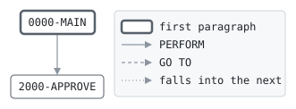

# AUTHREV

```text
AUTHREV: REVERSE A CARD PURCHASE

CALLED BY AUTHSRV WITH THE REQUEST, THE CARD, ITS ACCOUNT AND
THE HOLD OF THE AUTHORIZATION CODE TO REVERSE. A MERCHANT
REVERSES A PURCHASE OF THE SAME CARD THAT IS STILL HELD, EVEN
IF THE CARD HAS BEEN BLOCKED SINCE: THE HOLD IS RELEASED FROM
THE ACCOUNT, TAKEN OFF THE CARD'S PURCHASES OF THE DAY, AND
MARKED REVERSED FOR AUTHSRV TO REWRITE. CASH WITHDRAWALS ARE
NOT REVERSED. NO FILES.

MODIFICATION HISTORY
DATE       BY  CHANGE
2003-05-19 MV  CR-0342 ORIGINAL VERSION.
```

Program [AUTHREV.cbl](../../../pangaea/programs/AUTHREV.cbl): 0 files, 2 paragraphs. Its business rules: [2 decision tables](../rules/AUTHREV.md).

- AUTHOR: M. VARGA, ONLINE SYSTEMS.
- INSTALLATION: FIRST BANK OF PANGAEA, DATA CENTER.
- DATE-WRITTEN: 2003-05-19.

## Contents

- [Files](#files)
- [Flow](#flow)
- [Paragraphs](#paragraphs)
- [Calls](#calls)
- [Data flow](#data-flow)
- [Lineage](#lineage)
  - [Into WS-AVAILABLE](#into-ws-available)
  - [Into AUTH-RESPONSE](#into-auth-response)
  - [Into ACCT-ONLINE-RECORD](#into-acct-online-record)
  - [Into CARD-RECORD](#into-card-record)
  - [Into HOLD-RECORD](#into-hold-record)
- [Records](#records)
  - [WS-AVAILABLE](#ws-available)
  - [AUTH-REQUEST](#auth-request)
  - [AUTH-RESPONSE](#auth-response)
  - [BANK-CONTROL-RECORD](#bank-control-record)
  - [ACCT-ONLINE-RECORD](#acct-online-record)
  - [CARD-RECORD](#card-record)
  - [HOLD-RECORD](#hold-record)

## Files

| File | Kind | Assigned to | Organization | Status field | Opened | Records |
| --- | --- | --- | --- | --- | --- | --- |

## Flow



## Paragraphs

| Paragraph | Description | Source | Performs | Goes to | Performed by | Reached by |
| --- | --- | --- | --- | --- | --- | --- |
| 0000-MAIN | DECIDE, AND RELEASE THE HOLD IF THE REVERSAL IS APPROVED. | [AUTHREV.cbl:37](../../../pangaea/programs/AUTHREV.cbl#L37) | 2000-APPROVE | | | |
| 2000-APPROVE | RELEASE THE HOLD. THE CARD'S TOTALS COUNT IT ONLY IF THEY ARE STILL FOR THE DAY IT WAS HELD ON. | [AUTHREV.cbl:55](../../../pangaea/programs/AUTHREV.cbl#L55) | | | 0000-MAIN | |

## Calls

Called with AUTH-REQUEST, AUTH-RESPONSE, BANK-CONTROL-RECORD, ACCT-ONLINE-RECORD, CARD-RECORD, HOLD-RECORD by [AUTHSRV](AUTHSRV.md).

## Data flow

| Paragraph | Reads | Writes |
| --- | --- | --- |
| 0000-MAIN | HD-CARD-NO, CR-CARD-NO, HD-KIND, HD-STATUS | RS-RESULT, RS-MESSAGE |
| 2000-APPROVE | HD-AMOUNT, AO-HOLDS, CR-TOTALS-DATE, HD-BUSINESS-DATE, CR-DAY-PURCHASES, HD-HOLD-NO, AO-BALANCE, AO-OVERDRAFT-LIMIT, WS-AVAILABLE | AO-HOLDS, CR-DAY-PURCHASES, HD-STATUS, RS-RESULT, RS-MESSAGE, RS-AUTH-CODE, RS-AMOUNT, RS-FEE, RS-BALANCE, WS-AVAILABLE, RS-AVAILABLE |

## Lineage

Where each data item's values come from, grouped by the record they go into. A data item links to the record it belongs to.

### Into WS-AVAILABLE

Record [WS-AVAILABLE](#ws-available).

| Into | From | Statement | Paragraph | Source |
| --- | --- | --- | --- | --- |
| WS-AVAILABLE | [AO-BALANCE](#acct-online-record "in ACCT-ONLINE-RECORD") | ADD | 2000-APPROVE | [AUTHREV.cbl:67](../../../pangaea/programs/AUTHREV.cbl#L67) |
| WS-AVAILABLE | [AO-OVERDRAFT-LIMIT](#acct-online-record "in ACCT-ONLINE-RECORD") | ADD | 2000-APPROVE | [AUTHREV.cbl:67](../../../pangaea/programs/AUTHREV.cbl#L67) |
| WS-AVAILABLE | [AO-HOLDS](#acct-online-record "in ACCT-ONLINE-RECORD") | SUBTRACT | 2000-APPROVE | [AUTHREV.cbl:68](../../../pangaea/programs/AUTHREV.cbl#L68) |

### Into AUTH-RESPONSE

Record [AUTH-RESPONSE](#auth-response), from copybook [AUTHMSG](../copybooks/AUTHMSG.md).

| Into | From | Statement | Paragraph | Source |
| --- | --- | --- | --- | --- |
| RS-AMOUNT | [HD-AMOUNT](#hold-record "in HOLD-RECORD") | MOVE | 2000-APPROVE | [AUTHREV.cbl:64](../../../pangaea/programs/AUTHREV.cbl#L64) |
| RS-AUTH-CODE | [HD-HOLD-NO](#hold-record "in HOLD-RECORD") | MOVE | 2000-APPROVE | [AUTHREV.cbl:63](../../../pangaea/programs/AUTHREV.cbl#L63) |
| RS-AVAILABLE | [WS-AVAILABLE](#ws-available) | MOVE | 2000-APPROVE | [AUTHREV.cbl:69](../../../pangaea/programs/AUTHREV.cbl#L69) |
| RS-BALANCE | [AO-BALANCE](#acct-online-record "in ACCT-ONLINE-RECORD") | MOVE | 2000-APPROVE | [AUTHREV.cbl:66](../../../pangaea/programs/AUTHREV.cbl#L66) |
| RS-FEE | literal 0 | MOVE | 2000-APPROVE | [AUTHREV.cbl:65](../../../pangaea/programs/AUTHREV.cbl#L65) |
| RS-MESSAGE | literal 'AUTHORIZATION OF ANOTHER CARD' | MOVE | 0000-MAIN | [AUTHREV.cbl:41](../../../pangaea/programs/AUTHREV.cbl#L41) |
| RS-MESSAGE | literal 'ONLY PURCHASES ARE REVERSED' | MOVE | 0000-MAIN | [AUTHREV.cbl:44](../../../pangaea/programs/AUTHREV.cbl#L44) |
| RS-MESSAGE | literal 'ALREADY REVERSED' | MOVE | 0000-MAIN | [AUTHREV.cbl:47](../../../pangaea/programs/AUTHREV.cbl#L47) |
| RS-MESSAGE | literal 'REVERSED' | MOVE | 2000-APPROVE | [AUTHREV.cbl:62](../../../pangaea/programs/AUTHREV.cbl#L62) |
| RS-RESULT | literal condition RS-NO-SUCH-AUTH | SET | 0000-MAIN | [AUTHREV.cbl:40](../../../pangaea/programs/AUTHREV.cbl#L40) |
| RS-RESULT | literal condition RS-INVALID-REQUEST | SET | 0000-MAIN | [AUTHREV.cbl:43](../../../pangaea/programs/AUTHREV.cbl#L43) |
| RS-RESULT | literal condition RS-NO-SUCH-AUTH | SET | 0000-MAIN | [AUTHREV.cbl:46](../../../pangaea/programs/AUTHREV.cbl#L46) |
| RS-RESULT | literal condition RS-APPROVED | SET | 2000-APPROVE | [AUTHREV.cbl:61](../../../pangaea/programs/AUTHREV.cbl#L61) |

### Into ACCT-ONLINE-RECORD

Record [ACCT-ONLINE-RECORD](#acct-online-record), from copybook [ACCTONL](../copybooks/ACCTONL.md).

| Into | From | Statement | Paragraph | Source |
| --- | --- | --- | --- | --- |
| AO-HOLDS | [HD-AMOUNT](#hold-record "in HOLD-RECORD") | SUBTRACT | 2000-APPROVE | [AUTHREV.cbl:56](../../../pangaea/programs/AUTHREV.cbl#L56) |

### Into CARD-RECORD

Record [CARD-RECORD](#card-record), from copybook [CARDREC](../copybooks/CARDREC.md).

| Into | From | Statement | Paragraph | Source |
| --- | --- | --- | --- | --- |
| CR-DAY-PURCHASES | [HD-AMOUNT](#hold-record "in HOLD-RECORD") | SUBTRACT | 2000-APPROVE | [AUTHREV.cbl:58](../../../pangaea/programs/AUTHREV.cbl#L58) |

### Into HOLD-RECORD

Record [HOLD-RECORD](#hold-record), from copybook [HOLDREC](../copybooks/HOLDREC.md).

| Into | From | Statement | Paragraph | Source |
| --- | --- | --- | --- | --- |
| HD-STATUS | literal condition HD-REVERSED | SET | 2000-APPROVE | [AUTHREV.cbl:60](../../../pangaea/programs/AUTHREV.cbl#L60) |

## Records

### WS-AVAILABLE

Working storage. 13 bytes.

| Level | Field | Kind | Start | Length | Picture | Usage | Notes | Source |
| --: | --- | --- | --: | --: | --- | --- | --- | --- |
| 01 | WS-AVAILABLE | amount | 1 | 13 | S9(11)V99 | | | [AUTHREV.cbl:24](../../../pangaea/programs/AUTHREV.cbl#L24) |

### AUTH-REQUEST

Linkage. 80 bytes, layout in copybook [AUTHMSG](../copybooks/AUTHMSG.md).

### AUTH-RESPONSE

Linkage. 90 bytes, layout in copybook [AUTHMSG](../copybooks/AUTHMSG.md).

### BANK-CONTROL-RECORD

Linkage. 80 bytes, layout in copybook [BANKCTL](../copybooks/BANKCTL.md).

### ACCT-ONLINE-RECORD

Linkage. 100 bytes, layout in copybook [ACCTONL](../copybooks/ACCTONL.md).

### CARD-RECORD

Linkage. 80 bytes, layout in copybook [CARDREC](../copybooks/CARDREC.md).

### HOLD-RECORD

Linkage. 100 bytes, layout in copybook [HOLDREC](../copybooks/HOLDREC.md).
