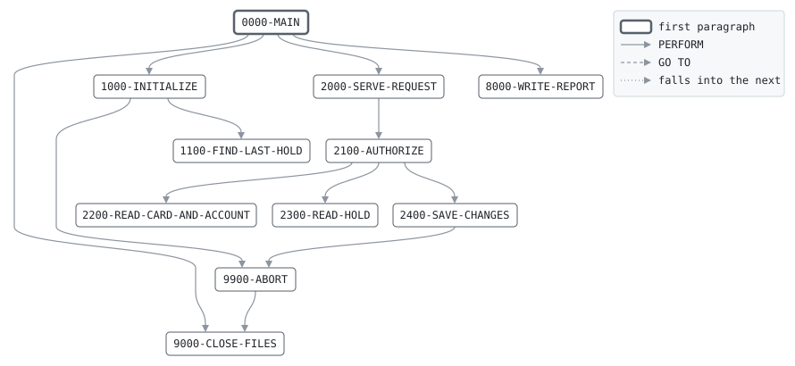

# AUTHSRV

```text
AUTHSRV: SERVE THE DAY'S CARD AND ATM AUTHORIZATIONS

RUNS FOR THE WHOLE ONLINE DAY, AS A TRANSACTION MONITOR DOES.
READS ONE AUTHORIZATION REQUEST AT A TIME FROM SYSIN, READS
THE CARD AND ITS ACCOUNT FROM THE ONLINE FILES, AND FOR A
REVERSAL THE HOLD, CALLS THE PROGRAM FOR THE REQUEST, AND
WRITES THE RESPONSE TO SYSOUT. WHEN A REQUEST IS APPROVED IT
REWRITES THE ACCOUNT AND THE CARD AND WRITES OR REWRITES THE
HOLD. THE CALLED PROGRAMS DECIDE; ONLY AUTHSRV OPENS FILES, SO
THAT EACH FILE HAS ONE READER AND WRITER. ENDS WITH THE
REQUESTS, WHEN THE BATCH WINDOW OPENS, AND REPORTS THE DAY.

HOLD NUMBERS, THE AUTHORIZATION CODES, NUMBER THE DAY'S HOLDS
FROM 1, AND GO ON FROM THE HIGHEST IN THE HOLD FILE WHEN THE
SERVER IS STARTED AGAIN DURING THE DAY.

RETURN CODES: 0 SERVED, 16 I/O.

MODIFICATION HISTORY
DATE       BY  CHANGE
2003-05-19 MV  CR-0342 ORIGINAL VERSION.
```

Program [AUTHSRV.cbl](../../../pangaea/programs/AUTHSRV.cbl): 5 files, 11 paragraphs. Its business rules: [8 decision tables](../rules/AUTHSRV.md).

- AUTHOR: M. VARGA, ONLINE SYSTEMS.
- INSTALLATION: FIRST BANK OF PANGAEA, DATA CENTER.
- DATE-WRITTEN: 2003-05-19.

## Contents

- [Files](#files)
- [Flow](#flow)
- [Paragraphs](#paragraphs)
- [Calls](#calls)
- [Data flow](#data-flow)
- [Lineage](#lineage)
  - [Into BANK-CONTROL-RECORD](#into-bank-control-record)
  - [Into ACCT-ONLINE-RECORD](#into-acct-online-record)
  - [Into CARD-RECORD](#into-card-record)
  - [Into HOLD-RECORD](#into-hold-record)
  - [Into REPORT-LINE](#into-report-line)
  - [Into WS-ABORT-MESSAGE](#into-ws-abort-message)
  - [Into WS-INPUT-END-SW](#into-ws-input-end-sw)
  - [Into WS-HOLDS-END-SW](#into-ws-holds-end-sw)
  - [Into WS-LAST-HOLD-NO](#into-ws-last-hold-no)
  - [Into AUTH-REQUEST](#into-auth-request)
  - [Into AUTH-RESPONSE](#into-auth-response)
  - [Into WS-TOTALS](#into-ws-totals)
  - [Into WS-REPORT-COUNT-LINE](#into-ws-report-count-line)
  - [Into WS-REPORT-AMOUNT-LINE](#into-ws-report-amount-line)
  - [Out of the program](#out-of-the-program)
  - [Into other data items](#into-other-data-items)
- [Field origins](#field-origins)
  - [File ACCT-FILE](#file-acct-file)
  - [File CARD-FILE](#file-card-file)
  - [File HOLD-FILE](#file-hold-file)
  - [File REPORT-OUT](#file-report-out)
- [Links between records](#links-between-records)
- [Records](#records)
  - [BANK-CONTROL-RECORD](#bank-control-record)
  - [ACCT-ONLINE-RECORD](#acct-online-record)
  - [CARD-RECORD](#card-record)
  - [HOLD-RECORD](#hold-record)
  - [REPORT-LINE](#report-line)
  - [WS-FILE-STATUSES](#ws-file-statuses)
  - [WS-ABORT-MESSAGE](#ws-abort-message)
  - [WS-INPUT-END-SW](#ws-input-end-sw)
  - [WS-HOLDS-END-SW](#ws-holds-end-sw)
  - [WS-LAST-HOLD-NO](#ws-last-hold-no)
  - [AUTH-REQUEST](#auth-request)
  - [AUTH-RESPONSE](#auth-response)
  - [WS-TOTALS](#ws-totals)
  - [WS-REPORT-COUNT-LINE](#ws-report-count-line)
  - [WS-REPORT-AMOUNT-LINE](#ws-report-amount-line)

## Files

| File | Kind | Assigned to | Organization | Status field | Opened | Records |
| --- | --- | --- | --- | --- | --- | --- |
| CONTROL-FILE | FD | BANKCTL | SEQUENTIAL | WS-CONTROL-STATUS | INPUT | BANK-CONTROL-RECORD |
| ACCT-FILE | FD | ACCTONL | INDEXED, key AO-ACCT-NO, RANDOM access | WS-ACCT-STATUS | I-O | ACCT-ONLINE-RECORD |
| CARD-FILE | FD | CARDONL | INDEXED, key CR-CARD-NO, RANDOM access | WS-CARD-STATUS | I-O | CARD-RECORD |
| HOLD-FILE | FD | HOLDS | INDEXED, key HD-KEY, DYNAMIC access | WS-HOLD-STATUS | I-O | HOLD-RECORD |
| REPORT-OUT | FD | AUTHRPT | LINE SEQUENTIAL | WS-REPORT-STATUS | OUTPUT | REPORT-LINE |

## Flow



## Paragraphs

| Paragraph | Description | Source | Performs | Goes to | Performed by | Reached by |
| --- | --- | --- | --- | --- | --- | --- |
| 0000-MAIN | SERVE REQUESTS UNTIL THERE ARE NO MORE, THEN REPORT. | [AUTHSRV.cbl:103](../../../pangaea/programs/AUTHSRV.cbl#L103) | 1000-INITIALIZE, 2000-SERVE-REQUEST, 8000-WRITE-REPORT, 9000-CLOSE-FILES | | | |
| 1000-INITIALIZE | OPEN THE FILES, READ THE BUSINESS DATE AND FIND THE LAST HOLD NUMBER GIVEN TODAY. | [AUTHSRV.cbl:113](../../../pangaea/programs/AUTHSRV.cbl#L113) | 9900-ABORT, 1100-FIND-LAST-HOLD | | 0000-MAIN | |
| 1100-FIND-LAST-HOLD | READ THROUGH THE HOLDS FOR THE HIGHEST HOLD NUMBER. | [AUTHSRV.cbl:131](../../../pangaea/programs/AUTHSRV.cbl#L131) | | | 1000-INITIALIZE | |
| 2000-SERVE-REQUEST | READ THE NEXT REQUEST, AND ANSWER IT. | [AUTHSRV.cbl:149](../../../pangaea/programs/AUTHSRV.cbl#L149) | 2100-AUTHORIZE | | 0000-MAIN | |
| 2100-AUTHORIZE | FIND THE RECORDS THE REQUEST IS ABOUT, CALL THE PROGRAM FOR IT, AND KEEP WHAT IT CHANGED IF IT APPROVED. | [AUTHSRV.cbl:160](../../../pangaea/programs/AUTHSRV.cbl#L160) | 2200-READ-CARD-AND-ACCOUNT, 2300-READ-HOLD, 2400-SAVE-CHANGES | | 2000-SERVE-REQUEST | |
| 2200-READ-CARD-AND-ACCOUNT | READ THE CARD, AND THE ACCOUNT IT DRAWS ON. | [AUTHSRV.cbl:203](../../../pangaea/programs/AUTHSRV.cbl#L203) | | | 2100-AUTHORIZE | |
| 2300-READ-HOLD | READ THE HOLD OF THE AUTHORIZATION TO REVERSE. | [AUTHSRV.cbl:219](../../../pangaea/programs/AUTHSRV.cbl#L219) | | | 2100-AUTHORIZE | |
| 2400-SAVE-CHANGES | REWRITE THE ACCOUNT AND THE CARD, AND WRITE A NEW HOLD UNDER THE NEXT HOLD NUMBER OR REWRITE THE REVERSED ONE. | [AUTHSRV.cbl:230](../../../pangaea/programs/AUTHSRV.cbl#L230) | 9900-ABORT | | 2100-AUTHORIZE | |
| 8000-WRITE-REPORT | WRITE THE DAY'S REPORT. | [AUTHSRV.cbl:262](../../../pangaea/programs/AUTHSRV.cbl#L262) | | | 0000-MAIN | |
| 9000-CLOSE-FILES | CLOSE ALL FILES. | [AUTHSRV.cbl:292](../../../pangaea/programs/AUTHSRV.cbl#L292) | | | 0000-MAIN, 9900-ABORT | |
| 9900-ABORT | STOP THE RUN WITH RETURN CODE 16, SAYING WHY. | [AUTHSRV.cbl:296](../../../pangaea/programs/AUTHSRV.cbl#L296) | 9000-CLOSE-FILES | | 1000-INITIALIZE, 2400-SAVE-CHANGES | |

## Calls

| Calls | Passing | Paragraph | Source |
| --- | --- | --- | --- |
| [AUTHPUR](AUTHPUR.md) | AUTH-REQUEST, AUTH-RESPONSE, BANK-CONTROL-RECORD, ACCT-ONLINE-RECORD, CARD-RECORD, HOLD-RECORD | 2100-AUTHORIZE | [AUTHSRV.cbl:176](../../../pangaea/programs/AUTHSRV.cbl#L176) |
| [AUTHREV](AUTHREV.md) | AUTH-REQUEST, AUTH-RESPONSE, BANK-CONTROL-RECORD, ACCT-ONLINE-RECORD, CARD-RECORD, HOLD-RECORD | 2100-AUTHORIZE | [AUTHSRV.cbl:180](../../../pangaea/programs/AUTHSRV.cbl#L180) |
| [ATMWDL](ATMWDL.md) | AUTH-REQUEST, AUTH-RESPONSE, BANK-CONTROL-RECORD, ACCT-ONLINE-RECORD, CARD-RECORD, HOLD-RECORD | 2100-AUTHORIZE | [AUTHSRV.cbl:184](../../../pangaea/programs/AUTHSRV.cbl#L184) |
| [ATMBAL](ATMBAL.md) | AUTH-REQUEST, AUTH-RESPONSE, BANK-CONTROL-RECORD, ACCT-ONLINE-RECORD, CARD-RECORD, HOLD-RECORD | 2100-AUTHORIZE | [AUTHSRV.cbl:188](../../../pangaea/programs/AUTHSRV.cbl#L188) |

## Data flow

| Paragraph | Reads | Writes |
| --- | --- | --- |
| 0000-MAIN | WS-INPUT-END-SW | RETURN-CODE |
| 1000-INITIALIZE | WS-FILE-STATUSES | RETURN-CODE, BANK-CONTROL-RECORD, WS-ABORT-MESSAGE |
| 1100-FIND-LAST-HOLD | HD-KEY, WS-HOLDS-END-SW, HD-HOLD-NO, WS-LAST-HOLD-NO | HD-KEY, WS-HOLDS-END-SW, HOLD-RECORD, WS-LAST-HOLD-NO |
| 2000-SERVE-REQUEST | AUTH-RESPONSE | AUTH-REQUEST, WS-INPUT-END-SW |
| 2100-AUTHORIZE | WS-REQUEST-COUNT, RQ-FUNCTION, RS-RESULT, AUTH-REQUEST, AUTH-RESPONSE, BANK-CONTROL-RECORD, ACCT-ONLINE-RECORD, CARD-RECORD, HOLD-RECORD, WS-APPROVED-COUNT, WS-DECLINED-COUNT | WS-REQUEST-COUNT, AUTH-RESPONSE, HOLD-RECORD, RS-RESULT, RS-MESSAGE, AUTH-REQUEST, BANK-CONTROL-RECORD, ACCT-ONLINE-RECORD, CARD-RECORD, WS-APPROVED-COUNT, WS-DECLINED-COUNT |
| 2200-READ-CARD-AND-ACCOUNT | RQ-CARD-NO, CR-ACCT-NO | CR-CARD-NO, CARD-RECORD, RS-RESULT, RS-MESSAGE, AO-ACCT-NO, ACCT-ONLINE-RECORD |
| 2300-READ-HOLD | CR-ACCT-NO, RQ-AUTH-CODE | HD-ACCT-NO, HD-HOLD-NO, HOLD-RECORD, RS-RESULT, RS-MESSAGE |
| 2400-SAVE-CHANGES | RQ-FUNCTION, HD-AMOUNT, WS-RELEASED-TOTAL, WS-LAST-HOLD-NO, WS-HELD-TOTAL, HD-FEE | ACCT-ONLINE-RECORD, WS-ABORT-MESSAGE, CARD-RECORD, HOLD-RECORD, WS-RELEASED-TOTAL, WS-LAST-HOLD-NO, HD-HOLD-NO, RS-AUTH-CODE, WS-HELD-TOTAL |
| 8000-WRITE-REPORT | BC-BUSINESS-DATE, WS-REQUEST-COUNT, WS-REPORT-COUNT-LINE, WS-APPROVED-COUNT, WS-DECLINED-COUNT, WS-LAST-HOLD-NO, WS-HELD-TOTAL, WS-REPORT-AMOUNT-LINE, WS-RELEASED-TOTAL | REPORT-LINE, WS-RC-LABEL, WS-RC-VALUE, WS-RA-LABEL, WS-RA-VALUE |
| 9000-CLOSE-FILES | | |
| 9900-ABORT | WS-ABORT-MESSAGE | RETURN-CODE |

## Lineage

Where each data item's values come from, grouped by the record they go into. A data item links to the record it belongs to.

### Into BANK-CONTROL-RECORD

Record [BANK-CONTROL-RECORD](#bank-control-record), from copybook [BANKCTL](../copybooks/BANKCTL.md).

| Into | From | Statement | Paragraph | Source |
| --- | --- | --- | --- | --- |
| BANK-CONTROL-RECORD | file CONTROL-FILE | READ | 1000-INITIALIZE | [AUTHSRV.cbl:123](../../../pangaea/programs/AUTHSRV.cbl#L123) |
| BANK-CONTROL-RECORD | call AUTHPUR argument 3 | CALL | 2100-AUTHORIZE | [AUTHSRV.cbl:176](../../../pangaea/programs/AUTHSRV.cbl#L176) |
| BANK-CONTROL-RECORD | call AUTHREV argument 3 | CALL | 2100-AUTHORIZE | [AUTHSRV.cbl:180](../../../pangaea/programs/AUTHSRV.cbl#L180) |
| BANK-CONTROL-RECORD | call ATMWDL argument 3 | CALL | 2100-AUTHORIZE | [AUTHSRV.cbl:184](../../../pangaea/programs/AUTHSRV.cbl#L184) |
| BANK-CONTROL-RECORD | call ATMBAL argument 3 | CALL | 2100-AUTHORIZE | [AUTHSRV.cbl:188](../../../pangaea/programs/AUTHSRV.cbl#L188) |

### Into ACCT-ONLINE-RECORD

Record [ACCT-ONLINE-RECORD](#acct-online-record), from copybook [ACCTONL](../copybooks/ACCTONL.md).

| Into | From | Statement | Paragraph | Source |
| --- | --- | --- | --- | --- |
| ACCT-ONLINE-RECORD | call AUTHPUR argument 4 | CALL | 2100-AUTHORIZE | [AUTHSRV.cbl:176](../../../pangaea/programs/AUTHSRV.cbl#L176) |
| ACCT-ONLINE-RECORD | call AUTHREV argument 4 | CALL | 2100-AUTHORIZE | [AUTHSRV.cbl:180](../../../pangaea/programs/AUTHSRV.cbl#L180) |
| ACCT-ONLINE-RECORD | call ATMWDL argument 4 | CALL | 2100-AUTHORIZE | [AUTHSRV.cbl:184](../../../pangaea/programs/AUTHSRV.cbl#L184) |
| ACCT-ONLINE-RECORD | call ATMBAL argument 4 | CALL | 2100-AUTHORIZE | [AUTHSRV.cbl:188](../../../pangaea/programs/AUTHSRV.cbl#L188) |
| ACCT-ONLINE-RECORD | file ACCT-FILE | READ | 2200-READ-CARD-AND-ACCOUNT | [AUTHSRV.cbl:211](../../../pangaea/programs/AUTHSRV.cbl#L211) |
| AO-ACCT-NO | [CR-ACCT-NO](#card-record "in CARD-RECORD") | MOVE | 2200-READ-CARD-AND-ACCOUNT | [AUTHSRV.cbl:210](../../../pangaea/programs/AUTHSRV.cbl#L210) |

### Into CARD-RECORD

Record [CARD-RECORD](#card-record), from copybook [CARDREC](../copybooks/CARDREC.md).

| Into | From | Statement | Paragraph | Source |
| --- | --- | --- | --- | --- |
| CARD-RECORD | call AUTHPUR argument 5 | CALL | 2100-AUTHORIZE | [AUTHSRV.cbl:176](../../../pangaea/programs/AUTHSRV.cbl#L176) |
| CARD-RECORD | call AUTHREV argument 5 | CALL | 2100-AUTHORIZE | [AUTHSRV.cbl:180](../../../pangaea/programs/AUTHSRV.cbl#L180) |
| CARD-RECORD | call ATMWDL argument 5 | CALL | 2100-AUTHORIZE | [AUTHSRV.cbl:184](../../../pangaea/programs/AUTHSRV.cbl#L184) |
| CARD-RECORD | call ATMBAL argument 5 | CALL | 2100-AUTHORIZE | [AUTHSRV.cbl:188](../../../pangaea/programs/AUTHSRV.cbl#L188) |
| CARD-RECORD | file CARD-FILE | READ | 2200-READ-CARD-AND-ACCOUNT | [AUTHSRV.cbl:205](../../../pangaea/programs/AUTHSRV.cbl#L205) |
| CR-CARD-NO | [RQ-CARD-NO](#auth-request "in AUTH-REQUEST") | MOVE | 2200-READ-CARD-AND-ACCOUNT | [AUTHSRV.cbl:204](../../../pangaea/programs/AUTHSRV.cbl#L204) |

### Into HOLD-RECORD

Record [HOLD-RECORD](#hold-record), from copybook [HOLDREC](../copybooks/HOLDREC.md).

| Into | From | Statement | Paragraph | Source |
| --- | --- | --- | --- | --- |
| HD-ACCT-NO | [CR-ACCT-NO](#card-record "in CARD-RECORD") | MOVE | 2300-READ-HOLD | [AUTHSRV.cbl:220](../../../pangaea/programs/AUTHSRV.cbl#L220) |
| HD-HOLD-NO | [RQ-AUTH-CODE](#auth-request "in AUTH-REQUEST") | MOVE | 2300-READ-HOLD | [AUTHSRV.cbl:221](../../../pangaea/programs/AUTHSRV.cbl#L221) |
| HD-HOLD-NO | [WS-LAST-HOLD-NO](#ws-last-hold-no) | MOVE | 2400-SAVE-CHANGES | [AUTHSRV.cbl:251](../../../pangaea/programs/AUTHSRV.cbl#L251) |
| HD-KEY | literal LOW-VALUES | MOVE | 1100-FIND-LAST-HOLD | [AUTHSRV.cbl:132](../../../pangaea/programs/AUTHSRV.cbl#L132) |
| HOLD-RECORD | file HOLD-FILE | READ | 1100-FIND-LAST-HOLD | [AUTHSRV.cbl:138](../../../pangaea/programs/AUTHSRV.cbl#L138) |
| HOLD-RECORD | literal SPACES | MOVE | 2100-AUTHORIZE | [AUTHSRV.cbl:162](../../../pangaea/programs/AUTHSRV.cbl#L162) |
| HOLD-RECORD | call AUTHPUR argument 6 | CALL | 2100-AUTHORIZE | [AUTHSRV.cbl:176](../../../pangaea/programs/AUTHSRV.cbl#L176) |
| HOLD-RECORD | call AUTHREV argument 6 | CALL | 2100-AUTHORIZE | [AUTHSRV.cbl:180](../../../pangaea/programs/AUTHSRV.cbl#L180) |
| HOLD-RECORD | call ATMWDL argument 6 | CALL | 2100-AUTHORIZE | [AUTHSRV.cbl:184](../../../pangaea/programs/AUTHSRV.cbl#L184) |
| HOLD-RECORD | call ATMBAL argument 6 | CALL | 2100-AUTHORIZE | [AUTHSRV.cbl:188](../../../pangaea/programs/AUTHSRV.cbl#L188) |
| HOLD-RECORD | file HOLD-FILE | READ | 2300-READ-HOLD | [AUTHSRV.cbl:222](../../../pangaea/programs/AUTHSRV.cbl#L222) |

### Into REPORT-LINE

Record [REPORT-LINE](#report-line).

| Into | From | Statement | Paragraph | Source |
| --- | --- | --- | --- | --- |
| REPORT-LINE | literal SPACES | MOVE | 8000-WRITE-REPORT | [AUTHSRV.cbl:263](../../../pangaea/programs/AUTHSRV.cbl#L263) |
| REPORT-LINE | literal 'AUTHSRV  ONLINE AUTHORIZATIONS   BUSINESS DATE ' | STRING | 8000-WRITE-REPORT | [AUTHSRV.cbl:264](../../../pangaea/programs/AUTHSRV.cbl#L264) |
| REPORT-LINE | [BC-BUSINESS-DATE](#bank-control-record "in BANK-CONTROL-RECORD") | STRING | 8000-WRITE-REPORT | [AUTHSRV.cbl:264](../../../pangaea/programs/AUTHSRV.cbl#L264) |
| REPORT-LINE | literal SPACES | MOVE | 8000-WRITE-REPORT | [AUTHSRV.cbl:268](../../../pangaea/programs/AUTHSRV.cbl#L268) |
| REPORT-LINE | [WS-REPORT-COUNT-LINE](#ws-report-count-line) | WRITE | 8000-WRITE-REPORT | [AUTHSRV.cbl:272](../../../pangaea/programs/AUTHSRV.cbl#L272) |
| REPORT-LINE | [WS-REPORT-COUNT-LINE](#ws-report-count-line) | WRITE | 8000-WRITE-REPORT | [AUTHSRV.cbl:275](../../../pangaea/programs/AUTHSRV.cbl#L275) |
| REPORT-LINE | [WS-REPORT-COUNT-LINE](#ws-report-count-line) | WRITE | 8000-WRITE-REPORT | [AUTHSRV.cbl:278](../../../pangaea/programs/AUTHSRV.cbl#L278) |
| REPORT-LINE | [WS-REPORT-COUNT-LINE](#ws-report-count-line) | WRITE | 8000-WRITE-REPORT | [AUTHSRV.cbl:281](../../../pangaea/programs/AUTHSRV.cbl#L281) |
| REPORT-LINE | literal SPACES | MOVE | 8000-WRITE-REPORT | [AUTHSRV.cbl:282](../../../pangaea/programs/AUTHSRV.cbl#L282) |
| REPORT-LINE | [WS-REPORT-AMOUNT-LINE](#ws-report-amount-line) | WRITE | 8000-WRITE-REPORT | [AUTHSRV.cbl:286](../../../pangaea/programs/AUTHSRV.cbl#L286) |
| REPORT-LINE | [WS-REPORT-AMOUNT-LINE](#ws-report-amount-line) | WRITE | 8000-WRITE-REPORT | [AUTHSRV.cbl:289](../../../pangaea/programs/AUTHSRV.cbl#L289) |

### Into WS-ABORT-MESSAGE

Record [WS-ABORT-MESSAGE](#ws-abort-message).

| Into | From | Statement | Paragraph | Source |
| --- | --- | --- | --- | --- |
| WS-ABORT-MESSAGE | literal 'NO BANK CONTROL RECORD' | MOVE | 1000-INITIALIZE | [AUTHSRV.cbl:125](../../../pangaea/programs/AUTHSRV.cbl#L125) |
| WS-ABORT-MESSAGE | literal 'CANNOT REWRITE THE ACCOUNT' | MOVE | 2400-SAVE-CHANGES | [AUTHSRV.cbl:233](../../../pangaea/programs/AUTHSRV.cbl#L233) |
| WS-ABORT-MESSAGE | literal 'CANNOT REWRITE THE CARD' | MOVE | 2400-SAVE-CHANGES | [AUTHSRV.cbl:238](../../../pangaea/programs/AUTHSRV.cbl#L238) |
| WS-ABORT-MESSAGE | literal 'CANNOT REWRITE THE HOLD' | MOVE | 2400-SAVE-CHANGES | [AUTHSRV.cbl:244](../../../pangaea/programs/AUTHSRV.cbl#L244) |
| WS-ABORT-MESSAGE | literal 'CANNOT WRITE THE HOLD' | MOVE | 2400-SAVE-CHANGES | [AUTHSRV.cbl:254](../../../pangaea/programs/AUTHSRV.cbl#L254) |

### Into WS-INPUT-END-SW

Record [WS-INPUT-END-SW](#ws-input-end-sw).

| Into | From | Statement | Paragraph | Source |
| --- | --- | --- | --- | --- |
| WS-INPUT-END-SW | literal condition END-OF-INPUT | SET | 2000-SERVE-REQUEST | [AUTHSRV.cbl:152](../../../pangaea/programs/AUTHSRV.cbl#L152) |

### Into WS-HOLDS-END-SW

Record [WS-HOLDS-END-SW](#ws-holds-end-sw).

| Into | From | Statement | Paragraph | Source |
| --- | --- | --- | --- | --- |
| WS-HOLDS-END-SW | literal condition END-OF-HOLDS | SET | 1100-FIND-LAST-HOLD | [AUTHSRV.cbl:135](../../../pangaea/programs/AUTHSRV.cbl#L135) |
| WS-HOLDS-END-SW | literal condition END-OF-HOLDS | SET | 1100-FIND-LAST-HOLD | [AUTHSRV.cbl:140](../../../pangaea/programs/AUTHSRV.cbl#L140) |

### Into WS-LAST-HOLD-NO

Record [WS-LAST-HOLD-NO](#ws-last-hold-no).

| Into | From | Statement | Paragraph | Source |
| --- | --- | --- | --- | --- |
| WS-LAST-HOLD-NO | [HD-HOLD-NO](#hold-record "in HOLD-RECORD") | MOVE | 1100-FIND-LAST-HOLD | [AUTHSRV.cbl:143](../../../pangaea/programs/AUTHSRV.cbl#L143) |
| WS-LAST-HOLD-NO | literal 1 | ADD | 2400-SAVE-CHANGES | [AUTHSRV.cbl:250](../../../pangaea/programs/AUTHSRV.cbl#L250) |

### Into AUTH-REQUEST

Record [AUTH-REQUEST](#auth-request), from copybook [AUTHMSG](../copybooks/AUTHMSG.md).

| Into | From | Statement | Paragraph | Source |
| --- | --- | --- | --- | --- |
| AUTH-REQUEST | SYSIN | ACCEPT | 2000-SERVE-REQUEST | [AUTHSRV.cbl:150](../../../pangaea/programs/AUTHSRV.cbl#L150) |
| AUTH-REQUEST | call AUTHPUR argument 1 | CALL | 2100-AUTHORIZE | [AUTHSRV.cbl:176](../../../pangaea/programs/AUTHSRV.cbl#L176) |
| AUTH-REQUEST | call AUTHREV argument 1 | CALL | 2100-AUTHORIZE | [AUTHSRV.cbl:180](../../../pangaea/programs/AUTHSRV.cbl#L180) |
| AUTH-REQUEST | call ATMWDL argument 1 | CALL | 2100-AUTHORIZE | [AUTHSRV.cbl:184](../../../pangaea/programs/AUTHSRV.cbl#L184) |
| AUTH-REQUEST | call ATMBAL argument 1 | CALL | 2100-AUTHORIZE | [AUTHSRV.cbl:188](../../../pangaea/programs/AUTHSRV.cbl#L188) |

### Into AUTH-RESPONSE

Record [AUTH-RESPONSE](#auth-response), from copybook [AUTHMSG](../copybooks/AUTHMSG.md).

| Into | From | Statement | Paragraph | Source |
| --- | --- | --- | --- | --- |
| AUTH-RESPONSE | literal SPACES | MOVE | 2100-AUTHORIZE | [AUTHSRV.cbl:162](../../../pangaea/programs/AUTHSRV.cbl#L162) |
| AUTH-RESPONSE | call AUTHPUR argument 2 | CALL | 2100-AUTHORIZE | [AUTHSRV.cbl:176](../../../pangaea/programs/AUTHSRV.cbl#L176) |
| AUTH-RESPONSE | call AUTHREV argument 2 | CALL | 2100-AUTHORIZE | [AUTHSRV.cbl:180](../../../pangaea/programs/AUTHSRV.cbl#L180) |
| AUTH-RESPONSE | call ATMWDL argument 2 | CALL | 2100-AUTHORIZE | [AUTHSRV.cbl:184](../../../pangaea/programs/AUTHSRV.cbl#L184) |
| AUTH-RESPONSE | call ATMBAL argument 2 | CALL | 2100-AUTHORIZE | [AUTHSRV.cbl:188](../../../pangaea/programs/AUTHSRV.cbl#L188) |
| RS-AUTH-CODE | [WS-LAST-HOLD-NO](#ws-last-hold-no) | MOVE | 2400-SAVE-CHANGES | [AUTHSRV.cbl:251](../../../pangaea/programs/AUTHSRV.cbl#L251) |
| RS-MESSAGE | literal 'UNKNOWN REQUEST' | MOVE | 2100-AUTHORIZE | [AUTHSRV.cbl:168](../../../pangaea/programs/AUTHSRV.cbl#L168) |
| RS-MESSAGE | literal 'NO SUCH CARD' | MOVE | 2200-READ-CARD-AND-ACCOUNT | [AUTHSRV.cbl:208](../../../pangaea/programs/AUTHSRV.cbl#L208) |
| RS-MESSAGE | literal 'NO SUCH ACCOUNT' | MOVE | 2200-READ-CARD-AND-ACCOUNT | [AUTHSRV.cbl:214](../../../pangaea/programs/AUTHSRV.cbl#L214) |
| RS-MESSAGE | literal 'NO SUCH AUTHORIZATION' | MOVE | 2300-READ-HOLD | [AUTHSRV.cbl:225](../../../pangaea/programs/AUTHSRV.cbl#L225) |
| RS-RESULT | literal condition RS-INVALID-REQUEST | SET | 2100-AUTHORIZE | [AUTHSRV.cbl:167](../../../pangaea/programs/AUTHSRV.cbl#L167) |
| RS-RESULT | literal condition RS-NO-SUCH-CARD | SET | 2200-READ-CARD-AND-ACCOUNT | [AUTHSRV.cbl:207](../../../pangaea/programs/AUTHSRV.cbl#L207) |
| RS-RESULT | literal condition RS-ACCOUNT-NOT-OPEN | SET | 2200-READ-CARD-AND-ACCOUNT | [AUTHSRV.cbl:213](../../../pangaea/programs/AUTHSRV.cbl#L213) |
| RS-RESULT | literal condition RS-NO-SUCH-AUTH | SET | 2300-READ-HOLD | [AUTHSRV.cbl:224](../../../pangaea/programs/AUTHSRV.cbl#L224) |

### Into WS-TOTALS

Record [WS-TOTALS](#ws-totals).

| Into | From | Statement | Paragraph | Source |
| --- | --- | --- | --- | --- |
| WS-APPROVED-COUNT | literal 1 | ADD | 2100-AUTHORIZE | [AUTHSRV.cbl:194](../../../pangaea/programs/AUTHSRV.cbl#L194) |
| WS-DECLINED-COUNT | literal 1 | ADD | 2100-AUTHORIZE | [AUTHSRV.cbl:199](../../../pangaea/programs/AUTHSRV.cbl#L199) |
| WS-HELD-TOTAL | [HD-AMOUNT](#hold-record "in HOLD-RECORD") | ADD | 2400-SAVE-CHANGES | [AUTHSRV.cbl:257](../../../pangaea/programs/AUTHSRV.cbl#L257) |
| WS-HELD-TOTAL | [HD-FEE](#hold-record "in HOLD-RECORD") | ADD | 2400-SAVE-CHANGES | [AUTHSRV.cbl:258](../../../pangaea/programs/AUTHSRV.cbl#L258) |
| WS-RELEASED-TOTAL | [HD-AMOUNT](#hold-record "in HOLD-RECORD") | ADD | 2400-SAVE-CHANGES | [AUTHSRV.cbl:248](../../../pangaea/programs/AUTHSRV.cbl#L248) |
| WS-REQUEST-COUNT | literal 1 | ADD | 2100-AUTHORIZE | [AUTHSRV.cbl:161](../../../pangaea/programs/AUTHSRV.cbl#L161) |

### Into WS-REPORT-COUNT-LINE

Record [WS-REPORT-COUNT-LINE](#ws-report-count-line).

| Into | From | Statement | Paragraph | Source |
| --- | --- | --- | --- | --- |
| WS-RC-LABEL | literal 'REQUESTS' | MOVE | 8000-WRITE-REPORT | [AUTHSRV.cbl:270](../../../pangaea/programs/AUTHSRV.cbl#L270) |
| WS-RC-LABEL | literal 'APPROVED' | MOVE | 8000-WRITE-REPORT | [AUTHSRV.cbl:273](../../../pangaea/programs/AUTHSRV.cbl#L273) |
| WS-RC-LABEL | literal 'DECLINED' | MOVE | 8000-WRITE-REPORT | [AUTHSRV.cbl:276](../../../pangaea/programs/AUTHSRV.cbl#L276) |
| WS-RC-LABEL | literal 'LAST AUTHORIZATION CODE' | MOVE | 8000-WRITE-REPORT | [AUTHSRV.cbl:279](../../../pangaea/programs/AUTHSRV.cbl#L279) |
| WS-RC-VALUE | [WS-REQUEST-COUNT](#ws-totals "in WS-TOTALS") | MOVE | 8000-WRITE-REPORT | [AUTHSRV.cbl:271](../../../pangaea/programs/AUTHSRV.cbl#L271) |
| WS-RC-VALUE | [WS-APPROVED-COUNT](#ws-totals "in WS-TOTALS") | MOVE | 8000-WRITE-REPORT | [AUTHSRV.cbl:274](../../../pangaea/programs/AUTHSRV.cbl#L274) |
| WS-RC-VALUE | [WS-DECLINED-COUNT](#ws-totals "in WS-TOTALS") | MOVE | 8000-WRITE-REPORT | [AUTHSRV.cbl:277](../../../pangaea/programs/AUTHSRV.cbl#L277) |
| WS-RC-VALUE | [WS-LAST-HOLD-NO](#ws-last-hold-no) | MOVE | 8000-WRITE-REPORT | [AUTHSRV.cbl:280](../../../pangaea/programs/AUTHSRV.cbl#L280) |

### Into WS-REPORT-AMOUNT-LINE

Record [WS-REPORT-AMOUNT-LINE](#ws-report-amount-line).

| Into | From | Statement | Paragraph | Source |
| --- | --- | --- | --- | --- |
| WS-RA-LABEL | literal 'HELD WITH FEES' | MOVE | 8000-WRITE-REPORT | [AUTHSRV.cbl:284](../../../pangaea/programs/AUTHSRV.cbl#L284) |
| WS-RA-LABEL | literal 'RELEASED BY REVERSALS' | MOVE | 8000-WRITE-REPORT | [AUTHSRV.cbl:287](../../../pangaea/programs/AUTHSRV.cbl#L287) |
| WS-RA-VALUE | [WS-HELD-TOTAL](#ws-totals "in WS-TOTALS") | MOVE | 8000-WRITE-REPORT | [AUTHSRV.cbl:285](../../../pangaea/programs/AUTHSRV.cbl#L285) |
| WS-RA-VALUE | [WS-RELEASED-TOTAL](#ws-totals "in WS-TOTALS") | MOVE | 8000-WRITE-REPORT | [AUTHSRV.cbl:288](../../../pangaea/programs/AUTHSRV.cbl#L288) |

### Out of the program

Records written to files, items passed to the programs called, and items displayed to the job's output.

| Into | From | Statement | Paragraph | Source |
| --- | --- | --- | --- | --- |
| file ACCT-FILE | [ACCT-ONLINE-RECORD](#acct-online-record) | REWRITE | 2400-SAVE-CHANGES | [AUTHSRV.cbl:231](../../../pangaea/programs/AUTHSRV.cbl#L231) |
| call ATMBAL argument 1 | [AUTH-REQUEST](#auth-request) | CALL | 2100-AUTHORIZE | [AUTHSRV.cbl:188](../../../pangaea/programs/AUTHSRV.cbl#L188) |
| call ATMBAL argument 2 | [AUTH-RESPONSE](#auth-response) | CALL | 2100-AUTHORIZE | [AUTHSRV.cbl:188](../../../pangaea/programs/AUTHSRV.cbl#L188) |
| call ATMBAL argument 3 | [BANK-CONTROL-RECORD](#bank-control-record) | CALL | 2100-AUTHORIZE | [AUTHSRV.cbl:188](../../../pangaea/programs/AUTHSRV.cbl#L188) |
| call ATMBAL argument 4 | [ACCT-ONLINE-RECORD](#acct-online-record) | CALL | 2100-AUTHORIZE | [AUTHSRV.cbl:188](../../../pangaea/programs/AUTHSRV.cbl#L188) |
| call ATMBAL argument 5 | [CARD-RECORD](#card-record) | CALL | 2100-AUTHORIZE | [AUTHSRV.cbl:188](../../../pangaea/programs/AUTHSRV.cbl#L188) |
| call ATMBAL argument 6 | [HOLD-RECORD](#hold-record) | CALL | 2100-AUTHORIZE | [AUTHSRV.cbl:188](../../../pangaea/programs/AUTHSRV.cbl#L188) |
| call ATMWDL argument 1 | [AUTH-REQUEST](#auth-request) | CALL | 2100-AUTHORIZE | [AUTHSRV.cbl:184](../../../pangaea/programs/AUTHSRV.cbl#L184) |
| call ATMWDL argument 2 | [AUTH-RESPONSE](#auth-response) | CALL | 2100-AUTHORIZE | [AUTHSRV.cbl:184](../../../pangaea/programs/AUTHSRV.cbl#L184) |
| call ATMWDL argument 3 | [BANK-CONTROL-RECORD](#bank-control-record) | CALL | 2100-AUTHORIZE | [AUTHSRV.cbl:184](../../../pangaea/programs/AUTHSRV.cbl#L184) |
| call ATMWDL argument 4 | [ACCT-ONLINE-RECORD](#acct-online-record) | CALL | 2100-AUTHORIZE | [AUTHSRV.cbl:184](../../../pangaea/programs/AUTHSRV.cbl#L184) |
| call ATMWDL argument 5 | [CARD-RECORD](#card-record) | CALL | 2100-AUTHORIZE | [AUTHSRV.cbl:184](../../../pangaea/programs/AUTHSRV.cbl#L184) |
| call ATMWDL argument 6 | [HOLD-RECORD](#hold-record) | CALL | 2100-AUTHORIZE | [AUTHSRV.cbl:184](../../../pangaea/programs/AUTHSRV.cbl#L184) |
| call AUTHPUR argument 1 | [AUTH-REQUEST](#auth-request) | CALL | 2100-AUTHORIZE | [AUTHSRV.cbl:176](../../../pangaea/programs/AUTHSRV.cbl#L176) |
| call AUTHPUR argument 2 | [AUTH-RESPONSE](#auth-response) | CALL | 2100-AUTHORIZE | [AUTHSRV.cbl:176](../../../pangaea/programs/AUTHSRV.cbl#L176) |
| call AUTHPUR argument 3 | [BANK-CONTROL-RECORD](#bank-control-record) | CALL | 2100-AUTHORIZE | [AUTHSRV.cbl:176](../../../pangaea/programs/AUTHSRV.cbl#L176) |
| call AUTHPUR argument 4 | [ACCT-ONLINE-RECORD](#acct-online-record) | CALL | 2100-AUTHORIZE | [AUTHSRV.cbl:176](../../../pangaea/programs/AUTHSRV.cbl#L176) |
| call AUTHPUR argument 5 | [CARD-RECORD](#card-record) | CALL | 2100-AUTHORIZE | [AUTHSRV.cbl:176](../../../pangaea/programs/AUTHSRV.cbl#L176) |
| call AUTHPUR argument 6 | [HOLD-RECORD](#hold-record) | CALL | 2100-AUTHORIZE | [AUTHSRV.cbl:176](../../../pangaea/programs/AUTHSRV.cbl#L176) |
| call AUTHREV argument 1 | [AUTH-REQUEST](#auth-request) | CALL | 2100-AUTHORIZE | [AUTHSRV.cbl:180](../../../pangaea/programs/AUTHSRV.cbl#L180) |
| call AUTHREV argument 2 | [AUTH-RESPONSE](#auth-response) | CALL | 2100-AUTHORIZE | [AUTHSRV.cbl:180](../../../pangaea/programs/AUTHSRV.cbl#L180) |
| call AUTHREV argument 3 | [BANK-CONTROL-RECORD](#bank-control-record) | CALL | 2100-AUTHORIZE | [AUTHSRV.cbl:180](../../../pangaea/programs/AUTHSRV.cbl#L180) |
| call AUTHREV argument 4 | [ACCT-ONLINE-RECORD](#acct-online-record) | CALL | 2100-AUTHORIZE | [AUTHSRV.cbl:180](../../../pangaea/programs/AUTHSRV.cbl#L180) |
| call AUTHREV argument 5 | [CARD-RECORD](#card-record) | CALL | 2100-AUTHORIZE | [AUTHSRV.cbl:180](../../../pangaea/programs/AUTHSRV.cbl#L180) |
| call AUTHREV argument 6 | [HOLD-RECORD](#hold-record) | CALL | 2100-AUTHORIZE | [AUTHSRV.cbl:180](../../../pangaea/programs/AUTHSRV.cbl#L180) |
| file CARD-FILE | [CARD-RECORD](#card-record) | REWRITE | 2400-SAVE-CHANGES | [AUTHSRV.cbl:236](../../../pangaea/programs/AUTHSRV.cbl#L236) |
| file HOLD-FILE | [HOLD-RECORD](#hold-record) | REWRITE | 2400-SAVE-CHANGES | [AUTHSRV.cbl:242](../../../pangaea/programs/AUTHSRV.cbl#L242) |
| file HOLD-FILE | [HOLD-RECORD](#hold-record) | WRITE | 2400-SAVE-CHANGES | [AUTHSRV.cbl:252](../../../pangaea/programs/AUTHSRV.cbl#L252) |
| file REPORT-OUT | [REPORT-LINE](#report-line) | WRITE | 8000-WRITE-REPORT | [AUTHSRV.cbl:267](../../../pangaea/programs/AUTHSRV.cbl#L267) |
| file REPORT-OUT | [REPORT-LINE](#report-line) | WRITE | 8000-WRITE-REPORT | [AUTHSRV.cbl:269](../../../pangaea/programs/AUTHSRV.cbl#L269) |
| file REPORT-OUT | [REPORT-LINE](#report-line) | WRITE | 8000-WRITE-REPORT | [AUTHSRV.cbl:272](../../../pangaea/programs/AUTHSRV.cbl#L272) |
| file REPORT-OUT | [REPORT-LINE](#report-line) | WRITE | 8000-WRITE-REPORT | [AUTHSRV.cbl:275](../../../pangaea/programs/AUTHSRV.cbl#L275) |
| file REPORT-OUT | [REPORT-LINE](#report-line) | WRITE | 8000-WRITE-REPORT | [AUTHSRV.cbl:278](../../../pangaea/programs/AUTHSRV.cbl#L278) |
| file REPORT-OUT | [REPORT-LINE](#report-line) | WRITE | 8000-WRITE-REPORT | [AUTHSRV.cbl:281](../../../pangaea/programs/AUTHSRV.cbl#L281) |
| file REPORT-OUT | [REPORT-LINE](#report-line) | WRITE | 8000-WRITE-REPORT | [AUTHSRV.cbl:283](../../../pangaea/programs/AUTHSRV.cbl#L283) |
| file REPORT-OUT | [REPORT-LINE](#report-line) | WRITE | 8000-WRITE-REPORT | [AUTHSRV.cbl:286](../../../pangaea/programs/AUTHSRV.cbl#L286) |
| file REPORT-OUT | [REPORT-LINE](#report-line) | WRITE | 8000-WRITE-REPORT | [AUTHSRV.cbl:289](../../../pangaea/programs/AUTHSRV.cbl#L289) |
| SYSOUT | [AUTH-RESPONSE](#auth-response) | DISPLAY | 2000-SERVE-REQUEST | [AUTHSRV.cbl:155](../../../pangaea/programs/AUTHSRV.cbl#L155) |

### Into other data items

Data items the program does not declare, such as special registers and index names.

| Into | From | Statement | Paragraph | Source |
| --- | --- | --- | --- | --- |
| RETURN-CODE | literal 0 | MOVE | 0000-MAIN | [AUTHSRV.cbl:108](../../../pangaea/programs/AUTHSRV.cbl#L108) |
| RETURN-CODE | literal 16 | MOVE | 1000-INITIALIZE | [AUTHSRV.cbl:120](../../../pangaea/programs/AUTHSRV.cbl#L120) |
| RETURN-CODE | literal 16 | MOVE | 9900-ABORT | [AUTHSRV.cbl:299](../../../pangaea/programs/AUTHSRV.cbl#L299) |

## Field origins

Where the values of each field the program writes to a file come from: the fields of the files it reads, literals, and initial values, followed through every statement that moves a value, and through groups and redefinitions by the bytes they share.

### File ACCT-FILE

Written from [ACCT-ONLINE-RECORD](#acct-online-record).

| Field | Position | Origins |
| --- | --: | --- |
| AO-ACCT-NO | 1-10 | call ATMBAL argument 4 AO-ACCT-NO; call ATMBAL argument 5 CR-ACCT-NO; call ATMWDL argument 4 AO-ACCT-NO; call ATMWDL argument 5 CR-ACCT-NO; call AUTHPUR argument 4 AO-ACCT-NO; call AUTHPUR argument 5 CR-ACCT-NO; call AUTHREV argument 4 AO-ACCT-NO; call AUTHREV argument 5 CR-ACCT-NO; file ACCT-FILE AO-ACCT-NO; file CARD-FILE CR-ACCT-NO |
| AO-CUST-NO | 11-18 | call ATMBAL argument 4 AO-CUST-NO; call ATMWDL argument 4 AO-CUST-NO; call AUTHPUR argument 4 AO-CUST-NO; call AUTHREV argument 4 AO-CUST-NO; file ACCT-FILE AO-CUST-NO |
| AO-SHORT-NAME | 19-38 | call ATMBAL argument 4 AO-SHORT-NAME; call ATMWDL argument 4 AO-SHORT-NAME; call AUTHPUR argument 4 AO-SHORT-NAME; call AUTHREV argument 4 AO-SHORT-NAME; file ACCT-FILE AO-SHORT-NAME |
| AO-ACCT-TYPE | 39 | call ATMBAL argument 4 AO-ACCT-TYPE; call ATMWDL argument 4 AO-ACCT-TYPE; call AUTHPUR argument 4 AO-ACCT-TYPE; call AUTHREV argument 4 AO-ACCT-TYPE; file ACCT-FILE AO-ACCT-TYPE |
| AO-STATUS | 40 | call ATMBAL argument 4 AO-STATUS; call ATMWDL argument 4 AO-STATUS; call AUTHPUR argument 4 AO-STATUS; call AUTHREV argument 4 AO-STATUS; file ACCT-FILE AO-STATUS |
| AO-BALANCE | 41-53 | call ATMBAL argument 4 AO-BALANCE; call ATMWDL argument 4 AO-BALANCE; call AUTHPUR argument 4 AO-BALANCE; call AUTHREV argument 4 AO-BALANCE; file ACCT-FILE AO-BALANCE |
| AO-OVERDRAFT-LIMIT | 54-62 | call ATMBAL argument 4 AO-OVERDRAFT-LIMIT; call ATMWDL argument 4 AO-OVERDRAFT-LIMIT; call AUTHPUR argument 4 AO-OVERDRAFT-LIMIT; call AUTHREV argument 4 AO-OVERDRAFT-LIMIT; file ACCT-FILE AO-OVERDRAFT-LIMIT |
| AO-HOLDS | 63-75 | call ATMBAL argument 4 AO-HOLDS; call ATMWDL argument 4 AO-HOLDS; call AUTHPUR argument 4 AO-HOLDS; call AUTHREV argument 4 AO-HOLDS; file ACCT-FILE AO-HOLDS |
| AO-AS-OF-DATE | 76-83 | call ATMBAL argument 4 AO-AS-OF-DATE; call ATMWDL argument 4 AO-AS-OF-DATE; call AUTHPUR argument 4 AO-AS-OF-DATE; call AUTHREV argument 4 AO-AS-OF-DATE; file ACCT-FILE AO-AS-OF-DATE |

### File CARD-FILE

Written from [CARD-RECORD](#card-record).

| Field | Position | Origins |
| --- | --: | --- |
| CR-CARD-NO | 1-16 | call ATMBAL argument 1 RQ-CARD-NO; call ATMBAL argument 5 CR-CARD-NO; call ATMWDL argument 1 RQ-CARD-NO; call ATMWDL argument 5 CR-CARD-NO; call AUTHPUR argument 1 RQ-CARD-NO; call AUTHPUR argument 5 CR-CARD-NO; call AUTHREV argument 1 RQ-CARD-NO; call AUTHREV argument 5 CR-CARD-NO; file CARD-FILE CR-CARD-NO; stream SYSIN RQ-CARD-NO |
| CR-ACCT-NO | 17-26 | call ATMBAL argument 5 CR-ACCT-NO; call ATMWDL argument 5 CR-ACCT-NO; call AUTHPUR argument 5 CR-ACCT-NO; call AUTHREV argument 5 CR-ACCT-NO; file CARD-FILE CR-ACCT-NO |
| CR-CUST-NO | 27-34 | call ATMBAL argument 5 CR-CUST-NO; call ATMWDL argument 5 CR-CUST-NO; call AUTHPUR argument 5 CR-CUST-NO; call AUTHREV argument 5 CR-CUST-NO; file CARD-FILE CR-CUST-NO |
| CR-STATUS | 35 | call ATMBAL argument 5 CR-STATUS; call ATMWDL argument 5 CR-STATUS; call AUTHPUR argument 5 CR-STATUS; call AUTHREV argument 5 CR-STATUS; file CARD-FILE CR-STATUS |
| CR-EXPIRY-MONTH | 36-41 | call ATMBAL argument 5 CR-EXPIRY-MONTH; call ATMWDL argument 5 CR-EXPIRY-MONTH; call AUTHPUR argument 5 CR-EXPIRY-MONTH; call AUTHREV argument 5 CR-EXPIRY-MONTH; file CARD-FILE CR-EXPIRY-MONTH |
| CR-PURCHASE-LIMIT | 42-48 | call ATMBAL argument 5 CR-PURCHASE-LIMIT; call ATMWDL argument 5 CR-PURCHASE-LIMIT; call AUTHPUR argument 5 CR-PURCHASE-LIMIT; call AUTHREV argument 5 CR-PURCHASE-LIMIT; file CARD-FILE CR-PURCHASE-LIMIT |
| CR-CASH-LIMIT | 49-55 | call ATMBAL argument 5 CR-CASH-LIMIT; call ATMWDL argument 5 CR-CASH-LIMIT; call AUTHPUR argument 5 CR-CASH-LIMIT; call AUTHREV argument 5 CR-CASH-LIMIT; file CARD-FILE CR-CASH-LIMIT |
| CR-TOTALS-DATE | 56-63 | call ATMBAL argument 5 CR-TOTALS-DATE; call ATMWDL argument 5 CR-TOTALS-DATE; call AUTHPUR argument 5 CR-TOTALS-DATE; call AUTHREV argument 5 CR-TOTALS-DATE; file CARD-FILE CR-TOTALS-DATE |
| CR-DAY-PURCHASES | 64-70 | call ATMBAL argument 5 CR-DAY-PURCHASES; call ATMWDL argument 5 CR-DAY-PURCHASES; call AUTHPUR argument 5 CR-DAY-PURCHASES; call AUTHREV argument 5 CR-DAY-PURCHASES; file CARD-FILE CR-DAY-PURCHASES |
| CR-DAY-CASH | 71-77 | call ATMBAL argument 5 CR-DAY-CASH; call ATMWDL argument 5 CR-DAY-CASH; call AUTHPUR argument 5 CR-DAY-CASH; call AUTHREV argument 5 CR-DAY-CASH; file CARD-FILE CR-DAY-CASH |
| CR-MONTH-WITHDRAWALS | 78-80 | call ATMBAL argument 5 CR-MONTH-WITHDRAWALS; call ATMWDL argument 5 CR-MONTH-WITHDRAWALS; call AUTHPUR argument 5 CR-MONTH-WITHDRAWALS; call AUTHREV argument 5 CR-MONTH-WITHDRAWALS; file CARD-FILE CR-MONTH-WITHDRAWALS |

### File HOLD-FILE

Written from [HOLD-RECORD](#hold-record).

| Field | Position | Origins |
| --- | --: | --- |
| HD-ACCT-NO | 1-10 | call ATMBAL argument 5 CR-ACCT-NO; call ATMBAL argument 6 HD-ACCT-NO; call ATMWDL argument 5 CR-ACCT-NO; call ATMWDL argument 6 HD-ACCT-NO; call AUTHPUR argument 5 CR-ACCT-NO; call AUTHPUR argument 6 HD-ACCT-NO; call AUTHREV argument 5 CR-ACCT-NO; call AUTHREV argument 6 HD-ACCT-NO; file CARD-FILE CR-ACCT-NO; file HOLD-FILE HD-ACCT-NO |
| HD-HOLD-NO | 11-16 | call ATMBAL argument 1 RQ-AUTH-CODE; call ATMBAL argument 6 HD-HOLD-NO; call ATMWDL argument 1 RQ-AUTH-CODE; call ATMWDL argument 6 HD-HOLD-NO; call AUTHPUR argument 1 RQ-AUTH-CODE; call AUTHPUR argument 6 HD-HOLD-NO; call AUTHREV argument 1 RQ-AUTH-CODE; call AUTHREV argument 6 HD-HOLD-NO; file HOLD-FILE HD-HOLD-NO; initial value of WS-LAST-HOLD-NO; literal 1; stream SYSIN RQ-AUTH-CODE |
| HD-CARD-NO | 17-32 | call ATMBAL argument 6 HD-CARD-NO; call ATMWDL argument 6 HD-CARD-NO; call AUTHPUR argument 6 HD-CARD-NO; call AUTHREV argument 6 HD-CARD-NO; file HOLD-FILE HD-CARD-NO |
| HD-KIND | 33 | call ATMBAL argument 6 HD-KIND; call ATMWDL argument 6 HD-KIND; call AUTHPUR argument 6 HD-KIND; call AUTHREV argument 6 HD-KIND; file HOLD-FILE HD-KIND |
| HD-STATUS | 34 | call ATMBAL argument 6 HD-STATUS; call ATMWDL argument 6 HD-STATUS; call AUTHPUR argument 6 HD-STATUS; call AUTHREV argument 6 HD-STATUS; file HOLD-FILE HD-STATUS |
| HD-AMOUNT | 35-43 | call ATMBAL argument 6 HD-AMOUNT; call ATMWDL argument 6 HD-AMOUNT; call AUTHPUR argument 6 HD-AMOUNT; call AUTHREV argument 6 HD-AMOUNT; file HOLD-FILE HD-AMOUNT |
| HD-FEE | 44-48 | call ATMBAL argument 6 HD-FEE; call ATMWDL argument 6 HD-FEE; call AUTHPUR argument 6 HD-FEE; call AUTHREV argument 6 HD-FEE; file HOLD-FILE HD-FEE |
| HD-TERMINAL | 49-68 | call ATMBAL argument 6 HD-TERMINAL; call ATMWDL argument 6 HD-TERMINAL; call AUTHPUR argument 6 HD-TERMINAL; call AUTHREV argument 6 HD-TERMINAL; file HOLD-FILE HD-TERMINAL |
| HD-TIMESTAMP | 69-82 | call ATMBAL argument 6 HD-TIMESTAMP; call ATMWDL argument 6 HD-TIMESTAMP; call AUTHPUR argument 6 HD-TIMESTAMP; call AUTHREV argument 6 HD-TIMESTAMP; file HOLD-FILE HD-TIMESTAMP |
| HD-BUSINESS-DATE | 83-90 | call ATMBAL argument 6 HD-BUSINESS-DATE; call ATMWDL argument 6 HD-BUSINESS-DATE; call AUTHPUR argument 6 HD-BUSINESS-DATE; call AUTHREV argument 6 HD-BUSINESS-DATE; file HOLD-FILE HD-BUSINESS-DATE |

### File REPORT-OUT

Written from [REPORT-LINE](#report-line), [WS-REPORT-COUNT-LINE](#ws-report-count-line) and [WS-REPORT-AMOUNT-LINE](#ws-report-amount-line).

#### Record REPORT-LINE

| Field | Position | Origins |
| --- | --: | --- |
| REPORT-LINE | 1-80 | call ATMBAL argument 3 BC-BUSINESS-DATE; call ATMWDL argument 3 BC-BUSINESS-DATE; call AUTHPUR argument 3 BC-BUSINESS-DATE; call AUTHREV argument 3 BC-BUSINESS-DATE; file CONTROL-FILE BC-BUSINESS-DATE; literal 'AUTHSRV  ONLINE AUTHORIZATIONS   BUSINESS DATE '; literal SPACES |

#### Record WS-REPORT-COUNT-LINE

| Field | Position | Origins |
| --- | --: | --- |
| WS-RC-LABEL | 1-30 | literal 'APPROVED'; literal 'DECLINED'; literal 'LAST AUTHORIZATION CODE'; literal 'REQUESTS' |
| WS-RC-VALUE | 31-40 | file HOLD-FILE HD-HOLD-NO; initial value of WS-APPROVED-COUNT; initial value of WS-DECLINED-COUNT; initial value of WS-LAST-HOLD-NO; initial value of WS-REQUEST-COUNT; literal 1 |

#### Record WS-REPORT-AMOUNT-LINE

| Field | Position | Origins |
| --- | --: | --- |
| WS-RA-LABEL | 1-30 | literal 'HELD WITH FEES'; literal 'RELEASED BY REVERSALS' |
| WS-RA-VALUE | 31-51 | call ATMBAL argument 6 HD-AMOUNT; call ATMBAL argument 6 HD-FEE; call ATMWDL argument 6 HD-AMOUNT; call ATMWDL argument 6 HD-FEE; call AUTHPUR argument 6 HD-AMOUNT; call AUTHPUR argument 6 HD-FEE; call AUTHREV argument 6 HD-AMOUNT; call AUTHREV argument 6 HD-FEE; file HOLD-FILE HD-AMOUNT; file HOLD-FILE HD-FEE; initial value of WS-HELD-TOTAL; initial value of WS-RELEASED-TOTAL |

## Links between records

Fields of one input the program relies on to find or match the records of another: moved into an indexed file's record key to read it by, or compared for equality, each side's values from that field alone.

| Field | Of | Links to | Of | How | Source |
| --- | --- | --- | --- | --- | --- |
| CR-ACCT-NO | CARD-FILE | AO-ACCT-NO | ACCT-FILE | key to read by | [AUTHSRV.cbl:210](../../../pangaea/programs/AUTHSRV.cbl#L210) |
| RQ-CARD-NO | SYSIN | CR-CARD-NO | CARD-FILE | key to read by | [AUTHSRV.cbl:204](../../../pangaea/programs/AUTHSRV.cbl#L204) |
| CR-ACCT-NO | CARD-FILE | HD-ACCT-NO | HOLD-FILE | key to read by | [AUTHSRV.cbl:220](../../../pangaea/programs/AUTHSRV.cbl#L220) |
| RQ-AUTH-CODE | SYSIN | HD-HOLD-NO | HOLD-FILE | key to read by | [AUTHSRV.cbl:221](../../../pangaea/programs/AUTHSRV.cbl#L221) |

## Records

### BANK-CONTROL-RECORD

File CONTROL-FILE. 80 bytes, layout in copybook [BANKCTL](../copybooks/BANKCTL.md).

### ACCT-ONLINE-RECORD

File ACCT-FILE. 100 bytes, layout in copybook [ACCTONL](../copybooks/ACCTONL.md).

### CARD-RECORD

File CARD-FILE. 80 bytes, layout in copybook [CARDREC](../copybooks/CARDREC.md).

### HOLD-RECORD

File HOLD-FILE. 100 bytes, layout in copybook [HOLDREC](../copybooks/HOLDREC.md).

### REPORT-LINE

File REPORT-OUT. 80 bytes.

| Level | Field | Kind | Start | Length | Picture | Usage | Notes | Source |
| --: | --- | --- | --: | --: | --- | --- | --- | --- |
| 01 | REPORT-LINE | text | 1 | 80 | X(80) | | | [AUTHSRV.cbl:66](../../../pangaea/programs/AUTHSRV.cbl#L66) |

### WS-FILE-STATUSES

Working storage. 10 bytes.

| Level | Field | Kind | Start | Length | Picture | Usage | Notes | Source |
| --: | --- | --- | --: | --: | --- | --- | --- | --- |
| 01 | WS-FILE-STATUSES | group | 1 | 10 | | | | [AUTHSRV.cbl:69](../../../pangaea/programs/AUTHSRV.cbl#L69) |
| 05 | ├ WS-CONTROL-STATUS | text | 1 | 2 | XX | | | [AUTHSRV.cbl:70](../../../pangaea/programs/AUTHSRV.cbl#L70) |
| 05 | ├ WS-ACCT-STATUS | text | 3 | 2 | XX | | | [AUTHSRV.cbl:71](../../../pangaea/programs/AUTHSRV.cbl#L71) |
| 05 | ├ WS-CARD-STATUS | text | 5 | 2 | XX | | | [AUTHSRV.cbl:72](../../../pangaea/programs/AUTHSRV.cbl#L72) |
| 05 | ├ WS-HOLD-STATUS | text | 7 | 2 | XX | | | [AUTHSRV.cbl:73](../../../pangaea/programs/AUTHSRV.cbl#L73) |
| 05 | └ WS-REPORT-STATUS | text | 9 | 2 | XX | | | [AUTHSRV.cbl:74](../../../pangaea/programs/AUTHSRV.cbl#L74) |

### WS-ABORT-MESSAGE

Working storage. 40 bytes.

| Level | Field | Kind | Start | Length | Picture | Usage | Notes | Source |
| --: | --- | --- | --: | --: | --- | --- | --- | --- |
| 01 | WS-ABORT-MESSAGE | text | 1 | 40 | X(40) | | | [AUTHSRV.cbl:76](../../../pangaea/programs/AUTHSRV.cbl#L76) |

### WS-INPUT-END-SW

Working storage. 1 bytes.

| Level | Field | Kind | Start | Length | Picture | Usage | Notes | Source |
| --: | --- | --- | --: | --: | --- | --- | --- | --- |
| 01 | WS-INPUT-END-SW | code | 1 | 1 | X | | VALUE 'N' | [AUTHSRV.cbl:77](../../../pangaea/programs/AUTHSRV.cbl#L77) |
| 88 | └ END-OF-INPUT | | | | | | VALUE 'Y' | [AUTHSRV.cbl:78](../../../pangaea/programs/AUTHSRV.cbl#L78) |

### WS-HOLDS-END-SW

Working storage. 1 bytes.

| Level | Field | Kind | Start | Length | Picture | Usage | Notes | Source |
| --: | --- | --- | --: | --: | --- | --- | --- | --- |
| 01 | WS-HOLDS-END-SW | code | 1 | 1 | X | | VALUE 'N' | [AUTHSRV.cbl:79](../../../pangaea/programs/AUTHSRV.cbl#L79) |
| 88 | └ END-OF-HOLDS | | | | | | VALUE 'Y' | [AUTHSRV.cbl:80](../../../pangaea/programs/AUTHSRV.cbl#L80) |

### WS-LAST-HOLD-NO

Working storage. 6 bytes.

| Level | Field | Kind | Start | Length | Picture | Usage | Notes | Source |
| --: | --- | --- | --: | --: | --- | --- | --- | --- |
| 01 | WS-LAST-HOLD-NO | number | 1 | 6 | 9(6) | | VALUE 0 | [AUTHSRV.cbl:81](../../../pangaea/programs/AUTHSRV.cbl#L81) |

### AUTH-REQUEST

Working storage. 80 bytes, layout in copybook [AUTHMSG](../copybooks/AUTHMSG.md).

### AUTH-RESPONSE

Working storage. 90 bytes, layout in copybook [AUTHMSG](../copybooks/AUTHMSG.md).

### WS-TOTALS

Working storage. 50 bytes.

| Level | Field | Kind | Start | Length | Picture | Usage | Notes | Source |
| --: | --- | --- | --: | --: | --- | --- | --- | --- |
| 01 | WS-TOTALS | group | 1 | 50 | | | | [AUTHSRV.cbl:85](../../../pangaea/programs/AUTHSRV.cbl#L85) |
| 05 | ├ WS-REQUEST-COUNT | number | 1 | 8 | 9(8) | | VALUE 0 | [AUTHSRV.cbl:86](../../../pangaea/programs/AUTHSRV.cbl#L86) |
| 05 | ├ WS-APPROVED-COUNT | number | 9 | 8 | 9(8) | | VALUE 0 | [AUTHSRV.cbl:87](../../../pangaea/programs/AUTHSRV.cbl#L87) |
| 05 | ├ WS-DECLINED-COUNT | number | 17 | 8 | 9(8) | | VALUE 0 | [AUTHSRV.cbl:88](../../../pangaea/programs/AUTHSRV.cbl#L88) |
| 05 | ├ WS-HELD-TOTAL | amount | 25 | 13 | 9(11)V99 | | VALUE 0 | [AUTHSRV.cbl:89](../../../pangaea/programs/AUTHSRV.cbl#L89) |
| 05 | └ WS-RELEASED-TOTAL | amount | 38 | 13 | 9(11)V99 | | VALUE 0 | [AUTHSRV.cbl:90](../../../pangaea/programs/AUTHSRV.cbl#L90) |

### WS-REPORT-COUNT-LINE

Working storage. 80 bytes.

| Level | Field | Kind | Start | Length | Picture | Usage | Notes | Source |
| --: | --- | --- | --: | --: | --- | --- | --- | --- |
| 01 | WS-REPORT-COUNT-LINE | group | 1 | 80 | | | | [AUTHSRV.cbl:92](../../../pangaea/programs/AUTHSRV.cbl#L92) |
| 05 | ├ WS-RC-LABEL | text | 1 | 30 | X(30) | | | [AUTHSRV.cbl:93](../../../pangaea/programs/AUTHSRV.cbl#L93) |
| 05 | ├ WS-RC-VALUE | edited | 31 | 10 | ZZ,ZZZ,ZZ9 | | | [AUTHSRV.cbl:94](../../../pangaea/programs/AUTHSRV.cbl#L94) |
| 05 | └ FILLER | filler | 41 | 40 | X(40) | | VALUE SPACES | [AUTHSRV.cbl:95](../../../pangaea/programs/AUTHSRV.cbl#L95) |

### WS-REPORT-AMOUNT-LINE

Working storage. 80 bytes.

| Level | Field | Kind | Start | Length | Picture | Usage | Notes | Source |
| --: | --- | --- | --: | --: | --- | --- | --- | --- |
| 01 | WS-REPORT-AMOUNT-LINE | group | 1 | 80 | | | | [AUTHSRV.cbl:96](../../../pangaea/programs/AUTHSRV.cbl#L96) |
| 05 | ├ WS-RA-LABEL | text | 1 | 30 | X(30) | | | [AUTHSRV.cbl:97](../../../pangaea/programs/AUTHSRV.cbl#L97) |
| 05 | ├ WS-RA-VALUE | edited | 31 | 21 | Z,ZZZ,ZZZ,ZZZ,ZZ9.99- | | | [AUTHSRV.cbl:98](../../../pangaea/programs/AUTHSRV.cbl#L98) |
| 05 | └ FILLER | filler | 52 | 29 | X(29) | | VALUE SPACES | [AUTHSRV.cbl:99](../../../pangaea/programs/AUTHSRV.cbl#L99) |
