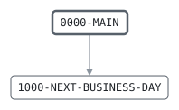

# BANKDATE

```text
BANKDATE: ADVANCE THE BUSINESS DATE

READS THE BANK CONTROL RECORD AND WRITES THE NEXT ONE, FOR
THE NEXT BUSINESS DAY: THE NEXT DAY FROM MONDAY TO FRIDAY.
THE LAST STEP OF THE DAILY BATCH, SO THAT THE NEXT RUN IS FOR
THE NEXT DAY ONLY IF THIS ONE WENT THROUGH.

RETURN CODES: 0 ADVANCED, 16 NO CONTROL RECORD OR I/O.

MODIFICATION HISTORY
DATE       BY  CHANGE
1987-03-12 JA  ORIGINAL VERSION.
1999-01-11 SL  Y2K: 8-DIGIT DATES, INTRINSIC DATE FUNCTIONS
               INSTEAD OF THE CALENDAR TABLE.
```

Program [BANKDATE.cbl](../../../pangaea/programs/BANKDATE.cbl): 2 files, 2 paragraphs. Its business rules: [1 decision tables](../rules/BANKDATE.md).

- AUTHOR: J. ARKWRIGHT, BATCH SYSTEMS.
- INSTALLATION: FIRST BANK OF PANGAEA, DATA CENTER.
- DATE-WRITTEN: 1987-03-12.

## Contents

- [Files](#files)
- [Flow](#flow)
- [Paragraphs](#paragraphs)
- [Data flow](#data-flow)
- [Lineage](#lineage)
  - [Into BANK-CONTROL-RECORD](#into-bank-control-record)
  - [Into CONTROL-OUT-RECORD](#into-control-out-record)
  - [Into WS-DAY-NUMBER](#into-ws-day-number)
  - [Into WS-WEEKDAY](#into-ws-weekday)
  - [Out of the program](#out-of-the-program)
  - [Into other data items](#into-other-data-items)
- [Field origins](#field-origins)
  - [File CONTROL-OUT](#file-control-out)
- [Records](#records)
  - [BANK-CONTROL-RECORD](#bank-control-record)
  - [CONTROL-OUT-RECORD](#control-out-record)
  - [WS-IN-STATUS](#ws-in-status)
  - [WS-OUT-STATUS](#ws-out-status)
  - [WS-DAY-NUMBER](#ws-day-number)
  - [WS-WEEKDAY](#ws-weekday)

## Files

| File | Kind | Assigned to | Organization | Status field | Opened | Records |
| --- | --- | --- | --- | --- | --- | --- |
| CONTROL-IN | FD | BANKIN | SEQUENTIAL | WS-IN-STATUS | INPUT | BANK-CONTROL-RECORD |
| CONTROL-OUT | FD | BANKOUT | SEQUENTIAL | WS-OUT-STATUS | OUTPUT | CONTROL-OUT-RECORD |

## Flow



## Paragraphs

| Paragraph | Description | Source | Performs | Goes to | Performed by | Reached by |
| --- | --- | --- | --- | --- | --- | --- |
| 0000-MAIN | READ TODAY'S CONTROL RECORD AND WRITE THE NEXT BUSINESS DAY'S. | [BANKDATE.cbl:52](../../../pangaea/programs/BANKDATE.cbl#L52) | 1000-NEXT-BUSINESS-DAY | | | |
| 1000-NEXT-BUSINESS-DAY | MOVE THE BUSINESS DATE TO THE NEXT DAY THAT IS NOT A WEEKEND. | [BANKDATE.cbl:74](../../../pangaea/programs/BANKDATE.cbl#L74) | | | 0000-MAIN | |

## Data flow

| Paragraph | Reads | Writes |
| --- | --- | --- |
| 0000-MAIN | WS-IN-STATUS, WS-OUT-STATUS, BANK-CONTROL-RECORD | RETURN-CODE, BANK-CONTROL-RECORD, CONTROL-OUT-RECORD |
| 1000-NEXT-BUSINESS-DAY | BC-BUSINESS-DATE, WS-DAY-NUMBER, WS-WEEKDAY | WS-DAY-NUMBER, WS-WEEKDAY, BC-BUSINESS-DATE |

## Lineage

Where each data item's values come from, grouped by the record they go into. A data item links to the record it belongs to.

### Into BANK-CONTROL-RECORD

Record [BANK-CONTROL-RECORD](#bank-control-record), from copybook [BANKCTL](../copybooks/BANKCTL.md).

| Into | From | Statement | Paragraph | Source |
| --- | --- | --- | --- | --- |
| BANK-CONTROL-RECORD | file CONTROL-IN | READ | 0000-MAIN | [BANKDATE.cbl:61](../../../pangaea/programs/BANKDATE.cbl#L61) |
| BC-BUSINESS-DATE | [WS-DAY-NUMBER](#ws-day-number) | COMPUTE | 1000-NEXT-BUSINESS-DAY | [BANKDATE.cbl:83](../../../pangaea/programs/BANKDATE.cbl#L83) |

### Into CONTROL-OUT-RECORD

Record [CONTROL-OUT-RECORD](#control-out-record).

| Into | From | Statement | Paragraph | Source |
| --- | --- | --- | --- | --- |
| CONTROL-OUT-RECORD | [BANK-CONTROL-RECORD](#bank-control-record) | WRITE | 0000-MAIN | [BANKDATE.cbl:68](../../../pangaea/programs/BANKDATE.cbl#L68) |

### Into WS-DAY-NUMBER

Record [WS-DAY-NUMBER](#ws-day-number).

| Into | From | Statement | Paragraph | Source |
| --- | --- | --- | --- | --- |
| WS-DAY-NUMBER | [BC-BUSINESS-DATE](#bank-control-record "in BANK-CONTROL-RECORD") | COMPUTE | 1000-NEXT-BUSINESS-DAY | [BANKDATE.cbl:75](../../../pangaea/programs/BANKDATE.cbl#L75) |
| WS-DAY-NUMBER | literal 1 | ADD | 1000-NEXT-BUSINESS-DAY | [BANKDATE.cbl:77](../../../pangaea/programs/BANKDATE.cbl#L77) |
| WS-DAY-NUMBER | literal 1 | ADD | 1000-NEXT-BUSINESS-DAY | [BANKDATE.cbl:80](../../../pangaea/programs/BANKDATE.cbl#L80) |

### Into WS-WEEKDAY

Record [WS-WEEKDAY](#ws-weekday).

| Into | From | Statement | Paragraph | Source |
| --- | --- | --- | --- | --- |
| WS-WEEKDAY | [WS-DAY-NUMBER](#ws-day-number) | COMPUTE | 1000-NEXT-BUSINESS-DAY | [BANKDATE.cbl:78](../../../pangaea/programs/BANKDATE.cbl#L78) |
| WS-WEEKDAY | [WS-DAY-NUMBER](#ws-day-number) | COMPUTE | 1000-NEXT-BUSINESS-DAY | [BANKDATE.cbl:81](../../../pangaea/programs/BANKDATE.cbl#L81) |

### Out of the program

Records written to files, items passed to the programs called, and items displayed to the job's output.

| Into | From | Statement | Paragraph | Source |
| --- | --- | --- | --- | --- |
| file CONTROL-OUT | [CONTROL-OUT-RECORD](#control-out-record) | WRITE | 0000-MAIN | [BANKDATE.cbl:68](../../../pangaea/programs/BANKDATE.cbl#L68) |
| SYSOUT | [WS-IN-STATUS](#ws-in-status) | DISPLAY | 0000-MAIN | [BANKDATE.cbl:56](../../../pangaea/programs/BANKDATE.cbl#L56) |
| SYSOUT | [WS-OUT-STATUS](#ws-out-status) | DISPLAY | 0000-MAIN | [BANKDATE.cbl:56](../../../pangaea/programs/BANKDATE.cbl#L56) |

### Into other data items

Data items the program does not declare, such as special registers and index names.

| Into | From | Statement | Paragraph | Source |
| --- | --- | --- | --- | --- |
| RETURN-CODE | literal 16 | MOVE | 0000-MAIN | [BANKDATE.cbl:58](../../../pangaea/programs/BANKDATE.cbl#L58) |
| RETURN-CODE | literal 16 | MOVE | 0000-MAIN | [BANKDATE.cbl:64](../../../pangaea/programs/BANKDATE.cbl#L64) |
| RETURN-CODE | literal 0 | MOVE | 0000-MAIN | [BANKDATE.cbl:70](../../../pangaea/programs/BANKDATE.cbl#L70) |

## Field origins

Where the values of each field the program writes to a file come from: the fields of the files it reads, literals, and initial values, followed through every statement that moves a value, and through groups and redefinitions by the bytes they share.

### File CONTROL-OUT

Written from [BANK-CONTROL-RECORD](#bank-control-record).

| Field | Position | Origins |
| --- | --: | --- |
| BC-BUSINESS-DATE | 1-8 | file CONTROL-IN BC-BUSINESS-DATE; literal 1 |

## Records

### BANK-CONTROL-RECORD

File CONTROL-IN. 80 bytes, layout in copybook [BANKCTL](../copybooks/BANKCTL.md).

### CONTROL-OUT-RECORD

File CONTROL-OUT. 80 bytes.

| Level | Field | Kind | Start | Length | Picture | Usage | Notes | Source |
| --: | --- | --- | --: | --: | --- | --- | --- | --- |
| 01 | CONTROL-OUT-RECORD | text | 1 | 80 | X(80) | | | [BANKDATE.cbl:38](../../../pangaea/programs/BANKDATE.cbl#L38) |

### WS-IN-STATUS

Working storage. 2 bytes.

| Level | Field | Kind | Start | Length | Picture | Usage | Notes | Source |
| --: | --- | --- | --: | --: | --- | --- | --- | --- |
| 01 | WS-IN-STATUS | text | 1 | 2 | XX | | | [BANKDATE.cbl:41](../../../pangaea/programs/BANKDATE.cbl#L41) |

### WS-OUT-STATUS

Working storage. 2 bytes.

| Level | Field | Kind | Start | Length | Picture | Usage | Notes | Source |
| --: | --- | --- | --: | --: | --- | --- | --- | --- |
| 01 | WS-OUT-STATUS | text | 1 | 2 | XX | | | [BANKDATE.cbl:42](../../../pangaea/programs/BANKDATE.cbl#L42) |

### WS-DAY-NUMBER

Working storage. 7 bytes. DAY NUMBERS COUNT FROM 1601-01-01, A MONDAY, SO A DAY NUMBER MODULO 7 IS 1 ON MONDAYS, 6 ON SATURDAYS AND 0 ON SUNDAYS.

| Level | Field | Kind | Start | Length | Picture | Usage | Notes | Source |
| --: | --- | --- | --: | --: | --- | --- | --- | --- |
| 01 | WS-DAY-NUMBER | number | 1 | 7 | 9(7) | | | [BANKDATE.cbl:46](../../../pangaea/programs/BANKDATE.cbl#L46) |

### WS-WEEKDAY

Working storage. 1 bytes.

| Level | Field | Kind | Start | Length | Picture | Usage | Notes | Source |
| --: | --- | --- | --: | --: | --- | --- | --- | --- |
| 01 | WS-WEEKDAY | code | 1 | 1 | 9 | | | [BANKDATE.cbl:47](../../../pangaea/programs/BANKDATE.cbl#L47) |
| 88 | └ WEEKEND | | | | | | VALUE 6, 0 | [BANKDATE.cbl:48](../../../pangaea/programs/BANKDATE.cbl#L48) |
