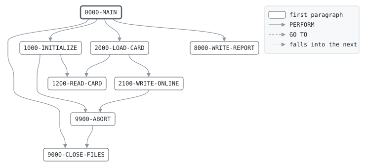

# CARDLOAD

```text
CARDLOAD: LOAD THE ONLINE CARD FILE

WRITES THE CARD MASTER'S CARDS TO A NEW INDEXED ONLINE CARD
FILE FOR THE NEXT BUSINESS DAY, THE DATE OF THE NEW BANK
CONTROL RECORD. CARDS THAT HAVE EXPIRED BY THAT DAY ARE LEFT
OUT, SO THAT AUTHORIZATIONS FIND NO SUCH CARD; BLOCKED CARDS
ARE LOADED, FOR THE AUTHORIZATIONS TO DECLINE. THE MASTER IS
IN CARD NUMBER ORDER, SO THE FILE IS WRITTEN IN KEY ORDER,
SEQUENTIALLY.

RETURN CODES: 0 LOADED, 16 MASTER OUT OF ORDER OR I/O.

MODIFICATION HISTORY
DATE       BY  CHANGE
2003-05-19 MV  CR-0342 ORIGINAL VERSION.
```

Program [CARDLOAD.cbl](../../../pangaea/programs/CARDLOAD.cbl): 4 files, 8 paragraphs. Its business rules: [4 decision tables](../rules/CARDLOAD.md).

- AUTHOR: M. VARGA, ONLINE SYSTEMS.
- INSTALLATION: FIRST BANK OF PANGAEA, DATA CENTER.
- DATE-WRITTEN: 2003-05-19.

## Contents

- [Files](#files)
- [Flow](#flow)
- [Paragraphs](#paragraphs)
- [Data flow](#data-flow)
- [Lineage](#lineage)
  - [Into BANK-CONTROL-RECORD](#into-bank-control-record)
  - [Into CARD-RECORD](#into-card-record)
  - [Into ONLINE-CARD](#into-online-card)
  - [Into REPORT-LINE](#into-report-line)
  - [Into WS-BUSINESS-DATE](#into-ws-business-date)
  - [Into WS-ABORT-MESSAGE](#into-ws-abort-message)
  - [Into WS-MASTER-END-SW](#into-ws-master-end-sw)
  - [Into WS-TOTALS](#into-ws-totals)
  - [Into WS-REPORT-COUNT-LINE](#into-ws-report-count-line)
  - [Out of the program](#out-of-the-program)
  - [Into other data items](#into-other-data-items)
- [Field origins](#field-origins)
  - [File ONLINE-OUT](#file-online-out)
  - [File REPORT-OUT](#file-report-out)
- [Records](#records)
  - [BANK-CONTROL-RECORD](#bank-control-record)
  - [CARD-RECORD](#card-record)
  - [ONLINE-CARD](#online-card)
  - [REPORT-LINE](#report-line)
  - [WS-FILE-STATUSES](#ws-file-statuses)
  - [WS-BUSINESS-DATE](#ws-business-date)
  - [WS-BUSINESS-DATE-PARTS](#ws-business-date-parts)
  - [WS-ABORT-MESSAGE](#ws-abort-message)
  - [WS-MASTER-END-SW](#ws-master-end-sw)
  - [WS-TOTALS](#ws-totals)
  - [WS-REPORT-COUNT-LINE](#ws-report-count-line)

## Files

| File | Kind | Assigned to | Organization | Status field | Opened | Records |
| --- | --- | --- | --- | --- | --- | --- |
| CONTROL-FILE | FD | BANKCTL | SEQUENTIAL | WS-CONTROL-STATUS | INPUT | BANK-CONTROL-RECORD |
| CARD-IN | FD | CARDIN | SEQUENTIAL | WS-CARD-IN-STATUS | INPUT | CARD-RECORD |
| ONLINE-OUT | FD | CARDOUT | INDEXED, key OC-CARD-NO | WS-ONLINE-STATUS | OUTPUT | ONLINE-CARD |
| REPORT-OUT | FD | LOADRPT | LINE SEQUENTIAL | WS-REPORT-STATUS | OUTPUT | REPORT-LINE |

## Flow



## Paragraphs

| Paragraph | Description | Source | Performs | Goes to | Performed by | Reached by |
| --- | --- | --- | --- | --- | --- | --- |
| 0000-MAIN | LOAD EVERY CARD, THEN REPORT. | [CARDLOAD.cbl:83](../../../pangaea/programs/CARDLOAD.cbl#L83) | 1000-INITIALIZE, 2000-LOAD-CARD, 8000-WRITE-REPORT, 9000-CLOSE-FILES | | | |
| 1000-INITIALIZE | OPEN THE FILES, READ THE DAY TO LOAD FOR AND THE FIRST CARD. | [CARDLOAD.cbl:92](../../../pangaea/programs/CARDLOAD.cbl#L92) | 9900-ABORT, 1200-READ-CARD | | 0000-MAIN | |
| 1200-READ-CARD | | [CARDLOAD.cbl:108](../../../pangaea/programs/CARDLOAD.cbl#L108) | | | 1000-INITIALIZE, 2000-LOAD-CARD | |
| 2000-LOAD-CARD | WRITE A CARD THAT HAS NOT EXPIRED TO THE ONLINE FILE. | [CARDLOAD.cbl:117](../../../pangaea/programs/CARDLOAD.cbl#L117) | 2100-WRITE-ONLINE, 1200-READ-CARD | | 0000-MAIN | |
| 2100-WRITE-ONLINE | | [CARDLOAD.cbl:128](../../../pangaea/programs/CARDLOAD.cbl#L128) | 9900-ABORT | | 2000-LOAD-CARD | |
| 8000-WRITE-REPORT | WRITE THE LOAD REPORT. | [CARDLOAD.cbl:138](../../../pangaea/programs/CARDLOAD.cbl#L138) | | | 0000-MAIN | |
| 9000-CLOSE-FILES | CLOSE ALL FILES. | [CARDLOAD.cbl:160](../../../pangaea/programs/CARDLOAD.cbl#L160) | | | 0000-MAIN, 9900-ABORT | |
| 9900-ABORT | STOP THE RUN WITH RETURN CODE 16, SAYING WHY. | [CARDLOAD.cbl:164](../../../pangaea/programs/CARDLOAD.cbl#L164) | 9000-CLOSE-FILES | | 1000-INITIALIZE, 2100-WRITE-ONLINE | |

## Data flow

| Paragraph | Reads | Writes |
| --- | --- | --- |
| 0000-MAIN | WS-MASTER-END-SW | RETURN-CODE |
| 1000-INITIALIZE | WS-FILE-STATUSES, BC-BUSINESS-DATE | RETURN-CODE, BANK-CONTROL-RECORD, WS-ABORT-MESSAGE, WS-BUSINESS-DATE |
| 1200-READ-CARD | WS-READ-COUNT | CARD-RECORD, WS-MASTER-END-SW, WS-READ-COUNT |
| 2000-LOAD-CARD | CR-EXPIRY-MONTH, WS-BUSINESS-MONTH, WS-EXPIRED-COUNT, CR-STATUS, WS-BLOCKED-COUNT | WS-EXPIRED-COUNT, WS-BLOCKED-COUNT |
| 2100-WRITE-ONLINE | CARD-RECORD, WS-LOADED-COUNT | ONLINE-CARD, WS-ABORT-MESSAGE, WS-LOADED-COUNT |
| 8000-WRITE-REPORT | WS-BUSINESS-DATE, WS-READ-COUNT, WS-REPORT-COUNT-LINE, WS-LOADED-COUNT, WS-BLOCKED-COUNT, WS-EXPIRED-COUNT | REPORT-LINE, WS-RC-LABEL, WS-RC-VALUE |
| 9000-CLOSE-FILES | | |
| 9900-ABORT | WS-ABORT-MESSAGE | RETURN-CODE |

## Lineage

Where each data item's values come from, grouped by the record they go into. A data item links to the record it belongs to.

### Into BANK-CONTROL-RECORD

Record [BANK-CONTROL-RECORD](#bank-control-record), from copybook [BANKCTL](../copybooks/BANKCTL.md).

| Into | From | Statement | Paragraph | Source |
| --- | --- | --- | --- | --- |
| BANK-CONTROL-RECORD | file CONTROL-FILE | READ | 1000-INITIALIZE | [CARDLOAD.cbl:100](../../../pangaea/programs/CARDLOAD.cbl#L100) |

### Into CARD-RECORD

Record [CARD-RECORD](#card-record), from copybook [CARDREC](../copybooks/CARDREC.md).

| Into | From | Statement | Paragraph | Source |
| --- | --- | --- | --- | --- |
| CARD-RECORD | file CARD-IN | READ | 1200-READ-CARD | [CARDLOAD.cbl:109](../../../pangaea/programs/CARDLOAD.cbl#L109) |

### Into ONLINE-CARD

Record [ONLINE-CARD](#online-card).

| Into | From | Statement | Paragraph | Source |
| --- | --- | --- | --- | --- |
| ONLINE-CARD | [CARD-RECORD](#card-record) | WRITE | 2100-WRITE-ONLINE | [CARDLOAD.cbl:129](../../../pangaea/programs/CARDLOAD.cbl#L129) |

### Into REPORT-LINE

Record [REPORT-LINE](#report-line).

| Into | From | Statement | Paragraph | Source |
| --- | --- | --- | --- | --- |
| REPORT-LINE | literal SPACES | MOVE | 8000-WRITE-REPORT | [CARDLOAD.cbl:139](../../../pangaea/programs/CARDLOAD.cbl#L139) |
| REPORT-LINE | literal 'CARDLOAD ONLINE CARD LOAD        BUSINESS DATE ' | STRING | 8000-WRITE-REPORT | [CARDLOAD.cbl:140](../../../pangaea/programs/CARDLOAD.cbl#L140) |
| REPORT-LINE | [WS-BUSINESS-DATE](#ws-business-date) | STRING | 8000-WRITE-REPORT | [CARDLOAD.cbl:140](../../../pangaea/programs/CARDLOAD.cbl#L140) |
| REPORT-LINE | literal SPACES | MOVE | 8000-WRITE-REPORT | [CARDLOAD.cbl:144](../../../pangaea/programs/CARDLOAD.cbl#L144) |
| REPORT-LINE | [WS-REPORT-COUNT-LINE](#ws-report-count-line) | WRITE | 8000-WRITE-REPORT | [CARDLOAD.cbl:148](../../../pangaea/programs/CARDLOAD.cbl#L148) |
| REPORT-LINE | [WS-REPORT-COUNT-LINE](#ws-report-count-line) | WRITE | 8000-WRITE-REPORT | [CARDLOAD.cbl:151](../../../pangaea/programs/CARDLOAD.cbl#L151) |
| REPORT-LINE | [WS-REPORT-COUNT-LINE](#ws-report-count-line) | WRITE | 8000-WRITE-REPORT | [CARDLOAD.cbl:154](../../../pangaea/programs/CARDLOAD.cbl#L154) |
| REPORT-LINE | [WS-REPORT-COUNT-LINE](#ws-report-count-line) | WRITE | 8000-WRITE-REPORT | [CARDLOAD.cbl:157](../../../pangaea/programs/CARDLOAD.cbl#L157) |

### Into WS-BUSINESS-DATE

Record [WS-BUSINESS-DATE](#ws-business-date).

| Into | From | Statement | Paragraph | Source |
| --- | --- | --- | --- | --- |
| WS-BUSINESS-DATE | [BC-BUSINESS-DATE](#bank-control-record "in BANK-CONTROL-RECORD") | MOVE | 1000-INITIALIZE | [CARDLOAD.cbl:105](../../../pangaea/programs/CARDLOAD.cbl#L105) |

### Into WS-ABORT-MESSAGE

Record [WS-ABORT-MESSAGE](#ws-abort-message).

| Into | From | Statement | Paragraph | Source |
| --- | --- | --- | --- | --- |
| WS-ABORT-MESSAGE | literal 'NO BANK CONTROL RECORD' | MOVE | 1000-INITIALIZE | [CARDLOAD.cbl:102](../../../pangaea/programs/CARDLOAD.cbl#L102) |
| WS-ABORT-MESSAGE | literal 'MASTER NOT IN CARD NUMBER ORDER' | MOVE | 2100-WRITE-ONLINE | [CARDLOAD.cbl:131](../../../pangaea/programs/CARDLOAD.cbl#L131) |

### Into WS-MASTER-END-SW

Record [WS-MASTER-END-SW](#ws-master-end-sw).

| Into | From | Statement | Paragraph | Source |
| --- | --- | --- | --- | --- |
| WS-MASTER-END-SW | literal condition MASTER-AT-END | SET | 1200-READ-CARD | [CARDLOAD.cbl:111](../../../pangaea/programs/CARDLOAD.cbl#L111) |

### Into WS-TOTALS

Record [WS-TOTALS](#ws-totals).

| Into | From | Statement | Paragraph | Source |
| --- | --- | --- | --- | --- |
| WS-BLOCKED-COUNT | literal 1 | ADD | 2000-LOAD-CARD | [CARDLOAD.cbl:122](../../../pangaea/programs/CARDLOAD.cbl#L122) |
| WS-EXPIRED-COUNT | literal 1 | ADD | 2000-LOAD-CARD | [CARDLOAD.cbl:119](../../../pangaea/programs/CARDLOAD.cbl#L119) |
| WS-LOADED-COUNT | literal 1 | ADD | 2100-WRITE-ONLINE | [CARDLOAD.cbl:135](../../../pangaea/programs/CARDLOAD.cbl#L135) |
| WS-READ-COUNT | literal 1 | ADD | 1200-READ-CARD | [CARDLOAD.cbl:113](../../../pangaea/programs/CARDLOAD.cbl#L113) |

### Into WS-REPORT-COUNT-LINE

Record [WS-REPORT-COUNT-LINE](#ws-report-count-line).

| Into | From | Statement | Paragraph | Source |
| --- | --- | --- | --- | --- |
| WS-RC-LABEL | literal 'CARDS READ' | MOVE | 8000-WRITE-REPORT | [CARDLOAD.cbl:146](../../../pangaea/programs/CARDLOAD.cbl#L146) |
| WS-RC-LABEL | literal 'CARDS LOADED' | MOVE | 8000-WRITE-REPORT | [CARDLOAD.cbl:149](../../../pangaea/programs/CARDLOAD.cbl#L149) |
| WS-RC-LABEL | literal '  OF WHICH BLOCKED' | MOVE | 8000-WRITE-REPORT | [CARDLOAD.cbl:152](../../../pangaea/programs/CARDLOAD.cbl#L152) |
| WS-RC-LABEL | literal 'EXPIRED CARDS LEFT OUT' | MOVE | 8000-WRITE-REPORT | [CARDLOAD.cbl:155](../../../pangaea/programs/CARDLOAD.cbl#L155) |
| WS-RC-VALUE | [WS-READ-COUNT](#ws-totals "in WS-TOTALS") | MOVE | 8000-WRITE-REPORT | [CARDLOAD.cbl:147](../../../pangaea/programs/CARDLOAD.cbl#L147) |
| WS-RC-VALUE | [WS-LOADED-COUNT](#ws-totals "in WS-TOTALS") | MOVE | 8000-WRITE-REPORT | [CARDLOAD.cbl:150](../../../pangaea/programs/CARDLOAD.cbl#L150) |
| WS-RC-VALUE | [WS-BLOCKED-COUNT](#ws-totals "in WS-TOTALS") | MOVE | 8000-WRITE-REPORT | [CARDLOAD.cbl:153](../../../pangaea/programs/CARDLOAD.cbl#L153) |
| WS-RC-VALUE | [WS-EXPIRED-COUNT](#ws-totals "in WS-TOTALS") | MOVE | 8000-WRITE-REPORT | [CARDLOAD.cbl:156](../../../pangaea/programs/CARDLOAD.cbl#L156) |

### Out of the program

Records written to files, items passed to the programs called, and items displayed to the job's output.

| Into | From | Statement | Paragraph | Source |
| --- | --- | --- | --- | --- |
| file ONLINE-OUT | [ONLINE-CARD](#online-card) | WRITE | 2100-WRITE-ONLINE | [CARDLOAD.cbl:129](../../../pangaea/programs/CARDLOAD.cbl#L129) |
| file REPORT-OUT | [REPORT-LINE](#report-line) | WRITE | 8000-WRITE-REPORT | [CARDLOAD.cbl:143](../../../pangaea/programs/CARDLOAD.cbl#L143) |
| file REPORT-OUT | [REPORT-LINE](#report-line) | WRITE | 8000-WRITE-REPORT | [CARDLOAD.cbl:145](../../../pangaea/programs/CARDLOAD.cbl#L145) |
| file REPORT-OUT | [REPORT-LINE](#report-line) | WRITE | 8000-WRITE-REPORT | [CARDLOAD.cbl:148](../../../pangaea/programs/CARDLOAD.cbl#L148) |
| file REPORT-OUT | [REPORT-LINE](#report-line) | WRITE | 8000-WRITE-REPORT | [CARDLOAD.cbl:151](../../../pangaea/programs/CARDLOAD.cbl#L151) |
| file REPORT-OUT | [REPORT-LINE](#report-line) | WRITE | 8000-WRITE-REPORT | [CARDLOAD.cbl:154](../../../pangaea/programs/CARDLOAD.cbl#L154) |
| file REPORT-OUT | [REPORT-LINE](#report-line) | WRITE | 8000-WRITE-REPORT | [CARDLOAD.cbl:157](../../../pangaea/programs/CARDLOAD.cbl#L157) |
| SYSOUT | [WS-FILE-STATUSES](#ws-file-statuses) | DISPLAY | 1000-INITIALIZE | [CARDLOAD.cbl:96](../../../pangaea/programs/CARDLOAD.cbl#L96) |
| SYSOUT | [WS-ABORT-MESSAGE](#ws-abort-message) | DISPLAY | 9900-ABORT | [CARDLOAD.cbl:165](../../../pangaea/programs/CARDLOAD.cbl#L165) |

### Into other data items

Data items the program does not declare, such as special registers and index names.

| Into | From | Statement | Paragraph | Source |
| --- | --- | --- | --- | --- |
| RETURN-CODE | literal 0 | MOVE | 0000-MAIN | [CARDLOAD.cbl:88](../../../pangaea/programs/CARDLOAD.cbl#L88) |
| RETURN-CODE | literal 16 | MOVE | 1000-INITIALIZE | [CARDLOAD.cbl:97](../../../pangaea/programs/CARDLOAD.cbl#L97) |
| RETURN-CODE | literal 16 | MOVE | 9900-ABORT | [CARDLOAD.cbl:167](../../../pangaea/programs/CARDLOAD.cbl#L167) |

## Field origins

Where the values of each field the program writes to a file come from: the fields of the files it reads, literals, and initial values, followed through every statement that moves a value, and through groups and redefinitions by the bytes they share.

### File ONLINE-OUT

Written from [CARD-RECORD](#card-record).

| Field | Position | Origins |
| --- | --: | --- |
| CR-CARD-NO | 1-16 | file CARD-IN CR-CARD-NO |
| CR-ACCT-NO | 17-26 | file CARD-IN CR-ACCT-NO |
| CR-CUST-NO | 27-34 | file CARD-IN CR-CUST-NO |
| CR-STATUS | 35 | file CARD-IN CR-STATUS |
| CR-EXPIRY-MONTH | 36-41 | file CARD-IN CR-EXPIRY-MONTH |
| CR-PURCHASE-LIMIT | 42-48 | file CARD-IN CR-PURCHASE-LIMIT |
| CR-CASH-LIMIT | 49-55 | file CARD-IN CR-CASH-LIMIT |
| CR-TOTALS-DATE | 56-63 | file CARD-IN CR-TOTALS-DATE |
| CR-DAY-PURCHASES | 64-70 | file CARD-IN CR-DAY-PURCHASES |
| CR-DAY-CASH | 71-77 | file CARD-IN CR-DAY-CASH |
| CR-MONTH-WITHDRAWALS | 78-80 | file CARD-IN CR-MONTH-WITHDRAWALS |

### File REPORT-OUT

Written from [WS-REPORT-COUNT-LINE](#ws-report-count-line).

| Field | Position | Origins |
| --- | --: | --- |
| WS-RC-LABEL | 1-30 | literal '  OF WHICH BLOCKED'; literal 'CARDS LOADED'; literal 'CARDS READ'; literal 'EXPIRED CARDS LEFT OUT' |
| WS-RC-VALUE | 31-40 | initial value of WS-BLOCKED-COUNT; initial value of WS-EXPIRED-COUNT; initial value of WS-LOADED-COUNT; initial value of WS-READ-COUNT; literal 1 |

## Records

### BANK-CONTROL-RECORD

File CONTROL-FILE. 80 bytes, layout in copybook [BANKCTL](../copybooks/BANKCTL.md).

### CARD-RECORD

File CARD-IN. 80 bytes, layout in copybook [CARDREC](../copybooks/CARDREC.md).

### ONLINE-CARD

File ONLINE-OUT. 80 bytes.

| Level | Field | Kind | Start | Length | Picture | Usage | Notes | Source |
| --: | --- | --- | --: | --: | --- | --- | --- | --- |
| 01 | ONLINE-CARD | group | 1 | 80 | | | | [CARDLOAD.cbl:49](../../../pangaea/programs/CARDLOAD.cbl#L49) |
| 05 | ├ OC-CARD-NO | key | 1 | 16 | 9(16) | | | [CARDLOAD.cbl:50](../../../pangaea/programs/CARDLOAD.cbl#L50) |
| 05 | └ FILLER | filler | 17 | 64 | X(64) | | | [CARDLOAD.cbl:51](../../../pangaea/programs/CARDLOAD.cbl#L51) |

### REPORT-LINE

File REPORT-OUT. 80 bytes.

| Level | Field | Kind | Start | Length | Picture | Usage | Notes | Source |
| --: | --- | --- | --: | --: | --- | --- | --- | --- |
| 01 | REPORT-LINE | text | 1 | 80 | X(80) | | | [CARDLOAD.cbl:53](../../../pangaea/programs/CARDLOAD.cbl#L53) |

### WS-FILE-STATUSES

Working storage. 8 bytes.

| Level | Field | Kind | Start | Length | Picture | Usage | Notes | Source |
| --: | --- | --- | --: | --: | --- | --- | --- | --- |
| 01 | WS-FILE-STATUSES | group | 1 | 8 | | | | [CARDLOAD.cbl:56](../../../pangaea/programs/CARDLOAD.cbl#L56) |
| 05 | ├ WS-CONTROL-STATUS | text | 1 | 2 | XX | | | [CARDLOAD.cbl:57](../../../pangaea/programs/CARDLOAD.cbl#L57) |
| 05 | ├ WS-CARD-IN-STATUS | text | 3 | 2 | XX | | | [CARDLOAD.cbl:58](../../../pangaea/programs/CARDLOAD.cbl#L58) |
| 05 | ├ WS-ONLINE-STATUS | text | 5 | 2 | XX | | | [CARDLOAD.cbl:59](../../../pangaea/programs/CARDLOAD.cbl#L59) |
| 05 | └ WS-REPORT-STATUS | text | 7 | 2 | XX | | | [CARDLOAD.cbl:60](../../../pangaea/programs/CARDLOAD.cbl#L60) |

### WS-BUSINESS-DATE

Working storage. 8 bytes.

| Level | Field | Kind | Start | Length | Picture | Usage | Notes | Source |
| --: | --- | --- | --: | --: | --- | --- | --- | --- |
| 01 | WS-BUSINESS-DATE | date | 1 | 8 | 9(8) | | | [CARDLOAD.cbl:62](../../../pangaea/programs/CARDLOAD.cbl#L62) |

### WS-BUSINESS-DATE-PARTS

Working storage. 8 bytes.

| Level | Field | Kind | Start | Length | Picture | Usage | Notes | Source |
| --: | --- | --- | --: | --: | --- | --- | --- | --- |
| 01 | WS-BUSINESS-DATE-PARTS | group | 1 | 8 | | | REDEFINES WS-BUSINESS-DATE | [CARDLOAD.cbl:63](../../../pangaea/programs/CARDLOAD.cbl#L63) |
| 05 | ├ WS-BUSINESS-MONTH | date | 1 | 6 | 9(6) | | | [CARDLOAD.cbl:64](../../../pangaea/programs/CARDLOAD.cbl#L64) |
| 05 | └ FILLER | filler | 7 | 2 | 99 | | | [CARDLOAD.cbl:65](../../../pangaea/programs/CARDLOAD.cbl#L65) |

### WS-ABORT-MESSAGE

Working storage. 40 bytes.

| Level | Field | Kind | Start | Length | Picture | Usage | Notes | Source |
| --: | --- | --- | --: | --: | --- | --- | --- | --- |
| 01 | WS-ABORT-MESSAGE | text | 1 | 40 | X(40) | | | [CARDLOAD.cbl:66](../../../pangaea/programs/CARDLOAD.cbl#L66) |

### WS-MASTER-END-SW

Working storage. 1 bytes.

| Level | Field | Kind | Start | Length | Picture | Usage | Notes | Source |
| --: | --- | --- | --: | --: | --- | --- | --- | --- |
| 01 | WS-MASTER-END-SW | code | 1 | 1 | X | | VALUE 'N' | [CARDLOAD.cbl:67](../../../pangaea/programs/CARDLOAD.cbl#L67) |
| 88 | └ MASTER-AT-END | | | | | | VALUE 'Y' | [CARDLOAD.cbl:68](../../../pangaea/programs/CARDLOAD.cbl#L68) |

### WS-TOTALS

Working storage. 32 bytes.

| Level | Field | Kind | Start | Length | Picture | Usage | Notes | Source |
| --: | --- | --- | --: | --: | --- | --- | --- | --- |
| 01 | WS-TOTALS | group | 1 | 32 | | | | [CARDLOAD.cbl:70](../../../pangaea/programs/CARDLOAD.cbl#L70) |
| 05 | ├ WS-READ-COUNT | number | 1 | 8 | 9(8) | | VALUE 0 | [CARDLOAD.cbl:71](../../../pangaea/programs/CARDLOAD.cbl#L71) |
| 05 | ├ WS-LOADED-COUNT | number | 9 | 8 | 9(8) | | VALUE 0 | [CARDLOAD.cbl:72](../../../pangaea/programs/CARDLOAD.cbl#L72) |
| 05 | ├ WS-BLOCKED-COUNT | number | 17 | 8 | 9(8) | | VALUE 0 | [CARDLOAD.cbl:73](../../../pangaea/programs/CARDLOAD.cbl#L73) |
| 05 | └ WS-EXPIRED-COUNT | number | 25 | 8 | 9(8) | | VALUE 0 | [CARDLOAD.cbl:74](../../../pangaea/programs/CARDLOAD.cbl#L74) |

### WS-REPORT-COUNT-LINE

Working storage. 80 bytes.

| Level | Field | Kind | Start | Length | Picture | Usage | Notes | Source |
| --: | --- | --- | --: | --: | --- | --- | --- | --- |
| 01 | WS-REPORT-COUNT-LINE | group | 1 | 80 | | | | [CARDLOAD.cbl:76](../../../pangaea/programs/CARDLOAD.cbl#L76) |
| 05 | ├ WS-RC-LABEL | text | 1 | 30 | X(30) | | | [CARDLOAD.cbl:77](../../../pangaea/programs/CARDLOAD.cbl#L77) |
| 05 | ├ WS-RC-VALUE | edited | 31 | 10 | ZZ,ZZZ,ZZ9 | | | [CARDLOAD.cbl:78](../../../pangaea/programs/CARDLOAD.cbl#L78) |
| 05 | └ FILLER | filler | 41 | 40 | X(40) | | VALUE SPACES | [CARDLOAD.cbl:79](../../../pangaea/programs/CARDLOAD.cbl#L79) |
