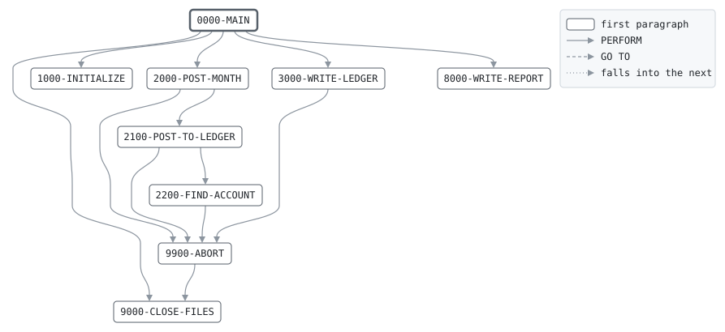

# GLSUM

```text
GLSUM: SUMMARIZE THE MONTH FOR THE GENERAL LEDGER

ON THE FIRST BUSINESS DAY OF A MONTH, AFTER THE DAILY BATCH,
POSTS EVERY POSTING OF THE MONTH THAT CLOSED TO THE GENERAL
LEDGER, AS STMTPRT PICKS THEM: ONE SIDE TO CUSTOMER DEPOSITS,
THE OTHER TO THE ACCOUNT THE CODE TABLE NAMES FOR ITS
TRANSACTION CODE. A CREDIT TO A CUSTOMER CREDITS DEPOSITS, A
DEBIT DEBITS THEM. WRITES EACH LEDGER ACCOUNT'S DEBITS AND
CREDITS FOR THE MONTH, AND REPORTS THEM.

EVERY TRANSFER'S LEGS POST ON ONE DAY, SO TRANSFERS IN TRANSIT
MUST NET TO ZERO OVER A MONTH. IF THEY DO NOT, A LEG WENT
MISSING, AND THE RUN ENDS WITH RETURN CODE 4.

RETURN CODES: 0 SUMMARIZED OR NO MONTH CLOSED,
              4 TRANSFERS IN TRANSIT DO NOT NET TO ZERO,
              16 AN UNKNOWN CODE OR ACCOUNT, OUT OF BALANCE,
              OR I/O.

MODIFICATION HISTORY
DATE       BY  CHANGE
1494-11-10 LP  EVERY DEBIT HAS ITS CREDIT: THE SUMMA, VENICE.
2004-03-15 TL  CR-0390 IN COBOL.
```

Program [GLSUM.cbl](../../../pangaea/programs/GLSUM.cbl): 4 files, 9 paragraphs. Its business rules: [9 decision tables](../rules/GLSUM.md).

- AUTHOR: T. LINDQVIST, BATCH SYSTEMS.
- INSTALLATION: FIRST BANK OF PANGAEA, DATA CENTER.
- DATE-WRITTEN: 2004-03-15.

## Contents

- [Files](#files)
- [Flow](#flow)
- [Paragraphs](#paragraphs)
- [Data flow](#data-flow)
- [Lineage](#lineage)
  - [Into ACCRUAL-RECORD](#into-accrual-record)
  - [Into AUDIT-RECORD](#into-audit-record)
  - [Into GL-SUMMARY-RECORD](#into-gl-summary-record)
  - [Into REPORT-LINE](#into-report-line)
  - [Into WS-ABORT-MESSAGE](#into-ws-abort-message)
  - [Into WS-CLOSED-MONTH-NUMBER](#into-ws-closed-month-number)
  - [Into WS-NEXT-MONTH](#into-ws-next-month)
  - [Into WS-POSTING-MONTH](#into-ws-posting-month)
  - [Into WS-POSTING-CODE](#into-ws-posting-code)
  - [Into WS-LEDGER-TOTALS](#into-ws-ledger-totals)
  - [Into WS-POSTING](#into-ws-posting)
  - [Into WS-TOTALS](#into-ws-totals)
  - [Into WS-LEDGER-LINE](#into-ws-ledger-line)
  - [Into WS-REPORT-COUNT-LINE](#into-ws-report-count-line)
  - [Into WS-REPORT-AMOUNT-LINE](#into-ws-report-amount-line)
  - [Out of the program](#out-of-the-program)
  - [Into other data items](#into-other-data-items)
- [Field origins](#field-origins)
  - [File GL-OUT](#file-gl-out)
  - [File REPORT-OUT](#file-report-out)
- [Records](#records)
  - [ACCRUAL-RECORD](#accrual-record)
  - [AUDIT-RECORD](#audit-record)
  - [GL-SUMMARY-RECORD](#gl-summary-record)
  - [REPORT-LINE](#report-line)
  - [WS-FILE-STATUSES](#ws-file-statuses)
  - [WS-ABORT-MESSAGE](#ws-abort-message)
  - [WS-CLOSED-MONTH](#ws-closed-month)
  - [WS-CLOSED-MONTH-NUMBER](#ws-closed-month-number)
  - [WS-NEXT-MONTH](#ws-next-month)
  - [WS-POSTING-MONTH](#ws-posting-month)
  - [WS-POSTING-CODE](#ws-posting-code)
  - [GS-CODE-VALUES](#gs-code-values)
  - [GS-CODE-TABLE](#gs-code-table)
  - [WS-LEDGER-COUNT](#ws-ledger-count)
  - [WS-LEDGER-VALUES](#ws-ledger-values)
  - [WS-LEDGER](#ws-ledger)
  - [WS-LEDGER-TOTALS](#ws-ledger-totals)
  - [WS-DEPOSITS-ACCOUNT](#ws-deposits-account)
  - [WS-TRANSIT-ACCOUNT](#ws-transit-account)
  - [WS-POSTING](#ws-posting)
  - [WS-TOTALS](#ws-totals)
  - [WS-HEADING-LINE](#ws-heading-line)
  - [WS-LEDGER-LINE](#ws-ledger-line)
  - [WS-REPORT-COUNT-LINE](#ws-report-count-line)
  - [WS-REPORT-AMOUNT-LINE](#ws-report-amount-line)

## Files

| File | Kind | Assigned to | Organization | Status field | Opened | Records |
| --- | --- | --- | --- | --- | --- | --- |
| ACCR-IN | FD | ACCRIN | SEQUENTIAL | WS-ACCR-IN-STATUS | INPUT | ACCRUAL-RECORD |
| AUDIT-IN | FD | AUDIT | SEQUENTIAL | WS-AUDIT-STATUS | INPUT | AUDIT-RECORD |
| GL-OUT | FD | GLOUT | SEQUENTIAL | WS-GL-STATUS | OUTPUT | GL-SUMMARY-RECORD |
| REPORT-OUT | FD | GLRPT | LINE SEQUENTIAL | WS-REPORT-STATUS | OUTPUT | REPORT-LINE |

## Flow



## Paragraphs

| Paragraph | Description | Source | Performs | Goes to | Performed by | Reached by |
| --- | --- | --- | --- | --- | --- | --- |
| 0000-MAIN | FIND THE MONTH THAT CLOSED, IF ONE DID, POST ITS POSTINGS TO THE LEDGER AND WRITE THE SUMMARY. | [GLSUM.cbl:161](../../../pangaea/programs/GLSUM.cbl#L161) | 1000-INITIALIZE, 2000-POST-MONTH, 3000-WRITE-LEDGER, 8000-WRITE-REPORT, 9000-CLOSE-FILES | | | |
| 1000-INITIALIZE | OPEN THE FILES, TAKE THE CLOSED MONTH FROM THE ACCRUALS AND START THE LEDGER AT ZERO. | [GLSUM.cbl:178](../../../pangaea/programs/GLSUM.cbl#L178) | | | 0000-MAIN | |
| 2000-POST-MONTH | POST THE POSTINGS OF THE CLOSED MONTH, AND THE INTEREST AND FEES POSTED FOR IT ON THE FIRST BUSINESS DAY OF THE NEXT. | [GLSUM.cbl:205](../../../pangaea/programs/GLSUM.cbl#L205) | 2100-POST-TO-LEDGER, 9900-ABORT | | 0000-MAIN | |
| 2100-POST-TO-LEDGER | POST ONE POSTING: DEPOSITS ON THE CUSTOMER'S SIDE, THE CODE'S LEDGER ACCOUNT ON THE OTHER. | [GLSUM.cbl:224](../../../pangaea/programs/GLSUM.cbl#L224) | 9900-ABORT, 2200-FIND-ACCOUNT | | 2000-POST-MONTH | |
| 2200-FIND-ACCOUNT | FIND THE WANTED LEDGER ACCOUNT, AND POINT AT ITS TOTALS. | [GLSUM.cbl:251](../../../pangaea/programs/GLSUM.cbl#L251) | 9900-ABORT | | 2100-POST-TO-LEDGER | |
| 3000-WRITE-LEDGER | WRITE A SUMMARY RECORD FOR EACH LEDGER ACCOUNT, AND CHECK THAT THE LEDGER BALANCES. | [GLSUM.cbl:263](../../../pangaea/programs/GLSUM.cbl#L263) | 9900-ABORT | | 0000-MAIN | |
| 8000-WRITE-REPORT | WRITE THE GENERAL LEDGER REPORT. | [GLSUM.cbl:291](../../../pangaea/programs/GLSUM.cbl#L291) | | | 0000-MAIN | |
| 9000-CLOSE-FILES | CLOSE ALL FILES. | [GLSUM.cbl:344](../../../pangaea/programs/GLSUM.cbl#L344) | | | 0000-MAIN, 9900-ABORT | |
| 9900-ABORT | STOP THE RUN WITH RETURN CODE 16, SAYING WHY. | [GLSUM.cbl:348](../../../pangaea/programs/GLSUM.cbl#L348) | 9000-CLOSE-FILES | | 2000-POST-MONTH, 2100-POST-TO-LEDGER, 2200-FIND-ACCOUNT, 3000-WRITE-LEDGER | |

## Data flow

| Paragraph | Reads | Writes |
| --- | --- | --- |
| 0000-MAIN | WS-CLOSED-MONTH-NUMBER, WS-TRANSIT-NET | RETURN-CODE |
| 1000-INITIALIZE | WS-FILE-STATUSES, AC-DUE-MONTH, WS-CM-YEAR, WS-CM-MONTH, WS-NM-YEAR, WS-TX, WS-LEDGER-COUNT | RETURN-CODE, WS-CLOSED-MONTH-NUMBER, ACCRUAL-RECORD, WS-NM-YEAR, WS-NM-MONTH, WS-TX, WS-LT-DEBITS, WS-LT-CREDITS |
| 2000-POST-MONTH | WS-AUDIT-STATUS, AU-BUSINESS-DATE, AU-TRAN-CODE, WS-POSTING-MONTH, WS-CLOSED-MONTH, WS-NEXT-MONTH, WS-POSTING-CODE | AUDIT-RECORD, WS-POSTING-MONTH, WS-POSTING-CODE, WS-ABORT-MESSAGE |
| 2100-POST-TO-LEDGER | GS-CODE-ENTRY, GS-CODE, GS-CX, AU-TRAN-CODE, AU-AMOUNT, WS-DEPOSITS-ACCOUNT, GS-CODE-GL-ACCOUNT, WS-DEBIT-ACCOUNT, WS-AMOUNT, WS-LT-DEBITS, WS-TX, WS-CREDIT-ACCOUNT, WS-LT-CREDITS, WS-POSTING-COUNT | GS-CX, WS-ABORT-MESSAGE, WS-AMOUNT, WS-DEBIT-ACCOUNT, WS-CREDIT-ACCOUNT, WS-WANTED-ACCOUNT, WS-LT-DEBITS, WS-LT-CREDITS, WS-POSTING-COUNT |
| 2200-FIND-ACCOUNT | WS-LEDGER-ENTRY, WS-LE-ACCOUNT, WS-LX, WS-WANTED-ACCOUNT | WS-LX, WS-ABORT-MESSAGE, WS-TX |
| 3000-WRITE-LEDGER | WS-LX, WS-LEDGER-COUNT, WS-CLOSED-MONTH-NUMBER, WS-LE-ACCOUNT, WS-LE-NAME, WS-LT-DEBITS, WS-TX, WS-LT-CREDITS, WS-DEBIT-TOTAL, WS-CREDIT-TOTAL, WS-DEPOSITS-ACCOUNT, WS-TRANSIT-ACCOUNT | WS-LX, WS-TX, GL-SUMMARY-RECORD, GL-MONTH, GL-ACCOUNT, GL-ACCOUNT-NAME, GL-DEBITS, GL-CREDITS, WS-DEBIT-TOTAL, WS-CREDIT-TOTAL, WS-DEPOSITS-CHANGE, WS-TRANSIT-NET, WS-ABORT-MESSAGE |
| 8000-WRITE-REPORT | WS-CLOSED-MONTH-NUMBER, WS-CLOSED-MONTH, WS-POSTING-COUNT, WS-REPORT-COUNT-LINE, WS-HEADING-LINE, WS-LX, WS-LEDGER-COUNT, WS-LE-ACCOUNT, WS-LE-NAME, WS-LT-DEBITS, WS-TX, WS-LT-CREDITS, WS-LEDGER-LINE, WS-DEBIT-TOTAL, WS-CREDIT-TOTAL, WS-DEPOSITS-CHANGE, WS-REPORT-AMOUNT-LINE, WS-TRANSIT-NET | REPORT-LINE, WS-RC-LABEL, WS-RC-VALUE, WS-LX, WS-TX, WS-LL-ACCOUNT, WS-LL-NAME, WS-LL-DEBITS, WS-LL-CREDITS, WS-RA-LABEL, WS-RA-VALUE |
| 9000-CLOSE-FILES | | |
| 9900-ABORT | WS-ABORT-MESSAGE | RETURN-CODE |

## Lineage

Where each data item's values come from, grouped by the record they go into. A data item links to the record it belongs to.

### Into ACCRUAL-RECORD

Record [ACCRUAL-RECORD](#accrual-record), from copybook [ACCRREC](../copybooks/ACCRREC.md).

| Into | From | Statement | Paragraph | Source |
| --- | --- | --- | --- | --- |
| ACCRUAL-RECORD | file ACCR-IN | READ | 1000-INITIALIZE | [GLSUM.cbl:187](../../../pangaea/programs/GLSUM.cbl#L187) |

### Into AUDIT-RECORD

Record [AUDIT-RECORD](#audit-record), from copybook [AUDITREC](../copybooks/AUDITREC.md).

| Into | From | Statement | Paragraph | Source |
| --- | --- | --- | --- | --- |
| AUDIT-RECORD | file AUDIT-IN | READ | 2000-POST-MONTH | [GLSUM.cbl:206](../../../pangaea/programs/GLSUM.cbl#L206) |
| AUDIT-RECORD | file AUDIT-IN | READ | 2000-POST-MONTH | [GLSUM.cbl:215](../../../pangaea/programs/GLSUM.cbl#L215) |

### Into GL-SUMMARY-RECORD

Record [GL-SUMMARY-RECORD](#gl-summary-record), from copybook [GLREC](../copybooks/GLREC.md).

| Into | From | Statement | Paragraph | Source |
| --- | --- | --- | --- | --- |
| GL-ACCOUNT | [WS-LE-ACCOUNT](#ws-ledger "in WS-LEDGER") | MOVE | 3000-WRITE-LEDGER | [GLSUM.cbl:269](../../../pangaea/programs/GLSUM.cbl#L269) |
| GL-ACCOUNT-NAME | [WS-LE-NAME](#ws-ledger "in WS-LEDGER") | MOVE | 3000-WRITE-LEDGER | [GLSUM.cbl:270](../../../pangaea/programs/GLSUM.cbl#L270) |
| GL-CREDITS | [WS-LT-CREDITS](#ws-ledger-totals "in WS-LEDGER-TOTALS") | MOVE | 3000-WRITE-LEDGER | [GLSUM.cbl:272](../../../pangaea/programs/GLSUM.cbl#L272) |
| GL-DEBITS | [WS-LT-DEBITS](#ws-ledger-totals "in WS-LEDGER-TOTALS") | MOVE | 3000-WRITE-LEDGER | [GLSUM.cbl:271](../../../pangaea/programs/GLSUM.cbl#L271) |
| GL-MONTH | [WS-CLOSED-MONTH-NUMBER](#ws-closed-month-number) | MOVE | 3000-WRITE-LEDGER | [GLSUM.cbl:268](../../../pangaea/programs/GLSUM.cbl#L268) |
| GL-SUMMARY-RECORD | literal SPACES | MOVE | 3000-WRITE-LEDGER | [GLSUM.cbl:267](../../../pangaea/programs/GLSUM.cbl#L267) |

### Into REPORT-LINE

Record [REPORT-LINE](#report-line).

| Into | From | Statement | Paragraph | Source |
| --- | --- | --- | --- | --- |
| REPORT-LINE | literal 'GLSUM    GENERAL LEDGER SUMMARY' | MOVE | 8000-WRITE-REPORT | [GLSUM.cbl:292](../../../pangaea/programs/GLSUM.cbl#L292) |
| REPORT-LINE | literal SPACES | MOVE | 8000-WRITE-REPORT | [GLSUM.cbl:294](../../../pangaea/programs/GLSUM.cbl#L294) |
| REPORT-LINE | literal 'NO MONTH CLOSED' | MOVE | 8000-WRITE-REPORT | [GLSUM.cbl:297](../../../pangaea/programs/GLSUM.cbl#L297) |
| REPORT-LINE | literal SPACES | MOVE | 8000-WRITE-REPORT | [GLSUM.cbl:301](../../../pangaea/programs/GLSUM.cbl#L301) |
| REPORT-LINE | literal 'MONTH CLOSED                  ' | STRING | 8000-WRITE-REPORT | [GLSUM.cbl:302](../../../pangaea/programs/GLSUM.cbl#L302) |
| REPORT-LINE | [WS-CLOSED-MONTH](#ws-closed-month) | STRING | 8000-WRITE-REPORT | [GLSUM.cbl:302](../../../pangaea/programs/GLSUM.cbl#L302) |
| REPORT-LINE | [WS-REPORT-COUNT-LINE](#ws-report-count-line) | WRITE | 8000-WRITE-REPORT | [GLSUM.cbl:307](../../../pangaea/programs/GLSUM.cbl#L307) |
| REPORT-LINE | literal SPACES | MOVE | 8000-WRITE-REPORT | [GLSUM.cbl:308](../../../pangaea/programs/GLSUM.cbl#L308) |
| REPORT-LINE | [WS-HEADING-LINE](#ws-heading-line) | WRITE | 8000-WRITE-REPORT | [GLSUM.cbl:310](../../../pangaea/programs/GLSUM.cbl#L310) |
| REPORT-LINE | [WS-LEDGER-LINE](#ws-ledger-line) | WRITE | 8000-WRITE-REPORT | [GLSUM.cbl:318](../../../pangaea/programs/GLSUM.cbl#L318) |
| REPORT-LINE | [WS-LEDGER-LINE](#ws-ledger-line) | WRITE | 8000-WRITE-REPORT | [GLSUM.cbl:324](../../../pangaea/programs/GLSUM.cbl#L324) |
| REPORT-LINE | literal SPACES | MOVE | 8000-WRITE-REPORT | [GLSUM.cbl:325](../../../pangaea/programs/GLSUM.cbl#L325) |
| REPORT-LINE | [WS-REPORT-AMOUNT-LINE](#ws-report-amount-line) | WRITE | 8000-WRITE-REPORT | [GLSUM.cbl:329](../../../pangaea/programs/GLSUM.cbl#L329) |
| REPORT-LINE | [WS-REPORT-AMOUNT-LINE](#ws-report-amount-line) | WRITE | 8000-WRITE-REPORT | [GLSUM.cbl:332](../../../pangaea/programs/GLSUM.cbl#L332) |
| REPORT-LINE | literal SPACES | MOVE | 8000-WRITE-REPORT | [GLSUM.cbl:333](../../../pangaea/programs/GLSUM.cbl#L333) |
| REPORT-LINE | literal 'LEDGER IN BALANCE' | MOVE | 8000-WRITE-REPORT | [GLSUM.cbl:336](../../../pangaea/programs/GLSUM.cbl#L336) |
| REPORT-LINE | literal 'TRANSFERS IN TRANSIT DO NOT NET TO ZERO' | MOVE | 8000-WRITE-REPORT | [GLSUM.cbl:338](../../../pangaea/programs/GLSUM.cbl#L338) |

### Into WS-ABORT-MESSAGE

Record [WS-ABORT-MESSAGE](#ws-abort-message).

| Into | From | Statement | Paragraph | Source |
| --- | --- | --- | --- | --- |
| WS-ABORT-MESSAGE | literal 'CANNOT READ THE AUDIT TRAILS' | MOVE | 2000-POST-MONTH | [GLSUM.cbl:218](../../../pangaea/programs/GLSUM.cbl#L218) |
| WS-ABORT-MESSAGE | literal 'UNKNOWN TRANSACTION CODE' | MOVE | 2100-POST-TO-LEDGER | [GLSUM.cbl:228](../../../pangaea/programs/GLSUM.cbl#L228) |
| WS-ABORT-MESSAGE | literal 'UNKNOWN LEDGER ACCOUNT' | MOVE | 2200-FIND-ACCOUNT | [GLSUM.cbl:255](../../../pangaea/programs/GLSUM.cbl#L255) |
| WS-ABORT-MESSAGE | literal 'LEDGER OUT OF BALANCE' | MOVE | 3000-WRITE-LEDGER | [GLSUM.cbl:286](../../../pangaea/programs/GLSUM.cbl#L286) |

### Into WS-CLOSED-MONTH-NUMBER

Record [WS-CLOSED-MONTH-NUMBER](#ws-closed-month-number).

| Into | From | Statement | Paragraph | Source |
| --- | --- | --- | --- | --- |
| WS-CLOSED-MONTH-NUMBER | literal 0 | MOVE | 1000-INITIALIZE | [GLSUM.cbl:186](../../../pangaea/programs/GLSUM.cbl#L186) |
| WS-CLOSED-MONTH-NUMBER | [AC-DUE-MONTH](#accrual-record "in ACCRUAL-RECORD") | MOVE | 1000-INITIALIZE | [GLSUM.cbl:189](../../../pangaea/programs/GLSUM.cbl#L189) |

### Into WS-NEXT-MONTH

Record [WS-NEXT-MONTH](#ws-next-month).

| Into | From | Statement | Paragraph | Source |
| --- | --- | --- | --- | --- |
| WS-NM-MONTH | literal 1 | MOVE | 1000-INITIALIZE | [GLSUM.cbl:194](../../../pangaea/programs/GLSUM.cbl#L194) |
| WS-NM-MONTH | [WS-CM-MONTH](#ws-closed-month "in WS-CLOSED-MONTH") | COMPUTE | 1000-INITIALIZE | [GLSUM.cbl:196](../../../pangaea/programs/GLSUM.cbl#L196) |
| WS-NM-YEAR | [WS-CM-YEAR](#ws-closed-month "in WS-CLOSED-MONTH") | MOVE | 1000-INITIALIZE | [GLSUM.cbl:191](../../../pangaea/programs/GLSUM.cbl#L191) |
| WS-NM-YEAR | literal 1 | ADD | 1000-INITIALIZE | [GLSUM.cbl:193](../../../pangaea/programs/GLSUM.cbl#L193) |

### Into WS-POSTING-MONTH

Record [WS-POSTING-MONTH](#ws-posting-month).

| Into | From | Statement | Paragraph | Source |
| --- | --- | --- | --- | --- |
| WS-POSTING-MONTH | [AU-BUSINESS-DATE](#audit-record "in AUDIT-RECORD") | MOVE | 2000-POST-MONTH | [GLSUM.cbl:208](../../../pangaea/programs/GLSUM.cbl#L208) |

### Into WS-POSTING-CODE

Record [WS-POSTING-CODE](#ws-posting-code).

| Into | From | Statement | Paragraph | Source |
| --- | --- | --- | --- | --- |
| WS-POSTING-CODE | [AU-TRAN-CODE](#audit-record "in AUDIT-RECORD") | MOVE | 2000-POST-MONTH | [GLSUM.cbl:209](../../../pangaea/programs/GLSUM.cbl#L209) |

### Into WS-LEDGER-TOTALS

Record [WS-LEDGER-TOTALS](#ws-ledger-totals).

| Into | From | Statement | Paragraph | Source |
| --- | --- | --- | --- | --- |
| WS-LT-CREDITS | literal 0 | MOVE | 1000-INITIALIZE | [GLSUM.cbl:200](../../../pangaea/programs/GLSUM.cbl#L200) |
| WS-LT-CREDITS | [WS-AMOUNT](#ws-posting "in WS-POSTING") | ADD | 2100-POST-TO-LEDGER | [GLSUM.cbl:247](../../../pangaea/programs/GLSUM.cbl#L247) |
| WS-LT-DEBITS | literal 0 | MOVE | 1000-INITIALIZE | [GLSUM.cbl:200](../../../pangaea/programs/GLSUM.cbl#L200) |
| WS-LT-DEBITS | [WS-AMOUNT](#ws-posting "in WS-POSTING") | ADD | 2100-POST-TO-LEDGER | [GLSUM.cbl:244](../../../pangaea/programs/GLSUM.cbl#L244) |

### Into WS-POSTING

Record [WS-POSTING](#ws-posting).

| Into | From | Statement | Paragraph | Source |
| --- | --- | --- | --- | --- |
| WS-AMOUNT | [AU-AMOUNT](#audit-record "in AUDIT-RECORD") | COMPUTE | 2100-POST-TO-LEDGER | [GLSUM.cbl:234](../../../pangaea/programs/GLSUM.cbl#L234) |
| WS-AMOUNT | [AU-AMOUNT](#audit-record "in AUDIT-RECORD") | MOVE | 2100-POST-TO-LEDGER | [GLSUM.cbl:238](../../../pangaea/programs/GLSUM.cbl#L238) |
| WS-CREDIT-ACCOUNT | [GS-CODE-GL-ACCOUNT](#gs-code-table "in GS-CODE-TABLE") | MOVE | 2100-POST-TO-LEDGER | [GLSUM.cbl:236](../../../pangaea/programs/GLSUM.cbl#L236) |
| WS-CREDIT-ACCOUNT | [WS-DEPOSITS-ACCOUNT](#ws-deposits-account) | MOVE | 2100-POST-TO-LEDGER | [GLSUM.cbl:240](../../../pangaea/programs/GLSUM.cbl#L240) |
| WS-DEBIT-ACCOUNT | [WS-DEPOSITS-ACCOUNT](#ws-deposits-account) | MOVE | 2100-POST-TO-LEDGER | [GLSUM.cbl:235](../../../pangaea/programs/GLSUM.cbl#L235) |
| WS-DEBIT-ACCOUNT | [GS-CODE-GL-ACCOUNT](#gs-code-table "in GS-CODE-TABLE") | MOVE | 2100-POST-TO-LEDGER | [GLSUM.cbl:239](../../../pangaea/programs/GLSUM.cbl#L239) |
| WS-WANTED-ACCOUNT | [WS-DEBIT-ACCOUNT](#ws-posting "in WS-POSTING") | MOVE | 2100-POST-TO-LEDGER | [GLSUM.cbl:242](../../../pangaea/programs/GLSUM.cbl#L242) |
| WS-WANTED-ACCOUNT | [WS-CREDIT-ACCOUNT](#ws-posting "in WS-POSTING") | MOVE | 2100-POST-TO-LEDGER | [GLSUM.cbl:245](../../../pangaea/programs/GLSUM.cbl#L245) |

### Into WS-TOTALS

Record [WS-TOTALS](#ws-totals).

| Into | From | Statement | Paragraph | Source |
| --- | --- | --- | --- | --- |
| WS-CREDIT-TOTAL | [WS-LT-CREDITS](#ws-ledger-totals "in WS-LEDGER-TOTALS") | ADD | 3000-WRITE-LEDGER | [GLSUM.cbl:275](../../../pangaea/programs/GLSUM.cbl#L275) |
| WS-DEBIT-TOTAL | [WS-LT-DEBITS](#ws-ledger-totals "in WS-LEDGER-TOTALS") | ADD | 3000-WRITE-LEDGER | [GLSUM.cbl:274](../../../pangaea/programs/GLSUM.cbl#L274) |
| WS-DEPOSITS-CHANGE | [WS-LT-CREDITS](#ws-ledger-totals "in WS-LEDGER-TOTALS") | COMPUTE | 3000-WRITE-LEDGER | [GLSUM.cbl:278](../../../pangaea/programs/GLSUM.cbl#L278) |
| WS-DEPOSITS-CHANGE | WS-TX | COMPUTE | 3000-WRITE-LEDGER | [GLSUM.cbl:278](../../../pangaea/programs/GLSUM.cbl#L278) |
| WS-DEPOSITS-CHANGE | [WS-LT-DEBITS](#ws-ledger-totals "in WS-LEDGER-TOTALS") | COMPUTE | 3000-WRITE-LEDGER | [GLSUM.cbl:278](../../../pangaea/programs/GLSUM.cbl#L278) |
| WS-DEPOSITS-CHANGE | WS-TX | COMPUTE | 3000-WRITE-LEDGER | [GLSUM.cbl:278](../../../pangaea/programs/GLSUM.cbl#L278) |
| WS-POSTING-COUNT | literal 1 | ADD | 2100-POST-TO-LEDGER | [GLSUM.cbl:248](../../../pangaea/programs/GLSUM.cbl#L248) |
| WS-TRANSIT-NET | [WS-LT-DEBITS](#ws-ledger-totals "in WS-LEDGER-TOTALS") | COMPUTE | 3000-WRITE-LEDGER | [GLSUM.cbl:281](../../../pangaea/programs/GLSUM.cbl#L281) |
| WS-TRANSIT-NET | WS-TX | COMPUTE | 3000-WRITE-LEDGER | [GLSUM.cbl:281](../../../pangaea/programs/GLSUM.cbl#L281) |
| WS-TRANSIT-NET | [WS-LT-CREDITS](#ws-ledger-totals "in WS-LEDGER-TOTALS") | COMPUTE | 3000-WRITE-LEDGER | [GLSUM.cbl:281](../../../pangaea/programs/GLSUM.cbl#L281) |
| WS-TRANSIT-NET | WS-TX | COMPUTE | 3000-WRITE-LEDGER | [GLSUM.cbl:281](../../../pangaea/programs/GLSUM.cbl#L281) |

### Into WS-LEDGER-LINE

Record [WS-LEDGER-LINE](#ws-ledger-line).

| Into | From | Statement | Paragraph | Source |
| --- | --- | --- | --- | --- |
| WS-LL-ACCOUNT | [WS-LE-ACCOUNT](#ws-ledger "in WS-LEDGER") | MOVE | 8000-WRITE-REPORT | [GLSUM.cbl:314](../../../pangaea/programs/GLSUM.cbl#L314) |
| WS-LL-ACCOUNT | literal SPACES | MOVE | 8000-WRITE-REPORT | [GLSUM.cbl:320](../../../pangaea/programs/GLSUM.cbl#L320) |
| WS-LL-CREDITS | [WS-LT-CREDITS](#ws-ledger-totals "in WS-LEDGER-TOTALS") | MOVE | 8000-WRITE-REPORT | [GLSUM.cbl:317](../../../pangaea/programs/GLSUM.cbl#L317) |
| WS-LL-CREDITS | [WS-CREDIT-TOTAL](#ws-totals "in WS-TOTALS") | MOVE | 8000-WRITE-REPORT | [GLSUM.cbl:323](../../../pangaea/programs/GLSUM.cbl#L323) |
| WS-LL-DEBITS | [WS-LT-DEBITS](#ws-ledger-totals "in WS-LEDGER-TOTALS") | MOVE | 8000-WRITE-REPORT | [GLSUM.cbl:316](../../../pangaea/programs/GLSUM.cbl#L316) |
| WS-LL-DEBITS | [WS-DEBIT-TOTAL](#ws-totals "in WS-TOTALS") | MOVE | 8000-WRITE-REPORT | [GLSUM.cbl:322](../../../pangaea/programs/GLSUM.cbl#L322) |
| WS-LL-NAME | [WS-LE-NAME](#ws-ledger "in WS-LEDGER") | MOVE | 8000-WRITE-REPORT | [GLSUM.cbl:315](../../../pangaea/programs/GLSUM.cbl#L315) |
| WS-LL-NAME | literal 'TOTAL' | MOVE | 8000-WRITE-REPORT | [GLSUM.cbl:321](../../../pangaea/programs/GLSUM.cbl#L321) |

### Into WS-REPORT-COUNT-LINE

Record [WS-REPORT-COUNT-LINE](#ws-report-count-line).

| Into | From | Statement | Paragraph | Source |
| --- | --- | --- | --- | --- |
| WS-RC-LABEL | literal 'POSTINGS' | MOVE | 8000-WRITE-REPORT | [GLSUM.cbl:305](../../../pangaea/programs/GLSUM.cbl#L305) |
| WS-RC-VALUE | [WS-POSTING-COUNT](#ws-totals "in WS-TOTALS") | MOVE | 8000-WRITE-REPORT | [GLSUM.cbl:306](../../../pangaea/programs/GLSUM.cbl#L306) |

### Into WS-REPORT-AMOUNT-LINE

Record [WS-REPORT-AMOUNT-LINE](#ws-report-amount-line).

| Into | From | Statement | Paragraph | Source |
| --- | --- | --- | --- | --- |
| WS-RA-LABEL | literal 'CUSTOMER DEPOSITS CHANGE' | MOVE | 8000-WRITE-REPORT | [GLSUM.cbl:327](../../../pangaea/programs/GLSUM.cbl#L327) |
| WS-RA-LABEL | literal 'TRANSFERS IN TRANSIT NET' | MOVE | 8000-WRITE-REPORT | [GLSUM.cbl:330](../../../pangaea/programs/GLSUM.cbl#L330) |
| WS-RA-VALUE | [WS-DEPOSITS-CHANGE](#ws-totals "in WS-TOTALS") | MOVE | 8000-WRITE-REPORT | [GLSUM.cbl:328](../../../pangaea/programs/GLSUM.cbl#L328) |
| WS-RA-VALUE | [WS-TRANSIT-NET](#ws-totals "in WS-TOTALS") | MOVE | 8000-WRITE-REPORT | [GLSUM.cbl:331](../../../pangaea/programs/GLSUM.cbl#L331) |

### Out of the program

Records written to files, items passed to the programs called, and items displayed to the job's output.

| Into | From | Statement | Paragraph | Source |
| --- | --- | --- | --- | --- |
| file GL-OUT | [GL-SUMMARY-RECORD](#gl-summary-record) | WRITE | 3000-WRITE-LEDGER | [GLSUM.cbl:273](../../../pangaea/programs/GLSUM.cbl#L273) |
| file REPORT-OUT | [REPORT-LINE](#report-line) | WRITE | 8000-WRITE-REPORT | [GLSUM.cbl:293](../../../pangaea/programs/GLSUM.cbl#L293) |
| file REPORT-OUT | [REPORT-LINE](#report-line) | WRITE | 8000-WRITE-REPORT | [GLSUM.cbl:295](../../../pangaea/programs/GLSUM.cbl#L295) |
| file REPORT-OUT | [REPORT-LINE](#report-line) | WRITE | 8000-WRITE-REPORT | [GLSUM.cbl:298](../../../pangaea/programs/GLSUM.cbl#L298) |
| file REPORT-OUT | [REPORT-LINE](#report-line) | WRITE | 8000-WRITE-REPORT | [GLSUM.cbl:304](../../../pangaea/programs/GLSUM.cbl#L304) |
| file REPORT-OUT | [REPORT-LINE](#report-line) | WRITE | 8000-WRITE-REPORT | [GLSUM.cbl:307](../../../pangaea/programs/GLSUM.cbl#L307) |
| file REPORT-OUT | [REPORT-LINE](#report-line) | WRITE | 8000-WRITE-REPORT | [GLSUM.cbl:309](../../../pangaea/programs/GLSUM.cbl#L309) |
| file REPORT-OUT | [REPORT-LINE](#report-line) | WRITE | 8000-WRITE-REPORT | [GLSUM.cbl:310](../../../pangaea/programs/GLSUM.cbl#L310) |
| file REPORT-OUT | [REPORT-LINE](#report-line) | WRITE | 8000-WRITE-REPORT | [GLSUM.cbl:318](../../../pangaea/programs/GLSUM.cbl#L318) |
| file REPORT-OUT | [REPORT-LINE](#report-line) | WRITE | 8000-WRITE-REPORT | [GLSUM.cbl:324](../../../pangaea/programs/GLSUM.cbl#L324) |
| file REPORT-OUT | [REPORT-LINE](#report-line) | WRITE | 8000-WRITE-REPORT | [GLSUM.cbl:326](../../../pangaea/programs/GLSUM.cbl#L326) |
| file REPORT-OUT | [REPORT-LINE](#report-line) | WRITE | 8000-WRITE-REPORT | [GLSUM.cbl:329](../../../pangaea/programs/GLSUM.cbl#L329) |
| file REPORT-OUT | [REPORT-LINE](#report-line) | WRITE | 8000-WRITE-REPORT | [GLSUM.cbl:332](../../../pangaea/programs/GLSUM.cbl#L332) |
| file REPORT-OUT | [REPORT-LINE](#report-line) | WRITE | 8000-WRITE-REPORT | [GLSUM.cbl:334](../../../pangaea/programs/GLSUM.cbl#L334) |
| file REPORT-OUT | [REPORT-LINE](#report-line) | WRITE | 8000-WRITE-REPORT | [GLSUM.cbl:341](../../../pangaea/programs/GLSUM.cbl#L341) |
| SYSOUT | [WS-FILE-STATUSES](#ws-file-statuses) | DISPLAY | 1000-INITIALIZE | [GLSUM.cbl:182](../../../pangaea/programs/GLSUM.cbl#L182) |
| SYSOUT | [WS-ABORT-MESSAGE](#ws-abort-message) | DISPLAY | 9900-ABORT | [GLSUM.cbl:349](../../../pangaea/programs/GLSUM.cbl#L349) |

### Into other data items

Data items the program does not declare, such as special registers and index names.

| Into | From | Statement | Paragraph | Source |
| --- | --- | --- | --- | --- |
| GS-CX | literal 1 | SET | 2100-POST-TO-LEDGER | [GLSUM.cbl:225](../../../pangaea/programs/GLSUM.cbl#L225) |
| RETURN-CODE | literal 4 | MOVE | 0000-MAIN | [GLSUM.cbl:170](../../../pangaea/programs/GLSUM.cbl#L170) |
| RETURN-CODE | literal 0 | MOVE | 0000-MAIN | [GLSUM.cbl:172](../../../pangaea/programs/GLSUM.cbl#L172) |
| RETURN-CODE | literal 16 | MOVE | 1000-INITIALIZE | [GLSUM.cbl:183](../../../pangaea/programs/GLSUM.cbl#L183) |
| RETURN-CODE | literal 16 | MOVE | 9900-ABORT | [GLSUM.cbl:351](../../../pangaea/programs/GLSUM.cbl#L351) |
| WS-LX | literal 1 | SET | 2200-FIND-ACCOUNT | [GLSUM.cbl:252](../../../pangaea/programs/GLSUM.cbl#L252) |
| WS-TX | WS-LX | SET | 2200-FIND-ACCOUNT | [GLSUM.cbl:258](../../../pangaea/programs/GLSUM.cbl#L258) |
| WS-TX | WS-LX | SET | 3000-WRITE-LEDGER | [GLSUM.cbl:266](../../../pangaea/programs/GLSUM.cbl#L266) |
| WS-TX | WS-LX | SET | 8000-WRITE-REPORT | [GLSUM.cbl:313](../../../pangaea/programs/GLSUM.cbl#L313) |

## Field origins

Where the values of each field the program writes to a file come from: the fields of the files it reads, literals, and initial values, followed through every statement that moves a value, and through groups and redefinitions by the bytes they share.

### File GL-OUT

Written from [GL-SUMMARY-RECORD](#gl-summary-record).

| Field | Position | Origins |
| --- | --: | --- |
| GL-MONTH | 1-6 | file ACCR-IN AC-DUE-MONTH; literal 0 |
| GL-ACCOUNT | 7-10 | literal SPACES |
| GL-ACCOUNT-NAME | 11-34 | literal SPACES |
| GL-DEBITS | 35-42 | file AUDIT-IN AU-AMOUNT; literal 0 |
| GL-CREDITS | 43-50 | file AUDIT-IN AU-AMOUNT; literal 0 |

### File REPORT-OUT

Written from [REPORT-LINE](#report-line), [WS-REPORT-COUNT-LINE](#ws-report-count-line), [WS-HEADING-LINE](#ws-heading-line), [WS-LEDGER-LINE](#ws-ledger-line) and [WS-REPORT-AMOUNT-LINE](#ws-report-amount-line).

#### Record REPORT-LINE

| Field | Position | Origins |
| --- | --: | --- |
| REPORT-LINE | 1-80 | file AUDIT-IN AU-AMOUNT; initial value of WS-CREDIT-TOTAL; initial value of WS-DEBIT-TOTAL; initial value of WS-DEPOSITS-CHANGE; initial value of WS-POSTING-COUNT; initial value of WS-TRANSIT-NET; literal 'CUSTOMER DEPOSITS CHANGE'; literal 'GLSUM    GENERAL LEDGER SUMMARY'; literal 'LEDGER IN BALANCE'; literal 'MONTH CLOSED                  '; literal 'NO MONTH CLOSED'; literal 'POSTINGS'; literal 'TOTAL'; literal 'TRANSFERS IN TRANSIT DO NOT NET TO ZERO'; literal 'TRANSFERS IN TRANSIT NET'; literal 0; literal 1; literal SPACES |

#### Record WS-REPORT-COUNT-LINE

| Field | Position | Origins |
| --- | --: | --- |
| WS-RC-LABEL | 1-30 | literal 'POSTINGS' |
| WS-RC-VALUE | 31-40 | initial value of WS-POSTING-COUNT; literal 1 |

#### Record WS-HEADING-LINE

| Field | Position | Origins |
| --- | --: | --- |

#### Record WS-LEDGER-LINE

| Field | Position | Origins |
| --- | --: | --- |
| WS-LL-ACCOUNT | 1-4 | literal SPACES |
| WS-LL-NAME | 6-30 | literal 'TOTAL' |
| WS-LL-DEBITS | 31-50 | file AUDIT-IN AU-AMOUNT; initial value of WS-DEBIT-TOTAL; literal 0 |
| WS-LL-CREDITS | 53-72 | file AUDIT-IN AU-AMOUNT; initial value of WS-CREDIT-TOTAL; literal 0 |

#### Record WS-REPORT-AMOUNT-LINE

| Field | Position | Origins |
| --- | --: | --- |
| WS-RA-LABEL | 1-30 | literal 'CUSTOMER DEPOSITS CHANGE'; literal 'TRANSFERS IN TRANSIT NET' |
| WS-RA-VALUE | 31-51 | file AUDIT-IN AU-AMOUNT; initial value of WS-DEPOSITS-CHANGE; initial value of WS-TRANSIT-NET; literal 0 |

## Records

### ACCRUAL-RECORD

File ACCR-IN. 40 bytes, layout in copybook [ACCRREC](../copybooks/ACCRREC.md).

### AUDIT-RECORD

File AUDIT-IN. 100 bytes, layout in copybook [AUDITREC](../copybooks/AUDITREC.md).

### GL-SUMMARY-RECORD

File GL-OUT. 60 bytes, layout in copybook [GLREC](../copybooks/GLREC.md).

### REPORT-LINE

File REPORT-OUT. 80 bytes.

| Level | Field | Kind | Start | Length | Picture | Usage | Notes | Source |
| --: | --- | --- | --: | --: | --- | --- | --- | --- |
| 01 | REPORT-LINE | text | 1 | 80 | X(80) | | | [GLSUM.cbl:57](../../../pangaea/programs/GLSUM.cbl#L57) |

### WS-FILE-STATUSES

Working storage. 8 bytes.

| Level | Field | Kind | Start | Length | Picture | Usage | Notes | Source |
| --: | --- | --- | --: | --: | --- | --- | --- | --- |
| 01 | WS-FILE-STATUSES | group | 1 | 8 | | | | [GLSUM.cbl:60](../../../pangaea/programs/GLSUM.cbl#L60) |
| 05 | ├ WS-ACCR-IN-STATUS | text | 1 | 2 | XX | | | [GLSUM.cbl:61](../../../pangaea/programs/GLSUM.cbl#L61) |
| 05 | ├ WS-AUDIT-STATUS | text | 3 | 2 | XX | | | [GLSUM.cbl:62](../../../pangaea/programs/GLSUM.cbl#L62) |
| 05 | ├ WS-GL-STATUS | text | 5 | 2 | XX | | | [GLSUM.cbl:63](../../../pangaea/programs/GLSUM.cbl#L63) |
| 05 | └ WS-REPORT-STATUS | text | 7 | 2 | XX | | | [GLSUM.cbl:64](../../../pangaea/programs/GLSUM.cbl#L64) |

### WS-ABORT-MESSAGE

Working storage. 40 bytes.

| Level | Field | Kind | Start | Length | Picture | Usage | Notes | Source |
| --: | --- | --- | --: | --: | --- | --- | --- | --- |
| 01 | WS-ABORT-MESSAGE | text | 1 | 40 | X(40) | | | [GLSUM.cbl:66](../../../pangaea/programs/GLSUM.cbl#L66) |

### WS-CLOSED-MONTH

Working storage. 6 bytes. THE MONTH THAT CLOSED AND THE ONE AFTER IT, AS IN STMTPRT.

| Level | Field | Kind | Start | Length | Picture | Usage | Notes | Source |
| --: | --- | --- | --: | --: | --- | --- | --- | --- |
| 01 | WS-CLOSED-MONTH | group | 1 | 6 | | | | [GLSUM.cbl:69](../../../pangaea/programs/GLSUM.cbl#L69) |
| 05 | ├ WS-CM-YEAR | number | 1 | 4 | 9(4) | | | [GLSUM.cbl:70](../../../pangaea/programs/GLSUM.cbl#L70) |
| 05 | └ WS-CM-MONTH | number | 5 | 2 | 99 | | | [GLSUM.cbl:71](../../../pangaea/programs/GLSUM.cbl#L71) |

### WS-CLOSED-MONTH-NUMBER

Working storage. 6 bytes.

| Level | Field | Kind | Start | Length | Picture | Usage | Notes | Source |
| --: | --- | --- | --: | --: | --- | --- | --- | --- |
| 01 | WS-CLOSED-MONTH-NUMBER | date | 1 | 6 | 9(6) | | REDEFINES WS-CLOSED-MONTH | [GLSUM.cbl:72](../../../pangaea/programs/GLSUM.cbl#L72) |

### WS-NEXT-MONTH

Working storage. 6 bytes.

| Level | Field | Kind | Start | Length | Picture | Usage | Notes | Source |
| --: | --- | --- | --: | --: | --- | --- | --- | --- |
| 01 | WS-NEXT-MONTH | group | 1 | 6 | | | | [GLSUM.cbl:74](../../../pangaea/programs/GLSUM.cbl#L74) |
| 05 | ├ WS-NM-YEAR | number | 1 | 4 | 9(4) | | | [GLSUM.cbl:75](../../../pangaea/programs/GLSUM.cbl#L75) |
| 05 | └ WS-NM-MONTH | number | 5 | 2 | 99 | | | [GLSUM.cbl:76](../../../pangaea/programs/GLSUM.cbl#L76) |

### WS-POSTING-MONTH

Working storage. 6 bytes.

| Level | Field | Kind | Start | Length | Picture | Usage | Notes | Source |
| --: | --- | --- | --: | --: | --- | --- | --- | --- |
| 01 | WS-POSTING-MONTH | text | 1 | 6 | X(6) | | | [GLSUM.cbl:77](../../../pangaea/programs/GLSUM.cbl#L77) |

### WS-POSTING-CODE

Working storage. 2 bytes.

| Level | Field | Kind | Start | Length | Picture | Usage | Notes | Source |
| --: | --- | --- | --: | --: | --- | --- | --- | --- |
| 01 | WS-POSTING-CODE | code | 1 | 2 | XX | | | [GLSUM.cbl:78](../../../pangaea/programs/GLSUM.cbl#L78) |
| 88 | └ WS-MONTH-END-CODE | | | | | | VALUE 'IN', 'OD', 'MF' | [GLSUM.cbl:79](../../../pangaea/programs/GLSUM.cbl#L79) |

### GS-CODE-VALUES

Working storage. 312 bytes, layout in copybook [CODETAB](../copybooks/CODETAB.md).

### GS-CODE-TABLE

Working storage. 312 bytes, layout in copybook [CODETAB](../copybooks/CODETAB.md).

### WS-LEDGER-COUNT

Working storage. 1 bytes. THE LEDGER ACCOUNTS, AND WHAT THE MONTH POSTED TO EACH.

| Level | Field | Kind | Start | Length | Picture | Usage | Notes | Source |
| --: | --- | --- | --: | --: | --- | --- | --- | --- |
| 01 | WS-LEDGER-COUNT | number | 1 | 1 | 9 | | VALUE 7 | [GLSUM.cbl:85](../../../pangaea/programs/GLSUM.cbl#L85) |

### WS-LEDGER-VALUES

Working storage. 196 bytes.

| Level | Field | Kind | Start | Length | Picture | Usage | Notes | Source |
| --: | --- | --- | --: | --: | --- | --- | --- | --- |
| 01 | WS-LEDGER-VALUES | group | 1 | 196 | | | | [GLSUM.cbl:86](../../../pangaea/programs/GLSUM.cbl#L86) |
| 05 | ├ FILLER | filler | 1 | 4 | 9(4) | | VALUE 1000 | [GLSUM.cbl:87](../../../pangaea/programs/GLSUM.cbl#L87) |
| 05 | ├ FILLER | filler | 5 | 24 | X(24) | | VALUE 'CASH' | [GLSUM.cbl:88](../../../pangaea/programs/GLSUM.cbl#L88) |
| 05 | ├ FILLER | filler | 29 | 4 | 9(4) | | VALUE 2000 | [GLSUM.cbl:89](../../../pangaea/programs/GLSUM.cbl#L89) |
| 05 | ├ FILLER | filler | 33 | 24 | X(24) | | VALUE 'CUSTOMER DEPOSITS' | [GLSUM.cbl:90](../../../pangaea/programs/GLSUM.cbl#L90) |
| 05 | ├ FILLER | filler | 57 | 4 | 9(4) | | VALUE 2100 | [GLSUM.cbl:92](../../../pangaea/programs/GLSUM.cbl#L92) |
| 05 | ├ FILLER | filler | 61 | 24 | X(24) | | VALUE 'CARD SETTLEMENT' | [GLSUM.cbl:93](../../../pangaea/programs/GLSUM.cbl#L93) |
| 05 | ├ FILLER | filler | 85 | 4 | 9(4) | | VALUE 2900 | [GLSUM.cbl:95](../../../pangaea/programs/GLSUM.cbl#L95) |
| 05 | ├ FILLER | filler | 89 | 24 | X(24) | | VALUE 'TRANSFERS IN TRANSIT' | [GLSUM.cbl:96](../../../pangaea/programs/GLSUM.cbl#L96) |
| 05 | ├ FILLER | filler | 113 | 4 | 9(4) | | VALUE 4000 | [GLSUM.cbl:98](../../../pangaea/programs/GLSUM.cbl#L98) |
| 05 | ├ FILLER | filler | 117 | 24 | X(24) | | VALUE 'INTEREST INCOME' | [GLSUM.cbl:99](../../../pangaea/programs/GLSUM.cbl#L99) |
| 05 | ├ FILLER | filler | 141 | 4 | 9(4) | | VALUE 4100 | [GLSUM.cbl:101](../../../pangaea/programs/GLSUM.cbl#L101) |
| 05 | ├ FILLER | filler | 145 | 24 | X(24) | | VALUE 'FEE INCOME' | [GLSUM.cbl:102](../../../pangaea/programs/GLSUM.cbl#L102) |
| 05 | ├ FILLER | filler | 169 | 4 | 9(4) | | VALUE 5000 | [GLSUM.cbl:104](../../../pangaea/programs/GLSUM.cbl#L104) |
| 05 | └ FILLER | filler | 173 | 24 | X(24) | | VALUE 'INTEREST EXPENSE' | [GLSUM.cbl:105](../../../pangaea/programs/GLSUM.cbl#L105) |

### WS-LEDGER

Working storage. 196 bytes.

| Level | Field | Kind | Start | Length | Picture | Usage | Notes | Source |
| --: | --- | --- | --: | --: | --- | --- | --- | --- |
| 01 | WS-LEDGER | group | 1 | 196 | | | REDEFINES WS-LEDGER-VALUES | [GLSUM.cbl:107](../../../pangaea/programs/GLSUM.cbl#L107) |
| 05 | └ WS-LEDGER-ENTRY | group | 1 | 28 | | | OCCURS 7; INDEXED BY WS-LX | [GLSUM.cbl:108](../../../pangaea/programs/GLSUM.cbl#L108) |
| 10 |   ├ WS-LE-ACCOUNT | number | 1 | 4 | 9(4) | | | [GLSUM.cbl:110](../../../pangaea/programs/GLSUM.cbl#L110) |
| 10 |   └ WS-LE-NAME | text | 5 | 24 | X(24) | | | [GLSUM.cbl:111](../../../pangaea/programs/GLSUM.cbl#L111) |

### WS-LEDGER-TOTALS

Working storage. 112 bytes.

| Level | Field | Kind | Start | Length | Picture | Usage | Notes | Source |
| --: | --- | --- | --: | --: | --- | --- | --- | --- |
| 01 | WS-LEDGER-TOTALS | group | 1 | 112 | | | | [GLSUM.cbl:112](../../../pangaea/programs/GLSUM.cbl#L112) |
| 05 | └ WS-LEDGER-TOTAL | group | 1 | 16 | | | OCCURS 7; INDEXED BY WS-TX | [GLSUM.cbl:113](../../../pangaea/programs/GLSUM.cbl#L113) |
| 10 |   ├ WS-LT-DEBITS | amount | 1 | 8 | S9(13)V99 | COMP-3 | | [GLSUM.cbl:115](../../../pangaea/programs/GLSUM.cbl#L115) |
| 10 |   └ WS-LT-CREDITS | amount | 9 | 8 | S9(13)V99 | COMP-3 | | [GLSUM.cbl:116](../../../pangaea/programs/GLSUM.cbl#L116) |

### WS-DEPOSITS-ACCOUNT

Working storage. 4 bytes.

| Level | Field | Kind | Start | Length | Picture | Usage | Notes | Source |
| --: | --- | --- | --: | --: | --- | --- | --- | --- |
| 01 | WS-DEPOSITS-ACCOUNT | number | 1 | 4 | 9(4) | | VALUE 2000 | [GLSUM.cbl:118](../../../pangaea/programs/GLSUM.cbl#L118) |

### WS-TRANSIT-ACCOUNT

Working storage. 4 bytes.

| Level | Field | Kind | Start | Length | Picture | Usage | Notes | Source |
| --: | --- | --- | --: | --: | --- | --- | --- | --- |
| 01 | WS-TRANSIT-ACCOUNT | number | 1 | 4 | 9(4) | | VALUE 2900 | [GLSUM.cbl:119](../../../pangaea/programs/GLSUM.cbl#L119) |

### WS-POSTING

Working storage. 23 bytes.

| Level | Field | Kind | Start | Length | Picture | Usage | Notes | Source |
| --: | --- | --- | --: | --: | --- | --- | --- | --- |
| 01 | WS-POSTING | group | 1 | 23 | | | | [GLSUM.cbl:120](../../../pangaea/programs/GLSUM.cbl#L120) |
| 05 | ├ WS-AMOUNT | amount | 1 | 11 | S9(9)V99 | | | [GLSUM.cbl:121](../../../pangaea/programs/GLSUM.cbl#L121) |
| 05 | ├ WS-DEBIT-ACCOUNT | number | 12 | 4 | 9(4) | | | [GLSUM.cbl:122](../../../pangaea/programs/GLSUM.cbl#L122) |
| 05 | ├ WS-CREDIT-ACCOUNT | number | 16 | 4 | 9(4) | | | [GLSUM.cbl:123](../../../pangaea/programs/GLSUM.cbl#L123) |
| 05 | └ WS-WANTED-ACCOUNT | number | 20 | 4 | 9(4) | | | [GLSUM.cbl:124](../../../pangaea/programs/GLSUM.cbl#L124) |

### WS-TOTALS

Working storage. 68 bytes.

| Level | Field | Kind | Start | Length | Picture | Usage | Notes | Source |
| --: | --- | --- | --: | --: | --- | --- | --- | --- |
| 01 | WS-TOTALS | group | 1 | 68 | | | | [GLSUM.cbl:126](../../../pangaea/programs/GLSUM.cbl#L126) |
| 05 | ├ WS-POSTING-COUNT | number | 1 | 8 | 9(8) | | VALUE 0 | [GLSUM.cbl:127](../../../pangaea/programs/GLSUM.cbl#L127) |
| 05 | ├ WS-DEBIT-TOTAL | amount | 9 | 15 | S9(13)V99 | | VALUE 0 | [GLSUM.cbl:128](../../../pangaea/programs/GLSUM.cbl#L128) |
| 05 | ├ WS-CREDIT-TOTAL | amount | 24 | 15 | S9(13)V99 | | VALUE 0 | [GLSUM.cbl:129](../../../pangaea/programs/GLSUM.cbl#L129) |
| 05 | ├ WS-DEPOSITS-CHANGE | amount | 39 | 15 | S9(13)V99 | | VALUE 0 | [GLSUM.cbl:130](../../../pangaea/programs/GLSUM.cbl#L130) |
| 05 | └ WS-TRANSIT-NET | amount | 54 | 15 | S9(13)V99 | | VALUE 0 | [GLSUM.cbl:131](../../../pangaea/programs/GLSUM.cbl#L131) |

### WS-HEADING-LINE

Working storage. 80 bytes.

| Level | Field | Kind | Start | Length | Picture | Usage | Notes | Source |
| --: | --- | --- | --: | --: | --- | --- | --- | --- |
| 01 | WS-HEADING-LINE | group | 1 | 80 | | | | [GLSUM.cbl:133](../../../pangaea/programs/GLSUM.cbl#L133) |
| 05 | ├ FILLER | filler | 1 | 30 | X(30) | | VALUE 'ACCOUNT' | [GLSUM.cbl:134](../../../pangaea/programs/GLSUM.cbl#L134) |
| 05 | ├ FILLER | filler | 31 | 18 | X(18) | | VALUE '            DEBITS' | [GLSUM.cbl:135](../../../pangaea/programs/GLSUM.cbl#L135) |
| 05 | ├ FILLER | filler | 49 | 2 | X(2) | | VALUE SPACES | [GLSUM.cbl:137](../../../pangaea/programs/GLSUM.cbl#L137) |
| 05 | ├ FILLER | filler | 51 | 18 | X(18) | | VALUE '           CREDITS' | [GLSUM.cbl:138](../../../pangaea/programs/GLSUM.cbl#L138) |
| 05 | └ FILLER | filler | 69 | 12 | X(12) | | VALUE SPACES | [GLSUM.cbl:140](../../../pangaea/programs/GLSUM.cbl#L140) |

### WS-LEDGER-LINE

Working storage. 82 bytes.

| Level | Field | Kind | Start | Length | Picture | Usage | Notes | Source |
| --: | --- | --- | --: | --: | --- | --- | --- | --- |
| 01 | WS-LEDGER-LINE | group | 1 | 82 | | | | [GLSUM.cbl:141](../../../pangaea/programs/GLSUM.cbl#L141) |
| 05 | ├ WS-LL-ACCOUNT | text | 1 | 4 | X(4) | | | [GLSUM.cbl:142](../../../pangaea/programs/GLSUM.cbl#L142) |
| 05 | ├ FILLER | filler | 5 | 1 | X(1) | | VALUE SPACES | [GLSUM.cbl:143](../../../pangaea/programs/GLSUM.cbl#L143) |
| 05 | ├ WS-LL-NAME | text | 6 | 25 | X(25) | | | [GLSUM.cbl:144](../../../pangaea/programs/GLSUM.cbl#L144) |
| 05 | ├ WS-LL-DEBITS | edited | 31 | 20 | Z,ZZZ,ZZZ,ZZZ,ZZ9.99 | | | [GLSUM.cbl:145](../../../pangaea/programs/GLSUM.cbl#L145) |
| 05 | ├ FILLER | filler | 51 | 2 | X(2) | | VALUE SPACES | [GLSUM.cbl:146](../../../pangaea/programs/GLSUM.cbl#L146) |
| 05 | ├ WS-LL-CREDITS | edited | 53 | 20 | Z,ZZZ,ZZZ,ZZZ,ZZ9.99 | | | [GLSUM.cbl:147](../../../pangaea/programs/GLSUM.cbl#L147) |
| 05 | └ FILLER | filler | 73 | 10 | X(10) | | VALUE SPACES | [GLSUM.cbl:148](../../../pangaea/programs/GLSUM.cbl#L148) |

### WS-REPORT-COUNT-LINE

Working storage. 80 bytes.

| Level | Field | Kind | Start | Length | Picture | Usage | Notes | Source |
| --: | --- | --- | --: | --: | --- | --- | --- | --- |
| 01 | WS-REPORT-COUNT-LINE | group | 1 | 80 | | | | [GLSUM.cbl:149](../../../pangaea/programs/GLSUM.cbl#L149) |
| 05 | ├ WS-RC-LABEL | text | 1 | 30 | X(30) | | | [GLSUM.cbl:150](../../../pangaea/programs/GLSUM.cbl#L150) |
| 05 | ├ WS-RC-VALUE | edited | 31 | 10 | ZZ,ZZZ,ZZ9 | | | [GLSUM.cbl:151](../../../pangaea/programs/GLSUM.cbl#L151) |
| 05 | └ FILLER | filler | 41 | 40 | X(40) | | VALUE SPACES | [GLSUM.cbl:152](../../../pangaea/programs/GLSUM.cbl#L152) |

### WS-REPORT-AMOUNT-LINE

Working storage. 80 bytes.

| Level | Field | Kind | Start | Length | Picture | Usage | Notes | Source |
| --: | --- | --- | --: | --: | --- | --- | --- | --- |
| 01 | WS-REPORT-AMOUNT-LINE | group | 1 | 80 | | | | [GLSUM.cbl:153](../../../pangaea/programs/GLSUM.cbl#L153) |
| 05 | ├ WS-RA-LABEL | text | 1 | 30 | X(30) | | | [GLSUM.cbl:154](../../../pangaea/programs/GLSUM.cbl#L154) |
| 05 | ├ WS-RA-VALUE | edited | 31 | 21 | Z,ZZZ,ZZZ,ZZZ,ZZ9.99- | | | [GLSUM.cbl:155](../../../pangaea/programs/GLSUM.cbl#L155) |
| 05 | └ FILLER | filler | 52 | 29 | X(29) | | VALUE SPACES | [GLSUM.cbl:156](../../../pangaea/programs/GLSUM.cbl#L156) |
