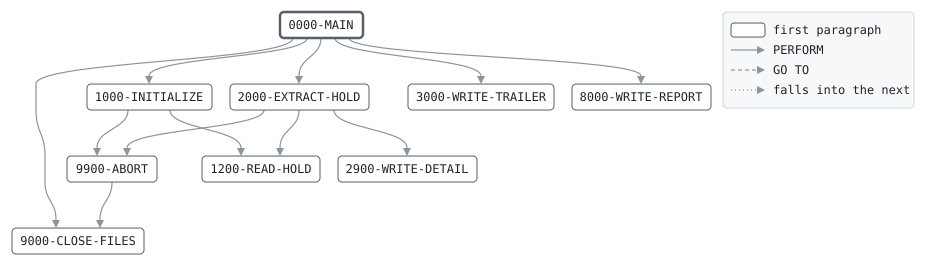

# HOLDEXT

```text
HOLDEXT: EXTRACT THE DAY'S HOLDS FOR POSTING

AT THE END OF THE ONLINE DAY, READS THE HOLDS IN KEY ORDER,
WHICH IS ACCOUNT ORDER, AND WRITES THE CARD FILE FOR THE
NIGHT'S BATCH IN THE FORM OF THE DAILY TRANSACTION FILE: A
HEADER FROM THE CARDS FOR THE BUSINESS DATE, A DETAIL FOR
EVERY CARD PURCHASE AND ATM WITHDRAWAL STILL HELD, ANOTHER
FOR THE FEE OF A WITHDRAWAL THAT HAD ONE, AND A TRAILER WITH
THE CONTROL TOTALS. REVERSED PURCHASES ARE LEFT OUT.
TRANSACTION IDS ARE 9, THE HOLD NUMBER, 00, AND 1 FOR THE
AMOUNT OR 2 FOR THE FEE.

RETURN CODES: 0 EXTRACTED, 16 A HOLD OF ANOTHER DAY OR I/O.

MODIFICATION HISTORY
DATE       BY  CHANGE
2003-05-19 MV  CR-0342 ORIGINAL VERSION.
2007-02-05 MV  CR-0415 ATM FEES.
```

Program [HOLDEXT.cbl](../../../pangaea/programs/HOLDEXT.cbl): 4 files, 9 paragraphs. Its business rules: [3 decision tables](../rules/HOLDEXT.md).

- AUTHOR: M. VARGA, ONLINE SYSTEMS.
- INSTALLATION: FIRST BANK OF PANGAEA, DATA CENTER.
- DATE-WRITTEN: 2003-05-19.

## Contents

- [Files](#files)
- [Flow](#flow)
- [Paragraphs](#paragraphs)
- [Data flow](#data-flow)
- [Lineage](#lineage)
  - [Into BANK-CONTROL-RECORD](#into-bank-control-record)
  - [Into HOLD-RECORD](#into-hold-record)
  - [Into TRAN-OUT-RECORD](#into-tran-out-record)
  - [Into REPORT-LINE](#into-report-line)
  - [Into WS-ABORT-MESSAGE](#into-ws-abort-message)
  - [Into WS-HOLDS-END-SW](#into-ws-holds-end-sw)
  - [Into TRAN-RECORD](#into-tran-record)
  - [Into WS-TRAN-ID](#into-ws-tran-id)
  - [Into WS-TOTALS](#into-ws-totals)
  - [Into WS-REPORT-COUNT-LINE](#into-ws-report-count-line)
  - [Into WS-REPORT-AMOUNT-LINE](#into-ws-report-amount-line)
  - [Out of the program](#out-of-the-program)
  - [Into other data items](#into-other-data-items)
- [Field origins](#field-origins)
  - [File TRAN-OUT](#file-tran-out)
  - [File REPORT-OUT](#file-report-out)
- [Records](#records)
  - [BANK-CONTROL-RECORD](#bank-control-record)
  - [HOLD-RECORD](#hold-record)
  - [TRAN-OUT-RECORD](#tran-out-record)
  - [REPORT-LINE](#report-line)
  - [WS-FILE-STATUSES](#ws-file-statuses)
  - [WS-ABORT-MESSAGE](#ws-abort-message)
  - [WS-HOLDS-END-SW](#ws-holds-end-sw)
  - [TRAN-RECORD](#tran-record)
  - [WS-TRAN-ID](#ws-tran-id)
  - [WS-TOTALS](#ws-totals)
  - [WS-REPORT-COUNT-LINE](#ws-report-count-line)
  - [WS-REPORT-AMOUNT-LINE](#ws-report-amount-line)

## Files

| File | Kind | Assigned to | Organization | Status field | Opened | Records |
| --- | --- | --- | --- | --- | --- | --- |
| CONTROL-FILE | FD | BANKCTL | SEQUENTIAL | WS-CONTROL-STATUS | INPUT | BANK-CONTROL-RECORD |
| HOLD-FILE | FD | HOLDS | INDEXED, key HD-KEY | WS-HOLD-STATUS | INPUT | HOLD-RECORD |
| TRAN-OUT | FD | TRANOUT | SEQUENTIAL | WS-TRAN-OUT-STATUS | OUTPUT | TRAN-OUT-RECORD |
| REPORT-OUT | FD | HOLDRPT | LINE SEQUENTIAL | WS-REPORT-STATUS | OUTPUT | REPORT-LINE |

## Flow



## Paragraphs

| Paragraph | Description | Source | Performs | Goes to | Performed by | Reached by |
| --- | --- | --- | --- | --- | --- | --- |
| 0000-MAIN | WRITE THE HEADER, A DETAIL OR TWO PER HOLD, AND THE TRAILER. | [HOLDEXT.cbl:93](../../../pangaea/programs/HOLDEXT.cbl#L93) | 1000-INITIALIZE, 2000-EXTRACT-HOLD, 3000-WRITE-TRAILER, 8000-WRITE-REPORT, 9000-CLOSE-FILES | | | |
| 1000-INITIALIZE | OPEN THE FILES, WRITE THE HEADER AND READ THE FIRST HOLD. | [HOLDEXT.cbl:103](../../../pangaea/programs/HOLDEXT.cbl#L103) | 9900-ABORT, 1200-READ-HOLD | | 0000-MAIN | |
| 1200-READ-HOLD | | [HOLDEXT.cbl:124](../../../pangaea/programs/HOLDEXT.cbl#L124) | | | 1000-INITIALIZE, 2000-EXTRACT-HOLD | |
| 2000-EXTRACT-HOLD | WRITE A HOLD STILL OPEN AS A TRANSACTION, AND ITS FEE AS ANOTHER. EVERY HOLD MUST BE OF THE BUSINESS DAY. | [HOLDEXT.cbl:134](../../../pangaea/programs/HOLDEXT.cbl#L134) | 9900-ABORT, 2900-WRITE-DETAIL, 1200-READ-HOLD | | 0000-MAIN | |
| 2900-WRITE-DETAIL | WRITE A DETAIL AND ADD IT TO THE CONTROL TOTALS. | [HOLDEXT.cbl:167](../../../pangaea/programs/HOLDEXT.cbl#L167) | | | 2000-EXTRACT-HOLD | |
| 3000-WRITE-TRAILER | | [HOLDEXT.cbl:174](../../../pangaea/programs/HOLDEXT.cbl#L174) | | | 0000-MAIN | |
| 8000-WRITE-REPORT | WRITE THE EXTRACTION REPORT. | [HOLDEXT.cbl:183](../../../pangaea/programs/HOLDEXT.cbl#L183) | | | 0000-MAIN | |
| 9000-CLOSE-FILES | CLOSE ALL FILES. | [HOLDEXT.cbl:205](../../../pangaea/programs/HOLDEXT.cbl#L205) | | | 0000-MAIN, 9900-ABORT | |
| 9900-ABORT | STOP THE RUN WITH RETURN CODE 16, SAYING WHY. | [HOLDEXT.cbl:209](../../../pangaea/programs/HOLDEXT.cbl#L209) | 9000-CLOSE-FILES | | 1000-INITIALIZE, 2000-EXTRACT-HOLD | |

## Data flow

| Paragraph | Reads | Writes |
| --- | --- | --- |
| 0000-MAIN | WS-HOLDS-END-SW | RETURN-CODE |
| 1000-INITIALIZE | WS-FILE-STATUSES, BC-BUSINESS-DATE, TRAN-RECORD | RETURN-CODE, BANK-CONTROL-RECORD, WS-ABORT-MESSAGE, TRAN-RECORD, TR-REC-TYPE, TH-BUSINESS-DATE, TH-SOURCE, TH-FILE-SEQ, TRAN-OUT-RECORD |
| 1200-READ-HOLD | WS-HOLD-COUNT | HOLD-RECORD, WS-HOLDS-END-SW, WS-HOLD-COUNT |
| 2000-EXTRACT-HOLD | HD-BUSINESS-DATE, BC-BUSINESS-DATE, HD-STATUS, WS-REVERSED-COUNT, HD-HOLD-NO, HD-ACCT-NO, HD-TERMINAL, HD-KIND, HD-AMOUNT, HD-FEE | WS-ABORT-MESSAGE, WS-REVERSED-COUNT, TRAN-RECORD, TR-REC-TYPE, WS-TI-HOLD-NO, TD-ACCT-NO, TD-DESCRIPTION, TD-COUNTER-ACCT-NO, TD-TRAN-CODE, TD-AMOUNT, WS-TI-PART |
| 2900-WRITE-DETAIL | WS-TRAN-ID, TRAN-RECORD, WS-DETAIL-COUNT, TD-AMOUNT, WS-AMOUNT-TOTAL, TD-ACCT-NO, WS-ACCT-HASH | TD-TRAN-ID, TRAN-OUT-RECORD, WS-DETAIL-COUNT, WS-AMOUNT-TOTAL, WS-ACCT-HASH |
| 3000-WRITE-TRAILER | WS-DETAIL-COUNT, WS-AMOUNT-TOTAL, WS-ACCT-HASH, TRAN-RECORD | TRAN-RECORD, TR-REC-TYPE, TT-DETAIL-COUNT, TT-AMOUNT-TOTAL, TT-ACCT-HASH, TRAN-OUT-RECORD |
| 8000-WRITE-REPORT | BC-BUSINESS-DATE, WS-HOLD-COUNT, WS-REPORT-COUNT-LINE, WS-REVERSED-COUNT, WS-DETAIL-COUNT, WS-AMOUNT-TOTAL, WS-REPORT-AMOUNT-LINE | REPORT-LINE, WS-RC-LABEL, WS-RC-VALUE, WS-RA-LABEL, WS-RA-VALUE |
| 9000-CLOSE-FILES | | |
| 9900-ABORT | WS-ABORT-MESSAGE | RETURN-CODE |

## Lineage

Where each data item's values come from, grouped by the record they go into. A data item links to the record it belongs to.

### Into BANK-CONTROL-RECORD

Record [BANK-CONTROL-RECORD](#bank-control-record), from copybook [BANKCTL](../copybooks/BANKCTL.md).

| Into | From | Statement | Paragraph | Source |
| --- | --- | --- | --- | --- |
| BANK-CONTROL-RECORD | file CONTROL-FILE | READ | 1000-INITIALIZE | [HOLDEXT.cbl:111](../../../pangaea/programs/HOLDEXT.cbl#L111) |

### Into HOLD-RECORD

Record [HOLD-RECORD](#hold-record), from copybook [HOLDREC](../copybooks/HOLDREC.md).

| Into | From | Statement | Paragraph | Source |
| --- | --- | --- | --- | --- |
| HOLD-RECORD | file HOLD-FILE | READ | 1200-READ-HOLD | [HOLDEXT.cbl:125](../../../pangaea/programs/HOLDEXT.cbl#L125) |

### Into TRAN-OUT-RECORD

Record [TRAN-OUT-RECORD](#tran-out-record).

| Into | From | Statement | Paragraph | Source |
| --- | --- | --- | --- | --- |
| TRAN-OUT-RECORD | [TRAN-RECORD](#tran-record) | WRITE | 1000-INITIALIZE | [HOLDEXT.cbl:121](../../../pangaea/programs/HOLDEXT.cbl#L121) |
| TRAN-OUT-RECORD | [TRAN-RECORD](#tran-record) | WRITE | 2900-WRITE-DETAIL | [HOLDEXT.cbl:169](../../../pangaea/programs/HOLDEXT.cbl#L169) |
| TRAN-OUT-RECORD | [TRAN-RECORD](#tran-record) | WRITE | 3000-WRITE-TRAILER | [HOLDEXT.cbl:180](../../../pangaea/programs/HOLDEXT.cbl#L180) |

### Into REPORT-LINE

Record [REPORT-LINE](#report-line).

| Into | From | Statement | Paragraph | Source |
| --- | --- | --- | --- | --- |
| REPORT-LINE | literal SPACES | MOVE | 8000-WRITE-REPORT | [HOLDEXT.cbl:184](../../../pangaea/programs/HOLDEXT.cbl#L184) |
| REPORT-LINE | literal 'HOLDEXT  HOLDS FOR POSTING       BUSINESS DATE ' | STRING | 8000-WRITE-REPORT | [HOLDEXT.cbl:185](../../../pangaea/programs/HOLDEXT.cbl#L185) |
| REPORT-LINE | [BC-BUSINESS-DATE](#bank-control-record "in BANK-CONTROL-RECORD") | STRING | 8000-WRITE-REPORT | [HOLDEXT.cbl:185](../../../pangaea/programs/HOLDEXT.cbl#L185) |
| REPORT-LINE | literal SPACES | MOVE | 8000-WRITE-REPORT | [HOLDEXT.cbl:189](../../../pangaea/programs/HOLDEXT.cbl#L189) |
| REPORT-LINE | [WS-REPORT-COUNT-LINE](#ws-report-count-line) | WRITE | 8000-WRITE-REPORT | [HOLDEXT.cbl:193](../../../pangaea/programs/HOLDEXT.cbl#L193) |
| REPORT-LINE | [WS-REPORT-COUNT-LINE](#ws-report-count-line) | WRITE | 8000-WRITE-REPORT | [HOLDEXT.cbl:196](../../../pangaea/programs/HOLDEXT.cbl#L196) |
| REPORT-LINE | [WS-REPORT-COUNT-LINE](#ws-report-count-line) | WRITE | 8000-WRITE-REPORT | [HOLDEXT.cbl:199](../../../pangaea/programs/HOLDEXT.cbl#L199) |
| REPORT-LINE | [WS-REPORT-AMOUNT-LINE](#ws-report-amount-line) | WRITE | 8000-WRITE-REPORT | [HOLDEXT.cbl:202](../../../pangaea/programs/HOLDEXT.cbl#L202) |

### Into WS-ABORT-MESSAGE

Record [WS-ABORT-MESSAGE](#ws-abort-message).

| Into | From | Statement | Paragraph | Source |
| --- | --- | --- | --- | --- |
| WS-ABORT-MESSAGE | literal 'NO BANK CONTROL RECORD' | MOVE | 1000-INITIALIZE | [HOLDEXT.cbl:113](../../../pangaea/programs/HOLDEXT.cbl#L113) |
| WS-ABORT-MESSAGE | literal 'A HOLD OF ANOTHER BUSINESS DAY' | MOVE | 2000-EXTRACT-HOLD | [HOLDEXT.cbl:136](../../../pangaea/programs/HOLDEXT.cbl#L136) |

### Into WS-HOLDS-END-SW

Record [WS-HOLDS-END-SW](#ws-holds-end-sw).

| Into | From | Statement | Paragraph | Source |
| --- | --- | --- | --- | --- |
| WS-HOLDS-END-SW | literal condition END-OF-HOLDS | SET | 1200-READ-HOLD | [HOLDEXT.cbl:127](../../../pangaea/programs/HOLDEXT.cbl#L127) |

### Into TRAN-RECORD

Record [TRAN-RECORD](#tran-record), from copybook [TRANREC](../copybooks/TRANREC.md).

| Into | From | Statement | Paragraph | Source |
| --- | --- | --- | --- | --- |
| TD-ACCT-NO | [HD-ACCT-NO](#hold-record "in HOLD-RECORD") | MOVE | 2000-EXTRACT-HOLD | [HOLDEXT.cbl:145](../../../pangaea/programs/HOLDEXT.cbl#L145) |
| TD-AMOUNT | [HD-AMOUNT](#hold-record "in HOLD-RECORD") | MOVE | 2000-EXTRACT-HOLD | [HOLDEXT.cbl:153](../../../pangaea/programs/HOLDEXT.cbl#L153) |
| TD-AMOUNT | [HD-FEE](#hold-record "in HOLD-RECORD") | MOVE | 2000-EXTRACT-HOLD | [HOLDEXT.cbl:158](../../../pangaea/programs/HOLDEXT.cbl#L158) |
| TD-COUNTER-ACCT-NO | literal 0 | MOVE | 2000-EXTRACT-HOLD | [HOLDEXT.cbl:147](../../../pangaea/programs/HOLDEXT.cbl#L147) |
| TD-DESCRIPTION | [HD-TERMINAL](#hold-record "in HOLD-RECORD") | MOVE | 2000-EXTRACT-HOLD | [HOLDEXT.cbl:146](../../../pangaea/programs/HOLDEXT.cbl#L146) |
| TD-DESCRIPTION | literal 'ATM FEE' | MOVE | 2000-EXTRACT-HOLD | [HOLDEXT.cbl:159](../../../pangaea/programs/HOLDEXT.cbl#L159) |
| TD-TRAN-CODE | literal condition TD-CARD-PURCHASE | SET | 2000-EXTRACT-HOLD | [HOLDEXT.cbl:149](../../../pangaea/programs/HOLDEXT.cbl#L149) |
| TD-TRAN-CODE | literal condition TD-ATM-WITHDRAWAL | SET | 2000-EXTRACT-HOLD | [HOLDEXT.cbl:151](../../../pangaea/programs/HOLDEXT.cbl#L151) |
| TD-TRAN-CODE | literal condition TD-ATM-FEE | SET | 2000-EXTRACT-HOLD | [HOLDEXT.cbl:157](../../../pangaea/programs/HOLDEXT.cbl#L157) |
| TD-TRAN-ID | [WS-TRAN-ID](#ws-tran-id) | MOVE | 2900-WRITE-DETAIL | [HOLDEXT.cbl:168](../../../pangaea/programs/HOLDEXT.cbl#L168) |
| TH-BUSINESS-DATE | [BC-BUSINESS-DATE](#bank-control-record "in BANK-CONTROL-RECORD") | MOVE | 1000-INITIALIZE | [HOLDEXT.cbl:118](../../../pangaea/programs/HOLDEXT.cbl#L118) |
| TH-FILE-SEQ | literal 1 | MOVE | 1000-INITIALIZE | [HOLDEXT.cbl:120](../../../pangaea/programs/HOLDEXT.cbl#L120) |
| TH-SOURCE | literal condition TH-FROM-CARDS | SET | 1000-INITIALIZE | [HOLDEXT.cbl:119](../../../pangaea/programs/HOLDEXT.cbl#L119) |
| TR-REC-TYPE | literal condition TR-HEADER | SET | 1000-INITIALIZE | [HOLDEXT.cbl:117](../../../pangaea/programs/HOLDEXT.cbl#L117) |
| TR-REC-TYPE | literal condition TR-DETAIL | SET | 2000-EXTRACT-HOLD | [HOLDEXT.cbl:143](../../../pangaea/programs/HOLDEXT.cbl#L143) |
| TR-REC-TYPE | literal condition TR-TRAILER | SET | 3000-WRITE-TRAILER | [HOLDEXT.cbl:176](../../../pangaea/programs/HOLDEXT.cbl#L176) |
| TRAN-RECORD | literal SPACES | MOVE | 1000-INITIALIZE | [HOLDEXT.cbl:116](../../../pangaea/programs/HOLDEXT.cbl#L116) |
| TRAN-RECORD | literal SPACES | MOVE | 2000-EXTRACT-HOLD | [HOLDEXT.cbl:142](../../../pangaea/programs/HOLDEXT.cbl#L142) |
| TRAN-RECORD | literal SPACES | MOVE | 3000-WRITE-TRAILER | [HOLDEXT.cbl:175](../../../pangaea/programs/HOLDEXT.cbl#L175) |
| TT-ACCT-HASH | [WS-ACCT-HASH](#ws-totals "in WS-TOTALS") | MOVE | 3000-WRITE-TRAILER | [HOLDEXT.cbl:179](../../../pangaea/programs/HOLDEXT.cbl#L179) |
| TT-AMOUNT-TOTAL | [WS-AMOUNT-TOTAL](#ws-totals "in WS-TOTALS") | MOVE | 3000-WRITE-TRAILER | [HOLDEXT.cbl:178](../../../pangaea/programs/HOLDEXT.cbl#L178) |
| TT-DETAIL-COUNT | [WS-DETAIL-COUNT](#ws-totals "in WS-TOTALS") | MOVE | 3000-WRITE-TRAILER | [HOLDEXT.cbl:177](../../../pangaea/programs/HOLDEXT.cbl#L177) |

### Into WS-TRAN-ID

Record [WS-TRAN-ID](#ws-tran-id).

| Into | From | Statement | Paragraph | Source |
| --- | --- | --- | --- | --- |
| WS-TI-HOLD-NO | [HD-HOLD-NO](#hold-record "in HOLD-RECORD") | MOVE | 2000-EXTRACT-HOLD | [HOLDEXT.cbl:144](../../../pangaea/programs/HOLDEXT.cbl#L144) |
| WS-TI-PART | literal 1 | MOVE | 2000-EXTRACT-HOLD | [HOLDEXT.cbl:154](../../../pangaea/programs/HOLDEXT.cbl#L154) |
| WS-TI-PART | literal 2 | MOVE | 2000-EXTRACT-HOLD | [HOLDEXT.cbl:160](../../../pangaea/programs/HOLDEXT.cbl#L160) |

### Into WS-TOTALS

Record [WS-TOTALS](#ws-totals).

| Into | From | Statement | Paragraph | Source |
| --- | --- | --- | --- | --- |
| WS-ACCT-HASH | [TD-ACCT-NO](#tran-record "in TRAN-RECORD") | ADD | 2900-WRITE-DETAIL | [HOLDEXT.cbl:172](../../../pangaea/programs/HOLDEXT.cbl#L172) |
| WS-AMOUNT-TOTAL | [TD-AMOUNT](#tran-record "in TRAN-RECORD") | ADD | 2900-WRITE-DETAIL | [HOLDEXT.cbl:171](../../../pangaea/programs/HOLDEXT.cbl#L171) |
| WS-DETAIL-COUNT | literal 1 | ADD | 2900-WRITE-DETAIL | [HOLDEXT.cbl:170](../../../pangaea/programs/HOLDEXT.cbl#L170) |
| WS-HOLD-COUNT | literal 1 | ADD | 1200-READ-HOLD | [HOLDEXT.cbl:129](../../../pangaea/programs/HOLDEXT.cbl#L129) |
| WS-REVERSED-COUNT | literal 1 | ADD | 2000-EXTRACT-HOLD | [HOLDEXT.cbl:140](../../../pangaea/programs/HOLDEXT.cbl#L140) |

### Into WS-REPORT-COUNT-LINE

Record [WS-REPORT-COUNT-LINE](#ws-report-count-line).

| Into | From | Statement | Paragraph | Source |
| --- | --- | --- | --- | --- |
| WS-RC-LABEL | literal 'HOLDS READ' | MOVE | 8000-WRITE-REPORT | [HOLDEXT.cbl:191](../../../pangaea/programs/HOLDEXT.cbl#L191) |
| WS-RC-LABEL | literal 'REVERSED, LEFT OUT' | MOVE | 8000-WRITE-REPORT | [HOLDEXT.cbl:194](../../../pangaea/programs/HOLDEXT.cbl#L194) |
| WS-RC-LABEL | literal 'TRANSACTIONS WRITTEN' | MOVE | 8000-WRITE-REPORT | [HOLDEXT.cbl:197](../../../pangaea/programs/HOLDEXT.cbl#L197) |
| WS-RC-VALUE | [WS-HOLD-COUNT](#ws-totals "in WS-TOTALS") | MOVE | 8000-WRITE-REPORT | [HOLDEXT.cbl:192](../../../pangaea/programs/HOLDEXT.cbl#L192) |
| WS-RC-VALUE | [WS-REVERSED-COUNT](#ws-totals "in WS-TOTALS") | MOVE | 8000-WRITE-REPORT | [HOLDEXT.cbl:195](../../../pangaea/programs/HOLDEXT.cbl#L195) |
| WS-RC-VALUE | [WS-DETAIL-COUNT](#ws-totals "in WS-TOTALS") | MOVE | 8000-WRITE-REPORT | [HOLDEXT.cbl:198](../../../pangaea/programs/HOLDEXT.cbl#L198) |

### Into WS-REPORT-AMOUNT-LINE

Record [WS-REPORT-AMOUNT-LINE](#ws-report-amount-line).

| Into | From | Statement | Paragraph | Source |
| --- | --- | --- | --- | --- |
| WS-RA-LABEL | literal 'AMOUNT TOTAL' | MOVE | 8000-WRITE-REPORT | [HOLDEXT.cbl:200](../../../pangaea/programs/HOLDEXT.cbl#L200) |
| WS-RA-VALUE | [WS-AMOUNT-TOTAL](#ws-totals "in WS-TOTALS") | MOVE | 8000-WRITE-REPORT | [HOLDEXT.cbl:201](../../../pangaea/programs/HOLDEXT.cbl#L201) |

### Out of the program

Records written to files, items passed to the programs called, and items displayed to the job's output.

| Into | From | Statement | Paragraph | Source |
| --- | --- | --- | --- | --- |
| file REPORT-OUT | [REPORT-LINE](#report-line) | WRITE | 8000-WRITE-REPORT | [HOLDEXT.cbl:188](../../../pangaea/programs/HOLDEXT.cbl#L188) |
| file REPORT-OUT | [REPORT-LINE](#report-line) | WRITE | 8000-WRITE-REPORT | [HOLDEXT.cbl:190](../../../pangaea/programs/HOLDEXT.cbl#L190) |
| file REPORT-OUT | [REPORT-LINE](#report-line) | WRITE | 8000-WRITE-REPORT | [HOLDEXT.cbl:193](../../../pangaea/programs/HOLDEXT.cbl#L193) |
| file REPORT-OUT | [REPORT-LINE](#report-line) | WRITE | 8000-WRITE-REPORT | [HOLDEXT.cbl:196](../../../pangaea/programs/HOLDEXT.cbl#L196) |
| file REPORT-OUT | [REPORT-LINE](#report-line) | WRITE | 8000-WRITE-REPORT | [HOLDEXT.cbl:199](../../../pangaea/programs/HOLDEXT.cbl#L199) |
| file REPORT-OUT | [REPORT-LINE](#report-line) | WRITE | 8000-WRITE-REPORT | [HOLDEXT.cbl:202](../../../pangaea/programs/HOLDEXT.cbl#L202) |
| SYSOUT | [WS-FILE-STATUSES](#ws-file-statuses) | DISPLAY | 1000-INITIALIZE | [HOLDEXT.cbl:107](../../../pangaea/programs/HOLDEXT.cbl#L107) |
| SYSOUT | [WS-ABORT-MESSAGE](#ws-abort-message) | DISPLAY | 9900-ABORT | [HOLDEXT.cbl:210](../../../pangaea/programs/HOLDEXT.cbl#L210) |
| file TRAN-OUT | [TRAN-OUT-RECORD](#tran-out-record) | WRITE | 1000-INITIALIZE | [HOLDEXT.cbl:121](../../../pangaea/programs/HOLDEXT.cbl#L121) |
| file TRAN-OUT | [TRAN-OUT-RECORD](#tran-out-record) | WRITE | 2900-WRITE-DETAIL | [HOLDEXT.cbl:169](../../../pangaea/programs/HOLDEXT.cbl#L169) |
| file TRAN-OUT | [TRAN-OUT-RECORD](#tran-out-record) | WRITE | 3000-WRITE-TRAILER | [HOLDEXT.cbl:180](../../../pangaea/programs/HOLDEXT.cbl#L180) |

### Into other data items

Data items the program does not declare, such as special registers and index names.

| Into | From | Statement | Paragraph | Source |
| --- | --- | --- | --- | --- |
| RETURN-CODE | literal 0 | MOVE | 0000-MAIN | [HOLDEXT.cbl:99](../../../pangaea/programs/HOLDEXT.cbl#L99) |
| RETURN-CODE | literal 16 | MOVE | 1000-INITIALIZE | [HOLDEXT.cbl:108](../../../pangaea/programs/HOLDEXT.cbl#L108) |
| RETURN-CODE | literal 16 | MOVE | 9900-ABORT | [HOLDEXT.cbl:212](../../../pangaea/programs/HOLDEXT.cbl#L212) |

## Field origins

Where the values of each field the program writes to a file come from: the fields of the files it reads, literals, and initial values, followed through every statement that moves a value, and through groups and redefinitions by the bytes they share.

### File TRAN-OUT

Written from [TRAN-RECORD](#tran-record).

| Field | Position | Origins |
| --- | --: | --- |
| TR-REC-TYPE | 1 | literal condition TR-DETAIL; literal condition TR-HEADER; literal condition TR-TRAILER |
| TR-BODY | 2-80 | file CONTROL-FILE BC-BUSINESS-DATE; file HOLD-FILE HD-ACCT-NO; file HOLD-FILE HD-AMOUNT; file HOLD-FILE HD-FEE; file HOLD-FILE HD-HOLD-NO; file HOLD-FILE HD-TERMINAL; initial value of WS-ACCT-HASH; initial value of WS-AMOUNT-TOTAL; initial value of WS-DETAIL-COUNT; literal 'ATM FEE'; literal 0; literal 1; literal 2; literal condition TD-ATM-FEE; literal condition TD-ATM-WITHDRAWAL; literal condition TD-CARD-PURCHASE; literal condition TH-FROM-CARDS |
| TH-BUSINESS-DATE | 2-9 | file CONTROL-FILE BC-BUSINESS-DATE; file HOLD-FILE HD-HOLD-NO; initial value of WS-DETAIL-COUNT; literal 1 |
| TH-SOURCE | 10-17 | file HOLD-FILE HD-ACCT-NO; file HOLD-FILE HD-AMOUNT; file HOLD-FILE HD-FEE; initial value of WS-ACCT-HASH; initial value of WS-AMOUNT-TOTAL; literal 1; literal 2; literal condition TH-FROM-CARDS |
| TH-FILE-SEQ | 18-23 | file HOLD-FILE HD-ACCT-NO; file HOLD-FILE HD-AMOUNT; file HOLD-FILE HD-FEE; initial value of WS-ACCT-HASH; initial value of WS-AMOUNT-TOTAL; literal 1; literal condition TD-ATM-FEE; literal condition TD-ATM-WITHDRAWAL; literal condition TD-CARD-PURCHASE; literal condition TH-FROM-CARDS |
| TD-TRAN-ID | 2-11 | file CONTROL-FILE BC-BUSINESS-DATE; file HOLD-FILE HD-ACCT-NO; file HOLD-FILE HD-AMOUNT; file HOLD-FILE HD-FEE; file HOLD-FILE HD-HOLD-NO; initial value of WS-ACCT-HASH; initial value of WS-AMOUNT-TOTAL; initial value of WS-DETAIL-COUNT; literal 1; literal 2; literal condition TH-FROM-CARDS |
| TD-ACCT-NO | 12-21 | file HOLD-FILE HD-ACCT-NO; file HOLD-FILE HD-AMOUNT; file HOLD-FILE HD-FEE; initial value of WS-ACCT-HASH; initial value of WS-AMOUNT-TOTAL; literal 1; literal condition TH-FROM-CARDS |
| TD-TRAN-CODE | 22-23 | file HOLD-FILE HD-ACCT-NO; file HOLD-FILE HD-AMOUNT; file HOLD-FILE HD-FEE; initial value of WS-ACCT-HASH; initial value of WS-AMOUNT-TOTAL; literal 1; literal condition TD-ATM-FEE; literal condition TD-ATM-WITHDRAWAL; literal condition TD-CARD-PURCHASE; literal condition TH-FROM-CARDS |
| TD-AMOUNT | 24-34 | file HOLD-FILE HD-ACCT-NO; file HOLD-FILE HD-AMOUNT; file HOLD-FILE HD-FEE; initial value of WS-ACCT-HASH; initial value of WS-AMOUNT-TOTAL; literal 1; literal condition TH-FROM-CARDS |
| TD-DESCRIPTION | 35-54 | file HOLD-FILE HD-ACCT-NO; file HOLD-FILE HD-AMOUNT; file HOLD-FILE HD-FEE; file HOLD-FILE HD-TERMINAL; initial value of WS-ACCT-HASH; initial value of WS-AMOUNT-TOTAL; literal 'ATM FEE'; literal 1; literal condition TH-FROM-CARDS |
| TD-COUNTER-ACCT-NO | 55-64 | literal 0 |
| TT-DETAIL-COUNT | 2-9 | file CONTROL-FILE BC-BUSINESS-DATE; file HOLD-FILE HD-HOLD-NO; initial value of WS-DETAIL-COUNT; literal 1 |
| TT-AMOUNT-TOTAL | 10-24 | file HOLD-FILE HD-ACCT-NO; file HOLD-FILE HD-AMOUNT; file HOLD-FILE HD-FEE; initial value of WS-ACCT-HASH; initial value of WS-AMOUNT-TOTAL; literal 1; literal 2; literal condition TD-ATM-FEE; literal condition TD-ATM-WITHDRAWAL; literal condition TD-CARD-PURCHASE; literal condition TH-FROM-CARDS |
| TT-ACCT-HASH | 25-39 | file HOLD-FILE HD-ACCT-NO; file HOLD-FILE HD-AMOUNT; file HOLD-FILE HD-FEE; file HOLD-FILE HD-TERMINAL; initial value of WS-ACCT-HASH; initial value of WS-AMOUNT-TOTAL; literal 'ATM FEE'; literal 1; literal condition TH-FROM-CARDS |

### File REPORT-OUT

Written from [WS-REPORT-AMOUNT-LINE](#ws-report-amount-line).

| Field | Position | Origins |
| --- | --: | --- |
| WS-RA-LABEL | 1-30 | literal 'AMOUNT TOTAL' |
| WS-RA-VALUE | 31-50 | file HOLD-FILE HD-ACCT-NO; file HOLD-FILE HD-AMOUNT; file HOLD-FILE HD-FEE; initial value of WS-ACCT-HASH; initial value of WS-AMOUNT-TOTAL; literal 1; literal condition TH-FROM-CARDS |

## Records

### BANK-CONTROL-RECORD

File CONTROL-FILE. 80 bytes, layout in copybook [BANKCTL](../copybooks/BANKCTL.md).

### HOLD-RECORD

File HOLD-FILE. 100 bytes, layout in copybook [HOLDREC](../copybooks/HOLDREC.md).

### TRAN-OUT-RECORD

File TRAN-OUT. 80 bytes.

| Level | Field | Kind | Start | Length | Picture | Usage | Notes | Source |
| --: | --- | --- | --: | --: | --- | --- | --- | --- |
| 01 | TRAN-OUT-RECORD | text | 1 | 80 | X(80) | | | [HOLDEXT.cbl:52](../../../pangaea/programs/HOLDEXT.cbl#L52) |

### REPORT-LINE

File REPORT-OUT. 80 bytes.

| Level | Field | Kind | Start | Length | Picture | Usage | Notes | Source |
| --: | --- | --- | --: | --: | --- | --- | --- | --- |
| 01 | REPORT-LINE | text | 1 | 80 | X(80) | | | [HOLDEXT.cbl:54](../../../pangaea/programs/HOLDEXT.cbl#L54) |

### WS-FILE-STATUSES

Working storage. 8 bytes.

| Level | Field | Kind | Start | Length | Picture | Usage | Notes | Source |
| --: | --- | --- | --: | --: | --- | --- | --- | --- |
| 01 | WS-FILE-STATUSES | group | 1 | 8 | | | | [HOLDEXT.cbl:57](../../../pangaea/programs/HOLDEXT.cbl#L57) |
| 05 | ├ WS-CONTROL-STATUS | text | 1 | 2 | XX | | | [HOLDEXT.cbl:58](../../../pangaea/programs/HOLDEXT.cbl#L58) |
| 05 | ├ WS-HOLD-STATUS | text | 3 | 2 | XX | | | [HOLDEXT.cbl:59](../../../pangaea/programs/HOLDEXT.cbl#L59) |
| 05 | ├ WS-TRAN-OUT-STATUS | text | 5 | 2 | XX | | | [HOLDEXT.cbl:60](../../../pangaea/programs/HOLDEXT.cbl#L60) |
| 05 | └ WS-REPORT-STATUS | text | 7 | 2 | XX | | | [HOLDEXT.cbl:61](../../../pangaea/programs/HOLDEXT.cbl#L61) |

### WS-ABORT-MESSAGE

Working storage. 40 bytes.

| Level | Field | Kind | Start | Length | Picture | Usage | Notes | Source |
| --: | --- | --- | --: | --: | --- | --- | --- | --- |
| 01 | WS-ABORT-MESSAGE | text | 1 | 40 | X(40) | | | [HOLDEXT.cbl:63](../../../pangaea/programs/HOLDEXT.cbl#L63) |

### WS-HOLDS-END-SW

Working storage. 1 bytes.

| Level | Field | Kind | Start | Length | Picture | Usage | Notes | Source |
| --: | --- | --- | --: | --: | --- | --- | --- | --- |
| 01 | WS-HOLDS-END-SW | code | 1 | 1 | X | | VALUE 'N' | [HOLDEXT.cbl:64](../../../pangaea/programs/HOLDEXT.cbl#L64) |
| 88 | └ END-OF-HOLDS | | | | | | VALUE 'Y' | [HOLDEXT.cbl:65](../../../pangaea/programs/HOLDEXT.cbl#L65) |

### TRAN-RECORD

Working storage. 80 bytes, layout in copybook [TRANREC](../copybooks/TRANREC.md).

### WS-TRAN-ID

Working storage. 10 bytes.

| Level | Field | Kind | Start | Length | Picture | Usage | Notes | Source |
| --: | --- | --- | --: | --: | --- | --- | --- | --- |
| 01 | WS-TRAN-ID | group | 1 | 10 | | | | [HOLDEXT.cbl:69](../../../pangaea/programs/HOLDEXT.cbl#L69) |
| 05 | ├ FILLER | filler | 1 | 1 | 9 | | VALUE 9 | [HOLDEXT.cbl:70](../../../pangaea/programs/HOLDEXT.cbl#L70) |
| 05 | ├ WS-TI-HOLD-NO | number | 2 | 6 | 9(6) | | | [HOLDEXT.cbl:71](../../../pangaea/programs/HOLDEXT.cbl#L71) |
| 05 | ├ FILLER | filler | 8 | 2 | 99 | | VALUE 0 | [HOLDEXT.cbl:72](../../../pangaea/programs/HOLDEXT.cbl#L72) |
| 05 | └ WS-TI-PART | number | 10 | 1 | 9 | | | [HOLDEXT.cbl:73](../../../pangaea/programs/HOLDEXT.cbl#L73) |

### WS-TOTALS

Working storage. 54 bytes.

| Level | Field | Kind | Start | Length | Picture | Usage | Notes | Source |
| --: | --- | --- | --: | --: | --- | --- | --- | --- |
| 01 | WS-TOTALS | group | 1 | 54 | | | | [HOLDEXT.cbl:75](../../../pangaea/programs/HOLDEXT.cbl#L75) |
| 05 | ├ WS-HOLD-COUNT | number | 1 | 8 | 9(8) | | VALUE 0 | [HOLDEXT.cbl:76](../../../pangaea/programs/HOLDEXT.cbl#L76) |
| 05 | ├ WS-REVERSED-COUNT | number | 9 | 8 | 9(8) | | VALUE 0 | [HOLDEXT.cbl:77](../../../pangaea/programs/HOLDEXT.cbl#L77) |
| 05 | ├ WS-DETAIL-COUNT | number | 17 | 8 | 9(8) | | VALUE 0 | [HOLDEXT.cbl:78](../../../pangaea/programs/HOLDEXT.cbl#L78) |
| 05 | ├ WS-AMOUNT-TOTAL | amount | 25 | 15 | 9(13)V99 | | VALUE 0 | [HOLDEXT.cbl:79](../../../pangaea/programs/HOLDEXT.cbl#L79) |
| 05 | └ WS-ACCT-HASH | number | 40 | 15 | 9(15) | | VALUE 0 | [HOLDEXT.cbl:80](../../../pangaea/programs/HOLDEXT.cbl#L80) |

### WS-REPORT-COUNT-LINE

Working storage. 80 bytes.

| Level | Field | Kind | Start | Length | Picture | Usage | Notes | Source |
| --: | --- | --- | --: | --: | --- | --- | --- | --- |
| 01 | WS-REPORT-COUNT-LINE | group | 1 | 80 | | | | [HOLDEXT.cbl:82](../../../pangaea/programs/HOLDEXT.cbl#L82) |
| 05 | ├ WS-RC-LABEL | text | 1 | 30 | X(30) | | | [HOLDEXT.cbl:83](../../../pangaea/programs/HOLDEXT.cbl#L83) |
| 05 | ├ WS-RC-VALUE | edited | 31 | 10 | ZZ,ZZZ,ZZ9 | | | [HOLDEXT.cbl:84](../../../pangaea/programs/HOLDEXT.cbl#L84) |
| 05 | └ FILLER | filler | 41 | 40 | X(40) | | VALUE SPACES | [HOLDEXT.cbl:85](../../../pangaea/programs/HOLDEXT.cbl#L85) |

### WS-REPORT-AMOUNT-LINE

Working storage. 80 bytes.

| Level | Field | Kind | Start | Length | Picture | Usage | Notes | Source |
| --: | --- | --- | --: | --: | --- | --- | --- | --- |
| 01 | WS-REPORT-AMOUNT-LINE | group | 1 | 80 | | | | [HOLDEXT.cbl:86](../../../pangaea/programs/HOLDEXT.cbl#L86) |
| 05 | ├ WS-RA-LABEL | text | 1 | 30 | X(30) | | | [HOLDEXT.cbl:87](../../../pangaea/programs/HOLDEXT.cbl#L87) |
| 05 | ├ WS-RA-VALUE | edited | 31 | 20 | Z,ZZZ,ZZZ,ZZZ,ZZ9.99 | | | [HOLDEXT.cbl:88](../../../pangaea/programs/HOLDEXT.cbl#L88) |
| 05 | └ FILLER | filler | 51 | 30 | X(30) | | VALUE SPACES | [HOLDEXT.cbl:89](../../../pangaea/programs/HOLDEXT.cbl#L89) |
