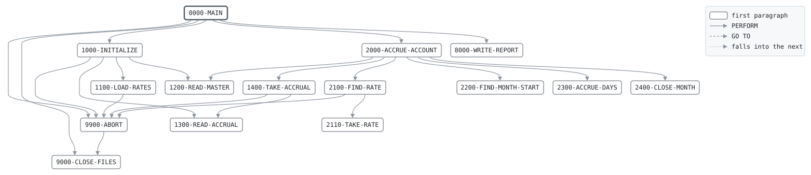

# INTACCR

```text
INTACCR: ACCRUE INTEREST

ACCRUES EVERY ACCOUNT'S INTEREST FOR THE CALENDAR DAYS FROM
ITS LAST ACCRUAL UP TO THE BUSINESS DATE, ON THE OPENING
BALANCE: THE BALANCE THE LAST BUSINESS DAY CLOSED WITH, WHICH
STOOD OVER THE DAYS IN BETWEEN. THE RATE IS THE ACCOUNT
TYPE'S HIGHEST CREDIT TIER THE BALANCE REACHES, OR ITS DEBIT
RATE BELOW ZERO. A YEAR HAS 365 DAYS.

WHEN THE DAYS CROSS INTO A NEW MONTH, THE DAYS OF THE OLD
MONTH ARE ACCRUED FIRST AND ITS INTEREST BECOMES DUE, ROUNDED
TO THE CENT, TO BE CREDITED OR CHARGED. THE ACCRUALS ARE READ
IN STEP WITH THE MASTER, ONE FOR EACH ACCOUNT. AN ACCOUNT
OPENED SINCE THE LAST RUN HAS NONE YET AND STARTS ACCRUING
TODAY.

RETURN CODES: 0 ACCRUED,
              16 AN ACCRUAL FOR NO ACCOUNT, NO RATE, OR I/O.

MODIFICATION HISTORY
DATE       BY  CHANGE
1202       FIB INTEREST BY THE DAY, IN THE LIBER ABACI, PISA.
2001-09-03 TL  CR-0298 IN COBOL.
2002-02-11 TL  CR-0311 ACCOUNTS OPENED SINCE THE LAST RUN.
```

Program [INTACCR.cbl](../../../pangaea/programs/INTACCR.cbl): 6 files, 15 paragraphs. Its business rules: [14 decision tables](../rules/INTACCR.md).

- AUTHOR: T. LINDQVIST, BATCH SYSTEMS.
- INSTALLATION: FIRST BANK OF PANGAEA, DATA CENTER.
- DATE-WRITTEN: 2001-09-03.

## Contents

- [Files](#files)
- [Flow](#flow)
- [Paragraphs](#paragraphs)
- [Data flow](#data-flow)
- [Lineage](#lineage)
  - [Into BANK-CONTROL-RECORD](#into-bank-control-record)
  - [Into RATE-RECORD](#into-rate-record)
  - [Into ACCT-MASTER-RECORD](#into-acct-master-record)
  - [Into ACCR-IN-RECORD](#into-accr-in-record)
  - [Into ACCR-OUT-RECORD](#into-accr-out-record)
  - [Into REPORT-LINE](#into-report-line)
  - [Into WS-BUSINESS-DATE](#into-ws-business-date)
  - [Into WS-ABORT-MESSAGE](#into-ws-abort-message)
  - [Into WS-END-SWITCHES](#into-ws-end-switches)
  - [Into WS-ACCRUAL-KEY](#into-ws-accrual-key)
  - [Into ACCRUAL-RECORD](#into-accrual-record)
  - [Into WS-RATE-COUNT](#into-ws-rate-count)
  - [Into WS-RATE-TABLE](#into-ws-rate-table)
  - [Into WS-ACCOUNT-RATE](#into-ws-account-rate)
  - [Into WS-RATE-FOUND-SW](#into-ws-rate-found-sw)
  - [Into WS-BEST-FLOOR](#into-ws-best-floor)
  - [Into WS-TODAY](#into-ws-today)
  - [Into WS-FROM-DAY](#into-ws-from-day)
  - [Into WS-MONTH-START-DAY](#into-ws-month-start-day)
  - [Into WS-DAYS](#into-ws-days)
  - [Into WS-THROUGH-DATE](#into-ws-through-date)
  - [Into WS-MONTH-START](#into-ws-month-start)
  - [Into WS-INTEREST-PRODUCT](#into-ws-interest-product)
  - [Into WS-INCREMENT](#into-ws-increment)
  - [Into WS-DUE-MONTH](#into-ws-due-month)
  - [Into WS-TOTALS](#into-ws-totals)
  - [Into WS-REPORT-COUNT-LINE](#into-ws-report-count-line)
  - [Into WS-REPORT-AMOUNT-LINE](#into-ws-report-amount-line)
  - [Into files](#into-files)
  - [Into other data items](#into-other-data-items)
- [Field origins](#field-origins)
  - [File ACCR-OUT](#file-accr-out)
  - [File REPORT-OUT](#file-report-out)
- [Records](#records)
  - [BANK-CONTROL-RECORD](#bank-control-record)
  - [RATE-RECORD](#rate-record)
  - [ACCT-MASTER-RECORD](#acct-master-record)
  - [ACCR-IN-RECORD](#accr-in-record)
  - [ACCR-OUT-RECORD](#accr-out-record)
  - [REPORT-LINE](#report-line)
  - [WS-FILE-STATUSES](#ws-file-statuses)
  - [WS-BUSINESS-DATE](#ws-business-date)
  - [WS-ABORT-MESSAGE](#ws-abort-message)
  - [WS-END-SWITCHES](#ws-end-switches)
  - [WS-ACCRUAL-KEY](#ws-accrual-key)
  - [ACCRUAL-RECORD](#accrual-record)
  - [WS-RATE-COUNT](#ws-rate-count)
  - [WS-RATE-TABLE](#ws-rate-table)
  - [WS-RX](#ws-rx)
  - [WS-ACCOUNT-RATE](#ws-account-rate)
  - [WS-RATE-FOUND-SW](#ws-rate-found-sw)
  - [WS-BEST-FLOOR](#ws-best-floor)
  - [WS-TODAY](#ws-today)
  - [WS-FROM-DAY](#ws-from-day)
  - [WS-MONTH-START-DAY](#ws-month-start-day)
  - [WS-DAYS](#ws-days)
  - [WS-THROUGH-DATE](#ws-through-date)
  - [WS-MONTH-START](#ws-month-start)
  - [WS-MONTH-START-DATE](#ws-month-start-date)
  - [WS-INTEREST-PRODUCT](#ws-interest-product)
  - [WS-INCREMENT](#ws-increment)
  - [WS-DUE-MONTH](#ws-due-month)
  - [WS-TOTALS](#ws-totals)
  - [WS-REPORT-COUNT-LINE](#ws-report-count-line)
  - [WS-REPORT-AMOUNT-LINE](#ws-report-amount-line)

## Files

| File | Kind | Assigned to | Organization | Status field | Opened | Records |
| --- | --- | --- | --- | --- | --- | --- |
| CONTROL-FILE | FD | BANKCTL | SEQUENTIAL | WS-CONTROL-STATUS | INPUT | BANK-CONTROL-RECORD |
| RATE-FILE | FD | RATES | SEQUENTIAL | WS-RATE-STATUS | INPUT | RATE-RECORD |
| ACCT-IN | FD | ACCTIN | SEQUENTIAL | WS-ACCT-IN-STATUS | INPUT | ACCT-MASTER-RECORD |
| ACCR-IN | FD | ACCRIN | SEQUENTIAL | WS-ACCR-IN-STATUS | INPUT | ACCR-IN-RECORD |
| ACCR-OUT | FD | ACCROUT | SEQUENTIAL | WS-ACCR-OUT-STATUS | OUTPUT | ACCR-OUT-RECORD |
| REPORT-OUT | FD | ACCRRPT | LINE SEQUENTIAL | WS-REPORT-STATUS | OUTPUT | REPORT-LINE |

## Flow



## Paragraphs

| Paragraph | Description | Source | Performs | Goes to | Performed by | Reached by |
| --- | --- | --- | --- | --- | --- | --- |
| 0000-MAIN | ACCRUE EVERY ACCOUNT, THEN REPORT. | [INTACCR.cbl:156](../../../pangaea/programs/INTACCR.cbl#L156) | 1000-INITIALIZE, 2000-ACCRUE-ACCOUNT, 9900-ABORT, 8000-WRITE-REPORT, 9000-CLOSE-FILES | | | |
| 1000-INITIALIZE | OPEN THE FILES, LOAD THE RATES AND READ THE FIRST ACCOUNT. | [INTACCR.cbl:170](../../../pangaea/programs/INTACCR.cbl#L170) | 9900-ABORT, 1100-LOAD-RATES, 1200-READ-MASTER, 1300-READ-ACCRUAL | | 0000-MAIN | |
| 1100-LOAD-RATES | READ THE RATE FILE INTO THE RATE TABLE. | [INTACCR.cbl:190](../../../pangaea/programs/INTACCR.cbl#L190) | 9900-ABORT | | 1000-INITIALIZE | |
| 1200-READ-MASTER | READ THE NEXT ACCOUNT. | [INTACCR.cbl:210](../../../pangaea/programs/INTACCR.cbl#L210) | | | 1000-INITIALIZE, 2000-ACCRUE-ACCOUNT | |
| 1300-READ-ACCRUAL | READ THE NEXT ACCRUAL. | [INTACCR.cbl:217](../../../pangaea/programs/INTACCR.cbl#L217) | | | 1000-INITIALIZE, 1400-TAKE-ACCRUAL | |
| 1400-TAKE-ACCRUAL | TAKE THE ACCOUNT'S ACCRUAL, OR START ONE FOR AN ACCOUNT OPENED SINCE THE LAST RUN: NOTHING ACCRUED, THROUGH TODAY. | [INTACCR.cbl:227](../../../pangaea/programs/INTACCR.cbl#L227) | 1300-READ-ACCRUAL, 9900-ABORT | | 2000-ACCRUE-ACCOUNT | |
| 2000-ACCRUE-ACCOUNT | ACCRUE ONE ACCOUNT UP TO THE BUSINESS DATE. IF A MONTH CLOSED ON THE WAY, ACCRUE ITS DAYS FIRST AND MAKE ITS INTEREST DUE. | [INTACCR.cbl:245](../../../pangaea/programs/INTACCR.cbl#L245) | 1400-TAKE-ACCRUAL, 2100-FIND-RATE, 2200-FIND-MONTH-START, 2300-ACCRUE-DAYS, 2400-CLOSE-MONTH, 1200-READ-MASTER | | 0000-MAIN | |
| 2100-FIND-RATE | FIND THE ACCOUNT'S RATE: BELOW ZERO THE DEBIT RATE OF ITS TYPE, OTHERWISE THE CREDIT RATE OF THE HIGHEST TIER IT REACHES. | [INTACCR.cbl:267](../../../pangaea/programs/INTACCR.cbl#L267) | 2110-TAKE-RATE, 9900-ABORT | | 2000-ACCRUE-ACCOUNT | |
| 2110-TAKE-RATE | TAKE THE RATE IN HAND AS THE ACCOUNT'S, SO FAR. | [INTACCR.cbl:292](../../../pangaea/programs/INTACCR.cbl#L292) | | | 2100-FIND-RATE | |
| 2200-FIND-MONTH-START | THE FIRST DAY OF THE MONTH AFTER THE THROUGH DATE. | [INTACCR.cbl:298](../../../pangaea/programs/INTACCR.cbl#L298) | | | 2000-ACCRUE-ACCOUNT | |
| 2300-ACCRUE-DAYS | ACCRUE THE OPENING BALANCE AT THE ACCOUNT'S RATE FOR THE DAYS. | [INTACCR.cbl:312](../../../pangaea/programs/INTACCR.cbl#L312) | | | 2000-ACCRUE-ACCOUNT | |
| 2400-CLOSE-MONTH | MAKE THE CLOSED MONTH'S INTEREST DUE, TO THE CENT, AND KEEP THE FRACTION ACCRUED. | [INTACCR.cbl:327](../../../pangaea/programs/INTACCR.cbl#L327) | | | 2000-ACCRUE-ACCOUNT | |
| 8000-WRITE-REPORT | WRITE THE ACCRUAL REPORT. | [INTACCR.cbl:341](../../../pangaea/programs/INTACCR.cbl#L341) | | | 0000-MAIN | |
| 9000-CLOSE-FILES | CLOSE ALL FILES. | [INTACCR.cbl:383](../../../pangaea/programs/INTACCR.cbl#L383) | | | 0000-MAIN, 9900-ABORT | |
| 9900-ABORT | STOP THE RUN WITH RETURN CODE 16, SAYING WHY. | [INTACCR.cbl:388](../../../pangaea/programs/INTACCR.cbl#L388) | 9000-CLOSE-FILES | | 0000-MAIN, 1000-INITIALIZE, 1100-LOAD-RATES, 1400-TAKE-ACCRUAL, 2100-FIND-RATE | |

## Data flow

| Paragraph | Reads | Writes |
| --- | --- | --- |
| 0000-MAIN | WS-MASTER-END-SW, WS-ACCRUAL-KEY | WS-ABORT-MESSAGE, RETURN-CODE |
| 1000-INITIALIZE | WS-FILE-STATUSES, BC-BUSINESS-DATE, WS-BUSINESS-DATE | RETURN-CODE, BANK-CONTROL-RECORD, WS-ABORT-MESSAGE, WS-BUSINESS-DATE, WS-TODAY |
| 1100-LOAD-RATES | WS-RATE-STATUS, WS-RATE-COUNT, RT-ACCT-TYPE, RT-KIND, RT-FLOOR, RT-ANNUAL-RATE | RATE-RECORD, WS-ABORT-MESSAGE, WS-RATE-COUNT, WS-RT-ACCT-TYPE, WS-RT-KIND, WS-RT-FLOOR, WS-RT-ANNUAL-RATE |
| 1200-READ-MASTER | | ACCT-MASTER-RECORD, WS-MASTER-END-SW |
| 1300-READ-ACCRUAL | AI-ACCT-NO | ACCR-IN-RECORD, WS-ACCRUAL-KEY |
| 1400-TAKE-ACCRUAL | WS-ACCRUAL-KEY, AM-ACCT-NO, ACCR-IN-RECORD, WS-BUSINESS-DATE, WS-STARTED-COUNT | ACCRUAL-RECORD, AC-ACCT-NO, AC-THROUGH-DATE, AC-ACCRUED, WS-STARTED-COUNT, WS-ABORT-MESSAGE |
| 2000-ACCRUE-ACCOUNT | AC-THROUGH-DATE, WS-MONTH-START-DAY, WS-TODAY, WS-FROM-DAY, WS-BUSINESS-DATE, ACCRUAL-RECORD, WS-ACCOUNT-COUNT | AC-DUE, AC-DUE-MONTH, WS-FROM-DAY, WS-DAYS, AC-THROUGH-DATE, ACCR-OUT-RECORD, WS-ACCOUNT-COUNT |
| 2100-FIND-RATE | WS-RX, WS-RATE-COUNT, WS-RT-ACCT-TYPE, AM-ACCT-TYPE, AM-BALANCE, WS-RT-KIND, WS-RT-FLOOR, WS-RATE-FOUND-SW, WS-BEST-FLOOR | WS-RATE-FOUND-SW, WS-RX, WS-ABORT-MESSAGE |
| 2110-TAKE-RATE | WS-RT-ANNUAL-RATE, WS-RX, WS-RT-FLOOR | WS-RATE-FOUND-SW, WS-ACCOUNT-RATE, WS-BEST-FLOOR |
| 2200-FIND-MONTH-START | AC-THROUGH-DATE, WS-TH-YEAR, WS-TH-MONTH, WS-MS-YEAR, WS-MONTH-START-DATE | WS-THROUGH-DATE, WS-MS-YEAR, WS-MS-MONTH, WS-MS-DAY, WS-MONTH-START-DAY |
| 2300-ACCRUE-DAYS | AM-BALANCE, WS-ACCOUNT-RATE, WS-DAYS, WS-INTEREST-PRODUCT, WS-INCREMENT, AC-ACCRUED, WS-DEBIT-ACCRUED, WS-CREDIT-ACCRUED | WS-INTEREST-PRODUCT, WS-INCREMENT, AC-ACCRUED, WS-DEBIT-ACCRUED, WS-CREDIT-ACCRUED |
| 2400-CLOSE-MONTH | AC-ACCRUED, AC-DUE, WS-TH-YEAR, WS-TH-MONTH, WS-DUE-MONTH, AC-DUE-MONTH, WS-DEBIT-DUE, WS-CREDIT-DUE | AC-DUE, AC-ACCRUED, WS-DM-YEAR, WS-DM-MONTH, AC-DUE-MONTH, WS-CLOSED-MONTH, WS-DEBIT-DUE, WS-CREDIT-DUE |
| 8000-WRITE-REPORT | WS-BUSINESS-DATE, WS-RATE-COUNT, WS-REPORT-COUNT-LINE, WS-ACCOUNT-COUNT, WS-STARTED-COUNT, WS-CREDIT-ACCRUED, WS-REPORT-AMOUNT-LINE, WS-DEBIT-ACCRUED, WS-CLOSED-MONTH, WS-CREDIT-DUE, WS-DEBIT-DUE | REPORT-LINE, WS-RC-LABEL, WS-RC-VALUE, WS-RA-LABEL, WS-RA-VALUE |
| 9000-CLOSE-FILES | | |
| 9900-ABORT | WS-ABORT-MESSAGE | RETURN-CODE |

## Lineage

Where each data item's values come from, grouped by the record they go into. A data item links to the record it belongs to.

### Into BANK-CONTROL-RECORD

Record [BANK-CONTROL-RECORD](#bank-control-record), from copybook [BANKCTL](../copybooks/BANKCTL.md).

| Into | From | Statement | Paragraph | Source |
| --- | --- | --- | --- | --- |
| BANK-CONTROL-RECORD | file CONTROL-FILE | READ | 1000-INITIALIZE | [INTACCR.cbl:178](../../../pangaea/programs/INTACCR.cbl#L178) |

### Into RATE-RECORD

Record [RATE-RECORD](#rate-record), from copybook [RATEREC](../copybooks/RATEREC.md).

| Into | From | Statement | Paragraph | Source |
| --- | --- | --- | --- | --- |
| RATE-RECORD | file RATE-FILE | READ | 1100-LOAD-RATES | [INTACCR.cbl:191](../../../pangaea/programs/INTACCR.cbl#L191) |
| RATE-RECORD | file RATE-FILE | READ | 1100-LOAD-RATES | [INTACCR.cbl:202](../../../pangaea/programs/INTACCR.cbl#L202) |

### Into ACCT-MASTER-RECORD

Record [ACCT-MASTER-RECORD](#acct-master-record), from copybook [ACCTMAST](../copybooks/ACCTMAST.md).

| Into | From | Statement | Paragraph | Source |
| --- | --- | --- | --- | --- |
| ACCT-MASTER-RECORD | file ACCT-IN | READ | 1200-READ-MASTER | [INTACCR.cbl:211](../../../pangaea/programs/INTACCR.cbl#L211) |

### Into ACCR-IN-RECORD

Record [ACCR-IN-RECORD](#accr-in-record).

| Into | From | Statement | Paragraph | Source |
| --- | --- | --- | --- | --- |
| ACCR-IN-RECORD | file ACCR-IN | READ | 1300-READ-ACCRUAL | [INTACCR.cbl:218](../../../pangaea/programs/INTACCR.cbl#L218) |

### Into ACCR-OUT-RECORD

Record [ACCR-OUT-RECORD](#accr-out-record).

| Into | From | Statement | Paragraph | Source |
| --- | --- | --- | --- | --- |
| ACCR-OUT-RECORD | [ACCRUAL-RECORD](#accrual-record) | WRITE | 2000-ACCRUE-ACCOUNT | [INTACCR.cbl:261](../../../pangaea/programs/INTACCR.cbl#L261) |

### Into REPORT-LINE

Record [REPORT-LINE](#report-line).

| Into | From | Statement | Paragraph | Source |
| --- | --- | --- | --- | --- |
| REPORT-LINE | literal SPACES | MOVE | 8000-WRITE-REPORT | [INTACCR.cbl:342](../../../pangaea/programs/INTACCR.cbl#L342) |
| REPORT-LINE | literal 'INTACCR  INTEREST ACCRUAL        BUSINESS DATE ' | STRING | 8000-WRITE-REPORT | [INTACCR.cbl:343](../../../pangaea/programs/INTACCR.cbl#L343) |
| REPORT-LINE | [WS-BUSINESS-DATE](#ws-business-date) | STRING | 8000-WRITE-REPORT | [INTACCR.cbl:343](../../../pangaea/programs/INTACCR.cbl#L343) |
| REPORT-LINE | literal SPACES | MOVE | 8000-WRITE-REPORT | [INTACCR.cbl:347](../../../pangaea/programs/INTACCR.cbl#L347) |
| REPORT-LINE | [WS-REPORT-COUNT-LINE](#ws-report-count-line) | WRITE | 8000-WRITE-REPORT | [INTACCR.cbl:351](../../../pangaea/programs/INTACCR.cbl#L351) |
| REPORT-LINE | [WS-REPORT-COUNT-LINE](#ws-report-count-line) | WRITE | 8000-WRITE-REPORT | [INTACCR.cbl:354](../../../pangaea/programs/INTACCR.cbl#L354) |
| REPORT-LINE | [WS-REPORT-COUNT-LINE](#ws-report-count-line) | WRITE | 8000-WRITE-REPORT | [INTACCR.cbl:357](../../../pangaea/programs/INTACCR.cbl#L357) |
| REPORT-LINE | [WS-REPORT-AMOUNT-LINE](#ws-report-amount-line) | WRITE | 8000-WRITE-REPORT | [INTACCR.cbl:360](../../../pangaea/programs/INTACCR.cbl#L360) |
| REPORT-LINE | [WS-REPORT-AMOUNT-LINE](#ws-report-amount-line) | WRITE | 8000-WRITE-REPORT | [INTACCR.cbl:363](../../../pangaea/programs/INTACCR.cbl#L363) |
| REPORT-LINE | literal SPACES | MOVE | 8000-WRITE-REPORT | [INTACCR.cbl:364](../../../pangaea/programs/INTACCR.cbl#L364) |
| REPORT-LINE | literal 'NO MONTH CLOSED' | MOVE | 8000-WRITE-REPORT | [INTACCR.cbl:367](../../../pangaea/programs/INTACCR.cbl#L367) |
| REPORT-LINE | literal SPACES | MOVE | 8000-WRITE-REPORT | [INTACCR.cbl:370](../../../pangaea/programs/INTACCR.cbl#L370) |
| REPORT-LINE | literal 'MONTH CLOSED                  ' | STRING | 8000-WRITE-REPORT | [INTACCR.cbl:371](../../../pangaea/programs/INTACCR.cbl#L371) |
| REPORT-LINE | [WS-CLOSED-MONTH](#ws-totals "in WS-TOTALS") | STRING | 8000-WRITE-REPORT | [INTACCR.cbl:371](../../../pangaea/programs/INTACCR.cbl#L371) |
| REPORT-LINE | [WS-REPORT-AMOUNT-LINE](#ws-report-amount-line) | WRITE | 8000-WRITE-REPORT | [INTACCR.cbl:376](../../../pangaea/programs/INTACCR.cbl#L376) |
| REPORT-LINE | [WS-REPORT-AMOUNT-LINE](#ws-report-amount-line) | WRITE | 8000-WRITE-REPORT | [INTACCR.cbl:379](../../../pangaea/programs/INTACCR.cbl#L379) |

### Into WS-BUSINESS-DATE

Record [WS-BUSINESS-DATE](#ws-business-date).

| Into | From | Statement | Paragraph | Source |
| --- | --- | --- | --- | --- |
| WS-BUSINESS-DATE | [BC-BUSINESS-DATE](#bank-control-record "in BANK-CONTROL-RECORD") | MOVE | 1000-INITIALIZE | [INTACCR.cbl:183](../../../pangaea/programs/INTACCR.cbl#L183) |

### Into WS-ABORT-MESSAGE

Record [WS-ABORT-MESSAGE](#ws-abort-message).

| Into | From | Statement | Paragraph | Source |
| --- | --- | --- | --- | --- |
| WS-ABORT-MESSAGE | literal 'AN ACCRUAL FOR NO ACCOUNT' | MOVE | 0000-MAIN | [INTACCR.cbl:161](../../../pangaea/programs/INTACCR.cbl#L161) |
| WS-ABORT-MESSAGE | literal 'NO BANK CONTROL RECORD' | MOVE | 1000-INITIALIZE | [INTACCR.cbl:180](../../../pangaea/programs/INTACCR.cbl#L180) |
| WS-ABORT-MESSAGE | literal 'MORE THAN 20 RATES' | MOVE | 1100-LOAD-RATES | [INTACCR.cbl:194](../../../pangaea/programs/INTACCR.cbl#L194) |
| WS-ABORT-MESSAGE | literal 'CANNOT READ THE RATES' | MOVE | 1100-LOAD-RATES | [INTACCR.cbl:205](../../../pangaea/programs/INTACCR.cbl#L205) |
| WS-ABORT-MESSAGE | literal 'AN ACCRUAL FOR NO ACCOUNT' | MOVE | 1400-TAKE-ACCRUAL | [INTACCR.cbl:239](../../../pangaea/programs/INTACCR.cbl#L239) |
| WS-ABORT-MESSAGE | literal 'NO RATE FOR AN ACCOUNT TYPE' | MOVE | 2100-FIND-RATE | [INTACCR.cbl:287](../../../pangaea/programs/INTACCR.cbl#L287) |

### Into WS-END-SWITCHES

Record [WS-END-SWITCHES](#ws-end-switches).

| Into | From | Statement | Paragraph | Source |
| --- | --- | --- | --- | --- |
| WS-MASTER-END-SW | literal condition MASTER-AT-END | SET | 1200-READ-MASTER | [INTACCR.cbl:213](../../../pangaea/programs/INTACCR.cbl#L213) |

### Into WS-ACCRUAL-KEY

Record [WS-ACCRUAL-KEY](#ws-accrual-key).

| Into | From | Statement | Paragraph | Source |
| --- | --- | --- | --- | --- |
| WS-ACCRUAL-KEY | literal HIGH-VALUES | MOVE | 1300-READ-ACCRUAL | [INTACCR.cbl:220](../../../pangaea/programs/INTACCR.cbl#L220) |
| WS-ACCRUAL-KEY | [AI-ACCT-NO](#accr-in-record "in ACCR-IN-RECORD") | MOVE | 1300-READ-ACCRUAL | [INTACCR.cbl:222](../../../pangaea/programs/INTACCR.cbl#L222) |

### Into ACCRUAL-RECORD

Record [ACCRUAL-RECORD](#accrual-record), from copybook [ACCRREC](../copybooks/ACCRREC.md).

| Into | From | Statement | Paragraph | Source |
| --- | --- | --- | --- | --- |
| AC-ACCRUED | literal 0 | MOVE | 1400-TAKE-ACCRUAL | [INTACCR.cbl:236](../../../pangaea/programs/INTACCR.cbl#L236) |
| AC-ACCRUED | [WS-INCREMENT](#ws-increment) | ADD | 2300-ACCRUE-DAYS | [INTACCR.cbl:318](../../../pangaea/programs/INTACCR.cbl#L318) |
| AC-ACCRUED | [AC-DUE](#accrual-record "in ACCRUAL-RECORD") | SUBTRACT | 2400-CLOSE-MONTH | [INTACCR.cbl:329](../../../pangaea/programs/INTACCR.cbl#L329) |
| AC-ACCT-NO | [AM-ACCT-NO](#acct-master-record "in ACCT-MASTER-RECORD") | MOVE | 1400-TAKE-ACCRUAL | [INTACCR.cbl:234](../../../pangaea/programs/INTACCR.cbl#L234) |
| AC-DUE | literal 0 | MOVE | 2000-ACCRUE-ACCOUNT | [INTACCR.cbl:248](../../../pangaea/programs/INTACCR.cbl#L248) |
| AC-DUE | [AC-ACCRUED](#accrual-record "in ACCRUAL-RECORD") | COMPUTE | 2400-CLOSE-MONTH | [INTACCR.cbl:328](../../../pangaea/programs/INTACCR.cbl#L328) |
| AC-DUE-MONTH | literal 0 | MOVE | 2000-ACCRUE-ACCOUNT | [INTACCR.cbl:248](../../../pangaea/programs/INTACCR.cbl#L248) |
| AC-DUE-MONTH | [WS-DUE-MONTH](#ws-due-month) | MOVE | 2400-CLOSE-MONTH | [INTACCR.cbl:332](../../../pangaea/programs/INTACCR.cbl#L332) |
| AC-THROUGH-DATE | [WS-BUSINESS-DATE](#ws-business-date) | MOVE | 1400-TAKE-ACCRUAL | [INTACCR.cbl:235](../../../pangaea/programs/INTACCR.cbl#L235) |
| AC-THROUGH-DATE | [WS-BUSINESS-DATE](#ws-business-date) | MOVE | 2000-ACCRUE-ACCOUNT | [INTACCR.cbl:260](../../../pangaea/programs/INTACCR.cbl#L260) |
| ACCRUAL-RECORD | [ACCR-IN-RECORD](#accr-in-record) | MOVE | 1400-TAKE-ACCRUAL | [INTACCR.cbl:230](../../../pangaea/programs/INTACCR.cbl#L230) |
| ACCRUAL-RECORD | literal SPACES | MOVE | 1400-TAKE-ACCRUAL | [INTACCR.cbl:233](../../../pangaea/programs/INTACCR.cbl#L233) |

### Into WS-RATE-COUNT

Record [WS-RATE-COUNT](#ws-rate-count).

| Into | From | Statement | Paragraph | Source |
| --- | --- | --- | --- | --- |
| WS-RATE-COUNT | literal 1 | ADD | 1100-LOAD-RATES | [INTACCR.cbl:197](../../../pangaea/programs/INTACCR.cbl#L197) |

### Into WS-RATE-TABLE

Record [WS-RATE-TABLE](#ws-rate-table).

| Into | From | Statement | Paragraph | Source |
| --- | --- | --- | --- | --- |
| WS-RT-ACCT-TYPE | [RT-ACCT-TYPE](#rate-record "in RATE-RECORD") | MOVE | 1100-LOAD-RATES | [INTACCR.cbl:198](../../../pangaea/programs/INTACCR.cbl#L198) |
| WS-RT-ANNUAL-RATE | [RT-ANNUAL-RATE](#rate-record "in RATE-RECORD") | MOVE | 1100-LOAD-RATES | [INTACCR.cbl:201](../../../pangaea/programs/INTACCR.cbl#L201) |
| WS-RT-FLOOR | [RT-FLOOR](#rate-record "in RATE-RECORD") | MOVE | 1100-LOAD-RATES | [INTACCR.cbl:200](../../../pangaea/programs/INTACCR.cbl#L200) |
| WS-RT-KIND | [RT-KIND](#rate-record "in RATE-RECORD") | MOVE | 1100-LOAD-RATES | [INTACCR.cbl:199](../../../pangaea/programs/INTACCR.cbl#L199) |

### Into WS-ACCOUNT-RATE

Record [WS-ACCOUNT-RATE](#ws-account-rate).

| Into | From | Statement | Paragraph | Source |
| --- | --- | --- | --- | --- |
| WS-ACCOUNT-RATE | [WS-RT-ANNUAL-RATE](#ws-rate-table "in WS-RATE-TABLE") | MOVE | 2110-TAKE-RATE | [INTACCR.cbl:294](../../../pangaea/programs/INTACCR.cbl#L294) |

### Into WS-RATE-FOUND-SW

Record [WS-RATE-FOUND-SW](#ws-rate-found-sw).

| Into | From | Statement | Paragraph | Source |
| --- | --- | --- | --- | --- |
| WS-RATE-FOUND-SW | literal 'N' | MOVE | 2100-FIND-RATE | [INTACCR.cbl:268](../../../pangaea/programs/INTACCR.cbl#L268) |
| WS-RATE-FOUND-SW | literal condition RATE-FOUND | SET | 2110-TAKE-RATE | [INTACCR.cbl:293](../../../pangaea/programs/INTACCR.cbl#L293) |

### Into WS-BEST-FLOOR

Record [WS-BEST-FLOOR](#ws-best-floor).

| Into | From | Statement | Paragraph | Source |
| --- | --- | --- | --- | --- |
| WS-BEST-FLOOR | [WS-RT-FLOOR](#ws-rate-table "in WS-RATE-TABLE") | MOVE | 2110-TAKE-RATE | [INTACCR.cbl:295](../../../pangaea/programs/INTACCR.cbl#L295) |

### Into WS-TODAY

Record [WS-TODAY](#ws-today).

| Into | From | Statement | Paragraph | Source |
| --- | --- | --- | --- | --- |
| WS-TODAY | [WS-BUSINESS-DATE](#ws-business-date) | COMPUTE | 1000-INITIALIZE | [INTACCR.cbl:184](../../../pangaea/programs/INTACCR.cbl#L184) |

### Into WS-FROM-DAY

Record [WS-FROM-DAY](#ws-from-day).

| Into | From | Statement | Paragraph | Source |
| --- | --- | --- | --- | --- |
| WS-FROM-DAY | [AC-THROUGH-DATE](#accrual-record "in ACCRUAL-RECORD") | COMPUTE | 2000-ACCRUE-ACCOUNT | [INTACCR.cbl:249](../../../pangaea/programs/INTACCR.cbl#L249) |
| WS-FROM-DAY | [WS-MONTH-START-DAY](#ws-month-start-day) | MOVE | 2000-ACCRUE-ACCOUNT | [INTACCR.cbl:256](../../../pangaea/programs/INTACCR.cbl#L256) |

### Into WS-MONTH-START-DAY

Record [WS-MONTH-START-DAY](#ws-month-start-day).

| Into | From | Statement | Paragraph | Source |
| --- | --- | --- | --- | --- |
| WS-MONTH-START-DAY | [WS-MONTH-START-DATE](#ws-month-start-date) | COMPUTE | 2200-FIND-MONTH-START | [INTACCR.cbl:308](../../../pangaea/programs/INTACCR.cbl#L308) |

### Into WS-DAYS

Record [WS-DAYS](#ws-days).

| Into | From | Statement | Paragraph | Source |
| --- | --- | --- | --- | --- |
| WS-DAYS | [WS-MONTH-START-DAY](#ws-month-start-day) | COMPUTE | 2000-ACCRUE-ACCOUNT | [INTACCR.cbl:253](../../../pangaea/programs/INTACCR.cbl#L253) |
| WS-DAYS | [WS-FROM-DAY](#ws-from-day) | COMPUTE | 2000-ACCRUE-ACCOUNT | [INTACCR.cbl:253](../../../pangaea/programs/INTACCR.cbl#L253) |
| WS-DAYS | [WS-TODAY](#ws-today) | COMPUTE | 2000-ACCRUE-ACCOUNT | [INTACCR.cbl:258](../../../pangaea/programs/INTACCR.cbl#L258) |
| WS-DAYS | [WS-FROM-DAY](#ws-from-day) | COMPUTE | 2000-ACCRUE-ACCOUNT | [INTACCR.cbl:258](../../../pangaea/programs/INTACCR.cbl#L258) |

### Into WS-THROUGH-DATE

Record [WS-THROUGH-DATE](#ws-through-date).

| Into | From | Statement | Paragraph | Source |
| --- | --- | --- | --- | --- |
| WS-THROUGH-DATE | [AC-THROUGH-DATE](#accrual-record "in ACCRUAL-RECORD") | MOVE | 2200-FIND-MONTH-START | [INTACCR.cbl:299](../../../pangaea/programs/INTACCR.cbl#L299) |

### Into WS-MONTH-START

Record [WS-MONTH-START](#ws-month-start).

| Into | From | Statement | Paragraph | Source |
| --- | --- | --- | --- | --- |
| WS-MS-DAY | literal 1 | MOVE | 2200-FIND-MONTH-START | [INTACCR.cbl:307](../../../pangaea/programs/INTACCR.cbl#L307) |
| WS-MS-MONTH | literal 1 | MOVE | 2200-FIND-MONTH-START | [INTACCR.cbl:303](../../../pangaea/programs/INTACCR.cbl#L303) |
| WS-MS-MONTH | [WS-TH-MONTH](#ws-through-date "in WS-THROUGH-DATE") | COMPUTE | 2200-FIND-MONTH-START | [INTACCR.cbl:305](../../../pangaea/programs/INTACCR.cbl#L305) |
| WS-MS-YEAR | [WS-TH-YEAR](#ws-through-date "in WS-THROUGH-DATE") | MOVE | 2200-FIND-MONTH-START | [INTACCR.cbl:300](../../../pangaea/programs/INTACCR.cbl#L300) |
| WS-MS-YEAR | literal 1 | ADD | 2200-FIND-MONTH-START | [INTACCR.cbl:302](../../../pangaea/programs/INTACCR.cbl#L302) |

### Into WS-INTEREST-PRODUCT

Record [WS-INTEREST-PRODUCT](#ws-interest-product).

| Into | From | Statement | Paragraph | Source |
| --- | --- | --- | --- | --- |
| WS-INTEREST-PRODUCT | [AM-BALANCE](#acct-master-record "in ACCT-MASTER-RECORD") | MULTIPLY | 2300-ACCRUE-DAYS | [INTACCR.cbl:313](../../../pangaea/programs/INTACCR.cbl#L313) |
| WS-INTEREST-PRODUCT | [WS-ACCOUNT-RATE](#ws-account-rate) | MULTIPLY | 2300-ACCRUE-DAYS | [INTACCR.cbl:313](../../../pangaea/programs/INTACCR.cbl#L313) |
| WS-INTEREST-PRODUCT | [WS-DAYS](#ws-days) | MULTIPLY | 2300-ACCRUE-DAYS | [INTACCR.cbl:315](../../../pangaea/programs/INTACCR.cbl#L315) |

### Into WS-INCREMENT

Record [WS-INCREMENT](#ws-increment).

| Into | From | Statement | Paragraph | Source |
| --- | --- | --- | --- | --- |
| WS-INCREMENT | [WS-INTEREST-PRODUCT](#ws-interest-product) | DIVIDE | 2300-ACCRUE-DAYS | [INTACCR.cbl:316](../../../pangaea/programs/INTACCR.cbl#L316) |
| WS-INCREMENT | literal 365 | DIVIDE | 2300-ACCRUE-DAYS | [INTACCR.cbl:316](../../../pangaea/programs/INTACCR.cbl#L316) |

### Into WS-DUE-MONTH

Record [WS-DUE-MONTH](#ws-due-month).

| Into | From | Statement | Paragraph | Source |
| --- | --- | --- | --- | --- |
| WS-DM-MONTH | [WS-TH-MONTH](#ws-through-date "in WS-THROUGH-DATE") | MOVE | 2400-CLOSE-MONTH | [INTACCR.cbl:331](../../../pangaea/programs/INTACCR.cbl#L331) |
| WS-DM-YEAR | [WS-TH-YEAR](#ws-through-date "in WS-THROUGH-DATE") | MOVE | 2400-CLOSE-MONTH | [INTACCR.cbl:330](../../../pangaea/programs/INTACCR.cbl#L330) |

### Into WS-TOTALS

Record [WS-TOTALS](#ws-totals).

| Into | From | Statement | Paragraph | Source |
| --- | --- | --- | --- | --- |
| WS-ACCOUNT-COUNT | literal 1 | ADD | 2000-ACCRUE-ACCOUNT | [INTACCR.cbl:262](../../../pangaea/programs/INTACCR.cbl#L262) |
| WS-CLOSED-MONTH | [AC-DUE-MONTH](#accrual-record "in ACCRUAL-RECORD") | MOVE | 2400-CLOSE-MONTH | [INTACCR.cbl:333](../../../pangaea/programs/INTACCR.cbl#L333) |
| WS-CREDIT-ACCRUED | [WS-INCREMENT](#ws-increment) | ADD | 2300-ACCRUE-DAYS | [INTACCR.cbl:322](../../../pangaea/programs/INTACCR.cbl#L322) |
| WS-CREDIT-DUE | [AC-DUE](#accrual-record "in ACCRUAL-RECORD") | ADD | 2400-CLOSE-MONTH | [INTACCR.cbl:337](../../../pangaea/programs/INTACCR.cbl#L337) |
| WS-DEBIT-ACCRUED | [WS-INCREMENT](#ws-increment) | ADD | 2300-ACCRUE-DAYS | [INTACCR.cbl:320](../../../pangaea/programs/INTACCR.cbl#L320) |
| WS-DEBIT-DUE | [AC-DUE](#accrual-record "in ACCRUAL-RECORD") | ADD | 2400-CLOSE-MONTH | [INTACCR.cbl:335](../../../pangaea/programs/INTACCR.cbl#L335) |
| WS-STARTED-COUNT | literal 1 | ADD | 1400-TAKE-ACCRUAL | [INTACCR.cbl:237](../../../pangaea/programs/INTACCR.cbl#L237) |

### Into WS-REPORT-COUNT-LINE

Record [WS-REPORT-COUNT-LINE](#ws-report-count-line).

| Into | From | Statement | Paragraph | Source |
| --- | --- | --- | --- | --- |
| WS-RC-LABEL | literal 'RATES' | MOVE | 8000-WRITE-REPORT | [INTACCR.cbl:349](../../../pangaea/programs/INTACCR.cbl#L349) |
| WS-RC-LABEL | literal 'ACCOUNTS ACCRUED' | MOVE | 8000-WRITE-REPORT | [INTACCR.cbl:352](../../../pangaea/programs/INTACCR.cbl#L352) |
| WS-RC-LABEL | literal 'ACCRUALS STARTED' | MOVE | 8000-WRITE-REPORT | [INTACCR.cbl:355](../../../pangaea/programs/INTACCR.cbl#L355) |
| WS-RC-VALUE | [WS-RATE-COUNT](#ws-rate-count) | MOVE | 8000-WRITE-REPORT | [INTACCR.cbl:350](../../../pangaea/programs/INTACCR.cbl#L350) |
| WS-RC-VALUE | [WS-ACCOUNT-COUNT](#ws-totals "in WS-TOTALS") | MOVE | 8000-WRITE-REPORT | [INTACCR.cbl:353](../../../pangaea/programs/INTACCR.cbl#L353) |
| WS-RC-VALUE | [WS-STARTED-COUNT](#ws-totals "in WS-TOTALS") | MOVE | 8000-WRITE-REPORT | [INTACCR.cbl:356](../../../pangaea/programs/INTACCR.cbl#L356) |

### Into WS-REPORT-AMOUNT-LINE

Record [WS-REPORT-AMOUNT-LINE](#ws-report-amount-line).

| Into | From | Statement | Paragraph | Source |
| --- | --- | --- | --- | --- |
| WS-RA-LABEL | literal 'CREDIT INTEREST ACCRUED' | MOVE | 8000-WRITE-REPORT | [INTACCR.cbl:358](../../../pangaea/programs/INTACCR.cbl#L358) |
| WS-RA-LABEL | literal 'DEBIT INTEREST ACCRUED' | MOVE | 8000-WRITE-REPORT | [INTACCR.cbl:361](../../../pangaea/programs/INTACCR.cbl#L361) |
| WS-RA-LABEL | literal 'CREDIT INTEREST DUE' | MOVE | 8000-WRITE-REPORT | [INTACCR.cbl:374](../../../pangaea/programs/INTACCR.cbl#L374) |
| WS-RA-LABEL | literal 'DEBIT INTEREST DUE' | MOVE | 8000-WRITE-REPORT | [INTACCR.cbl:377](../../../pangaea/programs/INTACCR.cbl#L377) |
| WS-RA-VALUE | [WS-CREDIT-ACCRUED](#ws-totals "in WS-TOTALS") | MOVE | 8000-WRITE-REPORT | [INTACCR.cbl:359](../../../pangaea/programs/INTACCR.cbl#L359) |
| WS-RA-VALUE | [WS-DEBIT-ACCRUED](#ws-totals "in WS-TOTALS") | MOVE | 8000-WRITE-REPORT | [INTACCR.cbl:362](../../../pangaea/programs/INTACCR.cbl#L362) |
| WS-RA-VALUE | [WS-CREDIT-DUE](#ws-totals "in WS-TOTALS") | MOVE | 8000-WRITE-REPORT | [INTACCR.cbl:375](../../../pangaea/programs/INTACCR.cbl#L375) |
| WS-RA-VALUE | [WS-DEBIT-DUE](#ws-totals "in WS-TOTALS") | MOVE | 8000-WRITE-REPORT | [INTACCR.cbl:378](../../../pangaea/programs/INTACCR.cbl#L378) |

### Into files

Records written to files.

| Into | From | Statement | Paragraph | Source |
| --- | --- | --- | --- | --- |
| file ACCR-OUT | [ACCR-OUT-RECORD](#accr-out-record) | WRITE | 2000-ACCRUE-ACCOUNT | [INTACCR.cbl:261](../../../pangaea/programs/INTACCR.cbl#L261) |
| file REPORT-OUT | [REPORT-LINE](#report-line) | WRITE | 8000-WRITE-REPORT | [INTACCR.cbl:346](../../../pangaea/programs/INTACCR.cbl#L346) |
| file REPORT-OUT | [REPORT-LINE](#report-line) | WRITE | 8000-WRITE-REPORT | [INTACCR.cbl:348](../../../pangaea/programs/INTACCR.cbl#L348) |
| file REPORT-OUT | [REPORT-LINE](#report-line) | WRITE | 8000-WRITE-REPORT | [INTACCR.cbl:351](../../../pangaea/programs/INTACCR.cbl#L351) |
| file REPORT-OUT | [REPORT-LINE](#report-line) | WRITE | 8000-WRITE-REPORT | [INTACCR.cbl:354](../../../pangaea/programs/INTACCR.cbl#L354) |
| file REPORT-OUT | [REPORT-LINE](#report-line) | WRITE | 8000-WRITE-REPORT | [INTACCR.cbl:357](../../../pangaea/programs/INTACCR.cbl#L357) |
| file REPORT-OUT | [REPORT-LINE](#report-line) | WRITE | 8000-WRITE-REPORT | [INTACCR.cbl:360](../../../pangaea/programs/INTACCR.cbl#L360) |
| file REPORT-OUT | [REPORT-LINE](#report-line) | WRITE | 8000-WRITE-REPORT | [INTACCR.cbl:363](../../../pangaea/programs/INTACCR.cbl#L363) |
| file REPORT-OUT | [REPORT-LINE](#report-line) | WRITE | 8000-WRITE-REPORT | [INTACCR.cbl:365](../../../pangaea/programs/INTACCR.cbl#L365) |
| file REPORT-OUT | [REPORT-LINE](#report-line) | WRITE | 8000-WRITE-REPORT | [INTACCR.cbl:368](../../../pangaea/programs/INTACCR.cbl#L368) |
| file REPORT-OUT | [REPORT-LINE](#report-line) | WRITE | 8000-WRITE-REPORT | [INTACCR.cbl:373](../../../pangaea/programs/INTACCR.cbl#L373) |
| file REPORT-OUT | [REPORT-LINE](#report-line) | WRITE | 8000-WRITE-REPORT | [INTACCR.cbl:376](../../../pangaea/programs/INTACCR.cbl#L376) |
| file REPORT-OUT | [REPORT-LINE](#report-line) | WRITE | 8000-WRITE-REPORT | [INTACCR.cbl:379](../../../pangaea/programs/INTACCR.cbl#L379) |

### Into other data items

Data items the program does not declare, such as special registers and index names.

| Into | From | Statement | Paragraph | Source |
| --- | --- | --- | --- | --- |
| RETURN-CODE | literal 0 | MOVE | 0000-MAIN | [INTACCR.cbl:166](../../../pangaea/programs/INTACCR.cbl#L166) |
| RETURN-CODE | literal 16 | MOVE | 1000-INITIALIZE | [INTACCR.cbl:175](../../../pangaea/programs/INTACCR.cbl#L175) |
| RETURN-CODE | literal 16 | MOVE | 9900-ABORT | [INTACCR.cbl:391](../../../pangaea/programs/INTACCR.cbl#L391) |

## Field origins

Where the values of each field the program writes to a file come from: the fields of the files it reads, literals, and initial values, followed through every statement that moves a value, and through groups and redefinitions by the bytes they share.

### File ACCR-OUT

Written from [ACCRUAL-RECORD](#accrual-record).

| Field | Position | Origins |
| --- | --: | --- |
| AC-ACCT-NO | 1-10 | file ACCR-IN AI-ACCT-NO; file ACCT-IN AM-ACCT-NO |
| AC-THROUGH-DATE | 11-18 | file ACCR-IN ACCR-IN-RECORD; file CONTROL-FILE BC-BUSINESS-DATE |
| AC-ACCRUED | 19-25 | file ACCR-IN ACCR-IN-RECORD; file ACCT-IN AM-BALANCE; file CONTROL-FILE BC-BUSINESS-DATE; file RATE-FILE RT-ANNUAL-RATE; literal 0; literal 365 |
| AC-DUE | 26-30 | file ACCR-IN ACCR-IN-RECORD; file ACCT-IN AM-BALANCE; file CONTROL-FILE BC-BUSINESS-DATE; file RATE-FILE RT-ANNUAL-RATE; literal 0; literal 365 |
| AC-DUE-MONTH | 31-36 | file ACCR-IN ACCR-IN-RECORD; file CONTROL-FILE BC-BUSINESS-DATE; literal 0 |

### File REPORT-OUT

Written from [WS-REPORT-AMOUNT-LINE](#ws-report-amount-line).

| Field | Position | Origins |
| --- | --: | --- |
| WS-RA-LABEL | 1-30 | literal 'CREDIT INTEREST ACCRUED'; literal 'CREDIT INTEREST DUE'; literal 'DEBIT INTEREST ACCRUED'; literal 'DEBIT INTEREST DUE' |
| WS-RA-VALUE | 31-49 | file ACCR-IN ACCR-IN-RECORD; file ACCT-IN AM-BALANCE; file CONTROL-FILE BC-BUSINESS-DATE; file RATE-FILE RT-ANNUAL-RATE; initial value of WS-CREDIT-ACCRUED; initial value of WS-CREDIT-DUE; initial value of WS-DEBIT-ACCRUED; initial value of WS-DEBIT-DUE; literal 0; literal 365 |

## Records

### BANK-CONTROL-RECORD

File CONTROL-FILE. 80 bytes, layout in copybook [BANKCTL](../copybooks/BANKCTL.md).

### RATE-RECORD

File RATE-FILE. 20 bytes, layout in copybook [RATEREC](../copybooks/RATEREC.md).

### ACCT-MASTER-RECORD

File ACCT-IN. 100 bytes, layout in copybook [ACCTMAST](../copybooks/ACCTMAST.md).

### ACCR-IN-RECORD

File ACCR-IN. 40 bytes.

| Level | Field | Start | Length | Picture | Usage | Notes | Source |
| --: | --- | --: | --: | --- | --- | --- | --- |
| 01 | ACCR-IN-RECORD | 1 | 40 | | | | [INTACCR.cbl:64](../../../pangaea/programs/INTACCR.cbl#L64) |
| 05 | AI-ACCT-NO | 1 | 10 | X(10) | | | [INTACCR.cbl:65](../../../pangaea/programs/INTACCR.cbl#L65) |
| 05 | FILLER | 11 | 30 | X(30) | | | [INTACCR.cbl:66](../../../pangaea/programs/INTACCR.cbl#L66) |

### ACCR-OUT-RECORD

File ACCR-OUT. 40 bytes.

| Level | Field | Start | Length | Picture | Usage | Notes | Source |
| --: | --- | --: | --: | --- | --- | --- | --- |
| 01 | ACCR-OUT-RECORD | 1 | 40 | X(40) | | | [INTACCR.cbl:68](../../../pangaea/programs/INTACCR.cbl#L68) |

### REPORT-LINE

File REPORT-OUT. 80 bytes.

| Level | Field | Start | Length | Picture | Usage | Notes | Source |
| --: | --- | --: | --: | --- | --- | --- | --- |
| 01 | REPORT-LINE | 1 | 80 | X(80) | | | [INTACCR.cbl:70](../../../pangaea/programs/INTACCR.cbl#L70) |

### WS-FILE-STATUSES

Working storage. 12 bytes.

| Level | Field | Start | Length | Picture | Usage | Notes | Source |
| --: | --- | --: | --: | --- | --- | --- | --- |
| 01 | WS-FILE-STATUSES | 1 | 12 | | | | [INTACCR.cbl:73](../../../pangaea/programs/INTACCR.cbl#L73) |
| 05 | WS-CONTROL-STATUS | 1 | 2 | XX | | | [INTACCR.cbl:74](../../../pangaea/programs/INTACCR.cbl#L74) |
| 05 | WS-RATE-STATUS | 3 | 2 | XX | | | [INTACCR.cbl:75](../../../pangaea/programs/INTACCR.cbl#L75) |
| 05 | WS-ACCT-IN-STATUS | 5 | 2 | XX | | | [INTACCR.cbl:76](../../../pangaea/programs/INTACCR.cbl#L76) |
| 05 | WS-ACCR-IN-STATUS | 7 | 2 | XX | | | [INTACCR.cbl:77](../../../pangaea/programs/INTACCR.cbl#L77) |
| 05 | WS-ACCR-OUT-STATUS | 9 | 2 | XX | | | [INTACCR.cbl:78](../../../pangaea/programs/INTACCR.cbl#L78) |
| 05 | WS-REPORT-STATUS | 11 | 2 | XX | | | [INTACCR.cbl:79](../../../pangaea/programs/INTACCR.cbl#L79) |

### WS-BUSINESS-DATE

Working storage. 8 bytes.

| Level | Field | Start | Length | Picture | Usage | Notes | Source |
| --: | --- | --: | --: | --- | --- | --- | --- |
| 01 | WS-BUSINESS-DATE | 1 | 8 | 9(8) | | | [INTACCR.cbl:81](../../../pangaea/programs/INTACCR.cbl#L81) |

### WS-ABORT-MESSAGE

Working storage. 40 bytes.

| Level | Field | Start | Length | Picture | Usage | Notes | Source |
| --: | --- | --: | --: | --- | --- | --- | --- |
| 01 | WS-ABORT-MESSAGE | 1 | 40 | X(40) | | | [INTACCR.cbl:82](../../../pangaea/programs/INTACCR.cbl#L82) |

### WS-END-SWITCHES

Working storage. 1 bytes.

| Level | Field | Start | Length | Picture | Usage | Notes | Source |
| --: | --- | --: | --: | --- | --- | --- | --- |
| 01 | WS-END-SWITCHES | 1 | 1 | | | | [INTACCR.cbl:83](../../../pangaea/programs/INTACCR.cbl#L83) |
| 05 | WS-MASTER-END-SW | 1 | 1 | X | | VALUE 'N' | [INTACCR.cbl:84](../../../pangaea/programs/INTACCR.cbl#L84) |
| 88 | MASTER-AT-END | | | | | VALUE 'Y' | [INTACCR.cbl:85](../../../pangaea/programs/INTACCR.cbl#L85) |

### WS-ACCRUAL-KEY

Working storage. 10 bytes. THE ACCOUNT NUMBER OF THE NEXT ACCRUAL: HIGH-VALUES AT THE END.

| Level | Field | Start | Length | Picture | Usage | Notes | Source |
| --: | --- | --: | --: | --- | --- | --- | --- |
| 01 | WS-ACCRUAL-KEY | 1 | 10 | X(10) | | | [INTACCR.cbl:87](../../../pangaea/programs/INTACCR.cbl#L87) |

### ACCRUAL-RECORD

Working storage. 40 bytes, layout in copybook [ACCRREC](../copybooks/ACCRREC.md).

### WS-RATE-COUNT

Working storage. 2 bytes. THE RATE TABLE, AS MANY RATES AS THE RATE FILE HOLDS.

| Level | Field | Start | Length | Picture | Usage | Notes | Source |
| --: | --- | --: | --: | --- | --- | --- | --- |
| 01 | WS-RATE-COUNT | 1 | 2 | 99 | | VALUE 0 | [INTACCR.cbl:93](../../../pangaea/programs/INTACCR.cbl#L93) |

### WS-RATE-TABLE

Working storage. 260 bytes.

| Level | Field | Start | Length | Picture | Usage | Notes | Source |
| --: | --- | --: | --: | --- | --- | --- | --- |
| 01 | WS-RATE-TABLE | 1 | 260 | | | | [INTACCR.cbl:94](../../../pangaea/programs/INTACCR.cbl#L94) |
| 05 | WS-RATE | 1 | 13 | | | OCCURS 1 TO 20 DEPENDING ON WS-RATE-COUNT | [INTACCR.cbl:95](../../../pangaea/programs/INTACCR.cbl#L95) |
| 10 | WS-RT-ACCT-TYPE | 1 | 1 | X | | | [INTACCR.cbl:97](../../../pangaea/programs/INTACCR.cbl#L97) |
| 10 | WS-RT-KIND | 2 | 1 | X | | | [INTACCR.cbl:98](../../../pangaea/programs/INTACCR.cbl#L98) |
| 88 | WS-RT-CREDIT | | | | | VALUE 'C' | [INTACCR.cbl:99](../../../pangaea/programs/INTACCR.cbl#L99) |
| 88 | WS-RT-DEBIT | | | | | VALUE 'D' | [INTACCR.cbl:100](../../../pangaea/programs/INTACCR.cbl#L100) |
| 10 | WS-RT-FLOOR | 3 | 7 | S9(11)V99 | COMP-3 | | [INTACCR.cbl:101](../../../pangaea/programs/INTACCR.cbl#L101) |
| 10 | WS-RT-ANNUAL-RATE | 10 | 4 | 9V9(6) | COMP-3 | | [INTACCR.cbl:102](../../../pangaea/programs/INTACCR.cbl#L102) |

### WS-RX

Working storage. 2 bytes.

| Level | Field | Start | Length | Picture | Usage | Notes | Source |
| --: | --- | --: | --: | --- | --- | --- | --- |
| 01 | WS-RX | 1 | 2 | 99 | | | [INTACCR.cbl:103](../../../pangaea/programs/INTACCR.cbl#L103) |

### WS-ACCOUNT-RATE

Working storage. 4 bytes. THE RATE FOR THE ACCOUNT IN HAND, AND THE TIER IT CAME FROM.

| Level | Field | Start | Length | Picture | Usage | Notes | Source |
| --: | --- | --: | --: | --- | --- | --- | --- |
| 01 | WS-ACCOUNT-RATE | 1 | 4 | 9V9(6) | COMP-3 | | [INTACCR.cbl:106](../../../pangaea/programs/INTACCR.cbl#L106) |

### WS-RATE-FOUND-SW

Working storage. 1 bytes.

| Level | Field | Start | Length | Picture | Usage | Notes | Source |
| --: | --- | --: | --: | --- | --- | --- | --- |
| 01 | WS-RATE-FOUND-SW | 1 | 1 | X | | | [INTACCR.cbl:107](../../../pangaea/programs/INTACCR.cbl#L107) |
| 88 | RATE-FOUND | | | | | VALUE 'Y' | [INTACCR.cbl:108](../../../pangaea/programs/INTACCR.cbl#L108) |

### WS-BEST-FLOOR

Working storage. 7 bytes.

| Level | Field | Start | Length | Picture | Usage | Notes | Source |
| --: | --- | --: | --: | --- | --- | --- | --- |
| 01 | WS-BEST-FLOOR | 1 | 7 | S9(11)V99 | COMP-3 | | [INTACCR.cbl:109](../../../pangaea/programs/INTACCR.cbl#L109) |

### WS-TODAY

Working storage. 7 bytes. DAYS COUNT FROM 1601-01-01, AS FUNCTION INTEGER-OF-DATE GIVES.

| Level | Field | Start | Length | Picture | Usage | Notes | Source |
| --: | --- | --: | --: | --- | --- | --- | --- |
| 01 | WS-TODAY | 1 | 7 | 9(7) | | | [INTACCR.cbl:112](../../../pangaea/programs/INTACCR.cbl#L112) |

### WS-FROM-DAY

Working storage. 7 bytes.

| Level | Field | Start | Length | Picture | Usage | Notes | Source |
| --: | --- | --: | --: | --- | --- | --- | --- |
| 01 | WS-FROM-DAY | 1 | 7 | 9(7) | | | [INTACCR.cbl:113](../../../pangaea/programs/INTACCR.cbl#L113) |

### WS-MONTH-START-DAY

Working storage. 7 bytes.

| Level | Field | Start | Length | Picture | Usage | Notes | Source |
| --: | --- | --: | --: | --- | --- | --- | --- |
| 01 | WS-MONTH-START-DAY | 1 | 7 | 9(7) | | | [INTACCR.cbl:114](../../../pangaea/programs/INTACCR.cbl#L114) |

### WS-DAYS

Working storage. 3 bytes.

| Level | Field | Start | Length | Picture | Usage | Notes | Source |
| --: | --- | --: | --: | --- | --- | --- | --- |
| 01 | WS-DAYS | 1 | 3 | 9(3) | | | [INTACCR.cbl:115](../../../pangaea/programs/INTACCR.cbl#L115) |

### WS-THROUGH-DATE

Working storage. 8 bytes.

| Level | Field | Start | Length | Picture | Usage | Notes | Source |
| --: | --- | --: | --: | --- | --- | --- | --- |
| 01 | WS-THROUGH-DATE | 1 | 8 | | | | [INTACCR.cbl:116](../../../pangaea/programs/INTACCR.cbl#L116) |
| 05 | WS-TH-YEAR | 1 | 4 | 9(4) | | | [INTACCR.cbl:117](../../../pangaea/programs/INTACCR.cbl#L117) |
| 05 | WS-TH-MONTH | 5 | 2 | 99 | | | [INTACCR.cbl:118](../../../pangaea/programs/INTACCR.cbl#L118) |
| 05 | WS-TH-DAY | 7 | 2 | 99 | | | [INTACCR.cbl:119](../../../pangaea/programs/INTACCR.cbl#L119) |

### WS-MONTH-START

Working storage. 8 bytes. THE FIRST DAY OF THE MONTH AFTER THE LAST ACCRUAL.

| Level | Field | Start | Length | Picture | Usage | Notes | Source |
| --: | --- | --: | --: | --- | --- | --- | --- |
| 01 | WS-MONTH-START | 1 | 8 | | | | [INTACCR.cbl:121](../../../pangaea/programs/INTACCR.cbl#L121) |
| 05 | WS-MS-YEAR | 1 | 4 | 9(4) | | | [INTACCR.cbl:122](../../../pangaea/programs/INTACCR.cbl#L122) |
| 05 | WS-MS-MONTH | 5 | 2 | 99 | | | [INTACCR.cbl:123](../../../pangaea/programs/INTACCR.cbl#L123) |
| 05 | WS-MS-DAY | 7 | 2 | 99 | | | [INTACCR.cbl:124](../../../pangaea/programs/INTACCR.cbl#L124) |

### WS-MONTH-START-DATE

Working storage. 8 bytes.

| Level | Field | Start | Length | Picture | Usage | Notes | Source |
| --: | --- | --: | --: | --- | --- | --- | --- |
| 01 | WS-MONTH-START-DATE | 1 | 8 | 9(8) | | REDEFINES WS-MONTH-START | [INTACCR.cbl:125](../../../pangaea/programs/INTACCR.cbl#L125) |

### WS-INTEREST-PRODUCT

Working storage. 11 bytes. THE BALANCE TIMES THE RATE TIMES THE DAYS, EXACT, BEFORE IT IS DIVIDED BY THE DAYS OF A YEAR AND ROUNDED.

| Level | Field | Start | Length | Picture | Usage | Notes | Source |
| --: | --- | --: | --: | --- | --- | --- | --- |
| 01 | WS-INTEREST-PRODUCT | 1 | 11 | S9(13)V9(8) | COMP-3 | | [INTACCR.cbl:130](../../../pangaea/programs/INTACCR.cbl#L130) |

### WS-INCREMENT

Working storage. 7 bytes.

| Level | Field | Start | Length | Picture | Usage | Notes | Source |
| --: | --- | --: | --: | --- | --- | --- | --- |
| 01 | WS-INCREMENT | 1 | 7 | S9(7)V9(6) | COMP-3 | | [INTACCR.cbl:131](../../../pangaea/programs/INTACCR.cbl#L131) |

### WS-DUE-MONTH

Working storage. 6 bytes.

| Level | Field | Start | Length | Picture | Usage | Notes | Source |
| --: | --- | --: | --: | --- | --- | --- | --- |
| 01 | WS-DUE-MONTH | 1 | 6 | | | | [INTACCR.cbl:132](../../../pangaea/programs/INTACCR.cbl#L132) |
| 05 | WS-DM-YEAR | 1 | 4 | 9(4) | | | [INTACCR.cbl:133](../../../pangaea/programs/INTACCR.cbl#L133) |
| 05 | WS-DM-MONTH | 5 | 2 | 99 | | | [INTACCR.cbl:134](../../../pangaea/programs/INTACCR.cbl#L134) |

### WS-TOTALS

Working storage. 52 bytes.

| Level | Field | Start | Length | Picture | Usage | Notes | Source |
| --: | --- | --: | --: | --- | --- | --- | --- |
| 01 | WS-TOTALS | 1 | 52 | | | | [INTACCR.cbl:136](../../../pangaea/programs/INTACCR.cbl#L136) |
| 05 | WS-ACCOUNT-COUNT | 1 | 8 | 9(8) | | VALUE 0 | [INTACCR.cbl:137](../../../pangaea/programs/INTACCR.cbl#L137) |
| 05 | WS-STARTED-COUNT | 9 | 8 | 9(8) | | VALUE 0 | [INTACCR.cbl:138](../../../pangaea/programs/INTACCR.cbl#L138) |
| 05 | WS-CREDIT-ACCRUED | 17 | 8 | S9(9)V9(6) | COMP-3 | VALUE 0 | [INTACCR.cbl:139](../../../pangaea/programs/INTACCR.cbl#L139) |
| 05 | WS-DEBIT-ACCRUED | 25 | 8 | S9(9)V9(6) | COMP-3 | VALUE 0 | [INTACCR.cbl:140](../../../pangaea/programs/INTACCR.cbl#L140) |
| 05 | WS-CREDIT-DUE | 33 | 7 | S9(11)V99 | COMP-3 | VALUE 0 | [INTACCR.cbl:141](../../../pangaea/programs/INTACCR.cbl#L141) |
| 05 | WS-DEBIT-DUE | 40 | 7 | S9(11)V99 | COMP-3 | VALUE 0 | [INTACCR.cbl:142](../../../pangaea/programs/INTACCR.cbl#L142) |
| 05 | WS-CLOSED-MONTH | 47 | 6 | 9(6) | | VALUE 0 | [INTACCR.cbl:143](../../../pangaea/programs/INTACCR.cbl#L143) |

### WS-REPORT-COUNT-LINE

Working storage. 80 bytes.

| Level | Field | Start | Length | Picture | Usage | Notes | Source |
| --: | --- | --: | --: | --- | --- | --- | --- |
| 01 | WS-REPORT-COUNT-LINE | 1 | 80 | | | | [INTACCR.cbl:145](../../../pangaea/programs/INTACCR.cbl#L145) |
| 05 | WS-RC-LABEL | 1 | 30 | X(30) | | | [INTACCR.cbl:146](../../../pangaea/programs/INTACCR.cbl#L146) |
| 05 | WS-RC-VALUE | 31 | 10 | ZZ,ZZZ,ZZ9 | | | [INTACCR.cbl:147](../../../pangaea/programs/INTACCR.cbl#L147) |
| 05 | FILLER | 41 | 40 | X(40) | | VALUE SPACES | [INTACCR.cbl:148](../../../pangaea/programs/INTACCR.cbl#L148) |

### WS-REPORT-AMOUNT-LINE

Working storage. 80 bytes.

| Level | Field | Start | Length | Picture | Usage | Notes | Source |
| --: | --- | --: | --: | --- | --- | --- | --- |
| 01 | WS-REPORT-AMOUNT-LINE | 1 | 80 | | | | [INTACCR.cbl:149](../../../pangaea/programs/INTACCR.cbl#L149) |
| 05 | WS-RA-LABEL | 1 | 30 | X(30) | | | [INTACCR.cbl:150](../../../pangaea/programs/INTACCR.cbl#L150) |
| 05 | WS-RA-VALUE | 31 | 19 | ZZZ,ZZZ,ZZ9.999999- | | | [INTACCR.cbl:151](../../../pangaea/programs/INTACCR.cbl#L151) |
| 05 | FILLER | 50 | 31 | X(31) | | VALUE SPACES | [INTACCR.cbl:152](../../../pangaea/programs/INTACCR.cbl#L152) |
