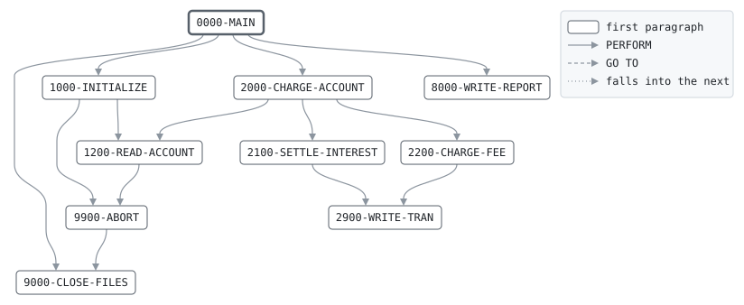

# MONCHG

```text
MONCHG: MONTH-END INTEREST AND FEES

ON THE DAY INTACCR CLOSES A MONTH, WRITES THE MONTH'S CHARGES
AND CREDITS AS TRANSACTIONS FOR TXPOST: THE INTEREST DUE,
CREDITED (IN) OR CHARGED AS OVERDRAFT INTEREST (OD), AND THE
MAINTENANCE FEE (MF) OF AN OPEN CURRENT ACCOUNT WHOSE BALANCE
CLOSED THE MONTH BELOW THE WAIVER BALANCE. ON OTHER DAYS IT
WRITES NOTHING.

THE MASTER AND THE ACCRUALS ARE READ IN STEP, SO THE
TRANSACTIONS COME OUT IN ACCOUNT NUMBER ORDER, AND TXPOST
POSTS THEM WITHOUT A SORT. TRANSACTION IDS ARE 00, THE CLOSED
MONTH AS YYMM, AND A SEQUENCE NUMBER.

RETURN CODES: 0 WRITTEN, 16 FILES OUT OF STEP OR I/O.

MODIFICATION HISTORY
DATE       BY  CHANGE
2001-09-03 TL  CR-0298 ORIGINAL VERSION.
```

Program [MONCHG.cbl](../../../pangaea/programs/MONCHG.cbl): 5 files, 10 paragraphs. Its business rules: [6 decision tables](../rules/MONCHG.md).

- AUTHOR: T. LINDQVIST, BATCH SYSTEMS.
- INSTALLATION: FIRST BANK OF PANGAEA, DATA CENTER.
- DATE-WRITTEN: 2001-09-03.

## Contents

- [Files](#files)
- [Flow](#flow)
- [Paragraphs](#paragraphs)
- [Data flow](#data-flow)
- [Lineage](#lineage)
  - [Into BANK-CONTROL-RECORD](#into-bank-control-record)
  - [Into ACCT-MASTER-RECORD](#into-acct-master-record)
  - [Into ACCRUAL-RECORD](#into-accrual-record)
  - [Into TRAN-OUT-RECORD](#into-tran-out-record)
  - [Into REPORT-LINE](#into-report-line)
  - [Into WS-BUSINESS-DATE](#into-ws-business-date)
  - [Into WS-ABORT-MESSAGE](#into-ws-abort-message)
  - [Into WS-END-SWITCHES](#into-ws-end-switches)
  - [Into WS-CLOSED-MONTH](#into-ws-closed-month)
  - [Into WS-TRAN-ID](#into-ws-tran-id)
  - [Into TRAN-RECORD](#into-tran-record)
  - [Into WS-TOTALS](#into-ws-totals)
  - [Into WS-REPORT-COUNT-LINE](#into-ws-report-count-line)
  - [Into WS-REPORT-AMOUNT-LINE](#into-ws-report-amount-line)
  - [Out of the program](#out-of-the-program)
  - [Into other data items](#into-other-data-items)
- [Field origins](#field-origins)
  - [File TRAN-OUT](#file-tran-out)
  - [File REPORT-OUT](#file-report-out)
- [Links between records](#links-between-records)
- [Records](#records)
  - [BANK-CONTROL-RECORD](#bank-control-record)
  - [ACCT-MASTER-RECORD](#acct-master-record)
  - [ACCRUAL-RECORD](#accrual-record)
  - [TRAN-OUT-RECORD](#tran-out-record)
  - [REPORT-LINE](#report-line)
  - [WS-FILE-STATUSES](#ws-file-statuses)
  - [WS-BUSINESS-DATE](#ws-business-date)
  - [WS-ABORT-MESSAGE](#ws-abort-message)
  - [WS-END-SWITCHES](#ws-end-switches)
  - [WS-MAINTENANCE-FEE](#ws-maintenance-fee)
  - [WS-FEE-WAIVER-BALANCE](#ws-fee-waiver-balance)
  - [WS-CLOSED-MONTH](#ws-closed-month)
  - [WS-CLOSED-MONTH-PARTS](#ws-closed-month-parts)
  - [WS-TRAN-ID](#ws-tran-id)
  - [TRAN-RECORD](#tran-record)
  - [WS-TOTALS](#ws-totals)
  - [WS-REPORT-COUNT-LINE](#ws-report-count-line)
  - [WS-REPORT-AMOUNT-LINE](#ws-report-amount-line)

## Files

| File | Kind | Assigned to | Organization | Status field | Opened | Records |
| --- | --- | --- | --- | --- | --- | --- |
| CONTROL-FILE | FD | BANKCTL | SEQUENTIAL | WS-CONTROL-STATUS | INPUT | BANK-CONTROL-RECORD |
| ACCT-IN | FD | ACCTIN | SEQUENTIAL | WS-ACCT-IN-STATUS | INPUT | ACCT-MASTER-RECORD |
| ACCR-IN | FD | ACCRIN | SEQUENTIAL | WS-ACCR-IN-STATUS | INPUT | ACCRUAL-RECORD |
| TRAN-OUT | FD | TRANOUT | SEQUENTIAL | WS-TRAN-OUT-STATUS | OUTPUT | TRAN-OUT-RECORD |
| REPORT-OUT | FD | MONRPT | LINE SEQUENTIAL | WS-REPORT-STATUS | OUTPUT | REPORT-LINE |

## Flow



## Paragraphs

| Paragraph | Description | Source | Performs | Goes to | Performed by | Reached by |
| --- | --- | --- | --- | --- | --- | --- |
| 0000-MAIN | CHARGE EVERY ACCOUNT, THEN REPORT. | [MONCHG.cbl:111](../../../pangaea/programs/MONCHG.cbl#L111) | 1000-INITIALIZE, 2000-CHARGE-ACCOUNT, 8000-WRITE-REPORT, 9000-CLOSE-FILES | | | |
| 1000-INITIALIZE | OPEN THE FILES AND READ THE FIRST ACCOUNT. THE TRANSACTION RECORD STARTS BLANK: NO COUNTER ACCOUNT. | [MONCHG.cbl:122](../../../pangaea/programs/MONCHG.cbl#L122) | 9900-ABORT, 1200-READ-ACCOUNT | | 0000-MAIN | |
| 1200-READ-ACCOUNT | READ THE NEXT ACCOUNT AND ITS ACCRUAL, WHICH MUST MATCH. | [MONCHG.cbl:140](../../../pangaea/programs/MONCHG.cbl#L140) | 9900-ABORT | | 1000-INITIALIZE, 2000-CHARGE-ACCOUNT | |
| 2000-CHARGE-ACCOUNT | WRITE AN ACCOUNT'S INTEREST AND FEE, IF ITS MONTH CLOSED. | [MONCHG.cbl:161](../../../pangaea/programs/MONCHG.cbl#L161) | 2100-SETTLE-INTEREST, 2200-CHARGE-FEE, 1200-READ-ACCOUNT | | 0000-MAIN | |
| 2100-SETTLE-INTEREST | CREDIT THE INTEREST DUE, OR CHARGE IT IF THE ACCOUNT WAS OVERDRAWN. | [MONCHG.cbl:172](../../../pangaea/programs/MONCHG.cbl#L172) | 2900-WRITE-TRAN | | 2000-CHARGE-ACCOUNT | |
| 2200-CHARGE-FEE | CHARGE THE MAINTENANCE FEE: OPEN CURRENT ACCOUNTS ONLY, AND NOT IF THE MONTH CLOSED AT OR ABOVE THE WAIVER BALANCE. | [MONCHG.cbl:194](../../../pangaea/programs/MONCHG.cbl#L194) | 2900-WRITE-TRAN | | 2000-CHARGE-ACCOUNT | |
| 2900-WRITE-TRAN | WRITE THE TRANSACTION FOR THE ACCOUNT, WITH THE NEXT ID. | [MONCHG.cbl:212](../../../pangaea/programs/MONCHG.cbl#L212) | | | 2100-SETTLE-INTEREST, 2200-CHARGE-FEE | |
| 8000-WRITE-REPORT | WRITE THE MONTH-END CHARGES REPORT. | [MONCHG.cbl:220](../../../pangaea/programs/MONCHG.cbl#L220) | | | 0000-MAIN | |
| 9000-CLOSE-FILES | CLOSE ALL FILES. | [MONCHG.cbl:262](../../../pangaea/programs/MONCHG.cbl#L262) | | | 0000-MAIN, 9900-ABORT | |
| 9900-ABORT | STOP THE RUN WITH RETURN CODE 16, SAYING WHY. | [MONCHG.cbl:266](../../../pangaea/programs/MONCHG.cbl#L266) | 9000-CLOSE-FILES | | 1000-INITIALIZE, 1200-READ-ACCOUNT | |

## Data flow

| Paragraph | Reads | Writes |
| --- | --- | --- |
| 0000-MAIN | WS-MASTER-END-SW, WS-ACCRUAL-END-SW | RETURN-CODE |
| 1000-INITIALIZE | WS-FILE-STATUSES, BC-BUSINESS-DATE | RETURN-CODE, BANK-CONTROL-RECORD, WS-ABORT-MESSAGE, WS-BUSINESS-DATE, TRAN-RECORD |
| 1200-READ-ACCOUNT | WS-MASTER-END-SW, WS-ACCRUAL-END-SW, AC-ACCT-NO, AM-ACCT-NO | ACCT-MASTER-RECORD, WS-MASTER-END-SW, ACCRUAL-RECORD, WS-ACCRUAL-END-SW, WS-ABORT-MESSAGE |
| 2000-CHARGE-ACCOUNT | AC-DUE-MONTH, WS-CM-YYMM | WS-CLOSED-MONTH, WS-TI-YYMM |
| 2100-SETTLE-INTEREST | AC-DUE, WS-INTEREST-COUNT, TD-AMOUNT, WS-INTEREST-TOTAL, WS-OVERDRAFT-COUNT, WS-OVERDRAFT-TOTAL | TD-TRAN-CODE, TD-AMOUNT, TD-DESCRIPTION, WS-INTEREST-COUNT, WS-INTEREST-TOTAL, WS-OVERDRAFT-COUNT, WS-OVERDRAFT-TOTAL |
| 2200-CHARGE-FEE | AM-ACCT-TYPE, AM-STATUS, AM-BALANCE, WS-FEE-WAIVER-BALANCE, WS-MAINTENANCE-FEE, WS-FEE-COUNT, TD-AMOUNT, WS-FEE-TOTAL, WS-WAIVED-COUNT | TD-TRAN-CODE, TD-AMOUNT, TD-DESCRIPTION, WS-FEE-COUNT, WS-FEE-TOTAL, WS-WAIVED-COUNT |
| 2900-WRITE-TRAN | WS-TI-SEQ, WS-TRAN-ID, AM-ACCT-NO, TRAN-RECORD | TR-REC-TYPE, WS-TI-SEQ, TD-TRAN-ID, TD-ACCT-NO, TRAN-OUT-RECORD |
| 8000-WRITE-REPORT | WS-BUSINESS-DATE, WS-CLOSED-MONTH, WS-INTEREST-COUNT, WS-REPORT-COUNT-LINE, WS-INTEREST-TOTAL, WS-REPORT-AMOUNT-LINE, WS-OVERDRAFT-COUNT, WS-OVERDRAFT-TOTAL, WS-FEE-COUNT, WS-FEE-TOTAL, WS-WAIVED-COUNT | REPORT-LINE, WS-RC-LABEL, WS-RC-VALUE, WS-RA-LABEL, WS-RA-VALUE |
| 9000-CLOSE-FILES | | |
| 9900-ABORT | WS-ABORT-MESSAGE | RETURN-CODE |

## Lineage

Where each data item's values come from, grouped by the record they go into. A data item links to the record it belongs to.

### Into BANK-CONTROL-RECORD

Record [BANK-CONTROL-RECORD](#bank-control-record), from copybook [BANKCTL](../copybooks/BANKCTL.md).

| Into | From | Statement | Paragraph | Source |
| --- | --- | --- | --- | --- |
| BANK-CONTROL-RECORD | file CONTROL-FILE | READ | 1000-INITIALIZE | [MONCHG.cbl:130](../../../pangaea/programs/MONCHG.cbl#L130) |

### Into ACCT-MASTER-RECORD

Record [ACCT-MASTER-RECORD](#acct-master-record), from copybook [ACCTMAST](../copybooks/ACCTMAST.md).

| Into | From | Statement | Paragraph | Source |
| --- | --- | --- | --- | --- |
| ACCT-MASTER-RECORD | file ACCT-IN | READ | 1200-READ-ACCOUNT | [MONCHG.cbl:141](../../../pangaea/programs/MONCHG.cbl#L141) |

### Into ACCRUAL-RECORD

Record [ACCRUAL-RECORD](#accrual-record), from copybook [ACCRREC](../copybooks/ACCRREC.md).

| Into | From | Statement | Paragraph | Source |
| --- | --- | --- | --- | --- |
| ACCRUAL-RECORD | file ACCR-IN | READ | 1200-READ-ACCOUNT | [MONCHG.cbl:145](../../../pangaea/programs/MONCHG.cbl#L145) |

### Into TRAN-OUT-RECORD

Record [TRAN-OUT-RECORD](#tran-out-record).

| Into | From | Statement | Paragraph | Source |
| --- | --- | --- | --- | --- |
| TRAN-OUT-RECORD | [TRAN-RECORD](#tran-record) | WRITE | 2900-WRITE-TRAN | [MONCHG.cbl:217](../../../pangaea/programs/MONCHG.cbl#L217) |

### Into REPORT-LINE

Record [REPORT-LINE](#report-line).

| Into | From | Statement | Paragraph | Source |
| --- | --- | --- | --- | --- |
| REPORT-LINE | literal SPACES | MOVE | 8000-WRITE-REPORT | [MONCHG.cbl:221](../../../pangaea/programs/MONCHG.cbl#L221) |
| REPORT-LINE | literal 'MONCHG   MONTH-END CHARGES       BUSINESS DATE ' | STRING | 8000-WRITE-REPORT | [MONCHG.cbl:222](../../../pangaea/programs/MONCHG.cbl#L222) |
| REPORT-LINE | [WS-BUSINESS-DATE](#ws-business-date) | STRING | 8000-WRITE-REPORT | [MONCHG.cbl:222](../../../pangaea/programs/MONCHG.cbl#L222) |
| REPORT-LINE | literal SPACES | MOVE | 8000-WRITE-REPORT | [MONCHG.cbl:226](../../../pangaea/programs/MONCHG.cbl#L226) |
| REPORT-LINE | literal 'NO MONTH CLOSED' | MOVE | 8000-WRITE-REPORT | [MONCHG.cbl:229](../../../pangaea/programs/MONCHG.cbl#L229) |
| REPORT-LINE | literal SPACES | MOVE | 8000-WRITE-REPORT | [MONCHG.cbl:232](../../../pangaea/programs/MONCHG.cbl#L232) |
| REPORT-LINE | literal 'MONTH CLOSED                  ' | STRING | 8000-WRITE-REPORT | [MONCHG.cbl:233](../../../pangaea/programs/MONCHG.cbl#L233) |
| REPORT-LINE | [WS-CLOSED-MONTH](#ws-closed-month) | STRING | 8000-WRITE-REPORT | [MONCHG.cbl:233](../../../pangaea/programs/MONCHG.cbl#L233) |
| REPORT-LINE | literal SPACES | MOVE | 8000-WRITE-REPORT | [MONCHG.cbl:236](../../../pangaea/programs/MONCHG.cbl#L236) |
| REPORT-LINE | [WS-REPORT-COUNT-LINE](#ws-report-count-line) | WRITE | 8000-WRITE-REPORT | [MONCHG.cbl:240](../../../pangaea/programs/MONCHG.cbl#L240) |
| REPORT-LINE | [WS-REPORT-AMOUNT-LINE](#ws-report-amount-line) | WRITE | 8000-WRITE-REPORT | [MONCHG.cbl:243](../../../pangaea/programs/MONCHG.cbl#L243) |
| REPORT-LINE | [WS-REPORT-COUNT-LINE](#ws-report-count-line) | WRITE | 8000-WRITE-REPORT | [MONCHG.cbl:246](../../../pangaea/programs/MONCHG.cbl#L246) |
| REPORT-LINE | [WS-REPORT-AMOUNT-LINE](#ws-report-amount-line) | WRITE | 8000-WRITE-REPORT | [MONCHG.cbl:249](../../../pangaea/programs/MONCHG.cbl#L249) |
| REPORT-LINE | [WS-REPORT-COUNT-LINE](#ws-report-count-line) | WRITE | 8000-WRITE-REPORT | [MONCHG.cbl:252](../../../pangaea/programs/MONCHG.cbl#L252) |
| REPORT-LINE | [WS-REPORT-AMOUNT-LINE](#ws-report-amount-line) | WRITE | 8000-WRITE-REPORT | [MONCHG.cbl:255](../../../pangaea/programs/MONCHG.cbl#L255) |
| REPORT-LINE | [WS-REPORT-COUNT-LINE](#ws-report-count-line) | WRITE | 8000-WRITE-REPORT | [MONCHG.cbl:258](../../../pangaea/programs/MONCHG.cbl#L258) |

### Into WS-BUSINESS-DATE

Record [WS-BUSINESS-DATE](#ws-business-date).

| Into | From | Statement | Paragraph | Source |
| --- | --- | --- | --- | --- |
| WS-BUSINESS-DATE | [BC-BUSINESS-DATE](#bank-control-record "in BANK-CONTROL-RECORD") | MOVE | 1000-INITIALIZE | [MONCHG.cbl:135](../../../pangaea/programs/MONCHG.cbl#L135) |

### Into WS-ABORT-MESSAGE

Record [WS-ABORT-MESSAGE](#ws-abort-message).

| Into | From | Statement | Paragraph | Source |
| --- | --- | --- | --- | --- |
| WS-ABORT-MESSAGE | literal 'NO BANK CONTROL RECORD' | MOVE | 1000-INITIALIZE | [MONCHG.cbl:132](../../../pangaea/programs/MONCHG.cbl#L132) |
| WS-ABORT-MESSAGE | literal 'ACCRUALS OUT OF STEP WITH THE MASTER' | MOVE | 1200-READ-ACCOUNT | [MONCHG.cbl:154](../../../pangaea/programs/MONCHG.cbl#L154) |

### Into WS-END-SWITCHES

Record [WS-END-SWITCHES](#ws-end-switches).

| Into | From | Statement | Paragraph | Source |
| --- | --- | --- | --- | --- |
| WS-ACCRUAL-END-SW | literal condition ACCRUALS-AT-END | SET | 1200-READ-ACCOUNT | [MONCHG.cbl:147](../../../pangaea/programs/MONCHG.cbl#L147) |
| WS-MASTER-END-SW | literal condition MASTER-AT-END | SET | 1200-READ-ACCOUNT | [MONCHG.cbl:143](../../../pangaea/programs/MONCHG.cbl#L143) |

### Into WS-CLOSED-MONTH

Record [WS-CLOSED-MONTH](#ws-closed-month).

| Into | From | Statement | Paragraph | Source |
| --- | --- | --- | --- | --- |
| WS-CLOSED-MONTH | [AC-DUE-MONTH](#accrual-record "in ACCRUAL-RECORD") | MOVE | 2000-CHARGE-ACCOUNT | [MONCHG.cbl:163](../../../pangaea/programs/MONCHG.cbl#L163) |

### Into WS-TRAN-ID

Record [WS-TRAN-ID](#ws-tran-id).

| Into | From | Statement | Paragraph | Source |
| --- | --- | --- | --- | --- |
| WS-TI-SEQ | literal 1 | ADD | 2900-WRITE-TRAN | [MONCHG.cbl:214](../../../pangaea/programs/MONCHG.cbl#L214) |
| WS-TI-YYMM | [WS-CM-YYMM](#ws-closed-month-parts "in WS-CLOSED-MONTH-PARTS") | MOVE | 2000-CHARGE-ACCOUNT | [MONCHG.cbl:164](../../../pangaea/programs/MONCHG.cbl#L164) |

### Into TRAN-RECORD

Record [TRAN-RECORD](#tran-record), from copybook [TRANREC](../copybooks/TRANREC.md).

| Into | From | Statement | Paragraph | Source |
| --- | --- | --- | --- | --- |
| TD-ACCT-NO | [AM-ACCT-NO](#acct-master-record "in ACCT-MASTER-RECORD") | MOVE | 2900-WRITE-TRAN | [MONCHG.cbl:216](../../../pangaea/programs/MONCHG.cbl#L216) |
| TD-AMOUNT | [AC-DUE](#accrual-record "in ACCRUAL-RECORD") | MOVE | 2100-SETTLE-INTEREST | [MONCHG.cbl:176](../../../pangaea/programs/MONCHG.cbl#L176) |
| TD-AMOUNT | [AC-DUE](#accrual-record "in ACCRUAL-RECORD") | COMPUTE | 2100-SETTLE-INTEREST | [MONCHG.cbl:183](../../../pangaea/programs/MONCHG.cbl#L183) |
| TD-AMOUNT | [WS-MAINTENANCE-FEE](#ws-maintenance-fee) | MOVE | 2200-CHARGE-FEE | [MONCHG.cbl:199](../../../pangaea/programs/MONCHG.cbl#L199) |
| TD-DESCRIPTION | literal 'CREDIT INTEREST' | MOVE | 2100-SETTLE-INTEREST | [MONCHG.cbl:177](../../../pangaea/programs/MONCHG.cbl#L177) |
| TD-DESCRIPTION | literal 'OVERDRAFT INTEREST' | MOVE | 2100-SETTLE-INTEREST | [MONCHG.cbl:184](../../../pangaea/programs/MONCHG.cbl#L184) |
| TD-DESCRIPTION | literal 'MAINTENANCE FEE' | MOVE | 2200-CHARGE-FEE | [MONCHG.cbl:200](../../../pangaea/programs/MONCHG.cbl#L200) |
| TD-TRAN-CODE | literal condition TD-INTEREST | SET | 2100-SETTLE-INTEREST | [MONCHG.cbl:175](../../../pangaea/programs/MONCHG.cbl#L175) |
| TD-TRAN-CODE | literal condition TD-OVERDRAFT-INTEREST | SET | 2100-SETTLE-INTEREST | [MONCHG.cbl:182](../../../pangaea/programs/MONCHG.cbl#L182) |
| TD-TRAN-CODE | literal condition TD-MAINTENANCE-FEE | SET | 2200-CHARGE-FEE | [MONCHG.cbl:198](../../../pangaea/programs/MONCHG.cbl#L198) |
| TD-TRAN-ID | [WS-TRAN-ID](#ws-tran-id) | MOVE | 2900-WRITE-TRAN | [MONCHG.cbl:215](../../../pangaea/programs/MONCHG.cbl#L215) |
| TR-REC-TYPE | literal condition TR-DETAIL | SET | 2900-WRITE-TRAN | [MONCHG.cbl:213](../../../pangaea/programs/MONCHG.cbl#L213) |
| TRAN-RECORD | literal SPACES | MOVE | 1000-INITIALIZE | [MONCHG.cbl:136](../../../pangaea/programs/MONCHG.cbl#L136) |

### Into WS-TOTALS

Record [WS-TOTALS](#ws-totals).

| Into | From | Statement | Paragraph | Source |
| --- | --- | --- | --- | --- |
| WS-FEE-COUNT | literal 1 | ADD | 2200-CHARGE-FEE | [MONCHG.cbl:202](../../../pangaea/programs/MONCHG.cbl#L202) |
| WS-FEE-TOTAL | [TD-AMOUNT](#tran-record "in TRAN-RECORD") | ADD | 2200-CHARGE-FEE | [MONCHG.cbl:203](../../../pangaea/programs/MONCHG.cbl#L203) |
| WS-INTEREST-COUNT | literal 1 | ADD | 2100-SETTLE-INTEREST | [MONCHG.cbl:179](../../../pangaea/programs/MONCHG.cbl#L179) |
| WS-INTEREST-TOTAL | [TD-AMOUNT](#tran-record "in TRAN-RECORD") | ADD | 2100-SETTLE-INTEREST | [MONCHG.cbl:180](../../../pangaea/programs/MONCHG.cbl#L180) |
| WS-OVERDRAFT-COUNT | literal 1 | ADD | 2100-SETTLE-INTEREST | [MONCHG.cbl:186](../../../pangaea/programs/MONCHG.cbl#L186) |
| WS-OVERDRAFT-TOTAL | [TD-AMOUNT](#tran-record "in TRAN-RECORD") | ADD | 2100-SETTLE-INTEREST | [MONCHG.cbl:187](../../../pangaea/programs/MONCHG.cbl#L187) |
| WS-WAIVED-COUNT | literal 1 | ADD | 2200-CHARGE-FEE | [MONCHG.cbl:205](../../../pangaea/programs/MONCHG.cbl#L205) |

### Into WS-REPORT-COUNT-LINE

Record [WS-REPORT-COUNT-LINE](#ws-report-count-line).

| Into | From | Statement | Paragraph | Source |
| --- | --- | --- | --- | --- |
| WS-RC-LABEL | literal 'INTEREST CREDITS' | MOVE | 8000-WRITE-REPORT | [MONCHG.cbl:238](../../../pangaea/programs/MONCHG.cbl#L238) |
| WS-RC-LABEL | literal 'OVERDRAFT INTEREST CHARGES' | MOVE | 8000-WRITE-REPORT | [MONCHG.cbl:244](../../../pangaea/programs/MONCHG.cbl#L244) |
| WS-RC-LABEL | literal 'MAINTENANCE FEES' | MOVE | 8000-WRITE-REPORT | [MONCHG.cbl:250](../../../pangaea/programs/MONCHG.cbl#L250) |
| WS-RC-LABEL | literal 'MAINTENANCE FEES WAIVED' | MOVE | 8000-WRITE-REPORT | [MONCHG.cbl:256](../../../pangaea/programs/MONCHG.cbl#L256) |
| WS-RC-VALUE | [WS-INTEREST-COUNT](#ws-totals "in WS-TOTALS") | MOVE | 8000-WRITE-REPORT | [MONCHG.cbl:239](../../../pangaea/programs/MONCHG.cbl#L239) |
| WS-RC-VALUE | [WS-OVERDRAFT-COUNT](#ws-totals "in WS-TOTALS") | MOVE | 8000-WRITE-REPORT | [MONCHG.cbl:245](../../../pangaea/programs/MONCHG.cbl#L245) |
| WS-RC-VALUE | [WS-FEE-COUNT](#ws-totals "in WS-TOTALS") | MOVE | 8000-WRITE-REPORT | [MONCHG.cbl:251](../../../pangaea/programs/MONCHG.cbl#L251) |
| WS-RC-VALUE | [WS-WAIVED-COUNT](#ws-totals "in WS-TOTALS") | MOVE | 8000-WRITE-REPORT | [MONCHG.cbl:257](../../../pangaea/programs/MONCHG.cbl#L257) |

### Into WS-REPORT-AMOUNT-LINE

Record [WS-REPORT-AMOUNT-LINE](#ws-report-amount-line).

| Into | From | Statement | Paragraph | Source |
| --- | --- | --- | --- | --- |
| WS-RA-LABEL | literal 'INTEREST CREDITED' | MOVE | 8000-WRITE-REPORT | [MONCHG.cbl:241](../../../pangaea/programs/MONCHG.cbl#L241) |
| WS-RA-LABEL | literal 'OVERDRAFT INTEREST CHARGED' | MOVE | 8000-WRITE-REPORT | [MONCHG.cbl:247](../../../pangaea/programs/MONCHG.cbl#L247) |
| WS-RA-LABEL | literal 'MAINTENANCE FEES CHARGED' | MOVE | 8000-WRITE-REPORT | [MONCHG.cbl:253](../../../pangaea/programs/MONCHG.cbl#L253) |
| WS-RA-VALUE | [WS-INTEREST-TOTAL](#ws-totals "in WS-TOTALS") | MOVE | 8000-WRITE-REPORT | [MONCHG.cbl:242](../../../pangaea/programs/MONCHG.cbl#L242) |
| WS-RA-VALUE | [WS-OVERDRAFT-TOTAL](#ws-totals "in WS-TOTALS") | MOVE | 8000-WRITE-REPORT | [MONCHG.cbl:248](../../../pangaea/programs/MONCHG.cbl#L248) |
| WS-RA-VALUE | [WS-FEE-TOTAL](#ws-totals "in WS-TOTALS") | MOVE | 8000-WRITE-REPORT | [MONCHG.cbl:254](../../../pangaea/programs/MONCHG.cbl#L254) |

### Out of the program

Records written to files, items passed to the programs called, and items displayed to the job's output.

| Into | From | Statement | Paragraph | Source |
| --- | --- | --- | --- | --- |
| file REPORT-OUT | [REPORT-LINE](#report-line) | WRITE | 8000-WRITE-REPORT | [MONCHG.cbl:225](../../../pangaea/programs/MONCHG.cbl#L225) |
| file REPORT-OUT | [REPORT-LINE](#report-line) | WRITE | 8000-WRITE-REPORT | [MONCHG.cbl:227](../../../pangaea/programs/MONCHG.cbl#L227) |
| file REPORT-OUT | [REPORT-LINE](#report-line) | WRITE | 8000-WRITE-REPORT | [MONCHG.cbl:230](../../../pangaea/programs/MONCHG.cbl#L230) |
| file REPORT-OUT | [REPORT-LINE](#report-line) | WRITE | 8000-WRITE-REPORT | [MONCHG.cbl:235](../../../pangaea/programs/MONCHG.cbl#L235) |
| file REPORT-OUT | [REPORT-LINE](#report-line) | WRITE | 8000-WRITE-REPORT | [MONCHG.cbl:237](../../../pangaea/programs/MONCHG.cbl#L237) |
| file REPORT-OUT | [REPORT-LINE](#report-line) | WRITE | 8000-WRITE-REPORT | [MONCHG.cbl:240](../../../pangaea/programs/MONCHG.cbl#L240) |
| file REPORT-OUT | [REPORT-LINE](#report-line) | WRITE | 8000-WRITE-REPORT | [MONCHG.cbl:243](../../../pangaea/programs/MONCHG.cbl#L243) |
| file REPORT-OUT | [REPORT-LINE](#report-line) | WRITE | 8000-WRITE-REPORT | [MONCHG.cbl:246](../../../pangaea/programs/MONCHG.cbl#L246) |
| file REPORT-OUT | [REPORT-LINE](#report-line) | WRITE | 8000-WRITE-REPORT | [MONCHG.cbl:249](../../../pangaea/programs/MONCHG.cbl#L249) |
| file REPORT-OUT | [REPORT-LINE](#report-line) | WRITE | 8000-WRITE-REPORT | [MONCHG.cbl:252](../../../pangaea/programs/MONCHG.cbl#L252) |
| file REPORT-OUT | [REPORT-LINE](#report-line) | WRITE | 8000-WRITE-REPORT | [MONCHG.cbl:255](../../../pangaea/programs/MONCHG.cbl#L255) |
| file REPORT-OUT | [REPORT-LINE](#report-line) | WRITE | 8000-WRITE-REPORT | [MONCHG.cbl:258](../../../pangaea/programs/MONCHG.cbl#L258) |
| SYSOUT | [WS-FILE-STATUSES](#ws-file-statuses) | DISPLAY | 1000-INITIALIZE | [MONCHG.cbl:126](../../../pangaea/programs/MONCHG.cbl#L126) |
| SYSOUT | [WS-ABORT-MESSAGE](#ws-abort-message) | DISPLAY | 9900-ABORT | [MONCHG.cbl:267](../../../pangaea/programs/MONCHG.cbl#L267) |
| file TRAN-OUT | [TRAN-OUT-RECORD](#tran-out-record) | WRITE | 2900-WRITE-TRAN | [MONCHG.cbl:217](../../../pangaea/programs/MONCHG.cbl#L217) |

### Into other data items

Data items the program does not declare, such as special registers and index names.

| Into | From | Statement | Paragraph | Source |
| --- | --- | --- | --- | --- |
| RETURN-CODE | literal 0 | MOVE | 0000-MAIN | [MONCHG.cbl:117](../../../pangaea/programs/MONCHG.cbl#L117) |
| RETURN-CODE | literal 16 | MOVE | 1000-INITIALIZE | [MONCHG.cbl:127](../../../pangaea/programs/MONCHG.cbl#L127) |
| RETURN-CODE | literal 16 | MOVE | 9900-ABORT | [MONCHG.cbl:269](../../../pangaea/programs/MONCHG.cbl#L269) |

## Field origins

Where the values of each field the program writes to a file come from: the fields of the files it reads, literals, and initial values, followed through every statement that moves a value, and through groups and redefinitions by the bytes they share.

### File TRAN-OUT

Written from [TRAN-RECORD](#tran-record).

#### Record TRAN-RECORD, of type TR-DETAIL

| Field | Position | Origins |
| --- | --: | --- |
| TR-REC-TYPE | 1 | literal condition TR-DETAIL |
| TD-TRAN-ID | 2-11 | initial value of WS-TI-SEQ; literal 1 |
| TD-ACCT-NO | 12-21 | file ACCT-IN AM-ACCT-NO |
| TD-TRAN-CODE | 22-23 | literal condition TD-INTEREST; literal condition TD-MAINTENANCE-FEE; literal condition TD-OVERDRAFT-INTEREST |
| TD-AMOUNT | 24-34 | file ACCR-IN AC-DUE; initial value of WS-MAINTENANCE-FEE |
| TD-DESCRIPTION | 35-54 | literal 'CREDIT INTEREST'; literal 'MAINTENANCE FEE'; literal 'OVERDRAFT INTEREST' |
| TD-COUNTER-ACCT-NO | 55-64 | literal SPACES |

### File REPORT-OUT

Written from [REPORT-LINE](#report-line), [WS-REPORT-COUNT-LINE](#ws-report-count-line) and [WS-REPORT-AMOUNT-LINE](#ws-report-amount-line).

#### Record REPORT-LINE

| Field | Position | Origins |
| --- | --: | --- |
| REPORT-LINE | 1-80 | file ACCR-IN AC-DUE-MONTH; file CONTROL-FILE BC-BUSINESS-DATE; initial value of WS-CLOSED-MONTH; literal 'MONCHG   MONTH-END CHARGES       BUSINESS DATE '; literal 'MONTH CLOSED                  '; literal 'NO MONTH CLOSED'; literal SPACES |

#### Record WS-REPORT-COUNT-LINE

| Field | Position | Origins |
| --- | --: | --- |
| WS-RC-LABEL | 1-30 | literal 'INTEREST CREDITS'; literal 'MAINTENANCE FEES WAIVED'; literal 'MAINTENANCE FEES'; literal 'OVERDRAFT INTEREST CHARGES' |
| WS-RC-VALUE | 31-40 | initial value of WS-FEE-COUNT; initial value of WS-INTEREST-COUNT; initial value of WS-OVERDRAFT-COUNT; initial value of WS-WAIVED-COUNT; literal 1 |

#### Record WS-REPORT-AMOUNT-LINE

| Field | Position | Origins |
| --- | --: | --- |
| WS-RA-LABEL | 1-30 | literal 'INTEREST CREDITED'; literal 'MAINTENANCE FEES CHARGED'; literal 'OVERDRAFT INTEREST CHARGED' |
| WS-RA-VALUE | 31-51 | file ACCR-IN AC-DUE; initial value of WS-FEE-TOTAL; initial value of WS-INTEREST-TOTAL; initial value of WS-MAINTENANCE-FEE; initial value of WS-OVERDRAFT-TOTAL |

## Links between records

Fields of one input the program relies on to find or match the records of another: moved into an indexed file's record key to read it by, compared for equality, or compared for order to merge the two in that order, each side's values from that field alone.

| Field | Of | Links to | Of | How | Source |
| --- | --- | --- | --- | --- | --- |
| AC-ACCT-NO | ACCR-IN | AM-ACCT-NO | ACCT-IN | equal to | [MONCHG.cbl:152](../../../pangaea/programs/MONCHG.cbl#L152) |

## Records

### BANK-CONTROL-RECORD

File CONTROL-FILE. 80 bytes, layout in copybook [BANKCTL](../copybooks/BANKCTL.md).

### ACCT-MASTER-RECORD

File ACCT-IN. 100 bytes, layout in copybook [ACCTMAST](../copybooks/ACCTMAST.md).

### ACCRUAL-RECORD

File ACCR-IN. 40 bytes, layout in copybook [ACCRREC](../copybooks/ACCRREC.md).

### TRAN-OUT-RECORD

File TRAN-OUT. 80 bytes.

| Level | Field | Kind | Start | Length | Picture | Usage | Notes | Source |
| --: | --- | --- | --: | --: | --- | --- | --- | --- |
| 01 | TRAN-OUT-RECORD | text | 1 | 80 | X(80) | | | [MONCHG.cbl:56](../../../pangaea/programs/MONCHG.cbl#L56) |

### REPORT-LINE

File REPORT-OUT. 80 bytes.

| Level | Field | Kind | Start | Length | Picture | Usage | Notes | Source |
| --: | --- | --- | --: | --: | --- | --- | --- | --- |
| 01 | REPORT-LINE | text | 1 | 80 | X(80) | | | [MONCHG.cbl:58](../../../pangaea/programs/MONCHG.cbl#L58) |

### WS-FILE-STATUSES

Working storage. 10 bytes.

| Level | Field | Kind | Start | Length | Picture | Usage | Notes | Source |
| --: | --- | --- | --: | --: | --- | --- | --- | --- |
| 01 | WS-FILE-STATUSES | group | 1 | 10 | | | | [MONCHG.cbl:61](../../../pangaea/programs/MONCHG.cbl#L61) |
| 05 | ├ WS-CONTROL-STATUS | text | 1 | 2 | XX | | | [MONCHG.cbl:62](../../../pangaea/programs/MONCHG.cbl#L62) |
| 05 | ├ WS-ACCT-IN-STATUS | text | 3 | 2 | XX | | | [MONCHG.cbl:63](../../../pangaea/programs/MONCHG.cbl#L63) |
| 05 | ├ WS-ACCR-IN-STATUS | text | 5 | 2 | XX | | | [MONCHG.cbl:64](../../../pangaea/programs/MONCHG.cbl#L64) |
| 05 | ├ WS-TRAN-OUT-STATUS | text | 7 | 2 | XX | | | [MONCHG.cbl:65](../../../pangaea/programs/MONCHG.cbl#L65) |
| 05 | └ WS-REPORT-STATUS | text | 9 | 2 | XX | | | [MONCHG.cbl:66](../../../pangaea/programs/MONCHG.cbl#L66) |

### WS-BUSINESS-DATE

Working storage. 8 bytes.

| Level | Field | Kind | Start | Length | Picture | Usage | Notes | Source |
| --: | --- | --- | --: | --: | --- | --- | --- | --- |
| 01 | WS-BUSINESS-DATE | date | 1 | 8 | 9(8) | | | [MONCHG.cbl:68](../../../pangaea/programs/MONCHG.cbl#L68) |

### WS-ABORT-MESSAGE

Working storage. 40 bytes.

| Level | Field | Kind | Start | Length | Picture | Usage | Notes | Source |
| --: | --- | --- | --: | --: | --- | --- | --- | --- |
| 01 | WS-ABORT-MESSAGE | text | 1 | 40 | X(40) | | | [MONCHG.cbl:69](../../../pangaea/programs/MONCHG.cbl#L69) |

### WS-END-SWITCHES

Working storage. 2 bytes.

| Level | Field | Kind | Start | Length | Picture | Usage | Notes | Source |
| --: | --- | --- | --: | --: | --- | --- | --- | --- |
| 01 | WS-END-SWITCHES | group | 1 | 2 | | | | [MONCHG.cbl:70](../../../pangaea/programs/MONCHG.cbl#L70) |
| 05 | ├ WS-MASTER-END-SW | code | 1 | 1 | X | | VALUE 'N' | [MONCHG.cbl:71](../../../pangaea/programs/MONCHG.cbl#L71) |
| 88 | │ └ MASTER-AT-END | | | | | | VALUE 'Y' | [MONCHG.cbl:72](../../../pangaea/programs/MONCHG.cbl#L72) |
| 05 | └ WS-ACCRUAL-END-SW | code | 2 | 1 | X | | VALUE 'N' | [MONCHG.cbl:73](../../../pangaea/programs/MONCHG.cbl#L73) |
| 88 |   └ ACCRUALS-AT-END | | | | | | VALUE 'Y' | [MONCHG.cbl:74](../../../pangaea/programs/MONCHG.cbl#L74) |

### WS-MAINTENANCE-FEE

Working storage. 5 bytes. THE MAINTENANCE FEE, AND THE BALANCE THAT WAIVES IT.

| Level | Field | Kind | Start | Length | Picture | Usage | Notes | Source |
| --: | --- | --- | --: | --: | --- | --- | --- | --- |
| 01 | WS-MAINTENANCE-FEE | amount | 1 | 5 | 9(3)V99 | | VALUE 2.50 | [MONCHG.cbl:77](../../../pangaea/programs/MONCHG.cbl#L77) |

### WS-FEE-WAIVER-BALANCE

Working storage. 9 bytes.

| Level | Field | Kind | Start | Length | Picture | Usage | Notes | Source |
| --: | --- | --- | --: | --: | --- | --- | --- | --- |
| 01 | WS-FEE-WAIVER-BALANCE | amount | 1 | 9 | 9(7)V99 | | VALUE 1000.00 | [MONCHG.cbl:78](../../../pangaea/programs/MONCHG.cbl#L78) |

### WS-CLOSED-MONTH

Working storage. 6 bytes.

| Level | Field | Kind | Start | Length | Picture | Usage | Notes | Source |
| --: | --- | --- | --: | --: | --- | --- | --- | --- |
| 01 | WS-CLOSED-MONTH | date | 1 | 6 | 9(6) | | VALUE 0 | [MONCHG.cbl:80](../../../pangaea/programs/MONCHG.cbl#L80) |

### WS-CLOSED-MONTH-PARTS

Working storage. 6 bytes.

| Level | Field | Kind | Start | Length | Picture | Usage | Notes | Source |
| --: | --- | --- | --: | --: | --- | --- | --- | --- |
| 01 | WS-CLOSED-MONTH-PARTS | group | 1 | 6 | | | REDEFINES WS-CLOSED-MONTH | [MONCHG.cbl:81](../../../pangaea/programs/MONCHG.cbl#L81) |
| 05 | ├ WS-CM-CENTURY | number | 1 | 2 | 99 | | | [MONCHG.cbl:82](../../../pangaea/programs/MONCHG.cbl#L82) |
| 05 | └ WS-CM-YYMM | number | 3 | 4 | 9(4) | | | [MONCHG.cbl:83](../../../pangaea/programs/MONCHG.cbl#L83) |

### WS-TRAN-ID

Working storage. 10 bytes.

| Level | Field | Kind | Start | Length | Picture | Usage | Notes | Source |
| --: | --- | --- | --: | --: | --- | --- | --- | --- |
| 01 | WS-TRAN-ID | group | 1 | 10 | | | | [MONCHG.cbl:84](../../../pangaea/programs/MONCHG.cbl#L84) |
| 05 | ├ FILLER | filler | 1 | 2 | 99 | | VALUE 0 | [MONCHG.cbl:85](../../../pangaea/programs/MONCHG.cbl#L85) |
| 05 | ├ WS-TI-YYMM | number | 3 | 4 | 9(4) | | | [MONCHG.cbl:86](../../../pangaea/programs/MONCHG.cbl#L86) |
| 05 | └ WS-TI-SEQ | number | 7 | 4 | 9(4) | | VALUE 0 | [MONCHG.cbl:87](../../../pangaea/programs/MONCHG.cbl#L87) |

### TRAN-RECORD

Working storage. 80 bytes, layout in copybook [TRANREC](../copybooks/TRANREC.md). Its types, told apart by TR-REC-TYPE: `TR-HEADER`, 'H', its fields in TR-HEADER-BODY; `TR-DETAIL`, 'D', its fields in TR-DETAIL-BODY; `TR-TRAILER`, 'T', its fields in TR-TRAILER-BODY.

### WS-TOTALS

Working storage. 71 bytes.

| Level | Field | Kind | Start | Length | Picture | Usage | Notes | Source |
| --: | --- | --- | --: | --: | --- | --- | --- | --- |
| 01 | WS-TOTALS | group | 1 | 71 | | | | [MONCHG.cbl:91](../../../pangaea/programs/MONCHG.cbl#L91) |
| 05 | ├ WS-INTEREST-COUNT | number | 1 | 8 | 9(8) | | VALUE 0 | [MONCHG.cbl:92](../../../pangaea/programs/MONCHG.cbl#L92) |
| 05 | ├ WS-INTEREST-TOTAL | amount | 9 | 13 | 9(11)V99 | | VALUE 0 | [MONCHG.cbl:93](../../../pangaea/programs/MONCHG.cbl#L93) |
| 05 | ├ WS-OVERDRAFT-COUNT | number | 22 | 8 | 9(8) | | VALUE 0 | [MONCHG.cbl:94](../../../pangaea/programs/MONCHG.cbl#L94) |
| 05 | ├ WS-OVERDRAFT-TOTAL | amount | 30 | 13 | 9(11)V99 | | VALUE 0 | [MONCHG.cbl:95](../../../pangaea/programs/MONCHG.cbl#L95) |
| 05 | ├ WS-FEE-COUNT | number | 43 | 8 | 9(8) | | VALUE 0 | [MONCHG.cbl:96](../../../pangaea/programs/MONCHG.cbl#L96) |
| 05 | ├ WS-FEE-TOTAL | amount | 51 | 13 | 9(11)V99 | | VALUE 0 | [MONCHG.cbl:97](../../../pangaea/programs/MONCHG.cbl#L97) |
| 05 | └ WS-WAIVED-COUNT | number | 64 | 8 | 9(8) | | VALUE 0 | [MONCHG.cbl:98](../../../pangaea/programs/MONCHG.cbl#L98) |

### WS-REPORT-COUNT-LINE

Working storage. 80 bytes.

| Level | Field | Kind | Start | Length | Picture | Usage | Notes | Source |
| --: | --- | --- | --: | --: | --- | --- | --- | --- |
| 01 | WS-REPORT-COUNT-LINE | group | 1 | 80 | | | | [MONCHG.cbl:100](../../../pangaea/programs/MONCHG.cbl#L100) |
| 05 | ├ WS-RC-LABEL | text | 1 | 30 | X(30) | | | [MONCHG.cbl:101](../../../pangaea/programs/MONCHG.cbl#L101) |
| 05 | ├ WS-RC-VALUE | edited | 31 | 10 | ZZ,ZZZ,ZZ9 | | | [MONCHG.cbl:102](../../../pangaea/programs/MONCHG.cbl#L102) |
| 05 | └ FILLER | filler | 41 | 40 | X(40) | | VALUE SPACES | [MONCHG.cbl:103](../../../pangaea/programs/MONCHG.cbl#L103) |

### WS-REPORT-AMOUNT-LINE

Working storage. 80 bytes.

| Level | Field | Kind | Start | Length | Picture | Usage | Notes | Source |
| --: | --- | --- | --: | --: | --- | --- | --- | --- |
| 01 | WS-REPORT-AMOUNT-LINE | group | 1 | 80 | | | | [MONCHG.cbl:104](../../../pangaea/programs/MONCHG.cbl#L104) |
| 05 | ├ WS-RA-LABEL | text | 1 | 30 | X(30) | | | [MONCHG.cbl:105](../../../pangaea/programs/MONCHG.cbl#L105) |
| 05 | ├ WS-RA-VALUE | edited | 31 | 21 | Z,ZZZ,ZZZ,ZZZ,ZZ9.99- | | | [MONCHG.cbl:106](../../../pangaea/programs/MONCHG.cbl#L106) |
| 05 | └ FILLER | filler | 52 | 29 | X(29) | | VALUE SPACES | [MONCHG.cbl:107](../../../pangaea/programs/MONCHG.cbl#L107) |
