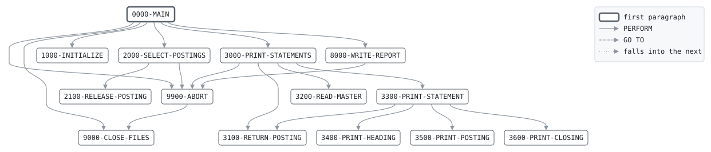

# STMTPRT

```text
STMTPRT: PRINT THE MONTH'S STATEMENTS

ON THE FIRST BUSINESS DAY OF A MONTH, AFTER THE DAILY BATCH,
PRINTS A STATEMENT FOR EVERY ACCOUNT FOR THE MONTH THAT
CLOSED: THE OPENING BALANCE, EVERY POSTING OF THE MONTH, THE
INTEREST AND FEES POSTED FOR IT AFTER IT CLOSED, AND THE
CLOSING BALANCE. A CLOSED ACCOUNT WITH NOTHING TO SHOW GETS
NONE.

THE MONTH THAT CLOSED IS THE DUE MONTH OF THE DAY'S ACCRUALS.
THE POSTINGS ARE READ FROM EVERY AUDIT TRAIL, NEWEST FIRST,
PICKED BY DATE AND SORTED BY ACCOUNT, DATE AND THE ORDER THEY
WERE READ IN, WHICH WITHIN A DAY IS THE ORDER THEY POSTED IN.
THEY ARE MATCHED AGAINST THE MASTER THE MONTH CLOSED WITH.

RETURN CODES: 0 PRINTED OR NO MONTH CLOSED,
              16 POSTINGS FOR NO ACCOUNT, SORT FAILED OR I/O.

MODIFICATION HISTORY
DATE       BY  CHANGE
2001-09-03 TL  CR-0298 ORIGINAL VERSION.
```

Program [STMTPRT.cbl](../../../pangaea/programs/STMTPRT.cbl): 6 files, 14 paragraphs.

- AUTHOR: T. LINDQVIST, BATCH SYSTEMS.
- INSTALLATION: FIRST BANK OF PANGAEA, DATA CENTER.
- DATE-WRITTEN: 2001-09-03.

## Files

| File | Kind | Assigned to | Organization | Status field | Records |
| --- | --- | --- | --- | --- | --- |
| ACCR-IN | FD | ACCRIN | SEQUENTIAL | WS-ACCR-IN-STATUS | ACCRUAL-RECORD |
| ACCT-IN | FD | ACCTIN | SEQUENTIAL | WS-ACCT-IN-STATUS | ACCT-MASTER-RECORD |
| AUDIT-IN | FD | AUDIT | SEQUENTIAL | WS-AUDIT-STATUS | AUDIT-RECORD |
| STMT-OUT | FD | STMTOUT | LINE SEQUENTIAL | WS-STMT-STATUS | STMT-LINE |
| REPORT-OUT | FD | STMTRPT | LINE SEQUENTIAL | WS-REPORT-STATUS | REPORT-LINE |
| STMT-SORT | SD | SORTWK | SEQUENTIAL | | SORT-RECORD |

## Flow



## Paragraphs

| Paragraph | Description | Source | Performs | Performed by |
| --- | --- | --- | --- | --- |
| 0000-MAIN | FIND THE MONTH THAT CLOSED, IF ONE DID, AND PRINT ITS STATEMENTS FROM THE SORTED POSTINGS. | [STMTPRT.cbl:229](../../../pangaea/programs/STMTPRT.cbl#L229) | 1000-INITIALIZE, 2000-SELECT-POSTINGS (SORT), 3000-PRINT-STATEMENTS (SORT), 9900-ABORT, 8000-WRITE-REPORT, 9000-CLOSE-FILES | |
| 1000-INITIALIZE | OPEN THE FILES AND TAKE THE CLOSED MONTH FROM THE ACCRUALS. | [STMTPRT.cbl:247](../../../pangaea/programs/STMTPRT.cbl#L247) | | 0000-MAIN |
| 2000-SELECT-POSTINGS | RELEASE THE POSTINGS OF THE CLOSED MONTH, AND THE INTEREST AND FEES POSTED FOR IT ON THE FIRST BUSINESS DAY OF THE NEXT. | [STMTPRT.cbl:270](../../../pangaea/programs/STMTPRT.cbl#L270) | 2100-RELEASE-POSTING, 9900-ABORT | 0000-MAIN |
| 2100-RELEASE-POSTING | RELEASE ONE POSTING TO THE SORT. | [STMTPRT.cbl:289](../../../pangaea/programs/STMTPRT.cbl#L289) | | 2000-SELECT-POSTINGS |
| 3000-PRINT-STATEMENTS | PRINT A STATEMENT FOR EACH ACCOUNT OF THE MASTER, WITH ITS SORTED POSTINGS. EVERY POSTING MUST BELONG TO AN ACCOUNT. | [STMTPRT.cbl:303](../../../pangaea/programs/STMTPRT.cbl#L303) | 3100-RETURN-POSTING, 3200-READ-MASTER, 9900-ABORT, 3300-PRINT-STATEMENT | 0000-MAIN |
| 3100-RETURN-POSTING | RETURN THE NEXT SORTED POSTING. | [STMTPRT.cbl:320](../../../pangaea/programs/STMTPRT.cbl#L320) | | 3000-PRINT-STATEMENTS, 3300-PRINT-STATEMENT |
| 3200-READ-MASTER | READ THE NEXT ACCOUNT OF THE MASTER. | [STMTPRT.cbl:330](../../../pangaea/programs/STMTPRT.cbl#L330) | | 3000-PRINT-STATEMENTS |
| 3300-PRINT-STATEMENT | PRINT ONE ACCOUNT'S STATEMENT, UNLESS IT IS CLOSED AND HAS NOTHING TO SHOW. | [STMTPRT.cbl:340](../../../pangaea/programs/STMTPRT.cbl#L340) | 3400-PRINT-HEADING, 3500-PRINT-POSTING, 3100-RETURN-POSTING, 3600-PRINT-CLOSING | 3000-PRINT-STATEMENTS |
| 3400-PRINT-HEADING | PRINT THE STATEMENT'S HEADING AND OPENING BALANCE. | [STMTPRT.cbl:360](../../../pangaea/programs/STMTPRT.cbl#L360) | | 3300-PRINT-STATEMENT |
| 3500-PRINT-POSTING | PRINT ONE POSTING, DESCRIBED BY ITS TRANSACTION CODE. | [STMTPRT.cbl:389](../../../pangaea/programs/STMTPRT.cbl#L389) | | 3300-PRINT-STATEMENT |
| 3600-PRINT-CLOSING | PRINT THE CLOSING BALANCE AND THE MONTH'S CREDITS AND DEBITS. | [STMTPRT.cbl:414](../../../pangaea/programs/STMTPRT.cbl#L414) | | 3300-PRINT-STATEMENT |
| 8000-WRITE-REPORT | WRITE THE STATEMENT RUN'S REPORT. EVERY POSTING SELECTED MUST HAVE BEEN PRINTED. | [STMTPRT.cbl:428](../../../pangaea/programs/STMTPRT.cbl#L428) | 9900-ABORT | 0000-MAIN |
| 9000-CLOSE-FILES | CLOSE ALL FILES. | [STMTPRT.cbl:467](../../../pangaea/programs/STMTPRT.cbl#L467) | | 0000-MAIN, 9900-ABORT |
| 9900-ABORT | STOP THE RUN WITH RETURN CODE 16, SAYING WHY. | [STMTPRT.cbl:471](../../../pangaea/programs/STMTPRT.cbl#L471) | 9000-CLOSE-FILES | 0000-MAIN, 2000-SELECT-POSTINGS, 3000-PRINT-STATEMENTS, 8000-WRITE-REPORT |

## Records

### ACCRUAL-RECORD

File ACCR-IN. 40 bytes, layout in copybook [ACCRREC](../copybooks/ACCRREC.md).

### ACCT-MASTER-RECORD

File ACCT-IN. 100 bytes, layout in copybook [ACCTMAST](../copybooks/ACCTMAST.md).

### AUDIT-RECORD

File AUDIT-IN. 100 bytes, layout in copybook [AUDITREC](../copybooks/AUDITREC.md).

### STMT-LINE

File STMT-OUT. 80 bytes.

| Level | Field | Start | Length | Picture | Usage | Notes | Source |
| --: | --- | --: | --: | --- | --- | --- | --- |
| 01 | STMT-LINE | 1 | 80 | X(80) | | | [STMTPRT.cbl:59](../../../pangaea/programs/STMTPRT.cbl#L59) |

### REPORT-LINE

File REPORT-OUT. 80 bytes.

| Level | Field | Start | Length | Picture | Usage | Notes | Source |
| --: | --- | --: | --: | --- | --- | --- | --- |
| 01 | REPORT-LINE | 1 | 80 | X(80) | | | [STMTPRT.cbl:61](../../../pangaea/programs/STMTPRT.cbl#L61) |

### SORT-RECORD

File STMT-SORT. 75 bytes.

| Level | Field | Start | Length | Picture | Usage | Notes | Source |
| --: | --- | --: | --: | --- | --- | --- | --- |
| 01 | SORT-RECORD | 1 | 75 | | | | [STMTPRT.cbl:63](../../../pangaea/programs/STMTPRT.cbl#L63) |
| 05 | SR-ACCT-NO | 1 | 10 | 9(10) | | | [STMTPRT.cbl:64](../../../pangaea/programs/STMTPRT.cbl#L64) |
| 05 | SR-DATE | 11 | 8 | 9(8) | | | [STMTPRT.cbl:65](../../../pangaea/programs/STMTPRT.cbl#L65) |
| 05 | SR-SEQ | 19 | 8 | 9(8) | | | [STMTPRT.cbl:66](../../../pangaea/programs/STMTPRT.cbl#L66) |
| 05 | SR-TRAN-ID | 27 | 10 | 9(10) | | | [STMTPRT.cbl:67](../../../pangaea/programs/STMTPRT.cbl#L67) |
| 05 | SR-TRAN-CODE | 37 | 2 | XX | | | [STMTPRT.cbl:68](../../../pangaea/programs/STMTPRT.cbl#L68) |
| 05 | SR-AMOUNT | 39 | 11 | S9(9)V99 | | | [STMTPRT.cbl:69](../../../pangaea/programs/STMTPRT.cbl#L69) |
| 05 | SR-BALANCE-BEFORE | 50 | 13 | S9(11)V99 | | | [STMTPRT.cbl:70](../../../pangaea/programs/STMTPRT.cbl#L70) |
| 05 | SR-BALANCE-AFTER | 63 | 13 | S9(11)V99 | | | [STMTPRT.cbl:71](../../../pangaea/programs/STMTPRT.cbl#L71) |

### WS-FILE-STATUSES

Working storage. 10 bytes.

| Level | Field | Start | Length | Picture | Usage | Notes | Source |
| --: | --- | --: | --: | --- | --- | --- | --- |
| 01 | WS-FILE-STATUSES | 1 | 10 | | | | [STMTPRT.cbl:74](../../../pangaea/programs/STMTPRT.cbl#L74) |
| 05 | WS-ACCR-IN-STATUS | 1 | 2 | XX | | | [STMTPRT.cbl:75](../../../pangaea/programs/STMTPRT.cbl#L75) |
| 05 | WS-ACCT-IN-STATUS | 3 | 2 | XX | | | [STMTPRT.cbl:76](../../../pangaea/programs/STMTPRT.cbl#L76) |
| 05 | WS-AUDIT-STATUS | 5 | 2 | XX | | | [STMTPRT.cbl:77](../../../pangaea/programs/STMTPRT.cbl#L77) |
| 05 | WS-STMT-STATUS | 7 | 2 | XX | | | [STMTPRT.cbl:78](../../../pangaea/programs/STMTPRT.cbl#L78) |
| 05 | WS-REPORT-STATUS | 9 | 2 | XX | | | [STMTPRT.cbl:79](../../../pangaea/programs/STMTPRT.cbl#L79) |

### WS-ABORT-MESSAGE

Working storage. 40 bytes.

| Level | Field | Start | Length | Picture | Usage | Notes | Source |
| --: | --- | --: | --: | --- | --- | --- | --- |
| 01 | WS-ABORT-MESSAGE | 1 | 40 | X(40) | | | [STMTPRT.cbl:81](../../../pangaea/programs/STMTPRT.cbl#L81) |

### WS-SWITCHES

Working storage. 2 bytes.

| Level | Field | Start | Length | Picture | Usage | Notes | Source |
| --: | --- | --: | --: | --- | --- | --- | --- |
| 01 | WS-SWITCHES | 1 | 2 | | | | [STMTPRT.cbl:82](../../../pangaea/programs/STMTPRT.cbl#L82) |
| 05 | WS-MASTER-END-SW | 1 | 1 | X | | VALUE 'N' | [STMTPRT.cbl:83](../../../pangaea/programs/STMTPRT.cbl#L83) |
| 88 | MASTER-AT-END | | | | | VALUE 'Y' | [STMTPRT.cbl:84](../../../pangaea/programs/STMTPRT.cbl#L84) |
| 05 | WS-POSTING-END-SW | 2 | 1 | X | | VALUE 'N' | [STMTPRT.cbl:85](../../../pangaea/programs/STMTPRT.cbl#L85) |
| 88 | POSTINGS-AT-END | | | | | VALUE 'Y' | [STMTPRT.cbl:86](../../../pangaea/programs/STMTPRT.cbl#L86) |

### WS-CLOSED-MONTH

Working storage. 6 bytes. THE MONTH THAT CLOSED AND THE ONE AFTER IT, WHOSE FIRST BUSINESS DAY POSTED THE CLOSED MONTH'S INTEREST AND FEES.

| Level | Field | Start | Length | Picture | Usage | Notes | Source |
| --: | --- | --: | --: | --- | --- | --- | --- |
| 01 | WS-CLOSED-MONTH | 1 | 6 | | | | [STMTPRT.cbl:90](../../../pangaea/programs/STMTPRT.cbl#L90) |
| 05 | WS-CM-YEAR | 1 | 4 | 9(4) | | | [STMTPRT.cbl:91](../../../pangaea/programs/STMTPRT.cbl#L91) |
| 05 | WS-CM-MONTH | 5 | 2 | 99 | | | [STMTPRT.cbl:92](../../../pangaea/programs/STMTPRT.cbl#L92) |

### WS-CLOSED-MONTH-NUMBER

Working storage. 6 bytes.

| Level | Field | Start | Length | Picture | Usage | Notes | Source |
| --: | --- | --: | --: | --- | --- | --- | --- |
| 01 | WS-CLOSED-MONTH-NUMBER | 1 | 6 | 9(6) | | REDEFINES WS-CLOSED-MONTH | [STMTPRT.cbl:93](../../../pangaea/programs/STMTPRT.cbl#L93) |

### WS-NEXT-MONTH

Working storage. 6 bytes.

| Level | Field | Start | Length | Picture | Usage | Notes | Source |
| --: | --- | --: | --: | --- | --- | --- | --- |
| 01 | WS-NEXT-MONTH | 1 | 6 | | | | [STMTPRT.cbl:95](../../../pangaea/programs/STMTPRT.cbl#L95) |
| 05 | WS-NM-YEAR | 1 | 4 | 9(4) | | | [STMTPRT.cbl:96](../../../pangaea/programs/STMTPRT.cbl#L96) |
| 05 | WS-NM-MONTH | 5 | 2 | 99 | | | [STMTPRT.cbl:97](../../../pangaea/programs/STMTPRT.cbl#L97) |

### WS-POSTING-MONTH

Working storage. 6 bytes.

| Level | Field | Start | Length | Picture | Usage | Notes | Source |
| --: | --- | --: | --: | --- | --- | --- | --- |
| 01 | WS-POSTING-MONTH | 1 | 6 | X(6) | | | [STMTPRT.cbl:98](../../../pangaea/programs/STMTPRT.cbl#L98) |

### WS-POSTING-CODE

Working storage. 2 bytes.

| Level | Field | Start | Length | Picture | Usage | Notes | Source |
| --: | --- | --: | --: | --- | --- | --- | --- |
| 01 | WS-POSTING-CODE | 1 | 2 | XX | | | [STMTPRT.cbl:99](../../../pangaea/programs/STMTPRT.cbl#L99) |
| 88 | WS-MONTH-END-CODE | | | | | VALUE 'IN', 'OD', 'MF' | [STMTPRT.cbl:100](../../../pangaea/programs/STMTPRT.cbl#L100) |

### WS-POSTING-KEY

Working storage. 10 bytes. THE KEY OF THE POSTING IN HAND: HIGH-VALUES AFTER THE LAST.

| Level | Field | Start | Length | Picture | Usage | Notes | Source |
| --: | --- | --: | --: | --- | --- | --- | --- |
| 01 | WS-POSTING-KEY | 1 | 10 | X(10) | | | [STMTPRT.cbl:103](../../../pangaea/programs/STMTPRT.cbl#L103) |

### WS-SEQ

Working storage. 8 bytes.

| Level | Field | Start | Length | Picture | Usage | Notes | Source |
| --: | --- | --: | --: | --- | --- | --- | --- |
| 01 | WS-SEQ | 1 | 8 | 9(8) | | VALUE 0 | [STMTPRT.cbl:104](../../../pangaea/programs/STMTPRT.cbl#L104) |

### WS-MONTH-NAME-VALUES

Working storage. 108 bytes.

| Level | Field | Start | Length | Picture | Usage | Notes | Source |
| --: | --- | --: | --: | --- | --- | --- | --- |
| 01 | WS-MONTH-NAME-VALUES | 1 | 108 | | | | [STMTPRT.cbl:106](../../../pangaea/programs/STMTPRT.cbl#L106) |
| 05 | FILLER | 1 | 9 | X(9) | | VALUE 'JANUARY' | [STMTPRT.cbl:107](../../../pangaea/programs/STMTPRT.cbl#L107) |
| 05 | FILLER | 10 | 9 | X(9) | | VALUE 'FEBRUARY' | [STMTPRT.cbl:108](../../../pangaea/programs/STMTPRT.cbl#L108) |
| 05 | FILLER | 19 | 9 | X(9) | | VALUE 'MARCH' | [STMTPRT.cbl:109](../../../pangaea/programs/STMTPRT.cbl#L109) |
| 05 | FILLER | 28 | 9 | X(9) | | VALUE 'APRIL' | [STMTPRT.cbl:110](../../../pangaea/programs/STMTPRT.cbl#L110) |
| 05 | FILLER | 37 | 9 | X(9) | | VALUE 'MAY' | [STMTPRT.cbl:111](../../../pangaea/programs/STMTPRT.cbl#L111) |
| 05 | FILLER | 46 | 9 | X(9) | | VALUE 'JUNE' | [STMTPRT.cbl:112](../../../pangaea/programs/STMTPRT.cbl#L112) |
| 05 | FILLER | 55 | 9 | X(9) | | VALUE 'JULY' | [STMTPRT.cbl:113](../../../pangaea/programs/STMTPRT.cbl#L113) |
| 05 | FILLER | 64 | 9 | X(9) | | VALUE 'AUGUST' | [STMTPRT.cbl:114](../../../pangaea/programs/STMTPRT.cbl#L114) |
| 05 | FILLER | 73 | 9 | X(9) | | VALUE 'SEPTEMBER' | [STMTPRT.cbl:115](../../../pangaea/programs/STMTPRT.cbl#L115) |
| 05 | FILLER | 82 | 9 | X(9) | | VALUE 'OCTOBER' | [STMTPRT.cbl:116](../../../pangaea/programs/STMTPRT.cbl#L116) |
| 05 | FILLER | 91 | 9 | X(9) | | VALUE 'NOVEMBER' | [STMTPRT.cbl:117](../../../pangaea/programs/STMTPRT.cbl#L117) |
| 05 | FILLER | 100 | 9 | X(9) | | VALUE 'DECEMBER' | [STMTPRT.cbl:118](../../../pangaea/programs/STMTPRT.cbl#L118) |

### WS-MONTH-NAMES

Working storage. 108 bytes.

| Level | Field | Start | Length | Picture | Usage | Notes | Source |
| --: | --- | --: | --: | --- | --- | --- | --- |
| 01 | WS-MONTH-NAMES | 1 | 108 | | | REDEFINES WS-MONTH-NAME-VALUES | [STMTPRT.cbl:119](../../../pangaea/programs/STMTPRT.cbl#L119) |
| 05 | WS-MONTH-NAME | 1 | 9 | X(9) | | OCCURS 12 | [STMTPRT.cbl:120](../../../pangaea/programs/STMTPRT.cbl#L120) |

### WS-CODE-VALUES

Working storage. 198 bytes. WHAT EACH TRANSACTION CODE SAYS ON A STATEMENT.

| Level | Field | Start | Length | Picture | Usage | Notes | Source |
| --: | --- | --: | --: | --- | --- | --- | --- |
| 01 | WS-CODE-VALUES | 1 | 198 | | | | [STMTPRT.cbl:123](../../../pangaea/programs/STMTPRT.cbl#L123) |
| 05 | FILLER | 1 | 22 | X(22) | | VALUE 'DPDEPOSIT' | [STMTPRT.cbl:124](../../../pangaea/programs/STMTPRT.cbl#L124) |
| 05 | FILLER | 23 | 22 | X(22) | | VALUE 'WDWITHDRAWAL' | [STMTPRT.cbl:126](../../../pangaea/programs/STMTPRT.cbl#L126) |
| 05 | FILLER | 45 | 22 | X(22) | | VALUE 'FEFEE' | [STMTPRT.cbl:128](../../../pangaea/programs/STMTPRT.cbl#L128) |
| 05 | FILLER | 67 | 22 | X(22) | | VALUE 'TRTRANSFER OUT' | [STMTPRT.cbl:130](../../../pangaea/programs/STMTPRT.cbl#L130) |
| 05 | FILLER | 89 | 22 | X(22) | | VALUE 'TCTRANSFER IN' | [STMTPRT.cbl:132](../../../pangaea/programs/STMTPRT.cbl#L132) |
| 05 | FILLER | 111 | 22 | X(22) | | VALUE 'RTTRANSFER RETURNED' | [STMTPRT.cbl:134](../../../pangaea/programs/STMTPRT.cbl#L134) |
| 05 | FILLER | 133 | 22 | X(22) | | VALUE 'INCREDIT INTEREST' | [STMTPRT.cbl:136](../../../pangaea/programs/STMTPRT.cbl#L136) |
| 05 | FILLER | 155 | 22 | X(22) | | VALUE 'ODOVERDRAFT INTEREST' | [STMTPRT.cbl:138](../../../pangaea/programs/STMTPRT.cbl#L138) |
| 05 | FILLER | 177 | 22 | X(22) | | VALUE 'MFMAINTENANCE FEE' | [STMTPRT.cbl:140](../../../pangaea/programs/STMTPRT.cbl#L140) |

### WS-CODE-TABLE

Working storage. 198 bytes.

| Level | Field | Start | Length | Picture | Usage | Notes | Source |
| --: | --- | --: | --: | --- | --- | --- | --- |
| 01 | WS-CODE-TABLE | 1 | 198 | | | REDEFINES WS-CODE-VALUES | [STMTPRT.cbl:142](../../../pangaea/programs/STMTPRT.cbl#L142) |
| 05 | WS-CODE-ENTRY | 1 | 22 | | | OCCURS 9; INDEXED BY WS-CX | [STMTPRT.cbl:143](../../../pangaea/programs/STMTPRT.cbl#L143) |
| 10 | WS-CODE | 1 | 2 | XX | | | [STMTPRT.cbl:145](../../../pangaea/programs/STMTPRT.cbl#L145) |
| 10 | WS-CODE-TEXT | 3 | 20 | X(20) | | | [STMTPRT.cbl:146](../../../pangaea/programs/STMTPRT.cbl#L146) |

### WS-STATEMENT

Working storage. 52 bytes.

| Level | Field | Start | Length | Picture | Usage | Notes | Source |
| --: | --- | --: | --: | --- | --- | --- | --- |
| 01 | WS-STATEMENT | 1 | 52 | | | | [STMTPRT.cbl:148](../../../pangaea/programs/STMTPRT.cbl#L148) |
| 05 | WS-OPENING | 1 | 13 | S9(11)V99 | | | [STMTPRT.cbl:149](../../../pangaea/programs/STMTPRT.cbl#L149) |
| 05 | WS-CLOSING | 14 | 13 | S9(11)V99 | | | [STMTPRT.cbl:150](../../../pangaea/programs/STMTPRT.cbl#L150) |
| 05 | WS-CREDITS | 27 | 13 | S9(11)V99 | | | [STMTPRT.cbl:151](../../../pangaea/programs/STMTPRT.cbl#L151) |
| 05 | WS-DEBITS | 40 | 13 | S9(11)V99 | | | [STMTPRT.cbl:152](../../../pangaea/programs/STMTPRT.cbl#L152) |

### WS-TOTALS

Working storage. 62 bytes.

| Level | Field | Start | Length | Picture | Usage | Notes | Source |
| --: | --- | --: | --: | --- | --- | --- | --- |
| 01 | WS-TOTALS | 1 | 62 | | | | [STMTPRT.cbl:154](../../../pangaea/programs/STMTPRT.cbl#L154) |
| 05 | WS-ACCOUNT-COUNT | 1 | 8 | 9(8) | | VALUE 0 | [STMTPRT.cbl:155](../../../pangaea/programs/STMTPRT.cbl#L155) |
| 05 | WS-STATEMENT-COUNT | 9 | 8 | 9(8) | | VALUE 0 | [STMTPRT.cbl:156](../../../pangaea/programs/STMTPRT.cbl#L156) |
| 05 | WS-SELECTED-COUNT | 17 | 8 | 9(8) | | VALUE 0 | [STMTPRT.cbl:157](../../../pangaea/programs/STMTPRT.cbl#L157) |
| 05 | WS-PRINTED-COUNT | 25 | 8 | 9(8) | | VALUE 0 | [STMTPRT.cbl:158](../../../pangaea/programs/STMTPRT.cbl#L158) |
| 05 | WS-CREDIT-TOTAL | 33 | 15 | S9(13)V99 | | VALUE 0 | [STMTPRT.cbl:159](../../../pangaea/programs/STMTPRT.cbl#L159) |
| 05 | WS-DEBIT-TOTAL | 48 | 15 | S9(13)V99 | | VALUE 0 | [STMTPRT.cbl:160](../../../pangaea/programs/STMTPRT.cbl#L160) |

### WS-RULE-LINE

Working storage. 80 bytes.

| Level | Field | Start | Length | Picture | Usage | Notes | Source |
| --: | --- | --: | --: | --- | --- | --- | --- |
| 01 | WS-RULE-LINE | 1 | 80 | X(80) | | VALUE ALL '=' | [STMTPRT.cbl:162](../../../pangaea/programs/STMTPRT.cbl#L162) |

### WS-TITLE-LINE

Working storage. 80 bytes.

| Level | Field | Start | Length | Picture | Usage | Notes | Source |
| --: | --- | --: | --: | --- | --- | --- | --- |
| 01 | WS-TITLE-LINE | 1 | 80 | | | | [STMTPRT.cbl:163](../../../pangaea/programs/STMTPRT.cbl#L163) |
| 05 | FILLER | 1 | 48 | X(48) | | VALUE 'FIRST BANK OF PANGAEA' | [STMTPRT.cbl:164](../../../pangaea/programs/STMTPRT.cbl#L164) |
| 05 | WS-TL-PERIOD | 49 | 32 | X(32) | | | [STMTPRT.cbl:166](../../../pangaea/programs/STMTPRT.cbl#L166) |

### WS-ACCOUNT-LINE

Working storage. 80 bytes.

| Level | Field | Start | Length | Picture | Usage | Notes | Source |
| --: | --- | --: | --: | --- | --- | --- | --- |
| 01 | WS-ACCOUNT-LINE | 1 | 80 | | | | [STMTPRT.cbl:167](../../../pangaea/programs/STMTPRT.cbl#L167) |
| 05 | FILLER | 1 | 8 | X(8) | | VALUE 'ACCOUNT' | [STMTPRT.cbl:168](../../../pangaea/programs/STMTPRT.cbl#L168) |
| 05 | WS-AL-ACCT-NO | 9 | 10 | 9(10) | | | [STMTPRT.cbl:169](../../../pangaea/programs/STMTPRT.cbl#L169) |
| 05 | FILLER | 19 | 3 | X(3) | | VALUE SPACES | [STMTPRT.cbl:170](../../../pangaea/programs/STMTPRT.cbl#L170) |
| 05 | WS-AL-NAME | 22 | 20 | X(20) | | | [STMTPRT.cbl:171](../../../pangaea/programs/STMTPRT.cbl#L171) |
| 05 | FILLER | 42 | 16 | X(16) | | VALUE SPACES | [STMTPRT.cbl:172](../../../pangaea/programs/STMTPRT.cbl#L172) |
| 05 | WS-AL-KIND | 58 | 23 | X(23) | | | [STMTPRT.cbl:173](../../../pangaea/programs/STMTPRT.cbl#L173) |

### WS-HEADING-LINE

Working storage. 80 bytes.

| Level | Field | Start | Length | Picture | Usage | Notes | Source |
| --: | --- | --: | --: | --- | --- | --- | --- |
| 01 | WS-HEADING-LINE | 1 | 80 | | | | [STMTPRT.cbl:174](../../../pangaea/programs/STMTPRT.cbl#L174) |
| 05 | FILLER | 1 | 12 | X(12) | | VALUE 'DATE' | [STMTPRT.cbl:175](../../../pangaea/programs/STMTPRT.cbl#L175) |
| 05 | FILLER | 13 | 12 | X(12) | | VALUE 'TRANSACTION' | [STMTPRT.cbl:176](../../../pangaea/programs/STMTPRT.cbl#L176) |
| 05 | FILLER | 25 | 20 | X(20) | | VALUE 'DESCRIPTION' | [STMTPRT.cbl:178](../../../pangaea/programs/STMTPRT.cbl#L178) |
| 05 | FILLER | 45 | 16 | X(16) | | VALUE '          AMOUNT' | [STMTPRT.cbl:180](../../../pangaea/programs/STMTPRT.cbl#L180) |
| 05 | FILLER | 61 | 19 | X(19) | | VALUE '            BALANCE' | [STMTPRT.cbl:182](../../../pangaea/programs/STMTPRT.cbl#L182) |
| 05 | FILLER | 80 | 1 | X(1) | | VALUE SPACES | [STMTPRT.cbl:184](../../../pangaea/programs/STMTPRT.cbl#L184) |

### WS-DATE

Working storage. 8 bytes.

| Level | Field | Start | Length | Picture | Usage | Notes | Source |
| --: | --- | --: | --: | --- | --- | --- | --- |
| 01 | WS-DATE | 1 | 8 | 9(8) | | | [STMTPRT.cbl:185](../../../pangaea/programs/STMTPRT.cbl#L185) |

### WS-DATE-PARTS

Working storage. 8 bytes.

| Level | Field | Start | Length | Picture | Usage | Notes | Source |
| --: | --- | --: | --: | --- | --- | --- | --- |
| 01 | WS-DATE-PARTS | 1 | 8 | | | REDEFINES WS-DATE | [STMTPRT.cbl:186](../../../pangaea/programs/STMTPRT.cbl#L186) |
| 05 | WS-DATE-YEAR | 1 | 4 | 9(4) | | | [STMTPRT.cbl:187](../../../pangaea/programs/STMTPRT.cbl#L187) |
| 05 | WS-DATE-MONTH | 5 | 2 | 99 | | | [STMTPRT.cbl:188](../../../pangaea/programs/STMTPRT.cbl#L188) |
| 05 | WS-DATE-DAY | 7 | 2 | 99 | | | [STMTPRT.cbl:189](../../../pangaea/programs/STMTPRT.cbl#L189) |

### WS-POSTING-LINE

Working storage. 80 bytes.

| Level | Field | Start | Length | Picture | Usage | Notes | Source |
| --: | --- | --: | --: | --- | --- | --- | --- |
| 01 | WS-POSTING-LINE | 1 | 80 | | | | [STMTPRT.cbl:190](../../../pangaea/programs/STMTPRT.cbl#L190) |
| 05 | WS-PL-DATE | 1 | 10 | | | | [STMTPRT.cbl:191](../../../pangaea/programs/STMTPRT.cbl#L191) |
| 10 | WS-PL-YEAR | 1 | 4 | 9(4) | | | [STMTPRT.cbl:192](../../../pangaea/programs/STMTPRT.cbl#L192) |
| 10 | FILLER | 5 | 1 | X | | VALUE '-' | [STMTPRT.cbl:193](../../../pangaea/programs/STMTPRT.cbl#L193) |
| 10 | WS-PL-MONTH | 6 | 2 | 99 | | | [STMTPRT.cbl:194](../../../pangaea/programs/STMTPRT.cbl#L194) |
| 10 | FILLER | 8 | 1 | X | | VALUE '-' | [STMTPRT.cbl:195](../../../pangaea/programs/STMTPRT.cbl#L195) |
| 10 | WS-PL-DAY | 9 | 2 | 99 | | | [STMTPRT.cbl:196](../../../pangaea/programs/STMTPRT.cbl#L196) |
| 05 | FILLER | 11 | 2 | X(2) | | VALUE SPACES | [STMTPRT.cbl:197](../../../pangaea/programs/STMTPRT.cbl#L197) |
| 05 | WS-PL-TRAN-ID | 13 | 10 | 9(10) | | | [STMTPRT.cbl:198](../../../pangaea/programs/STMTPRT.cbl#L198) |
| 05 | FILLER | 23 | 2 | X(2) | | VALUE SPACES | [STMTPRT.cbl:199](../../../pangaea/programs/STMTPRT.cbl#L199) |
| 05 | WS-PL-DESCRIPTION | 25 | 20 | X(20) | | | [STMTPRT.cbl:200](../../../pangaea/programs/STMTPRT.cbl#L200) |
| 05 | WS-PL-AMOUNT | 45 | 17 | Z,ZZZ,ZZZ,ZZ9.99- | | | [STMTPRT.cbl:201](../../../pangaea/programs/STMTPRT.cbl#L201) |
| 05 | FILLER | 62 | 1 | X(1) | | VALUE SPACES | [STMTPRT.cbl:202](../../../pangaea/programs/STMTPRT.cbl#L202) |
| 05 | WS-PL-BALANCE | 63 | 18 | ZZ,ZZZ,ZZZ,ZZ9.99- | | | [STMTPRT.cbl:203](../../../pangaea/programs/STMTPRT.cbl#L203) |

### WS-BALANCE-LINE

Working storage. 80 bytes.

| Level | Field | Start | Length | Picture | Usage | Notes | Source |
| --: | --- | --: | --: | --- | --- | --- | --- |
| 01 | WS-BALANCE-LINE | 1 | 80 | | | | [STMTPRT.cbl:204](../../../pangaea/programs/STMTPRT.cbl#L204) |
| 05 | FILLER | 1 | 12 | X(12) | | VALUE SPACES | [STMTPRT.cbl:205](../../../pangaea/programs/STMTPRT.cbl#L205) |
| 05 | WS-BL-LABEL | 13 | 50 | X(50) | | | [STMTPRT.cbl:206](../../../pangaea/programs/STMTPRT.cbl#L206) |
| 05 | WS-BL-BALANCE | 63 | 18 | ZZ,ZZZ,ZZZ,ZZ9.99- | | | [STMTPRT.cbl:207](../../../pangaea/programs/STMTPRT.cbl#L207) |

### WS-SUM-LINE

Working storage. 80 bytes.

| Level | Field | Start | Length | Picture | Usage | Notes | Source |
| --: | --- | --: | --: | --- | --- | --- | --- |
| 01 | WS-SUM-LINE | 1 | 80 | | | | [STMTPRT.cbl:208](../../../pangaea/programs/STMTPRT.cbl#L208) |
| 05 | FILLER | 1 | 12 | X(12) | | VALUE SPACES | [STMTPRT.cbl:209](../../../pangaea/programs/STMTPRT.cbl#L209) |
| 05 | FILLER | 13 | 8 | X(8) | | VALUE 'CREDITS' | [STMTPRT.cbl:210](../../../pangaea/programs/STMTPRT.cbl#L210) |
| 05 | WS-SL-CREDITS | 21 | 17 | ZZ,ZZZ,ZZZ,ZZ9.99 | | | [STMTPRT.cbl:211](../../../pangaea/programs/STMTPRT.cbl#L211) |
| 05 | FILLER | 38 | 4 | X(4) | | VALUE SPACES | [STMTPRT.cbl:212](../../../pangaea/programs/STMTPRT.cbl#L212) |
| 05 | FILLER | 42 | 7 | X(7) | | VALUE 'DEBITS' | [STMTPRT.cbl:213](../../../pangaea/programs/STMTPRT.cbl#L213) |
| 05 | WS-SL-DEBITS | 49 | 17 | ZZ,ZZZ,ZZZ,ZZ9.99 | | | [STMTPRT.cbl:214](../../../pangaea/programs/STMTPRT.cbl#L214) |
| 05 | FILLER | 66 | 15 | X(15) | | VALUE SPACES | [STMTPRT.cbl:215](../../../pangaea/programs/STMTPRT.cbl#L215) |

### WS-REPORT-COUNT-LINE

Working storage. 80 bytes.

| Level | Field | Start | Length | Picture | Usage | Notes | Source |
| --: | --- | --: | --: | --- | --- | --- | --- |
| 01 | WS-REPORT-COUNT-LINE | 1 | 80 | | | | [STMTPRT.cbl:217](../../../pangaea/programs/STMTPRT.cbl#L217) |
| 05 | WS-RC-LABEL | 1 | 30 | X(30) | | | [STMTPRT.cbl:218](../../../pangaea/programs/STMTPRT.cbl#L218) |
| 05 | WS-RC-VALUE | 31 | 10 | ZZ,ZZZ,ZZ9 | | | [STMTPRT.cbl:219](../../../pangaea/programs/STMTPRT.cbl#L219) |
| 05 | FILLER | 41 | 40 | X(40) | | VALUE SPACES | [STMTPRT.cbl:220](../../../pangaea/programs/STMTPRT.cbl#L220) |

### WS-REPORT-AMOUNT-LINE

Working storage. 80 bytes.

| Level | Field | Start | Length | Picture | Usage | Notes | Source |
| --: | --- | --: | --: | --- | --- | --- | --- |
| 01 | WS-REPORT-AMOUNT-LINE | 1 | 80 | | | | [STMTPRT.cbl:221](../../../pangaea/programs/STMTPRT.cbl#L221) |
| 05 | WS-RA-LABEL | 1 | 30 | X(30) | | | [STMTPRT.cbl:222](../../../pangaea/programs/STMTPRT.cbl#L222) |
| 05 | WS-RA-VALUE | 31 | 21 | Z,ZZZ,ZZZ,ZZZ,ZZ9.99- | | | [STMTPRT.cbl:223](../../../pangaea/programs/STMTPRT.cbl#L223) |
| 05 | FILLER | 52 | 29 | X(29) | | VALUE SPACES | [STMTPRT.cbl:224](../../../pangaea/programs/STMTPRT.cbl#L224) |
