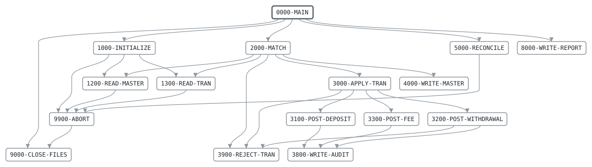

# TXPOST

```text
TXPOST: POST TRANSACTIONS TO THE ACCOUNT MASTER

MATCHES THE SORTED TRANSACTIONS AGAINST THE OLD MASTER, BOTH
IN ACCOUNT NUMBER ORDER, AND WRITES THE NEW MASTER: EVERY OLD
RECORD, WITH ITS TRANSACTIONS APPLIED. EACH POSTING GOES TO
THE AUDIT TRAIL; A TRANSACTION THAT CANNOT BE POSTED GOES TO
THE REJECTS. BOTH ARE APPENDED TO, AS THE DAILY BATCH RUNS
TXPOST FOUR TIMES:
  0. THE MONTH-END INTEREST AND FEES FROM MONCHG, ON THE DAY
     A MONTH CLOSES; ON OTHER DAYS NONE.
  1. THE DAY'S TRANSACTIONS. A POSTED TRANSFER WRITES A
     TRANSFER CREDIT FOR THE RECEIVING ACCOUNT TO THE LEGS.
  2. THE TRANSFER CREDITS, SORTED. ONE FOR AN UNKNOWN OR
     CLOSED ACCOUNT WRITES A RETURNED TRANSFER TO THE LEGS.
  3. THE RETURNED TRANSFERS, SORTED.

RULES: NOTHING POSTS TO A CLOSED ACCOUNT. CREDITS AND FEES
POST TO A FROZEN ACCOUNT, WITHDRAWALS AND TRANSFERS DO NOT. A
DEBIT MAY TAKE THE BALANCE DOWN TO THE OVERDRAFT LIMIT, NO
FURTHER. A FEE ALWAYS POSTS, EVEN PAST THE LIMIT. INTEREST
POSTS AS A CREDIT, OVERDRAFT INTEREST, MAINTENANCE FEES AND
ATM FEES AS FEES. CARD PURCHASES AND ATM WITHDRAWALS WERE
AUTHORIZED WHEN THEY WERE MADE, AND POST AS DEBITS WHATEVER
THE BALANCE, EVEN TO AN ACCOUNT FROZEN SINCE.

RETURN CODES: 0 ALL POSTED, 4 SOME REJECTED,
              16 INPUT OUT OF ORDER, OUT OF BALANCE OR I/O.

MODIFICATION HISTORY
DATE       BY  CHANGE
1987-04-02 JA  ORIGINAL VERSION.
1994-11-14 PK  CR-0201 OVERDRAFT LIMITS.
1996-04-15 PK  CR-0233 TRANSFERS, POSTED IN LEGS OVER THREE
               RUNS. AUDIT AND REJECTS ARE APPENDED TO.
1999-01-11 SL  Y2K: 8-DIGIT DATES IN THE AUDIT TRAIL.
2003-05-19 MV  CR-0342 CARD AND ATM TRANSACTIONS, AUTHORIZED
               ONLINE, POST WHATEVER THE BALANCE.
2003-05-26 MV  CR-0352 FEES POST EVEN PAST THE OVERDRAFT
               LIMIT.
2001-09-03 TL  CR-0298 MONTH-END INTEREST AND FEES.
2011-08-15 MV  CR-0471 RECONCILE THE NEW MASTER BEFORE
               ENDING THE RUN.
```

Program [TXPOST.cbl](../../../pangaea/programs/TXPOST.cbl): 8 files, 18 paragraphs. Its business rules: [10 decision tables](../rules/TXPOST.md).

- AUTHOR: J. ARKWRIGHT, BATCH SYSTEMS.
- INSTALLATION: FIRST BANK OF PANGAEA, DATA CENTER.
- DATE-WRITTEN: 1987-04-02.

## Contents

- [Files](#files)
- [Flow](#flow)
- [Paragraphs](#paragraphs)
- [Data flow](#data-flow)
- [Lineage](#lineage)
  - [Into BANK-CONTROL-RECORD](#into-bank-control-record)
  - [Into ACCT-MASTER-RECORD](#into-acct-master-record)
  - [Into TRAN-RECORD](#into-tran-record)
  - [Into ACCT-OUT-RECORD](#into-acct-out-record)
  - [Into AUDIT-OUT-RECORD](#into-audit-out-record)
  - [Into REJECT-OUT-RECORD](#into-reject-out-record)
  - [Into LEGS-OUT-RECORD](#into-legs-out-record)
  - [Into REPORT-LINE](#into-report-line)
  - [Into WS-BUSINESS-DATE](#into-ws-business-date)
  - [Into WS-ABORT-MESSAGE](#into-ws-abort-message)
  - [Into WS-MASTER-KEY](#into-ws-master-key)
  - [Into WS-TRAN-KEY](#into-ws-tran-key)
  - [Into WS-PREV-MASTER-KEY](#into-ws-prev-master-key)
  - [Into WS-TRAN-ORDER-KEY](#into-ws-tran-order-key)
  - [Into WS-PREV-TRAN-ORDER-KEY](#into-ws-prev-tran-order-key)
  - [Into WS-POSTING](#into-ws-posting)
  - [Into WS-SAVED-TRAN](#into-ws-saved-tran)
  - [Into WS-LEG-ACCT-NO](#into-ws-leg-acct-no)
  - [Into WS-TOTALS](#into-ws-totals)
  - [Into AUDIT-RECORD](#into-audit-record)
  - [Into REJECT-RECORD](#into-reject-record)
  - [Into WS-REPORT-COUNT-LINE](#into-ws-report-count-line)
  - [Into WS-REPORT-AMOUNT-LINE](#into-ws-report-amount-line)
  - [Into files](#into-files)
  - [Into other data items](#into-other-data-items)
- [Field origins](#field-origins)
  - [File LEGS-OUT](#file-legs-out)
  - [File AUDIT-OUT](#file-audit-out)
  - [File REJECT-OUT](#file-reject-out)
  - [File ACCT-OUT](#file-acct-out)
  - [File REPORT-OUT](#file-report-out)
- [Records](#records)
  - [BANK-CONTROL-RECORD](#bank-control-record)
  - [ACCT-MASTER-RECORD](#acct-master-record)
  - [TRAN-RECORD](#tran-record)
  - [ACCT-OUT-RECORD](#acct-out-record)
  - [AUDIT-OUT-RECORD](#audit-out-record)
  - [REJECT-OUT-RECORD](#reject-out-record)
  - [LEGS-OUT-RECORD](#legs-out-record)
  - [REPORT-LINE](#report-line)
  - [WS-FILE-STATUSES](#ws-file-statuses)
  - [WS-BUSINESS-DATE](#ws-business-date)
  - [WS-ABORT-MESSAGE](#ws-abort-message)
  - [WS-MASTER-KEY](#ws-master-key)
  - [WS-TRAN-KEY](#ws-tran-key)
  - [WS-PREV-MASTER-KEY](#ws-prev-master-key)
  - [WS-TRAN-ORDER-KEY](#ws-tran-order-key)
  - [WS-PREV-TRAN-ORDER-KEY](#ws-prev-tran-order-key)
  - [WS-POSTING](#ws-posting)
  - [WS-SAVED-TRAN](#ws-saved-tran)
  - [WS-LEG-ACCT-NO](#ws-leg-acct-no)
  - [WS-TOTALS](#ws-totals)
  - [AUDIT-RECORD](#audit-record)
  - [REJECT-RECORD](#reject-record)
  - [WS-REPORT-COUNT-LINE](#ws-report-count-line)
  - [WS-REPORT-AMOUNT-LINE](#ws-report-amount-line)

## Files

| File | Kind | Assigned to | Organization | Status field | Opened | Records |
| --- | --- | --- | --- | --- | --- | --- |
| CONTROL-FILE | FD | BANKCTL | SEQUENTIAL | WS-CONTROL-STATUS | INPUT | BANK-CONTROL-RECORD |
| ACCT-IN | FD | ACCTIN | SEQUENTIAL | WS-ACCT-IN-STATUS | INPUT | ACCT-MASTER-RECORD |
| TRAN-IN | FD | TRANIN | SEQUENTIAL | WS-TRAN-IN-STATUS | INPUT | TRAN-RECORD |
| ACCT-OUT | FD | ACCTOUT | SEQUENTIAL | WS-ACCT-OUT-STATUS | OUTPUT | ACCT-OUT-RECORD |
| AUDIT-OUT | FD | AUDIT | SEQUENTIAL | WS-AUDIT-STATUS | EXTEND | AUDIT-OUT-RECORD |
| REJECT-OUT | FD | REJECTS | SEQUENTIAL | WS-REJECT-STATUS | EXTEND | REJECT-OUT-RECORD |
| LEGS-OUT | FD | LEGS | SEQUENTIAL | WS-LEGS-STATUS | OUTPUT | LEGS-OUT-RECORD |
| REPORT-OUT | FD | POSTRPT | LINE SEQUENTIAL | WS-REPORT-STATUS | OUTPUT | REPORT-LINE |

## Flow



## Paragraphs

| Paragraph | Description | Source | Performs | Goes to | Performed by | Reached by |
| --- | --- | --- | --- | --- | --- | --- |
| 0000-MAIN | MATCH UNTIL BOTH FILES END, THEN RECONCILE AND REPORT. | [TXPOST.cbl:162](../../../pangaea/programs/TXPOST.cbl#L162) | 1000-INITIALIZE, 2000-MATCH, 5000-RECONCILE, 8000-WRITE-REPORT, 9000-CLOSE-FILES | | | |
| 1000-INITIALIZE | OPEN THE FILES AND READ THE FIRST RECORD OF EACH. THE AUDIT TRAIL AND THE REJECTS ARE EXTENDED, AND CREATED IF NEW. | [TXPOST.cbl:179](../../../pangaea/programs/TXPOST.cbl#L179) | 9900-ABORT, 1200-READ-MASTER, 1300-READ-TRAN | | 0000-MAIN | |
| 1200-READ-MASTER | READ THE NEXT OLD MASTER RECORD, CHECKING ACCOUNT ORDER. | [TXPOST.cbl:206](../../../pangaea/programs/TXPOST.cbl#L206) | 9900-ABORT | | 1000-INITIALIZE, 2000-MATCH | |
| 1300-READ-TRAN | READ THE NEXT TRANSACTION, CHECKING ITS ORDER. | [TXPOST.cbl:223](../../../pangaea/programs/TXPOST.cbl#L223) | 9900-ABORT | | 1000-INITIALIZE, 2000-MATCH | |
| 2000-MATCH | ONE STEP OF THE MATCH, BY WHICHEVER KEY IS LOWER: REJECT A TRANSACTION FOR A MISSING ACCOUNT, APPLY ONE TO ITS ACCOUNT, OR WRITE A FINISHED ACCOUNT. | [TXPOST.cbl:241](../../../pangaea/programs/TXPOST.cbl#L241) | 3900-REJECT-TRAN, 1300-READ-TRAN, 3000-APPLY-TRAN, 4000-WRITE-MASTER, 1200-READ-MASTER | | 0000-MAIN | |
| 3000-APPLY-TRAN | APPLY ONE TRANSACTION TO ITS ACCOUNT BY THE POSTING RULES. | [TXPOST.cbl:256](../../../pangaea/programs/TXPOST.cbl#L256) | 3900-REJECT-TRAN, 3100-POST-CREDIT, 3300-POST-FEE, 3400-POST-AUTHORIZED, 3200-POST-DEBIT | | 2000-MATCH | |
| 3100-POST-CREDIT | CREDIT A DEPOSIT, A TRANSFER CREDIT, A RETURNED TRANSFER OR INTEREST. | [TXPOST.cbl:285](../../../pangaea/programs/TXPOST.cbl#L285) | 3800-WRITE-AUDIT | | 3000-APPLY-TRAN | |
| 3200-POST-DEBIT | DEBIT A WITHDRAWAL OR TRANSFER IF IT STAYS WITHIN THE OVERDRAFT LIMIT. A POSTED TRANSFER SENDS ITS CREDIT ON. | [TXPOST.cbl:293](../../../pangaea/programs/TXPOST.cbl#L293) | 3900-REJECT-TRAN, 3800-WRITE-AUDIT, 3500-WRITE-LEG | | 3000-APPLY-TRAN | |
| 3300-POST-FEE | DEBIT A FEE, OVERDRAFT INTEREST, A MAINTENANCE FEE OR AN ATM FEE, WHATEVER THE BALANCE. | [TXPOST.cbl:311](../../../pangaea/programs/TXPOST.cbl#L311) | 3800-WRITE-AUDIT | | 3000-APPLY-TRAN | |
| 3400-POST-AUTHORIZED | DEBIT A CARD PURCHASE OR ATM WITHDRAWAL AUTHORIZED ONLINE, WHATEVER THE BALANCE. | [TXPOST.cbl:319](../../../pangaea/programs/TXPOST.cbl#L319) | 3800-WRITE-AUDIT | | 3000-APPLY-TRAN | |
| 3500-WRITE-LEG | WRITE THE NEXT LEG OF A TRANSFER FOR THE COUNTER ACCOUNT: A TRANSFER CREDIT AFTER A TRANSFER, A RETURN AFTER A CREDIT THAT COULD NOT POST. | [TXPOST.cbl:328](../../../pangaea/programs/TXPOST.cbl#L328) | | | 3200-POST-DEBIT, 3900-REJECT-TRAN | |
| 3800-WRITE-AUDIT | RECORD A POSTING IN THE AUDIT TRAIL. | [TXPOST.cbl:343](../../../pangaea/programs/TXPOST.cbl#L343) | | | 3100-POST-CREDIT, 3200-POST-DEBIT, 3300-POST-FEE, 3400-POST-AUTHORIZED | |
| 3900-REJECT-TRAN | WRITE THE TRANSACTION TO THE REJECTS WITH ITS REASON. A TRANSFER CREDIT THAT CANNOT POST GOES BACK TO ITS SENDER. | [TXPOST.cbl:357](../../../pangaea/programs/TXPOST.cbl#L357) | 3500-WRITE-LEG | | 2000-MATCH, 3000-APPLY-TRAN, 3200-POST-DEBIT | |
| 4000-WRITE-MASTER | WRITE AN ACCOUNT, ITS TRANSACTIONS APPLIED, TO THE NEW MASTER. | [TXPOST.cbl:367](../../../pangaea/programs/TXPOST.cbl#L367) | | | 2000-MATCH | |
| 5000-RECONCILE | THE NEW MASTER MUST HOLD THE OLD BALANCES PLUS WHAT WAS POSTED. | [TXPOST.cbl:373](../../../pangaea/programs/TXPOST.cbl#L373) | 9900-ABORT | | 0000-MAIN | |
| 8000-WRITE-REPORT | WRITE THE POSTING REPORT. | [TXPOST.cbl:385](../../../pangaea/programs/TXPOST.cbl#L385) | | | 0000-MAIN | |
| 9000-CLOSE-FILES | CLOSE ALL FILES. | [TXPOST.cbl:431](../../../pangaea/programs/TXPOST.cbl#L431) | | | 0000-MAIN, 9900-ABORT | |
| 9900-ABORT | STOP THE RUN WITH RETURN CODE 16, SAYING WHY. | [TXPOST.cbl:436](../../../pangaea/programs/TXPOST.cbl#L436) | 9000-CLOSE-FILES | | 1000-INITIALIZE, 1200-READ-MASTER, 1300-READ-TRAN, 5000-RECONCILE | |

## Data flow

| Paragraph | Reads | Writes |
| --- | --- | --- |
| 0000-MAIN | WS-MASTER-KEY, WS-TRAN-KEY, WS-REJECT-COUNT | RETURN-CODE |
| 1000-INITIALIZE | WS-CONTROL-STATUS, WS-ACCT-IN-STATUS, WS-TRAN-IN-STATUS, WS-ACCT-OUT-STATUS, WS-AUDIT-STATUS, WS-REJECT-STATUS, WS-LEGS-STATUS, WS-REPORT-STATUS, WS-FILE-STATUSES, BC-BUSINESS-DATE | RETURN-CODE, BANK-CONTROL-RECORD, WS-ABORT-MESSAGE, WS-BUSINESS-DATE, AUDIT-RECORD, REJECT-RECORD |
| 1200-READ-MASTER | AM-ACCT-NO, WS-MASTER-KEY, WS-PREV-MASTER-KEY, WS-MASTERS-READ, AM-BALANCE, WS-OPENING-TOTAL | ACCT-MASTER-RECORD, WS-MASTER-KEY, WS-ABORT-MESSAGE, WS-PREV-MASTER-KEY, WS-MASTERS-READ, WS-OPENING-TOTAL |
| 1300-READ-TRAN | TD-ACCT-NO, TD-TRAN-ID, WS-TRAN-ORDER-KEY, WS-PREV-TRAN-ORDER-KEY | TRAN-RECORD, WS-TRAN-KEY, WS-TOK-ACCT-NO, WS-TOK-TRAN-ID, WS-ABORT-MESSAGE, WS-PREV-TRAN-ORDER-KEY |
| 2000-MATCH | WS-TRAN-KEY, WS-MASTER-KEY | RJ-REASON |
| 3000-APPLY-TRAN | AM-BALANCE, AM-STATUS, TD-TRAN-CODE | WS-BALANCE-BEFORE, RJ-REASON |
| 3100-POST-CREDIT | TD-AMOUNT, AM-BALANCE, WS-CREDIT-TOTAL | AM-BALANCE, WS-CREDIT-TOTAL, WS-SIGNED-AMOUNT |
| 3200-POST-DEBIT | AM-BALANCE, TD-AMOUNT, AM-OVERDRAFT-LIMIT, WS-NEW-BALANCE, WS-BALANCE-FLOOR, WS-DEBIT-TOTAL, TD-TRAN-CODE | WS-NEW-BALANCE, WS-BALANCE-FLOOR, RJ-REASON, AM-BALANCE, WS-DEBIT-TOTAL, WS-SIGNED-AMOUNT |
| 3300-POST-FEE | TD-AMOUNT, AM-BALANCE, WS-FEE-TOTAL | AM-BALANCE, WS-FEE-TOTAL, WS-SIGNED-AMOUNT |
| 3400-POST-AUTHORIZED | TD-AMOUNT, AM-BALANCE, WS-DEBIT-TOTAL | AM-BALANCE, WS-DEBIT-TOTAL, WS-SIGNED-AMOUNT |
| 3500-WRITE-LEG | TRAN-RECORD, TD-TRAN-CODE, TD-ACCT-NO, TD-COUNTER-ACCT-NO, WS-LEG-ACCT-NO, WS-LEG-COUNT, WS-SAVED-TRAN | WS-SAVED-TRAN, TD-TRAN-CODE, WS-LEG-ACCT-NO, TD-ACCT-NO, TD-COUNTER-ACCT-NO, LEGS-OUT-RECORD, WS-LEG-COUNT, TRAN-RECORD |
| 3800-WRITE-AUDIT | WS-BUSINESS-DATE, TD-TRAN-ID, TD-ACCT-NO, TD-TRAN-CODE, WS-SIGNED-AMOUNT, WS-BALANCE-BEFORE, AM-BALANCE, AUDIT-RECORD, WS-POSTED-COUNT | AU-BUSINESS-DATE, AM-LAST-ACTIVITY-DATE, AU-TRAN-ID, AU-ACCT-NO, AU-TRAN-CODE, AU-AMOUNT, AU-BALANCE-BEFORE, AU-BALANCE-AFTER, AUDIT-OUT-RECORD, WS-POSTED-COUNT |
| 3900-REJECT-TRAN | TRAN-RECORD, REJECT-RECORD, WS-REJECT-COUNT, TD-TRAN-CODE | RJ-PROGRAM, RJ-TRAN, REJECT-OUT-RECORD, WS-REJECT-COUNT |
| 4000-WRITE-MASTER | ACCT-MASTER-RECORD, WS-MASTERS-WRITTEN, AM-BALANCE, WS-CLOSING-TOTAL | ACCT-OUT-RECORD, WS-MASTERS-WRITTEN, WS-CLOSING-TOTAL |
| 5000-RECONCILE | WS-OPENING-TOTAL, WS-CREDIT-TOTAL, WS-EXPECTED-TOTAL, WS-DEBIT-TOTAL, WS-FEE-TOTAL, WS-CLOSING-TOTAL, WS-MASTERS-WRITTEN, WS-MASTERS-READ | WS-EXPECTED-TOTAL, WS-ABORT-MESSAGE |
| 8000-WRITE-REPORT | WS-BUSINESS-DATE, WS-MASTERS-READ, WS-REPORT-COUNT-LINE, WS-MASTERS-WRITTEN, WS-POSTED-COUNT, WS-REJECT-COUNT, WS-LEG-COUNT, WS-OPENING-TOTAL, WS-REPORT-AMOUNT-LINE, WS-CREDIT-TOTAL, WS-DEBIT-TOTAL, WS-FEE-TOTAL, WS-CLOSING-TOTAL | REPORT-LINE, WS-RC-LABEL, WS-RC-VALUE, WS-RA-LABEL, WS-RA-VALUE |
| 9000-CLOSE-FILES | | |
| 9900-ABORT | WS-ABORT-MESSAGE | RETURN-CODE |

## Lineage

Where each data item's values come from, grouped by the record they go into. A data item links to the record it belongs to.

### Into BANK-CONTROL-RECORD

Record [BANK-CONTROL-RECORD](#bank-control-record), from copybook [BANKCTL](../copybooks/BANKCTL.md).

| Into | From | Statement | Paragraph | Source |
| --- | --- | --- | --- | --- |
| BANK-CONTROL-RECORD | file CONTROL-FILE | READ | 1000-INITIALIZE | [TXPOST.cbl:195](../../../pangaea/programs/TXPOST.cbl#L195) |

### Into ACCT-MASTER-RECORD

Record [ACCT-MASTER-RECORD](#acct-master-record), from copybook [ACCTMAST](../copybooks/ACCTMAST.md).

| Into | From | Statement | Paragraph | Source |
| --- | --- | --- | --- | --- |
| ACCT-MASTER-RECORD | file ACCT-IN | READ | 1200-READ-MASTER | [TXPOST.cbl:207](../../../pangaea/programs/TXPOST.cbl#L207) |
| AM-BALANCE | [TD-AMOUNT](#tran-record "in TRAN-RECORD") | ADD | 3100-POST-CREDIT | [TXPOST.cbl:286](../../../pangaea/programs/TXPOST.cbl#L286) |
| AM-BALANCE | [WS-NEW-BALANCE](#ws-posting "in WS-POSTING") | MOVE | 3200-POST-DEBIT | [TXPOST.cbl:300](../../../pangaea/programs/TXPOST.cbl#L300) |
| AM-BALANCE | [TD-AMOUNT](#tran-record "in TRAN-RECORD") | SUBTRACT | 3300-POST-FEE | [TXPOST.cbl:312](../../../pangaea/programs/TXPOST.cbl#L312) |
| AM-BALANCE | [TD-AMOUNT](#tran-record "in TRAN-RECORD") | SUBTRACT | 3400-POST-AUTHORIZED | [TXPOST.cbl:320](../../../pangaea/programs/TXPOST.cbl#L320) |
| AM-LAST-ACTIVITY-DATE | [WS-BUSINESS-DATE](#ws-business-date) | MOVE | 3800-WRITE-AUDIT | [TXPOST.cbl:344](../../../pangaea/programs/TXPOST.cbl#L344) |

### Into TRAN-RECORD

Record [TRAN-RECORD](#tran-record), from copybook [TRANREC](../copybooks/TRANREC.md).

| Into | From | Statement | Paragraph | Source |
| --- | --- | --- | --- | --- |
| TD-ACCT-NO | [TD-COUNTER-ACCT-NO](#tran-record "in TRAN-RECORD") | MOVE | 3500-WRITE-LEG | [TXPOST.cbl:336](../../../pangaea/programs/TXPOST.cbl#L336) |
| TD-COUNTER-ACCT-NO | [WS-LEG-ACCT-NO](#ws-leg-acct-no) | MOVE | 3500-WRITE-LEG | [TXPOST.cbl:337](../../../pangaea/programs/TXPOST.cbl#L337) |
| TD-TRAN-CODE | literal condition TD-TRANSFER-CREDIT | SET | 3500-WRITE-LEG | [TXPOST.cbl:331](../../../pangaea/programs/TXPOST.cbl#L331) |
| TD-TRAN-CODE | literal condition TD-TRANSFER-RETURN | SET | 3500-WRITE-LEG | [TXPOST.cbl:333](../../../pangaea/programs/TXPOST.cbl#L333) |
| TRAN-RECORD | file TRAN-IN | READ | 1300-READ-TRAN | [TXPOST.cbl:224](../../../pangaea/programs/TXPOST.cbl#L224) |
| TRAN-RECORD | [WS-SAVED-TRAN](#ws-saved-tran) | MOVE | 3500-WRITE-LEG | [TXPOST.cbl:340](../../../pangaea/programs/TXPOST.cbl#L340) |

### Into ACCT-OUT-RECORD

Record [ACCT-OUT-RECORD](#acct-out-record).

| Into | From | Statement | Paragraph | Source |
| --- | --- | --- | --- | --- |
| ACCT-OUT-RECORD | [ACCT-MASTER-RECORD](#acct-master-record) | WRITE | 4000-WRITE-MASTER | [TXPOST.cbl:368](../../../pangaea/programs/TXPOST.cbl#L368) |

### Into AUDIT-OUT-RECORD

Record [AUDIT-OUT-RECORD](#audit-out-record).

| Into | From | Statement | Paragraph | Source |
| --- | --- | --- | --- | --- |
| AUDIT-OUT-RECORD | [AUDIT-RECORD](#audit-record) | WRITE | 3800-WRITE-AUDIT | [TXPOST.cbl:352](../../../pangaea/programs/TXPOST.cbl#L352) |

### Into REJECT-OUT-RECORD

Record [REJECT-OUT-RECORD](#reject-out-record).

| Into | From | Statement | Paragraph | Source |
| --- | --- | --- | --- | --- |
| REJECT-OUT-RECORD | [REJECT-RECORD](#reject-record) | WRITE | 3900-REJECT-TRAN | [TXPOST.cbl:360](../../../pangaea/programs/TXPOST.cbl#L360) |

### Into LEGS-OUT-RECORD

Record [LEGS-OUT-RECORD](#legs-out-record).

| Into | From | Statement | Paragraph | Source |
| --- | --- | --- | --- | --- |
| LEGS-OUT-RECORD | [TRAN-RECORD](#tran-record) | WRITE | 3500-WRITE-LEG | [TXPOST.cbl:338](../../../pangaea/programs/TXPOST.cbl#L338) |

### Into REPORT-LINE

Record [REPORT-LINE](#report-line).

| Into | From | Statement | Paragraph | Source |
| --- | --- | --- | --- | --- |
| REPORT-LINE | literal SPACES | MOVE | 8000-WRITE-REPORT | [TXPOST.cbl:386](../../../pangaea/programs/TXPOST.cbl#L386) |
| REPORT-LINE | literal 'TXPOST   TRANSACTION POSTING     BUSINESS DATE ' | STRING | 8000-WRITE-REPORT | [TXPOST.cbl:387](../../../pangaea/programs/TXPOST.cbl#L387) |
| REPORT-LINE | [WS-BUSINESS-DATE](#ws-business-date) | STRING | 8000-WRITE-REPORT | [TXPOST.cbl:387](../../../pangaea/programs/TXPOST.cbl#L387) |
| REPORT-LINE | literal SPACES | MOVE | 8000-WRITE-REPORT | [TXPOST.cbl:391](../../../pangaea/programs/TXPOST.cbl#L391) |
| REPORT-LINE | [WS-REPORT-COUNT-LINE](#ws-report-count-line) | WRITE | 8000-WRITE-REPORT | [TXPOST.cbl:395](../../../pangaea/programs/TXPOST.cbl#L395) |
| REPORT-LINE | [WS-REPORT-COUNT-LINE](#ws-report-count-line) | WRITE | 8000-WRITE-REPORT | [TXPOST.cbl:398](../../../pangaea/programs/TXPOST.cbl#L398) |
| REPORT-LINE | [WS-REPORT-COUNT-LINE](#ws-report-count-line) | WRITE | 8000-WRITE-REPORT | [TXPOST.cbl:401](../../../pangaea/programs/TXPOST.cbl#L401) |
| REPORT-LINE | [WS-REPORT-COUNT-LINE](#ws-report-count-line) | WRITE | 8000-WRITE-REPORT | [TXPOST.cbl:404](../../../pangaea/programs/TXPOST.cbl#L404) |
| REPORT-LINE | [WS-REPORT-COUNT-LINE](#ws-report-count-line) | WRITE | 8000-WRITE-REPORT | [TXPOST.cbl:407](../../../pangaea/programs/TXPOST.cbl#L407) |
| REPORT-LINE | literal SPACES | MOVE | 8000-WRITE-REPORT | [TXPOST.cbl:408](../../../pangaea/programs/TXPOST.cbl#L408) |
| REPORT-LINE | [WS-REPORT-AMOUNT-LINE](#ws-report-amount-line) | WRITE | 8000-WRITE-REPORT | [TXPOST.cbl:412](../../../pangaea/programs/TXPOST.cbl#L412) |
| REPORT-LINE | [WS-REPORT-AMOUNT-LINE](#ws-report-amount-line) | WRITE | 8000-WRITE-REPORT | [TXPOST.cbl:415](../../../pangaea/programs/TXPOST.cbl#L415) |
| REPORT-LINE | [WS-REPORT-AMOUNT-LINE](#ws-report-amount-line) | WRITE | 8000-WRITE-REPORT | [TXPOST.cbl:418](../../../pangaea/programs/TXPOST.cbl#L418) |
| REPORT-LINE | [WS-REPORT-AMOUNT-LINE](#ws-report-amount-line) | WRITE | 8000-WRITE-REPORT | [TXPOST.cbl:421](../../../pangaea/programs/TXPOST.cbl#L421) |
| REPORT-LINE | [WS-REPORT-AMOUNT-LINE](#ws-report-amount-line) | WRITE | 8000-WRITE-REPORT | [TXPOST.cbl:424](../../../pangaea/programs/TXPOST.cbl#L424) |
| REPORT-LINE | literal SPACES | MOVE | 8000-WRITE-REPORT | [TXPOST.cbl:425](../../../pangaea/programs/TXPOST.cbl#L425) |
| REPORT-LINE | literal 'NEW MASTER IN BALANCE' | MOVE | 8000-WRITE-REPORT | [TXPOST.cbl:427](../../../pangaea/programs/TXPOST.cbl#L427) |

### Into WS-BUSINESS-DATE

Record [WS-BUSINESS-DATE](#ws-business-date).

| Into | From | Statement | Paragraph | Source |
| --- | --- | --- | --- | --- |
| WS-BUSINESS-DATE | [BC-BUSINESS-DATE](#bank-control-record "in BANK-CONTROL-RECORD") | MOVE | 1000-INITIALIZE | [TXPOST.cbl:200](../../../pangaea/programs/TXPOST.cbl#L200) |

### Into WS-ABORT-MESSAGE

Record [WS-ABORT-MESSAGE](#ws-abort-message).

| Into | From | Statement | Paragraph | Source |
| --- | --- | --- | --- | --- |
| WS-ABORT-MESSAGE | literal 'NO BANK CONTROL RECORD' | MOVE | 1000-INITIALIZE | [TXPOST.cbl:197](../../../pangaea/programs/TXPOST.cbl#L197) |
| WS-ABORT-MESSAGE | literal 'MASTER NOT IN ACCOUNT ORDER' | MOVE | 1200-READ-MASTER | [TXPOST.cbl:213](../../../pangaea/programs/TXPOST.cbl#L213) |
| WS-ABORT-MESSAGE | literal 'TRANSACTIONS NOT IN ACCOUNT ORDER' | MOVE | 1300-READ-TRAN | [TXPOST.cbl:231](../../../pangaea/programs/TXPOST.cbl#L231) |
| WS-ABORT-MESSAGE | literal 'NEW MASTER OUT OF BALANCE' | MOVE | 5000-RECONCILE | [TXPOST.cbl:380](../../../pangaea/programs/TXPOST.cbl#L380) |

### Into WS-MASTER-KEY

Record [WS-MASTER-KEY](#ws-master-key).

| Into | From | Statement | Paragraph | Source |
| --- | --- | --- | --- | --- |
| WS-MASTER-KEY | literal HIGH-VALUES | MOVE | 1200-READ-MASTER | [TXPOST.cbl:209](../../../pangaea/programs/TXPOST.cbl#L209) |
| WS-MASTER-KEY | [AM-ACCT-NO](#acct-master-record "in ACCT-MASTER-RECORD") | MOVE | 1200-READ-MASTER | [TXPOST.cbl:211](../../../pangaea/programs/TXPOST.cbl#L211) |

### Into WS-TRAN-KEY

Record [WS-TRAN-KEY](#ws-tran-key).

| Into | From | Statement | Paragraph | Source |
| --- | --- | --- | --- | --- |
| WS-TRAN-KEY | literal HIGH-VALUES | MOVE | 1300-READ-TRAN | [TXPOST.cbl:226](../../../pangaea/programs/TXPOST.cbl#L226) |
| WS-TRAN-KEY | [TD-ACCT-NO](#tran-record "in TRAN-RECORD") | MOVE | 1300-READ-TRAN | [TXPOST.cbl:228](../../../pangaea/programs/TXPOST.cbl#L228) |

### Into WS-PREV-MASTER-KEY

Record [WS-PREV-MASTER-KEY](#ws-prev-master-key).

| Into | From | Statement | Paragraph | Source |
| --- | --- | --- | --- | --- |
| WS-PREV-MASTER-KEY | [WS-MASTER-KEY](#ws-master-key) | MOVE | 1200-READ-MASTER | [TXPOST.cbl:217](../../../pangaea/programs/TXPOST.cbl#L217) |

### Into WS-TRAN-ORDER-KEY

Record [WS-TRAN-ORDER-KEY](#ws-tran-order-key).

| Into | From | Statement | Paragraph | Source |
| --- | --- | --- | --- | --- |
| WS-TOK-ACCT-NO | [TD-ACCT-NO](#tran-record "in TRAN-RECORD") | MOVE | 1300-READ-TRAN | [TXPOST.cbl:228](../../../pangaea/programs/TXPOST.cbl#L228) |
| WS-TOK-TRAN-ID | [TD-TRAN-ID](#tran-record "in TRAN-RECORD") | MOVE | 1300-READ-TRAN | [TXPOST.cbl:229](../../../pangaea/programs/TXPOST.cbl#L229) |

### Into WS-PREV-TRAN-ORDER-KEY

Record [WS-PREV-TRAN-ORDER-KEY](#ws-prev-tran-order-key).

| Into | From | Statement | Paragraph | Source |
| --- | --- | --- | --- | --- |
| WS-PREV-TRAN-ORDER-KEY | [WS-TRAN-ORDER-KEY](#ws-tran-order-key) | MOVE | 1300-READ-TRAN | [TXPOST.cbl:235](../../../pangaea/programs/TXPOST.cbl#L235) |

### Into WS-POSTING

Record [WS-POSTING](#ws-posting).

| Into | From | Statement | Paragraph | Source |
| --- | --- | --- | --- | --- |
| WS-BALANCE-BEFORE | [AM-BALANCE](#acct-master-record "in ACCT-MASTER-RECORD") | MOVE | 3000-APPLY-TRAN | [TXPOST.cbl:257](../../../pangaea/programs/TXPOST.cbl#L257) |
| WS-BALANCE-FLOOR | [AM-OVERDRAFT-LIMIT](#acct-master-record "in ACCT-MASTER-RECORD") | COMPUTE | 3200-POST-DEBIT | [TXPOST.cbl:295](../../../pangaea/programs/TXPOST.cbl#L295) |
| WS-NEW-BALANCE | [AM-BALANCE](#acct-master-record "in ACCT-MASTER-RECORD") | COMPUTE | 3200-POST-DEBIT | [TXPOST.cbl:294](../../../pangaea/programs/TXPOST.cbl#L294) |
| WS-NEW-BALANCE | [TD-AMOUNT](#tran-record "in TRAN-RECORD") | COMPUTE | 3200-POST-DEBIT | [TXPOST.cbl:294](../../../pangaea/programs/TXPOST.cbl#L294) |
| WS-SIGNED-AMOUNT | [TD-AMOUNT](#tran-record "in TRAN-RECORD") | MOVE | 3100-POST-CREDIT | [TXPOST.cbl:288](../../../pangaea/programs/TXPOST.cbl#L288) |
| WS-SIGNED-AMOUNT | [TD-AMOUNT](#tran-record "in TRAN-RECORD") | COMPUTE | 3200-POST-DEBIT | [TXPOST.cbl:302](../../../pangaea/programs/TXPOST.cbl#L302) |
| WS-SIGNED-AMOUNT | [TD-AMOUNT](#tran-record "in TRAN-RECORD") | COMPUTE | 3300-POST-FEE | [TXPOST.cbl:314](../../../pangaea/programs/TXPOST.cbl#L314) |
| WS-SIGNED-AMOUNT | [TD-AMOUNT](#tran-record "in TRAN-RECORD") | COMPUTE | 3400-POST-AUTHORIZED | [TXPOST.cbl:322](../../../pangaea/programs/TXPOST.cbl#L322) |

### Into WS-SAVED-TRAN

Record [WS-SAVED-TRAN](#ws-saved-tran).

| Into | From | Statement | Paragraph | Source |
| --- | --- | --- | --- | --- |
| WS-SAVED-TRAN | [TRAN-RECORD](#tran-record) | MOVE | 3500-WRITE-LEG | [TXPOST.cbl:329](../../../pangaea/programs/TXPOST.cbl#L329) |

### Into WS-LEG-ACCT-NO

Record [WS-LEG-ACCT-NO](#ws-leg-acct-no).

| Into | From | Statement | Paragraph | Source |
| --- | --- | --- | --- | --- |
| WS-LEG-ACCT-NO | [TD-ACCT-NO](#tran-record "in TRAN-RECORD") | MOVE | 3500-WRITE-LEG | [TXPOST.cbl:335](../../../pangaea/programs/TXPOST.cbl#L335) |

### Into WS-TOTALS

Record [WS-TOTALS](#ws-totals).

| Into | From | Statement | Paragraph | Source |
| --- | --- | --- | --- | --- |
| WS-CLOSING-TOTAL | [AM-BALANCE](#acct-master-record "in ACCT-MASTER-RECORD") | ADD | 4000-WRITE-MASTER | [TXPOST.cbl:370](../../../pangaea/programs/TXPOST.cbl#L370) |
| WS-CREDIT-TOTAL | [TD-AMOUNT](#tran-record "in TRAN-RECORD") | ADD | 3100-POST-CREDIT | [TXPOST.cbl:287](../../../pangaea/programs/TXPOST.cbl#L287) |
| WS-DEBIT-TOTAL | [TD-AMOUNT](#tran-record "in TRAN-RECORD") | ADD | 3200-POST-DEBIT | [TXPOST.cbl:301](../../../pangaea/programs/TXPOST.cbl#L301) |
| WS-DEBIT-TOTAL | [TD-AMOUNT](#tran-record "in TRAN-RECORD") | ADD | 3400-POST-AUTHORIZED | [TXPOST.cbl:321](../../../pangaea/programs/TXPOST.cbl#L321) |
| WS-EXPECTED-TOTAL | [WS-OPENING-TOTAL](#ws-totals "in WS-TOTALS") | MOVE | 5000-RECONCILE | [TXPOST.cbl:374](../../../pangaea/programs/TXPOST.cbl#L374) |
| WS-EXPECTED-TOTAL | [WS-CREDIT-TOTAL](#ws-totals "in WS-TOTALS") | ADD | 5000-RECONCILE | [TXPOST.cbl:375](../../../pangaea/programs/TXPOST.cbl#L375) |
| WS-EXPECTED-TOTAL | [WS-DEBIT-TOTAL](#ws-totals "in WS-TOTALS") | SUBTRACT | 5000-RECONCILE | [TXPOST.cbl:376](../../../pangaea/programs/TXPOST.cbl#L376) |
| WS-EXPECTED-TOTAL | [WS-FEE-TOTAL](#ws-totals "in WS-TOTALS") | SUBTRACT | 5000-RECONCILE | [TXPOST.cbl:377](../../../pangaea/programs/TXPOST.cbl#L377) |
| WS-FEE-TOTAL | [TD-AMOUNT](#tran-record "in TRAN-RECORD") | ADD | 3300-POST-FEE | [TXPOST.cbl:313](../../../pangaea/programs/TXPOST.cbl#L313) |
| WS-LEG-COUNT | literal 1 | ADD | 3500-WRITE-LEG | [TXPOST.cbl:339](../../../pangaea/programs/TXPOST.cbl#L339) |
| WS-MASTERS-READ | literal 1 | ADD | 1200-READ-MASTER | [TXPOST.cbl:218](../../../pangaea/programs/TXPOST.cbl#L218) |
| WS-MASTERS-WRITTEN | literal 1 | ADD | 4000-WRITE-MASTER | [TXPOST.cbl:369](../../../pangaea/programs/TXPOST.cbl#L369) |
| WS-OPENING-TOTAL | [AM-BALANCE](#acct-master-record "in ACCT-MASTER-RECORD") | ADD | 1200-READ-MASTER | [TXPOST.cbl:219](../../../pangaea/programs/TXPOST.cbl#L219) |
| WS-POSTED-COUNT | literal 1 | ADD | 3800-WRITE-AUDIT | [TXPOST.cbl:353](../../../pangaea/programs/TXPOST.cbl#L353) |
| WS-REJECT-COUNT | literal 1 | ADD | 3900-REJECT-TRAN | [TXPOST.cbl:361](../../../pangaea/programs/TXPOST.cbl#L361) |

### Into AUDIT-RECORD

Record [AUDIT-RECORD](#audit-record), from copybook [AUDITREC](../copybooks/AUDITREC.md).

| Into | From | Statement | Paragraph | Source |
| --- | --- | --- | --- | --- |
| AU-ACCT-NO | [TD-ACCT-NO](#tran-record "in TRAN-RECORD") | MOVE | 3800-WRITE-AUDIT | [TXPOST.cbl:347](../../../pangaea/programs/TXPOST.cbl#L347) |
| AU-AMOUNT | [WS-SIGNED-AMOUNT](#ws-posting "in WS-POSTING") | MOVE | 3800-WRITE-AUDIT | [TXPOST.cbl:349](../../../pangaea/programs/TXPOST.cbl#L349) |
| AU-BALANCE-AFTER | [AM-BALANCE](#acct-master-record "in ACCT-MASTER-RECORD") | MOVE | 3800-WRITE-AUDIT | [TXPOST.cbl:351](../../../pangaea/programs/TXPOST.cbl#L351) |
| AU-BALANCE-BEFORE | [WS-BALANCE-BEFORE](#ws-posting "in WS-POSTING") | MOVE | 3800-WRITE-AUDIT | [TXPOST.cbl:350](../../../pangaea/programs/TXPOST.cbl#L350) |
| AU-BUSINESS-DATE | [WS-BUSINESS-DATE](#ws-business-date) | MOVE | 3800-WRITE-AUDIT | [TXPOST.cbl:344](../../../pangaea/programs/TXPOST.cbl#L344) |
| AU-TRAN-CODE | [TD-TRAN-CODE](#tran-record "in TRAN-RECORD") | MOVE | 3800-WRITE-AUDIT | [TXPOST.cbl:348](../../../pangaea/programs/TXPOST.cbl#L348) |
| AU-TRAN-ID | [TD-TRAN-ID](#tran-record "in TRAN-RECORD") | MOVE | 3800-WRITE-AUDIT | [TXPOST.cbl:346](../../../pangaea/programs/TXPOST.cbl#L346) |
| AUDIT-RECORD | literal SPACES | MOVE | 1000-INITIALIZE | [TXPOST.cbl:201](../../../pangaea/programs/TXPOST.cbl#L201) |

### Into REJECT-RECORD

Record [REJECT-RECORD](#reject-record), from copybook [REJREC](../copybooks/REJREC.md).

| Into | From | Statement | Paragraph | Source |
| --- | --- | --- | --- | --- |
| REJECT-RECORD | literal SPACES | MOVE | 1000-INITIALIZE | [TXPOST.cbl:201](../../../pangaea/programs/TXPOST.cbl#L201) |
| RJ-PROGRAM | literal 'TXPOST' | MOVE | 3900-REJECT-TRAN | [TXPOST.cbl:358](../../../pangaea/programs/TXPOST.cbl#L358) |
| RJ-REASON | literal condition RJ-NO-ACCOUNT | SET | 2000-MATCH | [TXPOST.cbl:244](../../../pangaea/programs/TXPOST.cbl#L244) |
| RJ-REASON | literal condition RJ-CLOSED | SET | 3000-APPLY-TRAN | [TXPOST.cbl:260](../../../pangaea/programs/TXPOST.cbl#L260) |
| RJ-REASON | literal condition RJ-FROZEN | SET | 3000-APPLY-TRAN | [TXPOST.cbl:276](../../../pangaea/programs/TXPOST.cbl#L276) |
| RJ-REASON | literal condition RJ-NO-FUNDS | SET | 3200-POST-DEBIT | [TXPOST.cbl:297](../../../pangaea/programs/TXPOST.cbl#L297) |
| RJ-TRAN | [TRAN-RECORD](#tran-record) | MOVE | 3900-REJECT-TRAN | [TXPOST.cbl:359](../../../pangaea/programs/TXPOST.cbl#L359) |

### Into WS-REPORT-COUNT-LINE

Record [WS-REPORT-COUNT-LINE](#ws-report-count-line).

| Into | From | Statement | Paragraph | Source |
| --- | --- | --- | --- | --- |
| WS-RC-LABEL | literal 'ACCOUNTS READ' | MOVE | 8000-WRITE-REPORT | [TXPOST.cbl:393](../../../pangaea/programs/TXPOST.cbl#L393) |
| WS-RC-LABEL | literal 'ACCOUNTS WRITTEN' | MOVE | 8000-WRITE-REPORT | [TXPOST.cbl:396](../../../pangaea/programs/TXPOST.cbl#L396) |
| WS-RC-LABEL | literal 'TRANSACTIONS POSTED' | MOVE | 8000-WRITE-REPORT | [TXPOST.cbl:399](../../../pangaea/programs/TXPOST.cbl#L399) |
| WS-RC-LABEL | literal 'TRANSACTIONS REJECTED' | MOVE | 8000-WRITE-REPORT | [TXPOST.cbl:402](../../../pangaea/programs/TXPOST.cbl#L402) |
| WS-RC-LABEL | literal 'TRANSFER LEGS WRITTEN' | MOVE | 8000-WRITE-REPORT | [TXPOST.cbl:405](../../../pangaea/programs/TXPOST.cbl#L405) |
| WS-RC-VALUE | [WS-MASTERS-READ](#ws-totals "in WS-TOTALS") | MOVE | 8000-WRITE-REPORT | [TXPOST.cbl:394](../../../pangaea/programs/TXPOST.cbl#L394) |
| WS-RC-VALUE | [WS-MASTERS-WRITTEN](#ws-totals "in WS-TOTALS") | MOVE | 8000-WRITE-REPORT | [TXPOST.cbl:397](../../../pangaea/programs/TXPOST.cbl#L397) |
| WS-RC-VALUE | [WS-POSTED-COUNT](#ws-totals "in WS-TOTALS") | MOVE | 8000-WRITE-REPORT | [TXPOST.cbl:400](../../../pangaea/programs/TXPOST.cbl#L400) |
| WS-RC-VALUE | [WS-REJECT-COUNT](#ws-totals "in WS-TOTALS") | MOVE | 8000-WRITE-REPORT | [TXPOST.cbl:403](../../../pangaea/programs/TXPOST.cbl#L403) |
| WS-RC-VALUE | [WS-LEG-COUNT](#ws-totals "in WS-TOTALS") | MOVE | 8000-WRITE-REPORT | [TXPOST.cbl:406](../../../pangaea/programs/TXPOST.cbl#L406) |

### Into WS-REPORT-AMOUNT-LINE

Record [WS-REPORT-AMOUNT-LINE](#ws-report-amount-line).

| Into | From | Statement | Paragraph | Source |
| --- | --- | --- | --- | --- |
| WS-RA-LABEL | literal 'OPENING BALANCES' | MOVE | 8000-WRITE-REPORT | [TXPOST.cbl:410](../../../pangaea/programs/TXPOST.cbl#L410) |
| WS-RA-LABEL | literal 'CREDITS' | MOVE | 8000-WRITE-REPORT | [TXPOST.cbl:413](../../../pangaea/programs/TXPOST.cbl#L413) |
| WS-RA-LABEL | literal 'DEBITS' | MOVE | 8000-WRITE-REPORT | [TXPOST.cbl:416](../../../pangaea/programs/TXPOST.cbl#L416) |
| WS-RA-LABEL | literal 'FEES' | MOVE | 8000-WRITE-REPORT | [TXPOST.cbl:419](../../../pangaea/programs/TXPOST.cbl#L419) |
| WS-RA-LABEL | literal 'CLOSING BALANCES' | MOVE | 8000-WRITE-REPORT | [TXPOST.cbl:422](../../../pangaea/programs/TXPOST.cbl#L422) |
| WS-RA-VALUE | [WS-OPENING-TOTAL](#ws-totals "in WS-TOTALS") | MOVE | 8000-WRITE-REPORT | [TXPOST.cbl:411](../../../pangaea/programs/TXPOST.cbl#L411) |
| WS-RA-VALUE | [WS-CREDIT-TOTAL](#ws-totals "in WS-TOTALS") | MOVE | 8000-WRITE-REPORT | [TXPOST.cbl:414](../../../pangaea/programs/TXPOST.cbl#L414) |
| WS-RA-VALUE | [WS-DEBIT-TOTAL](#ws-totals "in WS-TOTALS") | MOVE | 8000-WRITE-REPORT | [TXPOST.cbl:417](../../../pangaea/programs/TXPOST.cbl#L417) |
| WS-RA-VALUE | [WS-FEE-TOTAL](#ws-totals "in WS-TOTALS") | MOVE | 8000-WRITE-REPORT | [TXPOST.cbl:420](../../../pangaea/programs/TXPOST.cbl#L420) |
| WS-RA-VALUE | [WS-CLOSING-TOTAL](#ws-totals "in WS-TOTALS") | MOVE | 8000-WRITE-REPORT | [TXPOST.cbl:423](../../../pangaea/programs/TXPOST.cbl#L423) |

### Into files

Records written to files.

| Into | From | Statement | Paragraph | Source |
| --- | --- | --- | --- | --- |
| file ACCT-OUT | [ACCT-OUT-RECORD](#acct-out-record) | WRITE | 4000-WRITE-MASTER | [TXPOST.cbl:368](../../../pangaea/programs/TXPOST.cbl#L368) |
| file AUDIT-OUT | [AUDIT-OUT-RECORD](#audit-out-record) | WRITE | 3800-WRITE-AUDIT | [TXPOST.cbl:352](../../../pangaea/programs/TXPOST.cbl#L352) |
| file LEGS-OUT | [LEGS-OUT-RECORD](#legs-out-record) | WRITE | 3500-WRITE-LEG | [TXPOST.cbl:338](../../../pangaea/programs/TXPOST.cbl#L338) |
| file REJECT-OUT | [REJECT-OUT-RECORD](#reject-out-record) | WRITE | 3900-REJECT-TRAN | [TXPOST.cbl:360](../../../pangaea/programs/TXPOST.cbl#L360) |
| file REPORT-OUT | [REPORT-LINE](#report-line) | WRITE | 8000-WRITE-REPORT | [TXPOST.cbl:390](../../../pangaea/programs/TXPOST.cbl#L390) |
| file REPORT-OUT | [REPORT-LINE](#report-line) | WRITE | 8000-WRITE-REPORT | [TXPOST.cbl:392](../../../pangaea/programs/TXPOST.cbl#L392) |
| file REPORT-OUT | [REPORT-LINE](#report-line) | WRITE | 8000-WRITE-REPORT | [TXPOST.cbl:395](../../../pangaea/programs/TXPOST.cbl#L395) |
| file REPORT-OUT | [REPORT-LINE](#report-line) | WRITE | 8000-WRITE-REPORT | [TXPOST.cbl:398](../../../pangaea/programs/TXPOST.cbl#L398) |
| file REPORT-OUT | [REPORT-LINE](#report-line) | WRITE | 8000-WRITE-REPORT | [TXPOST.cbl:401](../../../pangaea/programs/TXPOST.cbl#L401) |
| file REPORT-OUT | [REPORT-LINE](#report-line) | WRITE | 8000-WRITE-REPORT | [TXPOST.cbl:404](../../../pangaea/programs/TXPOST.cbl#L404) |
| file REPORT-OUT | [REPORT-LINE](#report-line) | WRITE | 8000-WRITE-REPORT | [TXPOST.cbl:407](../../../pangaea/programs/TXPOST.cbl#L407) |
| file REPORT-OUT | [REPORT-LINE](#report-line) | WRITE | 8000-WRITE-REPORT | [TXPOST.cbl:409](../../../pangaea/programs/TXPOST.cbl#L409) |
| file REPORT-OUT | [REPORT-LINE](#report-line) | WRITE | 8000-WRITE-REPORT | [TXPOST.cbl:412](../../../pangaea/programs/TXPOST.cbl#L412) |
| file REPORT-OUT | [REPORT-LINE](#report-line) | WRITE | 8000-WRITE-REPORT | [TXPOST.cbl:415](../../../pangaea/programs/TXPOST.cbl#L415) |
| file REPORT-OUT | [REPORT-LINE](#report-line) | WRITE | 8000-WRITE-REPORT | [TXPOST.cbl:418](../../../pangaea/programs/TXPOST.cbl#L418) |
| file REPORT-OUT | [REPORT-LINE](#report-line) | WRITE | 8000-WRITE-REPORT | [TXPOST.cbl:421](../../../pangaea/programs/TXPOST.cbl#L421) |
| file REPORT-OUT | [REPORT-LINE](#report-line) | WRITE | 8000-WRITE-REPORT | [TXPOST.cbl:424](../../../pangaea/programs/TXPOST.cbl#L424) |
| file REPORT-OUT | [REPORT-LINE](#report-line) | WRITE | 8000-WRITE-REPORT | [TXPOST.cbl:426](../../../pangaea/programs/TXPOST.cbl#L426) |
| file REPORT-OUT | [REPORT-LINE](#report-line) | WRITE | 8000-WRITE-REPORT | [TXPOST.cbl:428](../../../pangaea/programs/TXPOST.cbl#L428) |

### Into other data items

Data items the program does not declare, such as special registers and index names.

| Into | From | Statement | Paragraph | Source |
| --- | --- | --- | --- | --- |
| RETURN-CODE | literal 4 | MOVE | 0000-MAIN | [TXPOST.cbl:171](../../../pangaea/programs/TXPOST.cbl#L171) |
| RETURN-CODE | literal 0 | MOVE | 0000-MAIN | [TXPOST.cbl:173](../../../pangaea/programs/TXPOST.cbl#L173) |
| RETURN-CODE | literal 16 | MOVE | 1000-INITIALIZE | [TXPOST.cbl:192](../../../pangaea/programs/TXPOST.cbl#L192) |
| RETURN-CODE | literal 16 | MOVE | 9900-ABORT | [TXPOST.cbl:439](../../../pangaea/programs/TXPOST.cbl#L439) |

## Field origins

Where the values of each field the program writes to a file come from: the fields of the files it reads, literals, and initial values, followed through every statement that moves a value, and through groups and redefinitions by the bytes they share.

### File LEGS-OUT

Written from [TRAN-RECORD](#tran-record).

| Field | Position | Origins |
| --- | --: | --- |
| TR-REC-TYPE | 1 | file TRAN-IN TR-REC-TYPE |
| TR-BODY | 2-80 | file TRAN-IN TD-ACCT-NO; file TRAN-IN TD-COUNTER-ACCT-NO; file TRAN-IN TR-BODY; literal condition TD-TRANSFER-CREDIT; literal condition TD-TRANSFER-RETURN |
| TH-BUSINESS-DATE | 2-9 | file TRAN-IN TH-BUSINESS-DATE |
| TH-SOURCE | 10-17 | file TRAN-IN TD-COUNTER-ACCT-NO; file TRAN-IN TH-SOURCE |
| TH-FILE-SEQ | 18-23 | file TRAN-IN TD-COUNTER-ACCT-NO; file TRAN-IN TH-FILE-SEQ; literal condition TD-TRANSFER-CREDIT; literal condition TD-TRANSFER-RETURN |
| TD-TRAN-ID | 2-11 | file TRAN-IN TD-TRAN-ID |
| TD-ACCT-NO | 12-21 | file TRAN-IN TD-ACCT-NO; file TRAN-IN TD-COUNTER-ACCT-NO |
| TD-TRAN-CODE | 22-23 | file TRAN-IN TD-TRAN-CODE; literal condition TD-TRANSFER-CREDIT; literal condition TD-TRANSFER-RETURN |
| TD-AMOUNT | 24-34 | file TRAN-IN TD-AMOUNT |
| TD-DESCRIPTION | 35-54 | file TRAN-IN TD-DESCRIPTION |
| TD-COUNTER-ACCT-NO | 55-64 | file TRAN-IN TD-ACCT-NO; file TRAN-IN TD-COUNTER-ACCT-NO |
| TT-DETAIL-COUNT | 2-9 | file TRAN-IN TH-BUSINESS-DATE |
| TT-AMOUNT-TOTAL | 10-24 | file TRAN-IN TD-ACCT-NO; file TRAN-IN TD-COUNTER-ACCT-NO; file TRAN-IN TT-AMOUNT-TOTAL; literal condition TD-TRANSFER-CREDIT; literal condition TD-TRANSFER-RETURN |
| TT-ACCT-HASH | 25-39 | file TRAN-IN TT-ACCT-HASH |

### File AUDIT-OUT

Written from [AUDIT-RECORD](#audit-record).

| Field | Position | Origins |
| --- | --: | --- |
| AU-BUSINESS-DATE | 1-8 | file CONTROL-FILE BC-BUSINESS-DATE |
| AU-TRAN-ID | 9-18 | file TRAN-IN TD-TRAN-ID |
| AU-ACCT-NO | 19-28 | file TRAN-IN TD-ACCT-NO; file TRAN-IN TD-COUNTER-ACCT-NO |
| AU-TRAN-CODE | 29-30 | file TRAN-IN TD-TRAN-CODE; literal condition TD-TRANSFER-CREDIT; literal condition TD-TRANSFER-RETURN |
| AU-AMOUNT | 31-41 | file TRAN-IN TD-AMOUNT |
| AU-BALANCE-BEFORE | 42-54 | file ACCT-IN AM-BALANCE; file TRAN-IN TD-AMOUNT |
| AU-BALANCE-AFTER | 55-67 | file ACCT-IN AM-BALANCE; file TRAN-IN TD-AMOUNT |

### File REJECT-OUT

Written from [REJECT-RECORD](#reject-record).

| Field | Position | Origins |
| --- | --: | --- |
| RJ-PROGRAM | 1-8 | literal 'TXPOST' |
| RJ-REASON | 9-12 | literal condition RJ-CLOSED; literal condition RJ-FROZEN; literal condition RJ-NO-ACCOUNT; literal condition RJ-NO-FUNDS |
| RJ-TRAN | 13-92 | file TRAN-IN TD-ACCT-NO; file TRAN-IN TD-COUNTER-ACCT-NO; file TRAN-IN TRAN-RECORD; literal condition TD-TRANSFER-CREDIT; literal condition TD-TRANSFER-RETURN |

### File ACCT-OUT

Written from [ACCT-MASTER-RECORD](#acct-master-record).

| Field | Position | Origins |
| --- | --: | --- |
| AM-ACCT-NO | 1-10 | file ACCT-IN AM-ACCT-NO |
| AM-CUST-NO | 11-18 | file ACCT-IN AM-CUST-NO |
| AM-SHORT-NAME | 19-38 | file ACCT-IN AM-SHORT-NAME |
| AM-ACCT-TYPE | 39 | file ACCT-IN AM-ACCT-TYPE |
| AM-STATUS | 40 | file ACCT-IN AM-STATUS |
| AM-OPEN-DATE | 41-48 | file ACCT-IN AM-OPEN-DATE |
| AM-LAST-ACTIVITY-DATE | 49-56 | file ACCT-IN AM-LAST-ACTIVITY-DATE; file CONTROL-FILE BC-BUSINESS-DATE |
| AM-BALANCE | 57-69 | file ACCT-IN AM-BALANCE; file TRAN-IN TD-AMOUNT |
| AM-OVERDRAFT-LIMIT | 70-78 | file ACCT-IN AM-OVERDRAFT-LIMIT |

### File REPORT-OUT

Written from [WS-REPORT-AMOUNT-LINE](#ws-report-amount-line).

| Field | Position | Origins |
| --- | --: | --- |
| WS-RA-LABEL | 1-30 | literal 'CLOSING BALANCES'; literal 'CREDITS'; literal 'DEBITS'; literal 'FEES'; literal 'OPENING BALANCES' |
| WS-RA-VALUE | 31-51 | file ACCT-IN AM-BALANCE; file TRAN-IN TD-AMOUNT; initial value of WS-CLOSING-TOTAL; initial value of WS-CREDIT-TOTAL; initial value of WS-DEBIT-TOTAL; initial value of WS-FEE-TOTAL; initial value of WS-OPENING-TOTAL |

## Records

### BANK-CONTROL-RECORD

File CONTROL-FILE. 80 bytes, layout in copybook [BANKCTL](../copybooks/BANKCTL.md).

### ACCT-MASTER-RECORD

File ACCT-IN. 100 bytes, layout in copybook [ACCTMAST](../copybooks/ACCTMAST.md).

### TRAN-RECORD

File TRAN-IN. 80 bytes, layout in copybook [TRANREC](../copybooks/TRANREC.md).

### ACCT-OUT-RECORD

File ACCT-OUT. 100 bytes.

| Level | Field | Kind | Start | Length | Picture | Usage | Notes | Source |
| --: | --- | --- | --: | --: | --- | --- | --- | --- |
| 01 | ACCT-OUT-RECORD | text | 1 | 100 | X(100) | | | [TXPOST.cbl:88](../../../pangaea/programs/TXPOST.cbl#L88) |

### AUDIT-OUT-RECORD

File AUDIT-OUT. 100 bytes.

| Level | Field | Kind | Start | Length | Picture | Usage | Notes | Source |
| --: | --- | --- | --: | --: | --- | --- | --- | --- |
| 01 | AUDIT-OUT-RECORD | text | 1 | 100 | X(100) | | | [TXPOST.cbl:90](../../../pangaea/programs/TXPOST.cbl#L90) |

### REJECT-OUT-RECORD

File REJECT-OUT. 100 bytes.

| Level | Field | Kind | Start | Length | Picture | Usage | Notes | Source |
| --: | --- | --- | --: | --: | --- | --- | --- | --- |
| 01 | REJECT-OUT-RECORD | text | 1 | 100 | X(100) | | | [TXPOST.cbl:92](../../../pangaea/programs/TXPOST.cbl#L92) |

### LEGS-OUT-RECORD

File LEGS-OUT. 80 bytes.

| Level | Field | Kind | Start | Length | Picture | Usage | Notes | Source |
| --: | --- | --- | --: | --: | --- | --- | --- | --- |
| 01 | LEGS-OUT-RECORD | text | 1 | 80 | X(80) | | | [TXPOST.cbl:94](../../../pangaea/programs/TXPOST.cbl#L94) |

### REPORT-LINE

File REPORT-OUT. 80 bytes.

| Level | Field | Kind | Start | Length | Picture | Usage | Notes | Source |
| --: | --- | --- | --: | --: | --- | --- | --- | --- |
| 01 | REPORT-LINE | text | 1 | 80 | X(80) | | | [TXPOST.cbl:96](../../../pangaea/programs/TXPOST.cbl#L96) |

### WS-FILE-STATUSES

Working storage. 16 bytes.

| Level | Field | Kind | Start | Length | Picture | Usage | Notes | Source |
| --: | --- | --- | --: | --: | --- | --- | --- | --- |
| 01 | WS-FILE-STATUSES | group | 1 | 16 | | | | [TXPOST.cbl:99](../../../pangaea/programs/TXPOST.cbl#L99) |
| 05 | WS-CONTROL-STATUS | text | 1 | 2 | XX | | | [TXPOST.cbl:100](../../../pangaea/programs/TXPOST.cbl#L100) |
| 05 | WS-ACCT-IN-STATUS | text | 3 | 2 | XX | | | [TXPOST.cbl:101](../../../pangaea/programs/TXPOST.cbl#L101) |
| 05 | WS-TRAN-IN-STATUS | text | 5 | 2 | XX | | | [TXPOST.cbl:102](../../../pangaea/programs/TXPOST.cbl#L102) |
| 05 | WS-ACCT-OUT-STATUS | text | 7 | 2 | XX | | | [TXPOST.cbl:103](../../../pangaea/programs/TXPOST.cbl#L103) |
| 05 | WS-AUDIT-STATUS | code | 9 | 2 | XX | | | [TXPOST.cbl:104](../../../pangaea/programs/TXPOST.cbl#L104) |
| 88 | AUDIT-OPENED | | | | | | VALUE '00', '05' | [TXPOST.cbl:105](../../../pangaea/programs/TXPOST.cbl#L105) |
| 05 | WS-REJECT-STATUS | code | 11 | 2 | XX | | | [TXPOST.cbl:106](../../../pangaea/programs/TXPOST.cbl#L106) |
| 88 | REJECTS-OPENED | | | | | | VALUE '00', '05' | [TXPOST.cbl:107](../../../pangaea/programs/TXPOST.cbl#L107) |
| 05 | WS-LEGS-STATUS | text | 13 | 2 | XX | | | [TXPOST.cbl:108](../../../pangaea/programs/TXPOST.cbl#L108) |
| 05 | WS-REPORT-STATUS | text | 15 | 2 | XX | | | [TXPOST.cbl:109](../../../pangaea/programs/TXPOST.cbl#L109) |

### WS-BUSINESS-DATE

Working storage. 8 bytes.

| Level | Field | Kind | Start | Length | Picture | Usage | Notes | Source |
| --: | --- | --- | --: | --: | --- | --- | --- | --- |
| 01 | WS-BUSINESS-DATE | date | 1 | 8 | 9(8) | | | [TXPOST.cbl:111](../../../pangaea/programs/TXPOST.cbl#L111) |

### WS-ABORT-MESSAGE

Working storage. 40 bytes.

| Level | Field | Kind | Start | Length | Picture | Usage | Notes | Source |
| --: | --- | --- | --: | --: | --- | --- | --- | --- |
| 01 | WS-ABORT-MESSAGE | text | 1 | 40 | X(40) | | | [TXPOST.cbl:112](../../../pangaea/programs/TXPOST.cbl#L112) |

### WS-MASTER-KEY

Working storage. 10 bytes. MATCH KEYS: HIGH-VALUES ONCE A FILE IS AT ITS END.

| Level | Field | Kind | Start | Length | Picture | Usage | Notes | Source |
| --: | --- | --- | --: | --: | --- | --- | --- | --- |
| 01 | WS-MASTER-KEY | text | 1 | 10 | X(10) | | | [TXPOST.cbl:115](../../../pangaea/programs/TXPOST.cbl#L115) |

### WS-TRAN-KEY

Working storage. 10 bytes.

| Level | Field | Kind | Start | Length | Picture | Usage | Notes | Source |
| --: | --- | --- | --: | --: | --- | --- | --- | --- |
| 01 | WS-TRAN-KEY | text | 1 | 10 | X(10) | | | [TXPOST.cbl:116](../../../pangaea/programs/TXPOST.cbl#L116) |

### WS-PREV-MASTER-KEY

Working storage. 10 bytes.

| Level | Field | Kind | Start | Length | Picture | Usage | Notes | Source |
| --: | --- | --- | --: | --: | --- | --- | --- | --- |
| 01 | WS-PREV-MASTER-KEY | text | 1 | 10 | X(10) | | VALUE LOW-VALUES | [TXPOST.cbl:117](../../../pangaea/programs/TXPOST.cbl#L117) |

### WS-TRAN-ORDER-KEY

Working storage. 20 bytes.

| Level | Field | Kind | Start | Length | Picture | Usage | Notes | Source |
| --: | --- | --- | --: | --: | --- | --- | --- | --- |
| 01 | WS-TRAN-ORDER-KEY | group | 1 | 20 | | | | [TXPOST.cbl:118](../../../pangaea/programs/TXPOST.cbl#L118) |
| 05 | WS-TOK-ACCT-NO | text | 1 | 10 | X(10) | | | [TXPOST.cbl:119](../../../pangaea/programs/TXPOST.cbl#L119) |
| 05 | WS-TOK-TRAN-ID | text | 11 | 10 | X(10) | | | [TXPOST.cbl:120](../../../pangaea/programs/TXPOST.cbl#L120) |

### WS-PREV-TRAN-ORDER-KEY

Working storage. 20 bytes.

| Level | Field | Kind | Start | Length | Picture | Usage | Notes | Source |
| --: | --- | --- | --: | --: | --- | --- | --- | --- |
| 01 | WS-PREV-TRAN-ORDER-KEY | text | 1 | 20 | X(20) | | VALUE LOW-VALUES | [TXPOST.cbl:121](../../../pangaea/programs/TXPOST.cbl#L121) |

### WS-POSTING

Working storage. 50 bytes.

| Level | Field | Kind | Start | Length | Picture | Usage | Notes | Source |
| --: | --- | --- | --: | --: | --- | --- | --- | --- |
| 01 | WS-POSTING | group | 1 | 50 | | | | [TXPOST.cbl:123](../../../pangaea/programs/TXPOST.cbl#L123) |
| 05 | WS-BALANCE-BEFORE | amount | 1 | 13 | S9(11)V99 | | | [TXPOST.cbl:124](../../../pangaea/programs/TXPOST.cbl#L124) |
| 05 | WS-NEW-BALANCE | amount | 14 | 13 | S9(11)V99 | | | [TXPOST.cbl:125](../../../pangaea/programs/TXPOST.cbl#L125) |
| 05 | WS-BALANCE-FLOOR | amount | 27 | 13 | S9(11)V99 | | | [TXPOST.cbl:126](../../../pangaea/programs/TXPOST.cbl#L126) |
| 05 | WS-SIGNED-AMOUNT | amount | 40 | 11 | S9(9)V99 | | | [TXPOST.cbl:127](../../../pangaea/programs/TXPOST.cbl#L127) |

### WS-SAVED-TRAN

Working storage. 80 bytes. A LEG IS WRITTEN FROM THE TRANSACTION RECORD ITSELF, TURNED AROUND; THE TRANSACTION IS SAVED HERE AND PUT BACK AFTER.

| Level | Field | Kind | Start | Length | Picture | Usage | Notes | Source |
| --: | --- | --- | --: | --: | --- | --- | --- | --- |
| 01 | WS-SAVED-TRAN | text | 1 | 80 | X(80) | | | [TXPOST.cbl:131](../../../pangaea/programs/TXPOST.cbl#L131) |

### WS-LEG-ACCT-NO

Working storage. 10 bytes.

| Level | Field | Kind | Start | Length | Picture | Usage | Notes | Source |
| --: | --- | --- | --: | --: | --- | --- | --- | --- |
| 01 | WS-LEG-ACCT-NO | number | 1 | 10 | 9(10) | | | [TXPOST.cbl:132](../../../pangaea/programs/TXPOST.cbl#L132) |

### WS-TOTALS

Working storage. 130 bytes.

| Level | Field | Kind | Start | Length | Picture | Usage | Notes | Source |
| --: | --- | --- | --: | --: | --- | --- | --- | --- |
| 01 | WS-TOTALS | group | 1 | 130 | | | | [TXPOST.cbl:134](../../../pangaea/programs/TXPOST.cbl#L134) |
| 05 | WS-MASTERS-READ | number | 1 | 8 | 9(8) | | VALUE 0 | [TXPOST.cbl:135](../../../pangaea/programs/TXPOST.cbl#L135) |
| 05 | WS-MASTERS-WRITTEN | number | 9 | 8 | 9(8) | | VALUE 0 | [TXPOST.cbl:136](../../../pangaea/programs/TXPOST.cbl#L136) |
| 05 | WS-POSTED-COUNT | number | 17 | 8 | 9(8) | | VALUE 0 | [TXPOST.cbl:137](../../../pangaea/programs/TXPOST.cbl#L137) |
| 05 | WS-REJECT-COUNT | number | 25 | 8 | 9(8) | | VALUE 0 | [TXPOST.cbl:138](../../../pangaea/programs/TXPOST.cbl#L138) |
| 05 | WS-LEG-COUNT | number | 33 | 8 | 9(8) | | VALUE 0 | [TXPOST.cbl:139](../../../pangaea/programs/TXPOST.cbl#L139) |
| 05 | WS-OPENING-TOTAL | amount | 41 | 15 | S9(13)V99 | | VALUE 0 | [TXPOST.cbl:140](../../../pangaea/programs/TXPOST.cbl#L140) |
| 05 | WS-CREDIT-TOTAL | amount | 56 | 15 | 9(13)V99 | | VALUE 0 | [TXPOST.cbl:141](../../../pangaea/programs/TXPOST.cbl#L141) |
| 05 | WS-DEBIT-TOTAL | amount | 71 | 15 | 9(13)V99 | | VALUE 0 | [TXPOST.cbl:142](../../../pangaea/programs/TXPOST.cbl#L142) |
| 05 | WS-FEE-TOTAL | amount | 86 | 15 | 9(13)V99 | | VALUE 0 | [TXPOST.cbl:143](../../../pangaea/programs/TXPOST.cbl#L143) |
| 05 | WS-CLOSING-TOTAL | amount | 101 | 15 | S9(13)V99 | | VALUE 0 | [TXPOST.cbl:144](../../../pangaea/programs/TXPOST.cbl#L144) |
| 05 | WS-EXPECTED-TOTAL | amount | 116 | 15 | S9(13)V99 | | VALUE 0 | [TXPOST.cbl:145](../../../pangaea/programs/TXPOST.cbl#L145) |

### AUDIT-RECORD

Working storage. 100 bytes, layout in copybook [AUDITREC](../copybooks/AUDITREC.md).

### REJECT-RECORD

Working storage. 100 bytes, layout in copybook [REJREC](../copybooks/REJREC.md).

### WS-REPORT-COUNT-LINE

Working storage. 80 bytes.

| Level | Field | Kind | Start | Length | Picture | Usage | Notes | Source |
| --: | --- | --- | --: | --: | --- | --- | --- | --- |
| 01 | WS-REPORT-COUNT-LINE | group | 1 | 80 | | | | [TXPOST.cbl:151](../../../pangaea/programs/TXPOST.cbl#L151) |
| 05 | WS-RC-LABEL | text | 1 | 30 | X(30) | | | [TXPOST.cbl:152](../../../pangaea/programs/TXPOST.cbl#L152) |
| 05 | WS-RC-VALUE | edited | 31 | 10 | ZZ,ZZZ,ZZ9 | | | [TXPOST.cbl:153](../../../pangaea/programs/TXPOST.cbl#L153) |
| 05 | FILLER | filler | 41 | 40 | X(40) | | VALUE SPACES | [TXPOST.cbl:154](../../../pangaea/programs/TXPOST.cbl#L154) |

### WS-REPORT-AMOUNT-LINE

Working storage. 80 bytes.

| Level | Field | Kind | Start | Length | Picture | Usage | Notes | Source |
| --: | --- | --- | --: | --: | --- | --- | --- | --- |
| 01 | WS-REPORT-AMOUNT-LINE | group | 1 | 80 | | | | [TXPOST.cbl:155](../../../pangaea/programs/TXPOST.cbl#L155) |
| 05 | WS-RA-LABEL | text | 1 | 30 | X(30) | | | [TXPOST.cbl:156](../../../pangaea/programs/TXPOST.cbl#L156) |
| 05 | WS-RA-VALUE | edited | 31 | 21 | Z,ZZZ,ZZZ,ZZZ,ZZ9.99- | | | [TXPOST.cbl:157](../../../pangaea/programs/TXPOST.cbl#L157) |
| 05 | FILLER | filler | 52 | 29 | X(29) | | VALUE SPACES | [TXPOST.cbl:158](../../../pangaea/programs/TXPOST.cbl#L158) |
