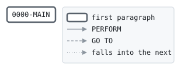

# TXSORT

```text
TXSORT: SORT TRANSACTIONS FOR POSTING

POSTING MATCHES TRANSACTIONS AGAINST THE ACCOUNT MASTER, SO
IT NEEDS THEM IN ACCOUNT NUMBER ORDER. WITHIN AN ACCOUNT THEY
KEEP THE ORDER OF THEIR TRANSACTION IDS. THE DAILY BATCH SORTS
THE VALID TRANSACTIONS, THEN THE TRANSFER CREDITS, THEN THE
RETURNED TRANSFERS.

RETURN CODES: 0 SORTED, 16 SORT FAILED.

MODIFICATION HISTORY
DATE       BY  CHANGE
1987-03-12 JA  ORIGINAL VERSION.
1993-02-08 PK  CR-0142 KEEP TRANSACTION ID ORDER WITHIN AN
               ACCOUNT.
```

Program [TXSORT.cbl](../../../pangaea/programs/TXSORT.cbl): 3 files, 1 paragraphs. Its business rules: [1 decision tables](../rules/TXSORT.md).

- AUTHOR: J. ARKWRIGHT, BATCH SYSTEMS.
- INSTALLATION: FIRST BANK OF PANGAEA, DATA CENTER.
- DATE-WRITTEN: 1987-03-12.

## Contents

- [Files](#files)
- [Flow](#flow)
- [Paragraphs](#paragraphs)
- [Data flow](#data-flow)
- [Lineage](#lineage)
  - [Into other data items](#into-other-data-items)
- [Records](#records)
  - [TRAN-IN-RECORD](#tran-in-record)
  - [TRAN-OUT-RECORD](#tran-out-record)
  - [SORT-RECORD](#sort-record)

## Files

| File | Kind | Assigned to | Organization | Status field | Opened | Records |
| --- | --- | --- | --- | --- | --- | --- |
| TRAN-IN | FD | TRANIN | SEQUENTIAL | | INPUT | TRAN-IN-RECORD |
| TRAN-OUT | FD | TRANOUT | SEQUENTIAL | | OUTPUT | TRAN-OUT-RECORD |
| SORT-WORK | SD | SORTWK | SEQUENTIAL | | | SORT-RECORD |

## Flow



## Paragraphs

| Paragraph | Description | Source | Performs | Goes to | Performed by | Reached by |
| --- | --- | --- | --- | --- | --- | --- |
| 0000-MAIN | SORT BY ACCOUNT NUMBER, THEN TRANSACTION ID. | [TXSORT.cbl:48](../../../pangaea/programs/TXSORT.cbl#L48) | | | | |

## Data flow

| Paragraph | Reads | Writes |
| --- | --- | --- |
| 0000-MAIN | SR-ACCT-NO, SR-TRAN-ID, SORT-RETURN | RETURN-CODE |

## Lineage

Where each data item's values come from, grouped by the record they go into. A data item links to the record it belongs to.

### Into other data items

Data items the program does not declare, such as special registers and index names.

| Into | From | Statement | Paragraph | Source |
| --- | --- | --- | --- | --- |
| RETURN-CODE | literal 16 | MOVE | 0000-MAIN | [TXSORT.cbl:55](../../../pangaea/programs/TXSORT.cbl#L55) |
| RETURN-CODE | literal 0 | MOVE | 0000-MAIN | [TXSORT.cbl:57](../../../pangaea/programs/TXSORT.cbl#L57) |

## Records

### TRAN-IN-RECORD

File TRAN-IN. 80 bytes.

| Level | Field | Kind | Start | Length | Picture | Usage | Notes | Source |
| --: | --- | --- | --: | --: | --- | --- | --- | --- |
| 01 | TRAN-IN-RECORD | text | 1 | 80 | X(80) | | | [TXSORT.cbl:36](../../../pangaea/programs/TXSORT.cbl#L36) |

### TRAN-OUT-RECORD

File TRAN-OUT. 80 bytes.

| Level | Field | Kind | Start | Length | Picture | Usage | Notes | Source |
| --: | --- | --- | --: | --: | --- | --- | --- | --- |
| 01 | TRAN-OUT-RECORD | text | 1 | 80 | X(80) | | | [TXSORT.cbl:38](../../../pangaea/programs/TXSORT.cbl#L38) |

### SORT-RECORD

File SORT-WORK. 80 bytes.

| Level | Field | Kind | Start | Length | Picture | Usage | Notes | Source |
| --: | --- | --- | --: | --: | --- | --- | --- | --- |
| 01 | SORT-RECORD | group | 1 | 80 | | | | [TXSORT.cbl:40](../../../pangaea/programs/TXSORT.cbl#L40) |
| 05 | SR-REC-TYPE | text | 1 | 1 | X | | | [TXSORT.cbl:41](../../../pangaea/programs/TXSORT.cbl#L41) |
| 05 | SR-TRAN-ID | key | 2 | 10 | 9(10) | | | [TXSORT.cbl:42](../../../pangaea/programs/TXSORT.cbl#L42) |
| 05 | SR-ACCT-NO | key | 12 | 10 | 9(10) | | | [TXSORT.cbl:43](../../../pangaea/programs/TXSORT.cbl#L43) |
| 05 | FILLER | filler | 22 | 59 | X(59) | | | [TXSORT.cbl:44](../../../pangaea/programs/TXSORT.cbl#L44) |
