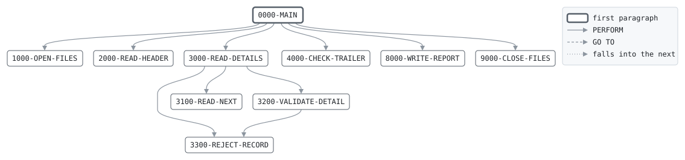

# TXVALID

```text
TXVALID: VALIDATE THE DAY'S TRANSACTION FILE

CHECKS THE FILE AS A WHOLE: A HEADER FOR TODAY'S BUSINESS
DATE, THEN DETAILS, THEN A TRAILER WHOSE CONTROL TOTALS MATCH
THE DETAILS. A FILE THAT FAILS THESE CHECKS IS NOT PROCESSED.
CHECKS EACH DETAIL'S FIELDS AND WRITES IT EITHER TO THE VALID
FILE OR TO THE REJECTS: THE ACCOUNT NUMBER, THE CODE, THE
AMOUNT, AND FOR A TRANSFER THE ACCOUNT IT GOES TO. WHETHER
THE ACCOUNTS EXIST IS LEFT TO POSTING, WHICH READS THE MASTER.

RETURN CODES: 0 ALL VALID, 4 SOME DETAILS REJECTED,
              12 FILE REJECTED, 16 I/O ERROR.

MODIFICATION HISTORY
DATE       BY  CHANGE
1987-03-12 JA  ORIGINAL VERSION.
1991-06-03 PK  CR-0117 ACCOUNT NUMBER HASH IN THE TRAILER.
1996-04-15 PK  CR-0233 TRANSFERS MUST NAME ANOTHER ACCOUNT.
1999-01-11 SL  Y2K: 8-DIGIT BUSINESS DATE FROM THE BANK
               CONTROL RECORD.
2004-09-20 PK  CR-0388 REJECT RECORDS OF UNKNOWN TYPE
               INSTEAD OF STOPPING THE RUN.
```

Program [TXVALID.cbl](../../../pangaea/programs/TXVALID.cbl): 5 files, 10 paragraphs. Its business rules: [8 decision tables](../rules/TXVALID.md).

- AUTHOR: J. ARKWRIGHT, BATCH SYSTEMS.
- INSTALLATION: FIRST BANK OF PANGAEA, DATA CENTER.
- DATE-WRITTEN: 1987-03-12.

## Contents

- [Files](#files)
- [Flow](#flow)
- [Paragraphs](#paragraphs)
- [Data flow](#data-flow)
- [Lineage](#lineage)
  - [Into BANK-CONTROL-RECORD](#into-bank-control-record)
  - [Into TRAN-RECORD](#into-tran-record)
  - [Into TRAN-OUT-RECORD](#into-tran-out-record)
  - [Into REJECT-OUT-RECORD](#into-reject-out-record)
  - [Into REPORT-LINE](#into-report-line)
  - [Into WS-BUSINESS-DATE](#into-ws-business-date)
  - [Into REJECT-RECORD](#into-reject-record)
  - [Into WS-TOTALS](#into-ws-totals)
  - [Into WS-REPORT-COUNT-LINE](#into-ws-report-count-line)
  - [Into WS-REPORT-AMOUNT-LINE](#into-ws-report-amount-line)
  - [Into files](#into-files)
- [Records](#records)
  - [BANK-CONTROL-RECORD](#bank-control-record)
  - [TRAN-RECORD](#tran-record)
  - [TRAN-OUT-RECORD](#tran-out-record)
  - [REJECT-OUT-RECORD](#reject-out-record)
  - [REPORT-LINE](#report-line)
  - [WS-FILE-STATUSES](#ws-file-statuses)
  - [WS-BUSINESS-DATE](#ws-business-date)
  - [REJECT-RECORD](#reject-record)
  - [WS-FILE-ERROR](#ws-file-error)
  - [WS-DETAIL-STATE](#ws-detail-state)
  - [WS-TOTALS](#ws-totals)
  - [WS-REPORT-COUNT-LINE](#ws-report-count-line)
  - [WS-REPORT-AMOUNT-LINE](#ws-report-amount-line)

## Files

| File | Kind | Assigned to | Organization | Status field | Opened | Records |
| --- | --- | --- | --- | --- | --- | --- |
| CONTROL-FILE | FD | BANKCTL | SEQUENTIAL | WS-CONTROL-STATUS | INPUT | BANK-CONTROL-RECORD |
| TRAN-IN | FD | TRANIN | SEQUENTIAL | WS-TRAN-IN-STATUS | INPUT | TRAN-RECORD |
| TRAN-OUT | FD | TRANOUT | SEQUENTIAL | WS-TRAN-OUT-STATUS | OUTPUT | TRAN-OUT-RECORD |
| REJECT-OUT | FD | REJECTS | SEQUENTIAL | WS-REJECT-STATUS | OUTPUT | REJECT-OUT-RECORD |
| REPORT-OUT | FD | VALRPT | LINE SEQUENTIAL | WS-REPORT-STATUS | OUTPUT | REPORT-LINE |

## Flow



## Paragraphs

| Paragraph | Description | Source | Performs | Goes to | Performed by | Reached by |
| --- | --- | --- | --- | --- | --- | --- |
| 0000-MAIN | VALIDATE THE FILE AND SET THE RETURN CODE. | [TXVALID.cbl:101](../../../pangaea/programs/TXVALID.cbl#L101) | 1000-OPEN-FILES, 2000-READ-HEADER, 3000-READ-DETAILS, 4000-CHECK-TRAILER, 8000-WRITE-REPORT, 9000-CLOSE-FILES | | | |
| 1000-OPEN-FILES | OPEN THE FILES AND READ THE BUSINESS DATE. | [TXVALID.cbl:123](../../../pangaea/programs/TXVALID.cbl#L123) | | | 0000-MAIN | |
| 2000-READ-HEADER | THE FIRST RECORD MUST BE THE HEADER FOR THE BUSINESS DATE. | [TXVALID.cbl:145](../../../pangaea/programs/TXVALID.cbl#L145) | | | 0000-MAIN | |
| 3000-READ-DETAILS | VALIDATE EACH RECORD UNTIL THE TRAILER. | [TXVALID.cbl:161](../../../pangaea/programs/TXVALID.cbl#L161) | 3100-READ-NEXT, 3200-VALIDATE-DETAIL, 3300-REJECT-RECORD | | 0000-MAIN | |
| 3100-READ-NEXT | READ ONE RECORD. THE FILE MUST NOT END BEFORE ITS TRAILER. | [TXVALID.cbl:179](../../../pangaea/programs/TXVALID.cbl#L179) | | | 3000-READ-DETAILS | |
| 3200-VALIDATE-DETAIL | ADD A DETAIL TO THE TOTALS, THEN CHECK ITS FIELDS. | [TXVALID.cbl:186](../../../pangaea/programs/TXVALID.cbl#L186) | 3300-REJECT-RECORD | | 3000-READ-DETAILS | |
| 3300-REJECT-RECORD | WRITE THE RECORD TO THE REJECTS WITH ITS REASON. | [TXVALID.cbl:220](../../../pangaea/programs/TXVALID.cbl#L220) | | | 3000-READ-DETAILS, 3200-VALIDATE-DETAIL | |
| 4000-CHECK-TRAILER | THE TRAILER MUST MATCH THE TOTALS, AND END THE FILE. | [TXVALID.cbl:227](../../../pangaea/programs/TXVALID.cbl#L227) | | | 0000-MAIN | |
| 8000-WRITE-REPORT | WRITE THE VALIDATION REPORT. | [TXVALID.cbl:248](../../../pangaea/programs/TXVALID.cbl#L248) | | | 0000-MAIN | |
| 9000-CLOSE-FILES | CLOSE ALL FILES. | [TXVALID.cbl:280](../../../pangaea/programs/TXVALID.cbl#L280) | | | 0000-MAIN | |

## Data flow

| Paragraph | Reads | Writes |
| --- | --- | --- |
| 0000-MAIN | WS-FILE-ERROR, WS-REJECT-COUNT | RETURN-CODE |
| 1000-OPEN-FILES | WS-CONTROL-STATUS, WS-TRAN-IN-STATUS, WS-TRAN-OUT-STATUS, WS-REJECT-STATUS, WS-REPORT-STATUS, WS-FILE-STATUSES, BC-BUSINESS-DATE | RETURN-CODE, BANK-CONTROL-RECORD, WS-BUSINESS-DATE, REJECT-RECORD |
| 2000-READ-HEADER | WS-FILE-ERROR, TR-REC-TYPE, TH-BUSINESS-DATE, WS-BUSINESS-DATE | TRAN-RECORD, WS-FILE-ERROR |
| 3000-READ-DETAILS | TR-REC-TYPE, WS-FILE-ERROR | WS-FILE-ERROR, RJ-REASON |
| 3100-READ-NEXT | | TRAN-RECORD, WS-FILE-ERROR |
| 3200-VALIDATE-DETAIL | WS-DETAIL-COUNT, TD-AMOUNT, WS-AMOUNT-TOTAL, TD-ACCT-NO, WS-ACCT-HASH, TD-TRAN-CODE, TD-COUNTER-ACCT-NO, WS-DETAIL-STATE, TRAN-RECORD, WS-VALID-COUNT | WS-DETAIL-COUNT, WS-AMOUNT-TOTAL, WS-ACCT-HASH, WS-DETAIL-STATE, RJ-REASON, TRAN-OUT-RECORD, WS-VALID-COUNT |
| 3300-REJECT-RECORD | TRAN-RECORD, REJECT-RECORD, WS-REJECT-COUNT | RJ-PROGRAM, RJ-TRAN, REJECT-OUT-RECORD, WS-REJECT-COUNT |
| 4000-CHECK-TRAILER | TT-DETAIL-COUNT, WS-DETAIL-COUNT, TT-AMOUNT-TOTAL, WS-AMOUNT-TOTAL, TT-ACCT-HASH, WS-ACCT-HASH, WS-FILE-ERROR | WS-FILE-ERROR, TRAN-RECORD |
| 8000-WRITE-REPORT | WS-BUSINESS-DATE, WS-DETAIL-COUNT, WS-REPORT-COUNT-LINE, WS-VALID-COUNT, WS-REJECT-COUNT, WS-AMOUNT-TOTAL, WS-REPORT-AMOUNT-LINE, WS-FILE-ERROR | REPORT-LINE, WS-RC-LABEL, WS-RC-VALUE, WS-RA-LABEL, WS-RA-VALUE |
| 9000-CLOSE-FILES | | |

## Lineage

Where each data item's values come from, grouped by the record they go into. A data item links to the record it belongs to.

### Into BANK-CONTROL-RECORD

Record [BANK-CONTROL-RECORD](#bank-control-record), from copybook [BANKCTL](../copybooks/BANKCTL.md).

| Into | From | Statement | Paragraph | Source |
| --- | --- | --- | --- | --- |
| BANK-CONTROL-RECORD | file CONTROL-FILE | READ | 1000-OPEN-FILES | [TXVALID.cbl:135](../../../pangaea/programs/TXVALID.cbl#L135) |

### Into TRAN-RECORD

Record [TRAN-RECORD](#tran-record), from copybook [TRANREC](../copybooks/TRANREC.md).

| Into | From | Statement | Paragraph | Source |
| --- | --- | --- | --- | --- |
| TRAN-RECORD | file TRAN-IN | READ | 2000-READ-HEADER | [TXVALID.cbl:146](../../../pangaea/programs/TXVALID.cbl#L146) |
| TRAN-RECORD | file TRAN-IN | READ | 3100-READ-NEXT | [TXVALID.cbl:180](../../../pangaea/programs/TXVALID.cbl#L180) |
| TRAN-RECORD | file TRAN-IN | READ | 4000-CHECK-TRAILER | [TXVALID.cbl:240](../../../pangaea/programs/TXVALID.cbl#L240) |

### Into TRAN-OUT-RECORD

Record [TRAN-OUT-RECORD](#tran-out-record).

| Into | From | Statement | Paragraph | Source |
| --- | --- | --- | --- | --- |
| TRAN-OUT-RECORD | [TRAN-RECORD](#tran-record) | WRITE | 3200-VALIDATE-DETAIL | [TXVALID.cbl:213](../../../pangaea/programs/TXVALID.cbl#L213) |

### Into REJECT-OUT-RECORD

Record [REJECT-OUT-RECORD](#reject-out-record).

| Into | From | Statement | Paragraph | Source |
| --- | --- | --- | --- | --- |
| REJECT-OUT-RECORD | [REJECT-RECORD](#reject-record) | WRITE | 3300-REJECT-RECORD | [TXVALID.cbl:223](../../../pangaea/programs/TXVALID.cbl#L223) |

### Into REPORT-LINE

Record [REPORT-LINE](#report-line).

| Into | From | Statement | Paragraph | Source |
| --- | --- | --- | --- | --- |
| REPORT-LINE | [WS-BUSINESS-DATE](#ws-business-date) | STRING | 8000-WRITE-REPORT | [TXVALID.cbl:250](../../../pangaea/programs/TXVALID.cbl#L250) |
| REPORT-LINE | [WS-REPORT-COUNT-LINE](#ws-report-count-line) | WRITE | 8000-WRITE-REPORT | [TXVALID.cbl:258](../../../pangaea/programs/TXVALID.cbl#L258) |
| REPORT-LINE | [WS-REPORT-COUNT-LINE](#ws-report-count-line) | WRITE | 8000-WRITE-REPORT | [TXVALID.cbl:261](../../../pangaea/programs/TXVALID.cbl#L261) |
| REPORT-LINE | [WS-REPORT-COUNT-LINE](#ws-report-count-line) | WRITE | 8000-WRITE-REPORT | [TXVALID.cbl:264](../../../pangaea/programs/TXVALID.cbl#L264) |
| REPORT-LINE | [WS-REPORT-AMOUNT-LINE](#ws-report-amount-line) | WRITE | 8000-WRITE-REPORT | [TXVALID.cbl:267](../../../pangaea/programs/TXVALID.cbl#L267) |
| REPORT-LINE | [WS-FILE-ERROR](#ws-file-error) | STRING | 8000-WRITE-REPORT | [TXVALID.cbl:274](../../../pangaea/programs/TXVALID.cbl#L274) |

### Into WS-BUSINESS-DATE

Record [WS-BUSINESS-DATE](#ws-business-date).

| Into | From | Statement | Paragraph | Source |
| --- | --- | --- | --- | --- |
| WS-BUSINESS-DATE | [BC-BUSINESS-DATE](#bank-control-record "in BANK-CONTROL-RECORD") | MOVE | 1000-OPEN-FILES | [TXVALID.cbl:141](../../../pangaea/programs/TXVALID.cbl#L141) |

### Into REJECT-RECORD

Record [REJECT-RECORD](#reject-record), from copybook [REJREC](../copybooks/REJREC.md).

| Into | From | Statement | Paragraph | Source |
| --- | --- | --- | --- | --- |
| RJ-TRAN | [TRAN-RECORD](#tran-record) | MOVE | 3300-REJECT-RECORD | [TXVALID.cbl:222](../../../pangaea/programs/TXVALID.cbl#L222) |

### Into WS-TOTALS

Record [WS-TOTALS](#ws-totals).

| Into | From | Statement | Paragraph | Source |
| --- | --- | --- | --- | --- |
| WS-ACCT-HASH | [TD-ACCT-NO](#tran-record "in TRAN-RECORD") | ADD | 3200-VALIDATE-DETAIL | [TXVALID.cbl:192](../../../pangaea/programs/TXVALID.cbl#L192) |
| WS-AMOUNT-TOTAL | [TD-AMOUNT](#tran-record "in TRAN-RECORD") | ADD | 3200-VALIDATE-DETAIL | [TXVALID.cbl:189](../../../pangaea/programs/TXVALID.cbl#L189) |

### Into WS-REPORT-COUNT-LINE

Record [WS-REPORT-COUNT-LINE](#ws-report-count-line).

| Into | From | Statement | Paragraph | Source |
| --- | --- | --- | --- | --- |
| WS-RC-VALUE | [WS-DETAIL-COUNT](#ws-totals "in WS-TOTALS") | MOVE | 8000-WRITE-REPORT | [TXVALID.cbl:257](../../../pangaea/programs/TXVALID.cbl#L257) |
| WS-RC-VALUE | [WS-VALID-COUNT](#ws-totals "in WS-TOTALS") | MOVE | 8000-WRITE-REPORT | [TXVALID.cbl:260](../../../pangaea/programs/TXVALID.cbl#L260) |
| WS-RC-VALUE | [WS-REJECT-COUNT](#ws-totals "in WS-TOTALS") | MOVE | 8000-WRITE-REPORT | [TXVALID.cbl:263](../../../pangaea/programs/TXVALID.cbl#L263) |

### Into WS-REPORT-AMOUNT-LINE

Record [WS-REPORT-AMOUNT-LINE](#ws-report-amount-line).

| Into | From | Statement | Paragraph | Source |
| --- | --- | --- | --- | --- |
| WS-RA-VALUE | [WS-AMOUNT-TOTAL](#ws-totals "in WS-TOTALS") | MOVE | 8000-WRITE-REPORT | [TXVALID.cbl:266](../../../pangaea/programs/TXVALID.cbl#L266) |

### Into files

Records written to files.

| Into | From | Statement | Paragraph | Source |
| --- | --- | --- | --- | --- |
| file REJECT-OUT | [REJECT-OUT-RECORD](#reject-out-record) | WRITE | 3300-REJECT-RECORD | [TXVALID.cbl:223](../../../pangaea/programs/TXVALID.cbl#L223) |
| file REPORT-OUT | [REPORT-LINE](#report-line) | WRITE | 8000-WRITE-REPORT | [TXVALID.cbl:253](../../../pangaea/programs/TXVALID.cbl#L253) |
| file REPORT-OUT | [REPORT-LINE](#report-line) | WRITE | 8000-WRITE-REPORT | [TXVALID.cbl:255](../../../pangaea/programs/TXVALID.cbl#L255) |
| file REPORT-OUT | [REPORT-LINE](#report-line) | WRITE | 8000-WRITE-REPORT | [TXVALID.cbl:258](../../../pangaea/programs/TXVALID.cbl#L258) |
| file REPORT-OUT | [REPORT-LINE](#report-line) | WRITE | 8000-WRITE-REPORT | [TXVALID.cbl:261](../../../pangaea/programs/TXVALID.cbl#L261) |
| file REPORT-OUT | [REPORT-LINE](#report-line) | WRITE | 8000-WRITE-REPORT | [TXVALID.cbl:264](../../../pangaea/programs/TXVALID.cbl#L264) |
| file REPORT-OUT | [REPORT-LINE](#report-line) | WRITE | 8000-WRITE-REPORT | [TXVALID.cbl:267](../../../pangaea/programs/TXVALID.cbl#L267) |
| file REPORT-OUT | [REPORT-LINE](#report-line) | WRITE | 8000-WRITE-REPORT | [TXVALID.cbl:269](../../../pangaea/programs/TXVALID.cbl#L269) |
| file REPORT-OUT | [REPORT-LINE](#report-line) | WRITE | 8000-WRITE-REPORT | [TXVALID.cbl:277](../../../pangaea/programs/TXVALID.cbl#L277) |
| file TRAN-OUT | [TRAN-OUT-RECORD](#tran-out-record) | WRITE | 3200-VALIDATE-DETAIL | [TXVALID.cbl:213](../../../pangaea/programs/TXVALID.cbl#L213) |

## Records

### BANK-CONTROL-RECORD

File CONTROL-FILE. 80 bytes, layout in copybook [BANKCTL](../copybooks/BANKCTL.md).

### TRAN-RECORD

File TRAN-IN. 80 bytes, layout in copybook [TRANREC](../copybooks/TRANREC.md).

### TRAN-OUT-RECORD

File TRAN-OUT. 80 bytes.

| Level | Field | Start | Length | Picture | Usage | Notes | Source |
| --: | --- | --: | --: | --- | --- | --- | --- |
| 01 | TRAN-OUT-RECORD | 1 | 80 | X(80) | | | [TXVALID.cbl:57](../../../pangaea/programs/TXVALID.cbl#L57) |

### REJECT-OUT-RECORD

File REJECT-OUT. 100 bytes.

| Level | Field | Start | Length | Picture | Usage | Notes | Source |
| --: | --- | --: | --: | --- | --- | --- | --- |
| 01 | REJECT-OUT-RECORD | 1 | 100 | X(100) | | | [TXVALID.cbl:59](../../../pangaea/programs/TXVALID.cbl#L59) |

### REPORT-LINE

File REPORT-OUT. 80 bytes.

| Level | Field | Start | Length | Picture | Usage | Notes | Source |
| --: | --- | --: | --: | --- | --- | --- | --- |
| 01 | REPORT-LINE | 1 | 80 | X(80) | | | [TXVALID.cbl:61](../../../pangaea/programs/TXVALID.cbl#L61) |

### WS-FILE-STATUSES

Working storage. 10 bytes.

| Level | Field | Start | Length | Picture | Usage | Notes | Source |
| --: | --- | --: | --: | --- | --- | --- | --- |
| 01 | WS-FILE-STATUSES | 1 | 10 | | | | [TXVALID.cbl:64](../../../pangaea/programs/TXVALID.cbl#L64) |
| 05 | WS-CONTROL-STATUS | 1 | 2 | XX | | | [TXVALID.cbl:65](../../../pangaea/programs/TXVALID.cbl#L65) |
| 05 | WS-TRAN-IN-STATUS | 3 | 2 | XX | | | [TXVALID.cbl:66](../../../pangaea/programs/TXVALID.cbl#L66) |
| 88 | TRAN-IN-EOF | | | | | VALUE '10' | [TXVALID.cbl:67](../../../pangaea/programs/TXVALID.cbl#L67) |
| 05 | WS-TRAN-OUT-STATUS | 5 | 2 | XX | | | [TXVALID.cbl:68](../../../pangaea/programs/TXVALID.cbl#L68) |
| 05 | WS-REJECT-STATUS | 7 | 2 | XX | | | [TXVALID.cbl:69](../../../pangaea/programs/TXVALID.cbl#L69) |
| 05 | WS-REPORT-STATUS | 9 | 2 | XX | | | [TXVALID.cbl:70](../../../pangaea/programs/TXVALID.cbl#L70) |

### WS-BUSINESS-DATE

Working storage. 8 bytes.

| Level | Field | Start | Length | Picture | Usage | Notes | Source |
| --: | --- | --: | --: | --- | --- | --- | --- |
| 01 | WS-BUSINESS-DATE | 1 | 8 | 9(8) | | | [TXVALID.cbl:72](../../../pangaea/programs/TXVALID.cbl#L72) |

### REJECT-RECORD

Working storage. 100 bytes, layout in copybook [REJREC](../copybooks/REJREC.md).

### WS-FILE-ERROR

Working storage. 40 bytes.

| Level | Field | Start | Length | Picture | Usage | Notes | Source |
| --: | --- | --: | --: | --- | --- | --- | --- |
| 01 | WS-FILE-ERROR | 1 | 40 | X(40) | | VALUE SPACES | [TXVALID.cbl:76](../../../pangaea/programs/TXVALID.cbl#L76) |
| 88 | FILE-IS-GOOD | | | | | VALUE SPACES | [TXVALID.cbl:77](../../../pangaea/programs/TXVALID.cbl#L77) |

### WS-DETAIL-STATE

Working storage. 1 bytes.

| Level | Field | Start | Length | Picture | Usage | Notes | Source |
| --: | --- | --: | --: | --- | --- | --- | --- |
| 01 | WS-DETAIL-STATE | 1 | 1 | X | | | [TXVALID.cbl:79](../../../pangaea/programs/TXVALID.cbl#L79) |
| 88 | DETAIL-IS-VALID | | | | | VALUE 'Y' | [TXVALID.cbl:80](../../../pangaea/programs/TXVALID.cbl#L80) |
| 88 | DETAIL-IS-REJECTED | | | | | VALUE 'N' | [TXVALID.cbl:81](../../../pangaea/programs/TXVALID.cbl#L81) |

### WS-TOTALS

Working storage. 54 bytes.

| Level | Field | Start | Length | Picture | Usage | Notes | Source |
| --: | --- | --: | --: | --- | --- | --- | --- |
| 01 | WS-TOTALS | 1 | 54 | | | | [TXVALID.cbl:83](../../../pangaea/programs/TXVALID.cbl#L83) |
| 05 | WS-DETAIL-COUNT | 1 | 8 | 9(8) | | VALUE 0 | [TXVALID.cbl:84](../../../pangaea/programs/TXVALID.cbl#L84) |
| 05 | WS-VALID-COUNT | 9 | 8 | 9(8) | | VALUE 0 | [TXVALID.cbl:85](../../../pangaea/programs/TXVALID.cbl#L85) |
| 05 | WS-REJECT-COUNT | 17 | 8 | 9(8) | | VALUE 0 | [TXVALID.cbl:86](../../../pangaea/programs/TXVALID.cbl#L86) |
| 05 | WS-AMOUNT-TOTAL | 25 | 15 | 9(13)V99 | | VALUE 0 | [TXVALID.cbl:87](../../../pangaea/programs/TXVALID.cbl#L87) |
| 05 | WS-ACCT-HASH | 40 | 15 | 9(15) | | VALUE 0 | [TXVALID.cbl:88](../../../pangaea/programs/TXVALID.cbl#L88) |

### WS-REPORT-COUNT-LINE

Working storage. 80 bytes.

| Level | Field | Start | Length | Picture | Usage | Notes | Source |
| --: | --- | --: | --: | --- | --- | --- | --- |
| 01 | WS-REPORT-COUNT-LINE | 1 | 80 | | | | [TXVALID.cbl:90](../../../pangaea/programs/TXVALID.cbl#L90) |
| 05 | WS-RC-LABEL | 1 | 30 | X(30) | | | [TXVALID.cbl:91](../../../pangaea/programs/TXVALID.cbl#L91) |
| 05 | WS-RC-VALUE | 31 | 10 | ZZ,ZZZ,ZZ9 | | | [TXVALID.cbl:92](../../../pangaea/programs/TXVALID.cbl#L92) |
| 05 | FILLER | 41 | 40 | X(40) | | VALUE SPACES | [TXVALID.cbl:93](../../../pangaea/programs/TXVALID.cbl#L93) |

### WS-REPORT-AMOUNT-LINE

Working storage. 80 bytes.

| Level | Field | Start | Length | Picture | Usage | Notes | Source |
| --: | --- | --: | --: | --- | --- | --- | --- |
| 01 | WS-REPORT-AMOUNT-LINE | 1 | 80 | | | | [TXVALID.cbl:94](../../../pangaea/programs/TXVALID.cbl#L94) |
| 05 | WS-RA-LABEL | 1 | 30 | X(30) | | | [TXVALID.cbl:95](../../../pangaea/programs/TXVALID.cbl#L95) |
| 05 | WS-RA-VALUE | 31 | 20 | Z,ZZZ,ZZZ,ZZZ,ZZ9.99 | | | [TXVALID.cbl:96](../../../pangaea/programs/TXVALID.cbl#L96) |
| 05 | FILLER | 51 | 30 | X(30) | | VALUE SPACES | [TXVALID.cbl:97](../../../pangaea/programs/TXVALID.cbl#L97) |
