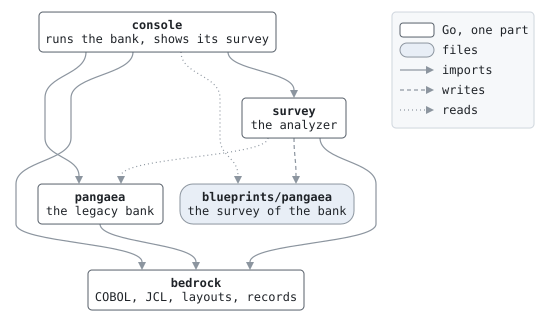

# Architecture

Copal is one Go module: the survey, the part it stands on, and three specimens, each a directory at the top of the repository, and the files where the survey meets them. What reads COBOL is a library of its own, [cobolith](https://github.com/vlumi/cobolith), which every part imports.

## The parts

- **Survey**, `survey/`, is the analyzer: it reads a COBOL system and writes its blueprints, and serves the explorer. Only `blueprint`, its model of a system, is exported; every analysis is under `survey/internal/`. [survey/README.md](../survey/README.md) describes the pipeline.
- **Cobolith**, [cobolith](https://github.com/vlumi/cobolith), is the language layer everything stands on: reading COBOL source and copybooks in the IBM, Micro Focus, Hitachi and Fujitsu dialects, laying out records, reading and writing them by field, and reading JCL. It was written here and is now a library in a repository of its own, which Copal requires by version; how it got there is in [plans/library.md](plans/library.md).
- **Bedrock**, `bedrock/`, is the harness built on it: keeping datasets and their catalog, reading batch scripts and batch files, and compiling COBOL programs with GnuCOBOL and running them and the jobs, scripts and batch files that run them. The survey's oracle runs programs with it, and the specimens' machine rooms run the bank, the card processor and the life insurer with it. None of it is analysis.

## The specimens

`pangaea/`, `laurasia/` and `gondwana/` are three legacy systems written for the survey to read, and they are built alike. Each is a directory of COBOL programs, copybooks and what runs them, with a machine room in Go beside them: a generator that writes its inputs from a seed, a command that opens it and runs it day after day through bedrock, backing out a day that fails, and fixtures under `testdata/` whose outputs are golden. Each also has a console for its operators, `pangaea/console/`, `laurasia/console/` and `gondwana/console/`: its accounts, cards or policies, and each day's steps and files, in the browser, and the bank's online day. The consoles share no code, though they look alike: three shops would not, and the specimens never import each other. Each is written and documented as a legacy system would be, its operations guide in its operators' voice under `docs/`, and none of them knows the survey. They differ where shops differ, and each was added to show where the survey had assumed the ones before:

| Specimen | Business | COBOL | Run by | Its guide |
| --- | --- | --- | --- | --- |
| Pangaea | a bank, with an online day of card and ATM authorizations | IBM, fixed format | JCL | [pangaea/docs/](../pangaea/docs/README.md) |
| Laurasia | a card processor | Micro Focus, free format | shell scripts | [laurasia/docs/](../laurasia/docs/operations.md) |
| Gondwana | a life insurer, amounts in yen and dates in the Japanese eras | Fujitsu NetCOBOL, source and data in Shift_JIS with Japanese names and comments | Windows batch files, which bedrock interprets | [gondwana/docs/](../gondwana/docs/operations.md) |

## The rule

Dependencies run one way, and `make lint-deps` checks it in CI with `go list`, tests included: `bedrock` imports nothing of Copal; `survey`, `pangaea`, `laurasia` and `gondwana` import `bedrock` and never each other. Any of them may import cobolith, the library. The survey's tests read the specimens as their fixtures and compare with `blueprints/`, which is data, not an import.

The rule exists because a bank must not depend on the tool that studies it. Everything the bank's Go needed from the analyzer turned out to be language, now cobolith and bedrock, and once that was moved the import went away. The bank's console once drew its runs with the survey's diagrams; it shows them as tables now, a console of the bank's own.

## Golden files, twice

Two kinds of thing are checked in that a build regenerates and compares, the specimens' outputs and the survey's blueprints of them:

- **The specimens' outputs.** Each fixture under a specimen's `testdata/` runs its jobs, scripts or batch files through GnuCOBOL, and the datasets, logs and reports they leave behind are golden; Gondwana's are Shift_JIS in the working tree and UTF-8 in the repository. A change to a specimen updates them in the same commit, so the history of its behavior is in the history of its goldens.
- **The survey of the three.** `blueprints/pangaea/`, `blueprints/laurasia/` and `blueprints/gondwana/` are what the survey says about the bank, the card processor and the life insurer, and `oracle/` the cases it found and what the programs did on them. A change in the analyzer shows as a diff there, which is how its behavior is reviewed: not by reading the code change alone, but by reading what it changed in the blueprints of a real system.

Both depend on everything being deterministic: the analysis, the diagram layout, and the specimens themselves, whose days follow from a seed and never read the clock.

## One module, and one library

Copal is one Go module: separate modules for its parts would make the sibling relation formal, but add toolchain friction for nothing a reader gains, and the survey's tests read `pangaea/` as their fixture across that boundary. The exception is what reads COBOL, which is of use to anyone reading COBOL: it became [cobolith](https://github.com/vlumi/cobolith), a module and repository of its own, which Copal requires by version. A change to it reaches Copal as a version bump, and the commit that bumps it carries the golden files it changes.

## Commands and make

Each part has its own command: `survey/cmd/survey`, `pangaea/cmd/pangaea`, `laurasia/cmd/laurasia`, `gondwana/cmd/gondwana`, and the consoles, `pangaea/cmd/console`, `laurasia/cmd/console` and `gondwana/cmd/console`. Routine operations are make targets with a description, so plain `make` lists them; the Makefile names the work and scripts and commands do it. `make ci` is what the hosted build runs: the toolchain check, Markdown and Go linting, the dependency check, and every test, the goldens included.

The diagrams on this page are drawn by `make docs-diagrams` with the survey's own diagram package, and a test keeps them current.
