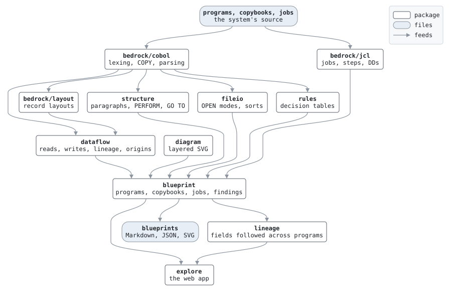

# Survey

Survey reads a legacy COBOL batch system and writes its blueprints: the layout of every record, the structure of every program, what each paragraph reads and writes, where every value comes from, the business rules in its conditions, and the job network that ties the programs together through fixed-format files. Everything it says is derived from the source, deterministically, so the same system always gives the same blueprints and a change in the source shows as a diff in them.

It does not translate COBOL into anything. It produces the understanding a translation needs.

## Using it

```sh
survey blueprints -copybooks dir -out dir [-title name] program.cbl... [job.jcl...]
survey explore -copybooks dir [-addr host:port] [-title name] program.cbl... [job.jcl...]
```

Point it at the programs and the jobs, and tell it where the copybooks are. `blueprints` writes a directory of Markdown for people and JSON for tools, with SVG diagrams, and an index; [docs/blueprints.md](../docs/blueprints.md) explains how to read them. `explore` serves the same analysis as a web app, at `127.0.0.1:1192` by default, where every job, step, dataset, program, paragraph, field and copybook is a page and a link, each with a badge for its kind, a search finds any of them, and a field's values can be followed back across programs and job steps to the input they came from, highlighted on the diagrams. Its design views show the system as the business sees it: the entities, with who reads, writes and decides on each field across the programs, and the state machines of their codes.

For the First Bank of Pangaea, `make blueprints` regenerates [blueprints/pangaea/](../blueprints/pangaea/README.md) and `make explore` serves the explorer.

What it reads: fixed-format COBOL in the subset Pangaea uses, with `COPY` and `COPY ... REPLACING`, and job files in a small subset of JCL. Which parts of COBOL that is, and what each analysis does and does not attempt, is below.

## How it works



The analyses run in order, each on the output of the ones before it, and each is a package with its own tests. The first three are in [bedrock](../bedrock/), because the bank's machine room needs them too.

1. **Lexing and parsing**, `bedrock/cobol`. Fixed-format source: sequence area, indicator column, areas A and B. `COPY` statements are expanded, with `REPLACING`, and every token remembers the file and line it came from, copybook or program, so that everything downstream can point at the source. The parser knows the divisions, the file control entries, the data description entries, and the statements of the subset: `MOVE`, the arithmetic verbs, `COMPUTE`, `STRING`, `SET`, `IF`, `EVALUATE`, `PERFORM` in its forms, `GO TO`, `SEARCH`, `SORT` with procedures or files, the file verbs including indexed access, `CALL ... USING`, `ACCEPT` and `DISPLAY`. A verb outside the subset is an error, not a guess.
2. **Record layouts**, `bedrock/layout`. From the data divisions and copybooks: every field's position, length, picture and usage, `OCCURS` and `OCCURS DEPENDING ON`, `REDEFINES`, and the level-88 condition names on it. Packed decimal and signed display fields get their true sizes.
3. **Jobs**, `bedrock/jcl`. Steps, the programs they run, their `COND` tests, and the DD statements: datasets with generations, temporary datasets, concatenations, SYSOUT, DUMMY, in-stream data, indexed datasets.
4. **Structure**, `structure`. Paragraphs and sections, which performs which, `THRU` ranges, where `GO TO` goes, and where control falls from one paragraph into the next. A sort's input and output procedures count as performed.
5. **File I/O**, `fileio`. The mode each file is opened in, and the files each sort reads with `USING` and writes with `GIVING`.
6. **Data flow**, `dataflow`. What each paragraph reads and writes, with condition names resolved to their fields, and the lineage of every item: each statement that moves a value into it, from another item, a literal or a file. From the lineage, the origins of a field: followed back by storage position, through groups, through the fields of a group and through redefinitions, to the files, literals and initial values a value can come from.
7. **Rules**, `rules`. Each paragraph's decisions as a decision table: every path through its `IF`s, `EVALUATE`s, `SEARCH`es and the conditional phrases of its file verbs, with the conditions each path tests and the actions it takes, in order. A path ends at a `GO TO` or `STOP RUN`, so the `IF ... GO TO` chains of old code read as they run.
8. **Blueprints**, `blueprint`. The analyses assembled into a model of the system: programs with their files, records, paragraphs, calls, lineage and field origins; copybooks with who uses them; jobs with their steps bound to the programs' files, the datasets between the steps, and findings where the job and its programs disagree; the system's datasets. Each field, program and dataset has a kind: an amount, a code, a key or a date; a main or a called program; an external, internal, output or temporary dataset. Written as Markdown and JSON, with the job networks and program flows drawn by `diagram`, a layered layout of its own so that the SVG is reproducible byte for byte.
9. **Lineage across programs**, `lineage`. A field's values followed back out of its program: from the file it reads them from, through the dataset its job step binds to the file, to the step that wrote the dataset and the field of its record over the same bytes, and on, through sorts, until the values start at literals, initial values, or datasets no job writes.
10. **The explorer**, `explore`. Server-rendered pages over the model, with a little script for pan and zoom and nothing to build.

## What it does not do

- It does not run the programs or execute the jobs; Pangaea's machine room does that, outside the survey.
- Field origins and lineage do not consider the order of statements: a value that every path overwrites still counts as an origin, and so does a field of a record redefined for another record type. Order-aware tracing would need the control flow between statements, which the structure analysis now makes possible.
- Lineage goes back, not forward, and does not yet follow values into a called program through its `LINKAGE SECTION`, nor in from `SYSIN` through `ACCEPT`. A program's outputs keep only the first record type it writes to a file.
- The kinds say no more than the code: a field is a key only where a file's `RECORD KEY` or a sort names it, so a key a master file is merely sorted by is a number. The one guess among them is the date, told by its name.
- An entity's uses are by name: a statement that moves a whole record counts for the record, not for each of its fields. A state machine reads one paragraph's decisions at a time: a state tested in one paragraph and set in the paragraph it performs, or after a jump, is drawn from any state, and so is a state set on a path that only finds the field not in some state. Values copied from another field are listed, not drawn.
- It reads Pangaea's subset of COBOL and JCL. Breadth is not a goal until the project needs it.
- No language model is involved. One may come later, for naming and prose, on top of facts the analysis has established.

## Layout

- [cmd/survey/](cmd/survey/): the command.
- [blueprint/](blueprint/): the model of a system and its writers, the only exported package.
- [internal/](internal/): the analyses, one package each, and the explorer.

Tests: every analysis has unit tests on small programs under its `testdata/`, and the whole pipeline is tested against the First Bank of Pangaea, whose blueprints in `blueprints/pangaea/` are golden files that `make ci` regenerates and compares.
